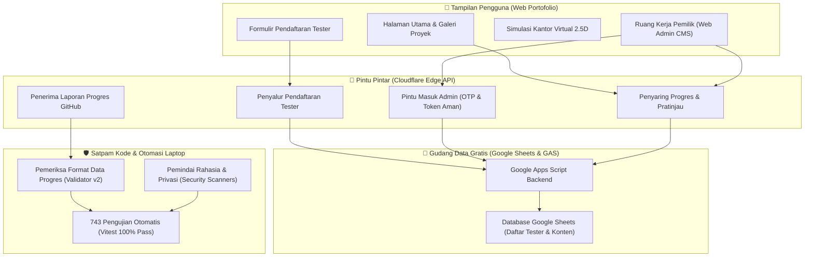

# ARCHITECTURE_MAP.md
# PETA HUBUNGAN ANTAR FITUR & STRUKTUR SISTEM: SleepyKoala Studio Portfolio

> [!IMPORTANT]
> **PETA ANTI-TABRAKAN FITUR (UNTUK OWNER & AGEN AI):**
> Agen AI DILARANG mengedit atau menambah kode apa pun sebelum membaca peta ini.
> Modul yang bertanda **🔒 [KRITIS / JANGAN RUSAK]** adalah urat nadi sistem yang sudah berfungsi normal dan tidak boleh dirombak sembarangan tanpa persetujuan Owner!

---

## 1. Penjelasan Awam: Bagaimana Sistem Ini Bekerja?

Bayangkan proyek ini seperti **"Gedung Kantor & Showroom Game Indie"** milik Anda:
1. **Lantai 1: Ruang Pameran & Lobi (Frontend Web / Tampilan Pengguna)**  
   Tempat pengunjung melihat portofolio game Anda, membaca cerita proyek, mencoba simulasi kantor virtual 2.5D, dan mendaftar jadi penguji coba (beta tester) di Google Play Store.
2. **Lantai 2: Pintu Masuk Khusus & Ruang Satpam (Cloudflare Edge Functions / API)**  
   Pintu pintar yang menyaring siapa saja yang boleh masuk. Mengatur autentikasi login rahasia Owner (Admin OTP), menyaring pesan dari GitHub, dan memastikan tidak ada data palsu atau berbahaya yang bisa menembus masuk.
3. **Lantai 3: Brankas & Arsip Dokumen (Google Sheets & Google Apps Script Backend)**  
   Tempat penyimpanan resmi berbiaya Rp 0 (Google Cloud Free). Menyimpan daftar calon tester yang sudah mendaftar, pengaturan situs, dan data progres pengerjaan fitur game.
4. **Ruang Kendali Mutu & Satpam Kode (DevSecOps & Local Git Automation)**  
   Robot otomatis di laptop Anda yang memeriksa setiap baris kode baru: memastikan tidak ada kata sandi yang bocor, data pribadi terlindungi, dan seluruh 743 pengujian otomatis lulus sebelum kode bisa disimpan.

---

## 2. Diagram Sederhana Alur Kerja Sistem

---

## 3. Matriks Hubungan Antar Modul & Batasan Keamanan

| Fitur / Modul | Lokasi File Utama | Fungsi Utama | Dampak Jika Rusak | Status Keamanan |
| :--- | :--- | :--- | :--- | :--- |
| **Formulir & API Tester Google Play** | `src/components/RegistrationModal.tsx` `functions/api/register-tester.ts` `backend/gas/Code.gs` | Menerima pendaftaran calon tester dari website dan menyimpannya ke Google Sheets | Calon pemain tidak bisa mendaftar; syarat 20 tester Google Play terancam gagal | 🔒 **KRITIS (JANGAN RUSAK)** |
| **Pintu Masuk Admin (OTP Login)** | `src/services/adminAuthService.ts` `functions/api/admin/auth/*` `src/pages/AdminPage.tsx` | Mengirim kode OTP ke email pemilik (`zweifeel@gmail.com`) dan memberikan token sesi aman | Pemilik terkunci dari dashboard admin atau orang asing bisa menyusup | 🔒 **KRITIS (JANGAN RUSAK)** |
| **Pengelola Progres & Konten (CMS)** | `src/services/cmsProgressService.ts` `src/services/portfolioMetadataValidator.ts` `functions/api/admin/progress/*` | Mengatur draf, publikasi fitur baru, peta jalan (roadmap), dan foto tangkapan layar game | Halaman detail game di website bisa kosong atau menampilkan draf rahasia | 🔒 **KRITIS (JANGAN RUSAK)** |
| **Penerima Progres GitHub (Webhook)** | `functions/api/webhook/github.ts` `src/services/githubWebhookService.ts` | Mendengarkan kabar otomatis saat ada commit baru dari repositori game private | Progres website tidak bertambah otomatis saat game di-update | 🔒 **KRITIS (JANGAN RUSAK)** |
| **Satpam Pemindai & Pre-Commit Hook** | `scripts/security-scan.js` `scripts/privacy-scan.js` `scripts/check-file-policy.js` `scripts/git-automation/*` | Memindai kode dari kebocoran password, data pribadi, dan file sampah | Rahasia penting bisa bocor ke publik tanpa disengaja | 🔒 **KRITIS (JANGAN RUSAK)** |
| **Isolasi Proyek Game Roblox (TBO)** | Konfigurasi mapping & sync | Repositori proyek game *The Broken Origin* yang sedang dibekukan | Risiko merusak game Roblox yang terpisah arsitekturnya | 🔒 **BEKU (DILARANG SENTUH)** |
| **Etalase Tampilan Publik (Website UI)** | `src/pages/HomePage.tsx` `src/pages/ProjectsPage.tsx` `src/pages/ProjectDetailPage.tsx` `src/pages/AboutPage.tsx` | Menampilkan antarmuka website kepada pengunjung umum | Tampilan visual berantakan, tapi data di gudang tetap aman | 🟢 **STABIL (Boleh Dipercantik)** |
| **Simulasi Kantor Virtual 2.5D** | `src/components/virtual-office/ProductionVirtualHQCampus.tsx` `src/data/virtualOfficeFloorPlan.ts` | Visualisasi interaktif kantor pengembang indie dengan karakter bergerak | Pengunjung tidak bisa melihat animasi kantor virtual | 🟢 **STABIL (Boleh Dipercantik)** |

---

## 4. Zona Larangan Sentuh Sembarangan

1. **File Kredensial & Sandi:**
   - DILARANG membaca atau memodifikasi file `webcredential.txt` yang ada di komputer.
   - DILARANG menuliskan email, password, token API, atau webhook secret ke dalam file kode apa pun.
2. **Gudang Data Produksi (Google Apps Script & Spreadsheet Aktif):**
   - DILARANG mengubah struktur kolom Google Sheets yang sedang menampung data tester aktif.
   - DILARANG mengirimkan email uji coba massal ke calon tester asli.
3. **Repositori Proyek Luar (The Broken Origin):**
   - Proyek Roblox ini dikunci dengan status *FROZEN*. Dilarang keras menambahkan kode, commit, atau push ke repositori tersebut dari workspace ini.
4. **Kumpulan Uji Otomatis (751 Skrip Tes di 38 Test Suites):**
   - Seluruh 751 skenario uji di folder `src/test/` adalah pelindung sistem. Dilarang menghapus atau melemahkan pengujian agar sebuah bug "kelihatan lulus".
