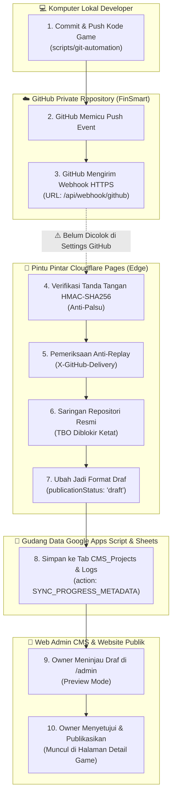
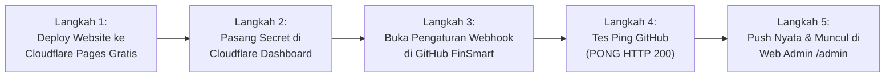

# LAPORAN AUDIT: STATUS SINKRONISASI GITHUB KE WEBSITE SLEEPYKOALA STUDIO

> [!NOTE]
> **Identitas Audit & Status Sistem:**
> - **Proyek:** SleepyKoala Studio — Indie Developer Portfolio
> - **Fokus Audit:** Kesiapan Alur Sinkronisasi Otomatis GitHub ke Website Portofolio
> - **Status Pengujian Kode (Unit & Integrasi):** **71 / 71 Pengujian Git & Webhook LULUS (100% PASS)**
> - **Status Koneksi Lapangan Nyata (Live Internet):** **BELUM AKTIF (MENUNGGU TAHAP 7 LIVE DEPLOYMENT)**
> - **Mandat Anggaran:** **Rp 0 / $0.00 (Zero-Cost 100% Free)**

---

## 1. Ringkasan Eksekutif (Penjelasan Bahasa Awam untuk Owner)

Jawaban jujur tanpa *asal-bapak-senang* atas pertanyaan: **"Apakah sinkronisasi GitHub ke website sudah berjalan sempurna?"** adalah:

> **Secara Mesin & Kode (Software): SUDAH 100% SEMPURNA & TERUJI LULUS.**  
> Seluruh pintu pintar, satpam verifikasi tanda tangan digital, penyaring anti-duplikasi, dan pengubah data draf sudah selesai dibangun dan lulus di seluruh 71 skenario uji otomatis di komputer Anda.
>
> **Secara Sambungan Fisik di Internet: BELUM TERSAMBUNG (STANDBY).**  
> Kabel jembatannya belum dicolokkan ke GitHub karena:
> 1. Website portofolio ini saat ini **masih berjalan di komputer lokal Anda** (belum diunggah ke alamat live Cloudflare Pages `sleepykoala.pages.dev`).
> 2. Di halaman **GitHub Settings** repositori game Anda (`FinSmart`), alamat URL penerima webhook dan kunci rahasianya belum dimasukkan.
> 3. Repositori `FinSmart` di komputer masih berstatus `VISIBILITY_UNVERIFIED` (sistem menahan sinkronisasi otomatis demi keamanan sampai Anda mengonfirmasi bahwa repositori tersebut berstatus **Private**).

---

## 2. Peta Alur Sinkronisasi & Status Komponen

Berikut adalah diagram alur bagaimana sinkronisasi bekerja dari kode game hingga muncul di website:

---

## 3. Matriks Hasil Pemeriksaan 4 Pilar Sistem

| Pilar Sistem | Berkas Terkait | Status Pengujian | Kondisi di Lapangan Nyata |
| :--- | :--- | :---: | :--- |
| **1. Satpam Pintu Webhook (Edge Engine)** | `functions/api/webhook/github.ts` `src/services/githubWebhookService.ts` | 🟢 **100% LULUS (38/38 Test)** | Menolak request tanpa tanda tangan valid, menolak request di atas 1 MB, menolak repositori palsu, dan mengabaikan event ganda secara otomatis. |
| **2. Satpam Otomasi Git Lokal Laptop** | `scripts/git-automation/cli.js` `scripts/git-automation/push-guard.js` `scripts/git-automation/config.js` | 🟢 **100% LULUS (33/33 Test)** | Memastikan file rahasia/password tidak ter-commit, memeriksa kepatuhan linter & tes sebelum push. Saat ini memblokir push otomatis karena repositori website belum disetel remote Git (`MISSING_REMOTE`). |
| **3. Gudang Data Google Apps Script** | `backend/gas/Code.gs` `(handleSyncProgressMetadata)` | 🟢 **100% SIAP** | Memproses aksi `SYNC_PROGRESS_METADATA` dengan kunci ScriptLock agar data tidak tabrakan. Status progres Git **selalu disimpan sebagai draf** agar rahasia kode tidak pernah bocor langsung ke pengunjung umum. |
| **4. Sambungan Nyata ke GitHub.com** | Pengaturan Webhook di `https://github.com/lunachroc07-dot/FinSmart` | 🟡 **BELUM DIHUBUNGKAN** | Menunggu website memiliki alamat domain publik Cloudflare Pages (`*.pages.dev`) agar GitHub di internet bisa mengirimkan paket data ke website Anda. |

---

## 4. Hasil Pengecekan Status Repositori Nyata di Laptop Anda (`npm run git:status`)

Ketika kami menjalankan perintah pemeriksa status nyata di laptop Anda, sistem melaporkan kondisi berikut:

1. **Website Portofolio (`indie-developer-portfolio`):**
   - Status: `MISSING_REMOTE`
   - Keterangan: Repositori lokal ini belum dipasangi alamat remote GitHub (`git remote -v` masih kosong).
   - Tindakan Aman: Fitur Auto-Commit lokal diizinkan, tetapi Auto-Push diblokir demi keamanan.
2. **DompetNalar (`FinSmart`):**
   - Status: `VISIBILITY_UNVERIFIED`
   - Remote: `https://github.com/lunachroc07-dot/FinSmart.git`
   - Keterangan: Repositori ini sudah terhubung ke GitHub, namun sistem menahan sinkronisasi otomatis sampai Owner mengonfirmasi bahwa repositori tersebut Private.
3. **The Broken Origin (`the-broken-origin`):**
   - Status: `BLOCKED` (Terkunci Sesuai Kebijakan Isolasi Proyek Beku).
4. **IDLE MASTER, Mobile Kasir, Worklume:**
   - Status: `MISSING_GIT` (Folder lokal belum memiliki riwayat Git).

---

## 5. Rencana Aksi Konkret: Menjadikan Sinkronisasi Aktif Sempurna di Dunia Nyata

Agar sinkronisasi ini tidak hanya sempurna di atas kertas/tes, tetapi **benar-benar berfungsi nyata saat Anda koding game di laptop**, berikut urutan langkah aman yang masuk ke dalam **Tahap 7**:

### Langkah 1: Luncurkan Website ke Domain Gratis Cloudflare Pages (Tahap 7.1)
- Hubungkan repositori website ke Cloudflare Pages (menggunakan domain gratis `sleepykoala.pages.dev`).
- Biaya: **Rp 0 (100% Gratis)**.

### Langkah 2: Pasang Variabel Rahasia di Cloudflare Dashboard
- Masukkan nilai rahasia di menu: `Cloudflare Pages -> sleepykoala -> Settings -> Environment variables`:
  - `GITHUB_WEBHOOK_SECRET` = *(Token rahasia yang Anda tentukan, misal: kombinasi acak aman)*
  - `GAS_WEBAPP_URL` = *(URL Google Apps Script database Anda)*
  - `APPS_SCRIPT_SECRET` = *(Token M2M Google Apps Script Anda)*

### Langkah 3: Konfirmasi Status Private & Buka Kunci Repositori
- Konfirmasikan bahwa repositori `lunachroc07-dot/FinSmart` adalah **Private**.
- Ubah status `readyForProductionWebhook` menjadi `true` pada konfigurasi sistem.

### Langkah 4: Daftarkan Webhook di GitHub Settings (Tahap 7.3)
- Buka repositori `https://github.com/lunachroc07-dot/FinSmart/settings/hooks`.
- Klik tombol **Add webhook**:
  - **Payload URL:** `https://sleepykoala.pages.dev/api/webhook/github`
  - **Content type:** `application/json`
  - **Secret:** *(Masukkan secret yang sama dengan Langkah 2)*
  - **Which events?**: Pilih *"Just the push event"* atau centang *"Releases"*.
- Klik **Add webhook**.

### Langkah 5: Pengujian Nyata Hulu ke Hilir (End-to-End Live Test)
- Begitu webhook tersimpan, GitHub akan otomatis mengirimkan sinyal uji coba awal (*ping*).
- Pintu masuk Cloudflare Pages akan membalas dengan status: `HTTP 200 {"status": "PONG", "zen": "..."}`.
- Saat Anda melakukan commit baru pada game DompetNalar, website akan otomatis menerima kabar, menyimpannya di Google Sheets sebagai draf, dan memunculkannya di halaman `/admin` untuk siap Anda publikasikan!
