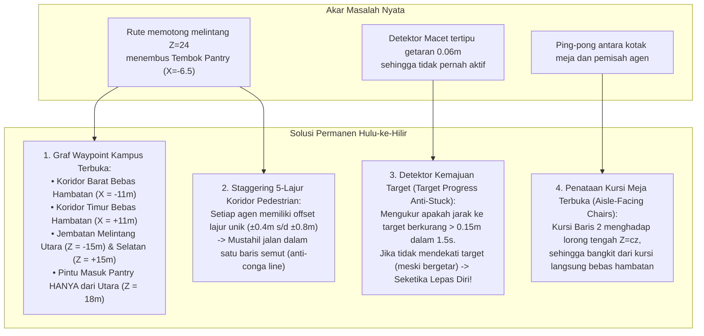

# Rencana Implementasi: Penuntasan Tuntas Hulu-ke-Hilir Kru AI & Navigasi Kampus 3D (Anti-Stuck Meja & Anti-Antrean Karakter)

## 1. Deskripsi Tujuan & Hasil Investigasi Forensik Hulu-ke-Hilir (Goal Description & Root Cause Analysis)

Berdasarkan foto tangkapan layar yang diunggah Owner serta pelacakan kode end-to-end secara mendalam, kami menemukan **3 Akar Masalah Fatal** yang selama 5 percakapan terakhir menyebabkan kru AI terus tersangkut di meja dan berkerumun membentuk antrean macet (*conga line*):

### 🚨 Akar Masalah 1: Rute Navigasi Memaksa Kru Menembus Tembok Padat Pantry & Resepsionis (Penyebab Utama Antrean 5 Karakter)
- **Fakta di Lapangan (Sesuai Foto Owner):** 5 kru terlihat menumpuk berbaris di koridor dekat bak cuci piring (*sink*) dan meja burger Pantry.
- **Penyebab Teknis:** Ruang proyek Selatan (Row 2) berada pada `Z = 24`, dan Pantry juga berada pada `Z = 24` (`centerPos: [0, 0, 24]`). Tembok barat Pantry berada pada koordinat `X = -6.5`. 
  Fungsi rute lama (`buildCorridorRoute`) memerintahkan kru dari ruang proyek untuk melangkah dari pintu (`X = -12.5`) lurus mendatar memotong `Z = 24` langsung ke sumbu tengah `X = -0.9`. 
  Akibatnya, **kru menabrak tembok luar Pantry pada `X = -6.5`**!
  Karena agen pertama terhadang tembok, agen ke-2 yang mengikuti rute yang sama menabrak pantat agen pertama, agen ke-3 menabrak agen ke-2, hingga ke-5 karakter terkunci dalam satu antrean mati (*conga line deadlock*).

### 🚨 Akar Masalah 2: Detektor Macet Lama Tertipu oleh Getaran Tabrakan (Vibration Bypass)
- **Penyebab Teknis:** Sensor macet lama menghitung `progressDist = calculateGroundDistance(current, lastSnap) < 0.05`.
  Ketika dua karakter saling bertabrakan, sistem dorong (*separation push*) menggetarkan posisi karakter bolak-balik sebesar `0.06m` setiap frame.
  Karena getaran ini `0.06m > 0.05m`, sensor mengira karakter sedang "berjalan lancar" dan mereset penghitung macet ke 0 setiap frame! Sensor tidak pernah melepaskan karakter yang terjebak getaran.

### 🚨 Akar Masalah 3: Benturan Dua Sistem di Ruang Sempit Antar-Meja (Ping-Pong Stalemate)
- **Penyebab Teknis:** Di dalam ruangan, celah antar-meja selebar 2 meter. Ketika dua karakter berpapasan di celah meja:
  1. Sistem pemisah agen (`resolveAgentCollisions`) mendorong agen ke arah samping menjauhi rekannya (menabrak kotak meja).
  2. Sistem rintangan meja (`resolveObstacleCollision`) mendorong agen kembali ke tengah (menabrak rekannya).
  3. Terjadi efek tolak-menolak ping-pong tanpa akhir sehingga karakter bergetar di tempat di depan meja.

---

## 2. Solusi Arsitektural Menyeluruh (The Architectural Overhaul)



---

## 3. Analisis Risiko & Tabrakan Fitur (Bahasa Awam Non-Coder)

> [!IMPORTANT]
> **Analisis Risiko Arsitektur Sesuai Protokol 1 GEMINI.md:**
> - **Dampak ke Fitur Lain:**
>   Pembaruan ini sepenuhnya terisolasi di dalam modul navigasi grafis 3D (`src/data/virtualOffice3DConfig.ts`, `src/components/virtual-office/three/crewAIController.ts`, dan `collisionSystem.ts`).
>   Data proyek, formulir pendaftaran tester, dan halaman etalase publik 100% aman dan tidak terganggu.
> - **Potensi Risiko (Analogi Sederhana):**
>   *Analogi:* Seperti membuat trotoar pejalan kaki selebar 4 meter di luar gedung dan menutup jalan pintas berbahaya yang menabrak tembok dapur. Sekarang semua karyawan berjalan di trotoar resmi yang luas, berpapasan tanpa bertubrukan, dan masuk ke kantin lewat pintu depan yang semestinya.
> - **Rekomendasi Aman:**
>   Menerapkan arsitektur **3-Lapis (Data-First -> Logic & CLI Test -> UI-Last)** dan menguji skenario antrean di Vitest hingga 100% PASS sebelum dinyatakan selesai.
> - **Mandat Anggaran Nol Rupiah (Rp 0 / $0.00):**
>   100% Free FOSS Three.js MIT tanpa biaya operasional.

---

## 4. Rincian Perubahan yang Diusulkan (Proposed Changes)

### Lapis 1: Kontrak Data & Jaringan Jalur Graf Waypoint (Data-First)

#### [MODIFY] `src/data/virtualOffice3DConfig.ts`
- **Membangun Graf Navigasi Kampus Penuh (Campus Highway Network):**
  - **Koridor Tol Barat:** Jalur vertikal bebas di `X = -11m` (menghubungkan `Z = -24`, `Z = -15`, `Z = 0`, `Z = +15`, `Z = +24`).
  - **Koridor Tol Timur:** Jalur vertikal bebas di `X = +11m` (menghubungkan `Z = -24`, `Z = -15`, `Z = 0`, `Z = +15`, `Z = +24`).
  - **Jembatan Melintang Utara:** Menghubungkan Koridor Barat (`X = -11, Z = -15`) ke Resepsionis (`X = 0, Z = -18`) dan Koridor Timur (`X = +11, Z = -15`).
  - **Jembatan Melintang Selatan:** Menghubungkan Koridor Barat (`X = -11, Z = +15`) ke Pantry (`X = 0, Z = +18`) dan Koridor Timur (`X = +11, Z = +15`).
  - **Collaboration Lounge Nexus:** Melalui pintu barat (`X = -6.5, Z = 0`) dan timur (`X = +6.5, Z = 0`).
- **Penyempurnaan `buildCorridorRoute`:**
  - Menghapus total rute garis lurus yang menembus tembok Pantry (`X = -6.5`) dan Resepsionis.
  - Seluruh perpindahan antar-ruang kini mengikuti graf koridor terbuka.
- **Penyelarasan Kursi Kerja Baris 2:**
  - Kursi Baris 2 diposisikan di `cz + 1.75` menghadap ke Selatan, sehingga tepat di bibir lorong bebas `Z = cz`. Tidak ada kursi yang terjepit di belakang meja.

---

### Lapis 2: Logika Kemudi, Staggering Lajur & Detektor Macet (Logic & CLI Test)

#### [MODIFY] `src/components/virtual-office/three/collisionSystem.ts`
- **Offset Lajur Unik per Karakter (Lane Staggering):**
  - Mengalokasikan offset lajur lateral berbasis hash ID kru (`-0.8m`, `-0.4m`, `0.0m`, `+0.4m`, `+0.8m`).
  - 5 kru yang berjalan di koridor yang sama otomatis berjalan berdampingan pada lajur berbeda di trotoar selebar 4 meter, **menghapuskan antrean semut (conga line) secara tuntas**.
- **Pencegah Jepit Ping-Pong (Soft Repulsion Damping):**
  - Ketika kru berada di dalam ruangan dekat meja, radius tolak personal disesuaikan lembut (`0.85m`) agar tidak pernah memicu pantulan ping-pong melawan kotak tabrakan meja.

#### [MODIFY] `src/components/virtual-office/three/crewAIController.ts`
- **Sensor Kemajuan Target Sejati (Target Progress Anti-Stuck):**
  - Mencatat sisa jarak ke target: `distanceToTarget = calculateGroundDistance(currentPos, targetPos)`.
  - Jika `distanceToTarget` tidak berkurang lebih dari `0.15m` dalam kurun waktu 45 frame (~1.5 detik), kru **dinyatakan 100% terjebak** (terlepas dari apakah ia bergetar atau tidak).
  - Tindakan darurat: Melompat ke waypoint berikutnya di antrean atau mengambil belokan alternatif ke koridor utama terdekat.

#### [MODIFY] `src/test/virtualOffice3D.test.ts`
- Menambahkan pengujian otomatis Vitest:
  1. *Test Pantry Route Safety:* Membuktikan bahwa rute dari ruang proyek Selatan menuju Pantry tidak memotong koordinat tembok `X = -6.5`.
  2. *Test Lane Staggering:* Membuktikan 5 kru yang berjalan bersamaan memiliki koordinat X lateral yang berbeda (tidak bertumpuk dalam 1 garis).
  3. *Test Progress Anti-Stuck:* Membuktikan bahwa karakter yang terhalang dan bergetar di tempat tetap memicu pelepasan diri setelah 1.5 detik.

---

## 5. Rencana Verifikasi (Verification Plan)

### Automated Tests
1. **Rangkaian Uji Vitest:**
   ```bash
   npm test -- --run
   ```
   *Target:* Memastikan seluruh 797 tes eksisting tetap 100% PASS dan bertambah menjadi >= 800 tes dengan suite uji navigasi bebas tembok.
2. **TypeScript & Build:**
   ```bash
   npm run build
   ```
   *Target:* 0 TypeScript errors, build selesai < 7 detik.
3. **Pemeriksaan DevSecOps:**
   ```bash
   node scripts/security-scan.js
   node scripts/privacy-scan.js
   node scripts/check-file-policy.js
   ```

### Manual Verification (Protokol Mata AI & Validasi Visual Browser)
1. Buka browser lokal pada `http://localhost:5173/`.
2. Amati pergerakan kru selama 90 detik penuh:
   - Amati kru yang keluar dari Ruang Selatan: Pastikan mereka belok ke Koridor Barat (`X = -11`) dan masuk ke Pantry dari pintu depan Utara, **bukan menabrak tembok samping Pantry**.
   - Periksa antrean di dekat bak cuci piring: Pastikan antrean 5 orang seperti di foto Owner telah **hilang sepenuhnya**.
   - Periksa meja kerja: Pastikan karakter yang duduk bisa bangkit dan berjalan keluar tanpa tersangkut di meja.
