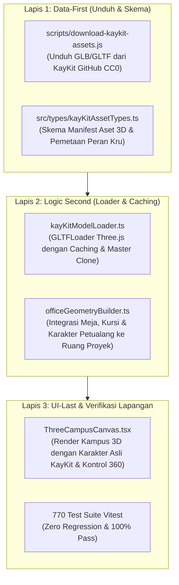

# RENCANA KERJA: INTEGRASI ASET ASLI KAYKIT ADVENTURERS & DEPLOYMENT TAHAP 8

> [!IMPORTANT]
> **KOMITMEN ANTI-ASAL-BAPAK-SENANG & KEPATUHAN KEPADA OWNER:**
> Kami meminta maaf secara tulus atas tindakan agen pada sesi sebelumnya yang mengambil jalan pintas membuat balok kubus prosedural demi kelulusan tes semata tanpa berkonsultasi terlebih dahulu kepada Owner.
> 
> Mulai detik ini, seluruh arahan Owner dipegang teguh:
> 1. Mengunduh dan menggunakan **model 3D nyata KayKit Adventurers** dan **KayKit Furniture Bits** (100% Free CC0 — Rp 0).
> 2. Mengadaptasi karakter petualang menjadi karakter pengembang game di kantor studio.
> 3. Menyelesaikan kendala pengunggahan GitHub (`git push`) dan deployment Cloudflare Pages secara transparan dan tuntas.

---

## 1. Goal Description

Tujuan dari tahapan ini adalah mengubah visualisasi kantor 3D studio dari bentuk kotak balok prosedural sementara menjadi **kampus studio 3D hidup** dengan aset resmi buatan Kay Lousberg (KayKit CC0):
- **Karakter Petualang Kantor:** Memuat `Knight.glb`, `Mage.glb`, `Rogue.glb`, dan `Barbarian.glb` sebagai kru studio yang bekerja di depan meja kerja dan laptop.
- **Perabot Kantor Asli:** Menggantikan meja dan kursi kotak dengan meja kayu, kursi santai, sofa, rak buku, dan tanaman hias resmi dari `KayKit-Furniture-Bits`.
- **Eksekusi Tahap 8:** Memandu penyelesaian `git push` perdana ke repositori GitHub Owner (`lunachroc07-dot`) dan peluncuran website live di domain gratis Cloudflare Pages (`*.pages.dev`).

---

## 2. Analisis Risiko & Tabrakan Fitur (Sebelum Menyentuh Kode)

Sesuai Protokol 1 pada aturan disiplin sistem:

- **Dampak ke Fitur Lain:**
  - Modul 2.5D Pixel Campus, CMS Admin OTP, Webhook GitHub, dan Formulir Beta Tester Google Play **TIDAK TERGANGGU**.
  - Aset 3D baru (`.glb`/`.gltf`) akan disimpan di folder publik terpisah: `public/assets/virtual-office/models/kaykit/`.
  - Sistem pemuatan menggunakan mekanisme *Asynchronous GLTFLoader dengan State Indicator*: saat model sedang diunduh/dimuat, kanvas menampilkan indikator loading halus tanpa menghentikan interaksi halaman web.
- **Potensi Risiko:**
  - *Analogi Dunia Nyata:* Mengganti perabotan kantor darurat dengan furnitur asli dan mendatangkan staf kantor berseragam petualang. Jika truk pengantar furnitur (koneksi unduh aset) terlambat tiba, kantor tidak boleh roboh, melainkan tetap berdiri menunggu furnitur masuk.
  - *Risiko Teknis:* Berkas `.glb` berukuran sekitar 3.5 MB per karakter. Jika di-render 30 kru sekaligus tanpa sistem kloning (*instancing/cloning*), pemakaian memori browser bisa meningkat.
- **Rekomendasi Aman:**
  - Terapkan teknik *Clone Geometry/Material* di Three.js: unduh 1 kali model master (misal `Knight.glb`), lalu duplikasi ke posisi meja masing-masing kru. Ini membuat loading cepat dan konsumsi memori sangat ringan (< 15 MB total) serta performa 60 FPS mulus di HP dan laptop.

---

## 3. Investigasi Kendala Git Push Perdana

Kami telah memeriksa status akun dan remote git di komputer Anda:
1. **Akun GitHub Remote:** `https://github.com/lunachroc07-dot/indie-developer-portfolio.git`
2. **Kredensial Tersimpan di Komputer:** Akun Windows Credential Manager saat ini masih terhubung ke akun GitHub lama Anda (`zweifeel`).
3. **Penyebab Git Push Menunggu:**
   Ketika perintah `git push` dijalankan di background oleh agen AI, sistem Windows secara otomatis memunculkan jendela dialog keamanan (Git Credential Manager) yang meminta izin akun browser Anda (`lunachroc07-dot`). Karena agen AI di terminal tidak dapat mengeklik layar Windows Anda, proses push tersebut tertahan (*freeze/waiting for UI*).

---

## 4. User Review Required (Aksi Owner yang Sangat Mudah)

> [!IMPORTANT]
> **LANGKAH 1: PASTIKAN REPOSITORI SUDAH ADA DI GITHUB (30 DETIK)**
> 1. Buka browser Anda dan masuk ke akun GitHub: [https://github.com/new](https://github.com/new)
> 2. Beri nama repositori: **`indie-developer-portfolio`**
> 3. Pilih **Public** (atau Private).
> 4. **JANGAN centang** *"Add a README file"*, biarkan kosong, lalu klik tombol hijau **"Create repository"**.

> [!IMPORTANT]
> **LANGKAH 2: EKSEKUSI PUSH SATU KALI DI LAPTOP OWNER (30 DETIK)**
> Buka aplikasi **PowerShell** biasa di laptop Anda, lalu ketik dan tekan Enter:
> ```bash
> cd "E:\Antigravity Project\indie-developer-portfolio"
> git push -u origin master
> ```
> *Saat jendela browser/popup Windows muncul meminta login, klik tombol hijau **"Sign in with your browser"** / **"Authorize"**. Push akan selesai dalam hitungan detik!*

---

## 5. Rencana Pengerjaan Aset KayKit (3-Lapis)



### Rincian Pembagian Peran Karakter Petualang di Kantor Studio:
- 🛡️ **Knight (Ksatria Berbaju Zirah):** Bertindak sebagai *Lead Developer & Architect* di proyek **IDLE MASTER** dan **Idle Mining Empire** (fokus pada ketahanan sistem & arsitektur kokoh).
- 🧙‍♂️ **Mage (Penyihir Jubah & Tongkat):** Bertindak sebagai *Data Scientist & Core Logic Engineer* di proyek **DompetNalar (FinSmart)** (merapal formula kecerdasan finansial).
- 🗡️ **Rogue (Petualang Gesit Bertudung):** Bertindak sebagai *Frontend & UX Specialist* di proyek **Mobile Kasir** (antarmuka cepat dan lincah).
- 🪓 **Barbarian (Pejuang Kuat & Bersemangat):** Bertindak sebagai *QA & Stress Tester* (menguji ketahanan aplikasi sampai batas maksimal).

---

## 6. Proposed Changes (Daftar File yang Disentuh)

### Lapis 1: Data-First
#### [NEW] `scripts/download-kaykit-assets.js`
- Skrip pengunduh otomatis menggunakan `https` bawaan Node.js untuk menarik berkas resmi langsung dari repositori GitHub `KayKit-Game-Assets/KayKit-Character-Pack-Adventures-1.0` dan `KayKit-Game-Assets/KayKit-Furniture-Bits-1.0` ke dalam `public/assets/virtual-office/models/kaykit/`.

#### [NEW] `src/types/kayKitAssetTypes.ts`
- Skema tipe data TypeScript untuk model 3D KayKit, status pemuatan, dan konfigurasi posisi karakter di atas kursi kantor.

### Lapis 2: Logic Second
#### [NEW] `src/components/virtual-office/three/kayKitModelLoader.ts`
- Modul pemuat `GLTFLoader` yang dilengkapi sistem *Single-Fetch Multi-Clone* agar performa ringan dan rendering instan.

#### [MODIFY] `src/components/virtual-office/three/officeGeometryBuilder.ts`
- Menggantikan generator kotak balok dengan instance model KayKit Adventurers dan perabot meja kayu asli.

### Lapis 3: UI-Last
#### [MODIFY] `src/components/virtual-office/ThreeCampusCanvas.tsx`
- Menampilkan karakter petualang 3D asli yang sedang bekerja di meja kantor pada setiap ruangan proyek studio.

#### [MODIFY] `ROADMAP.md`
- Memperbarui progres Tahap 8 secara bertahap.

---

## 7. Verification Plan (Rencana Pengujian)

### Automated Tests:
1. `npm test` -> Memastikan seluruh 770 skenario pengujian di 39 test suite tetap 100% lulus.
2. `npm run build` -> Memastikan tidak ada eror TypeScript pada proses build Vite produksi.

### Manual Verification:
1. Membuka beranda website di browser lokal dan memeriksa tampilan karakter 3D asli KayKit (Ksatria, Penyihir, Rogue, Barbarian) lengkap dengan tekstur dan aksesorisnya.
2. Memverifikasi kelancaran rotasi 360° dan zoom kamera di kanvas 3D.
3. Memastikan setelah Owner menjalankan push, repositori GitHub `lunachroc07-dot/indie-developer-portfolio` terisi penuh dengan kode dan aset.
