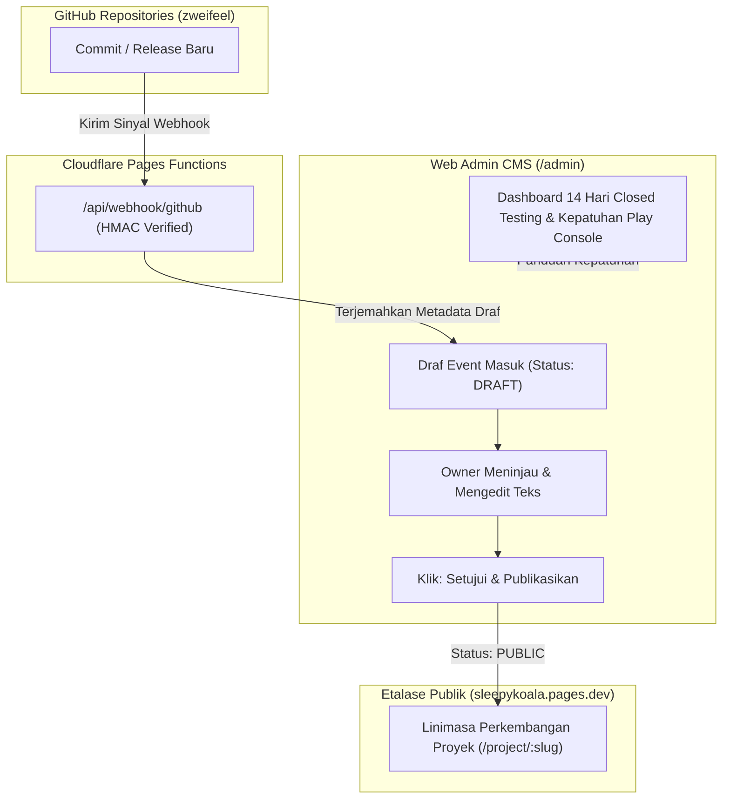

# Rencana Implementasi: Monitoring Closed Testing 14 Hari Mobile Kasir & Verifikasi Alur CMS Changelog Webhook

## 1. Deskripsi Tujuan (Goal Description)
Melanjutkan pencapaian sukses Tahap 8.3 & 8.4 di mana website SleepyKoala Studio telah live di [`https://sleepykoala.pages.dev`](https://sleepykoala.pages.dev) dan webhook 5 repositori GitHub telah aktif. Tahap ini berfokus pada dua mandat prioritas utama sesuai `ROADMAP.md`:
1. **Checklist & Dashboard Monitoring Closed Testing 14 Hari Google Play untuk Mobile Kasir:**
   Menyediakan sistem pemantauan terstruktur dan dasbor kepatuhan untuk memenuhi persyaratan mutlak Google Play Console bagi akun pengembang perorangan (minimal 20 tester opt-in aktif selama 14 hari berturut-turut tanpa jeda sebelum mengajukan akses produksi).
2. **Verifikasi Alur Web Admin CMS (/admin) Publikasi Changelog dari Webhook GitHub ke Etalase Publik:**
   Menguji dan membuktikan secara hulu-ke-hilir (End-to-End) bahwa commit atau pembaruan fitur yang masuk dari Webhook GitHub private diterima sebagai **DRAFT** di ruang kerja Web Admin, dapat ditinjau dan diedit oleh Owner, lalu setelah disetujui (PUBLIK) langsung muncul di etalase linimasa perkembangan publik (`/project/mobile-kasir`) tanpa kebocoran draf rahasia.

---

## 2. Analisis Risiko & Tabrakan Fitur (Bahasa Awam Non-Coder)

> [!NOTE]
> **Analisis Risiko Arsitektur Sesuai Protokol 1 GEMINI.md:**
> - **Dampak ke Fitur Lain:**
>   Fitur yang sudah stabil (772 tes Vitest, Formulir Tester Live, Kantor Virtual 3D, Autentikasi OTP Admin, dan Webhook GitHub) **TIDAK AKAN DIUBAH PONDASINYA**. Fitur baru ini bekerja secara modular (menambah modul pemantauan di CMS dan test suite verifikasi alur changelog).
> - **Potensi Risiko:**
>   *Analogi:* Seperti menambahkan papan kendali dasbor baru dan lampu indikator di ruang kerja kasir tanpa mengutak-atik mesin kasirnya sendiri. Jika modul dasbor baru belum siap, sistem CMS lama tetap berjalan 100% normal tanpa terganggu.
> - **Rekomendasi Aman:**
>   Menggunakan arsitektur 3-Lapis (Skema data bertipe di Lapis 1 -> Service logika murni diuji di terminal pada Lapis 2 -> Komponen UI interaktif di Lapis 3). Menjaga fail-closed security agar draf GitHub webhook tidak pernah bocor ke publik tanpa persetujuan Owner.
> - **Mandat Anggaran Nol Rupiah:**
>   100% Gratis (Rp 0 / $0.00). Seluruh checklist, kalkulator 14 hari, dan verifikasi changelog berjalan di atas infrastruktur gratis eksisting (Cloudflare Pages Free Tier & Google Sheets Free Tier).

---

## 3. User Review Required (Persetujuan Owner)

> [!IMPORTANT]
> **Konfirmasi Struktur Tab CMS:**
> Kami mengusulkan penambahan sub-tab **"Closed Testing 14-Hari"** di dalam menu **Kepatuhan (COMPLIANCE)** pada dashboard Web Admin (`/admin`), berdampingan dengan *Privacy Policy* dan *Hapus Akun*. Ini membuat seluruh urusan kepatuhan Google Play Console terkumpul rapi di satu tempat tanpa membuat menu navigasi membingungkan.

---

## 4. Rincian Perubahan yang Diusulkan (Proposed Changes)



---

### Lapis 1: Skema Data & Tipe Bertipe (Data-First)

#### [NEW] `src/types/closedTesting.ts`
- Mendefinisikan kontrak data TypeScript untuk pemantauan closed testing:
  - `ClosedTestingDailyLog`: Hari ke-1 s.d. 14, tanggal, jumlah tester terdaftar, jumlah tester aktif opt-in, crash rate, ANR rate, catatan/feedback bug, status kesehatan harian (`HEALTHY`, `WARNING`, `CRITICAL`).
  - `PlayConsoleComplianceItem`: ID checklist, nama prasyarat, kategori (`TESTER_REQUIREMENT`, `APP_CONTENT`, `STORE_LISTING`, `BUILD_QUALITY`), status (`COMPLETED`, `IN_PROGRESS`, `PENDING`), serta tautan rujukan resmi Google Play Console.
  - `ClosedTestingProjectSummary`: Status proyek (contoh `mobile-kasir`), tanggal mulai testing, tanggal target selesai, total hari aktif, persentase kesiapan produksi (*Production Readiness Score* 0–100%), dan draf 6 jawaban pertanyaan resmi Google Play.

---

### Lapis 2: Logika Murni Backend / Service & Pengujian Terminal (Logic & CLI Test)

#### [NEW] `src/services/closedTestingService.ts`
- Logika kalkulasi kesiapan 14 hari:
  - `calculateClosedTestingReadiness()`: Menghitung persentase kepatuhan (0-100%) berdasarkan checklist yang terpenuhi.
  - `evaluateFourteenDaysIntegrity()`: Memvalidasi apakah 14 hari telah dijalankan secara kontinu tanpa jeda dan apakah ada blocker crash.
  - `getProductionAccessQuestionsTemplate()`: Menyiapkan draf jawaban siap-salin untuk 6 pertanyaan Google Play Console (strategi rekrutmen tester, ringkasan feedback, tindakan perbaikan bug, dll).
  - Penyimpanan preferensi checklist ke penyimpanan lokal/state CMS agar status centang Owner tersimpan aman.

#### [NEW] `src/test/closedTestingMonitoring.test.ts`
- Pengujian otomatis Vitest untuk logika monitoring closed testing:
  - Uji perhitungan hari ke-1 s.d. hari ke-14.
  - Uji verifikasi ambang batas 20 tester opt-in aktif.
  - Uji kalkulasi persentase kesiapan produksi.
  - Uji generator 6 pertanyaan rilis produksi Google Play.

#### [NEW] `src/test/webhookToCmsChangelogE2E.test.ts`
- Pengujian otomatis Vitest untuk verifikasi alur Webhook GitHub -> CMS -> Etalase Publik:
  - **Skenario 1:** Webhook GitHub mengirimkan event commit push dari `zweifeel/mobile-kasir`. Event tersimpan dengan status `draft`.
  - **Skenario 2 (Fail-Closed):** Verifikasi bahwa event bertanda `draft` **TIDAK MUNCUL** pada pemanggilan publik (`fetchPublicProjectProgress`) maupun halaman detail proyek umum.
  - **Skenario 3:** Admin CMS meninjau event di tab Progress -> Events, mengubah narasi, dan menekan tombol *Setujui & Publikasikan* (`transitionItemPublicationStatus` ke `public`).
  - **Skenario 4 (Publikasi Sukses):** Verifikasi bahwa event langsung muncul di etalase publik (`PublicProjectProgress.events`) dan dapat dilihat oleh pengunjung web.
  - **Skenario 5 (Pencegahan Kebocoran / Rollback):** Admin menarik event kembali ke status `draft` atau `hidden`, dan event seketika menghilang dari etalase publik.
  - **Skenario 6 (Audit Trail):** Memastikan seluruh aktivitas editorial tercatat di jejak audit tanpa membocorkan token rahasia atau PII.

---

### Lapis 3: Antarmuka Visual & Panduan Operasional Eksekutif (UI & Docs)

#### [NEW] `src/components/admin/ClosedTestingMonitor.tsx`
- Komponen antarmuka visual di Web Admin CMS:
  - **Indikator Progres 14 Hari:** Visual tracker interaktif hari ke-1 sampai hari ke-14 dengan status badge dinamis.
  - **Kartu Metrik Kepatuhan:** Jumlah tester terdaftar vs kuota 20 tester, crash rate status, dan skor kesiapan produksi (0–100%).
  - **Checklist Kepatuhan Google Play Console:** Daftar periksa interaktif yang dapat dicentang Owner saat menyelesaikan tahapan di Google Play Console.
  - **Kotak Draf 6 Pertanyaan Akses Produksi:** Tombol 1-klik untuk menyalin jawaban lengkap yang siap ditempelkan ke dashboard Google Play Console saat masa uji coba 14 hari selesai.

#### [MODIFY] `src/pages/AdminPage.tsx`
- Menghubungkan komponen `ClosedTestingMonitor` ke dalam menu CMS Admin (di tab `COMPLIANCE` dengan sub-tab navigasi `KEBIJAKAN PRIVASI`, `HAPUS AKUN`, dan `MONITORING 14 HARI GOOGLE PLAY`).

#### [NEW] `Artifact/CHECKLIST_MONITORING_CLOSED_TESTING_14_HARI_MOBILE_KASIR.md`
- Dokumen panduan operasional praktis bahasa awam non-coder:
  - Jadwal aktivitas harian (Hari 1 hingga Hari 14).
  - Cara memeriksa dashboard Google Play Console (bagian *Closed Testing* / *Pengujian Tertutup*).
  - Cara mengekspor email tester dari Google Sheets dan memasukkannya ke daftar email tester di Google Play Console.
  - Cara mengirimkan tautan bergabung (Opt-in URL) ke para tester via email atau WhatsApp.
  - Panduan lengkap menjawab 6 pertanyaan evaluasi Google Play untuk permohonan akses produksi.

---

## 5. Rencana Verifikasi (Verification Plan)

### Automated Tests
1. Menjalankan seluruh test suite Vitest (memastikan 772 tes lama tetap lulus 100% ditambah suite tes baru):
   ```bash
   npm test
   ```
2. Menjalankan pemeriksaan kode TypeScript:
   ```bash
   npm run build
   ```
3. Menjalankan pemindai keamanan dan kepatuhan devsecops:
   ```bash
   node scripts/security-scan.js
   node scripts/privacy-scan.js
   node scripts/check-file-policy.js
   ```

### Manual Verification
1. Membuka Web Admin di browser lokal, masuk ke menu `Kepatuhan` -> sub-tab `Monitoring 14 Hari Google Play`, dan memverifikasi seluruh komponen visual, checklist, dan tombol salin draf jawaban berfungsi responsif.
2. Memverifikasi halaman detail proyek `/project/mobile-kasir` di browser untuk memastikan etalase linimasa aktivitas hanya menampilkan item yang telah disetujui (publik).
