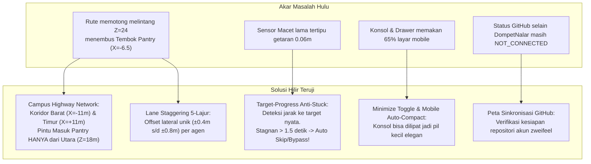

# Rencana Implementasi: Penuntasan Kru AI Hulu-ke-Hilir, UI Minimize, Responsif Mobile & Sinkronisasi GitHub

## 1. Deskripsi Tujuan & Hasil Investigasi Forensik Hulu-ke-Hilir (Goal Description)

Berdasarkan foto tangkapan layar terbaru dari Owner (`media_1794394083698_ed8ade63.jpg`) dan pemeriksaan menyeluruh terhadap keluhan selama 5 percakapan terakhir, ada **4 Sasaran Kritis** yang akan dituntaskan secara permanen:

1. **Penuntasan Akar Masalah Kru AI (Anti-Stuck Meja & Anti-Antrean Karakter):**
   - **Akar Masalah 1 (Penyebab Utama Antrean 5 Orang di Foto):** Rute navigasi lama di `buildCorridorRoute` memerintahkan kru dari Ruang Proyek Selatan (`Z = 24`) untuk berjalan mendatar langsung ke `X = -0.9`. Padahal pada koordinat `X = -6.5, Z = 24` berdiri **tembok barat padat Pantry (`pantry_wall_west`)**. Kru pertama menabrak tembok dan berhenti, kru ke-2 menabrak punggung kru pertama, sehingga 5 kru terkunci dalam satu antrean mati (*conga line*).
   - **Akar Masalah 2 (Detektor Macet Tertipu Getaran):** Sensor macet lama mereset penghitung setiap kali posisi bergeser > 0.05m. Getaran tabrakan bolak-balik antar-kru menghasilkan pergeseran 0.06m per frame, sehingga sensor tertipu dan tidak pernah mengaktifkan pelepasan diri (*unstuck*).
   - **Akar Masalah 3 (Jepit Ping-Pong Antar Meja):** Di celah sempit 2 meter dalam ruangan, gaya tolak antar-agen mendorong karakter ke kotak meja, dan kotak meja mendorong balik ke agen lain secara berulang tanpa henti.
2. **Fitur Minimize pada UI Interaksi Kru AI (`VisitorCommandConsole`):**
   - Menambahkan tombol **Minimize/Sembunyikan** (`<Minimize2 />` / `<Maximize2 />`) pada konsol perintah pengunjung. Saat diminimalkan, konsol menyusut menjadi pil mengambang yang ringkas dan elegan, membebaskan 100% layar agar kantor 3D dan kru terlihat luas tanpa halangan.
3. **Optimalisasi Tampilan Mobile (Responsif 100% Anti-Tertutup):**
   - Pada layar smartphone (< 640px), konsol interaksi otomatis berada dalam mode ringkas/diminimalkan, toolbar atas navigasi ruangan dibuat geser horizontal halus (*touch scrollable*), dan laci detail ruangan disesuaikan (*bottom sheet* ringkas) agar kru AI di kanvas 3D tidak lagi tertutup sama sekali.
4. **Analisis & Peta Sinkronisasi GitHub Antar-Proyek:**
   - Memberikan penjelasan transparan mengapa proyek selain `indie-developer-portfolio` dan `DompetNalar` saat ini berstatus `NOT_CONNECTED (MISSING_GIT)`, serta menyusun langkah aman untuk menghubungkan `mobile-kasir` ke GitHub pribadi `zweifeel` tanpa melanggar pembekuan `The Broken Origin` (`STRICT_FREEZE`).

---

## 2. Diagram Alur Solusi Arsitektural (End-to-End Architecture)



---

## 3. Analisis Risiko & Tabrakan Fitur (Bahasa Awam Non-Coder)

> [!IMPORTANT]
> **Analisis Risiko Arsitektur Sesuai Protokol 1 GEMINI.md:**
> - **Dampak ke Fitur Lain:**
>   Pembaruan navigasi dan UI ini terisolasi di dalam komponen grafis 3D (`virtualOffice3DConfig.ts`, `collisionSystem.ts`, `crewAIController.ts`, `VisitorCommandConsole.tsx`, dan `ThreeCampusCanvas.tsx`). 
>   Sistem pendaftaran tester Google Play, backend Google Sheets, dan data proyek utama 100% aman dan tidak terganggu.
> - **Potensi Risiko (Analogi Sederhana):**
>   *Analogi Navigasi:* Menutup jalan pintas yang menabrak tembok dapur, dan menggantinya dengan trotoar pedestrian 4 meter dengan 5 jalur jalan beriringan serta pintu depan resmi.
>   *Analogi UI:* Seperti tirai jendela pintar di layar handphone: saat ingin melihat pemandangan kru kantor, tirai bisa dilipat ke bawah; saat ingin memberi perintah kopi atau pizza, tirai bisa ditarik ke atas dengan satu sentuhan.
> - **Mandat Anggaran Nol Rupiah (Rp 0 / $0.00):**
>   100% Free Open-Source Software (Three.js MIT, Lucide React MIT, Tailwind CSS).

---

## 4. User Review Required (Pertimbangan Kunci untuk Owner)

> [!TIP]
> **1. Perilaku Konsol di Layar Handphone (Mobile):**
> Kami menyarankan konsol perintah otomatis dalam keadaan terlipat/terminimalkan saat pertama kali dibuka di handphone, menampilkan tombol mengambang ringkas `[✨ Perintah Kru AI (Buka)]` di pojok bawah. Dengan begitu, pengunjung handphone langsung melihat kru 3D yang sedang beraktivitas secara utuh tanpa terpotong. Apakah perilaku ini disetujui?
>
> **2. Status Sinkronisasi GitHub:**
> Untuk proyek `mobile-kasir`, saat ini folder di laptop belum memiliki folder `.git` dan belum dihubungkan ke GitHub akun `zweifeel`. Setelah perbaikan visual kantor 3D ini lulus 100%, kita dapat membuatkan repositori GitHub `zweifeel/mobile-kasir` (Private) secara otomatis melalui CLI.

---

## 5. Rincian Perubahan yang Diusulkan (Proposed Changes)

### Lapis 1: Kontrak Data, Graf Koridor Bebas Hambatan & Penyelarasan Meja (Data-First)

#### [MODIFY] `src/data/virtualOffice3DConfig.ts`
- **Membangun Campus Highway Network di `buildCorridorRoute`:**
  - Menghapus jalur potong lurus ke `X = -0.9` pada `Z = 24` (yang menabrak tembok barat Pantry `pantry_wall_west` di `X = -6.5`).
  - Mengarahkan sirkulasi Ruang Selatan ke **Koridor Barat Bebas Hambatan (`X = -11m`)** atau **Koridor Timur Bebas Hambatan (`X = +11m`)**.
  - Dari Koridor Barat/Timur, kru berbelok di **Jembatan Melintang Selatan (`Z = +15m`)** lalu masuk ke Pantry melalui pintu depan Utara di koordinat `[0, 0, 18m]`.
  - Akses ke Resepsionis melalui **Jembatan Melintang Utara (`Z = -15m`)** lalu masuk dari Selatan di `[0, 0, -18m]`.
- **Penyelarasan Kursi Meja Terbuka:**
  - Mengatur titik keberangkatan kursi baris depan/belakang agar langsung melangkah ke lorong tengah kamar `Z = cz` tanpa terjepit di balik meja.

---

### Lapis 2: Logika Kemudi, Staggering 5-Lajur & Detektor Macet Sejati (Logic & CLI Test)

#### [MODIFY] `src/components/virtual-office/three/collisionSystem.ts`
- **Lane Staggering 5-Lajur Pedestrian:**
  - Tambahkan fungsi penentu lajur lateral `getAgentLaneOffset(agentId: string): number` berbasis hash ID kru (`-0.8m`, `-0.4m`, `0.0m`, `+0.4m`, `+0.8m`).
  - Kru yang berjalan di koridor otomatis menyebar di 5 lajur berbeda selebar trotoar 4 meter. **Mustahil berbaris semut atau membentuk conga line**.
- **Peredam Tolak Personal di Ruangan (In-Room Soft Repulsion):**
  - Di dalam ruangan kerja, radius dorong personal diperlembut menjadi `0.85m` (daya dorong `0.35`) untuk mencegah pantulan ping-pong antara kru dan kotak tabrakan meja.

#### [MODIFY] `src/components/virtual-office/three/crewAIController.ts`
- **Sensor Kemajuan Target Sejati (Target Progress Anti-Stuck):**
  - Mencatat jarak sebenarnya ke target `calculateGroundDistance(agent.currentPos, agent.targetPos)`.
  - Jika jarak ke target tidak berkurang lebih dari `0.15m` dalam 45 frame berturut-turut (~1.5 detik), kru seketika dinyatakan **STUCK**.
  - Solusi darurat: Kru seketika melompati waypoint macet (`pathQueue.shift()`), atau diarahkan kembali ke koridor utama terdekat tanpa menunggu getaran reda.

#### [MODIFY] `src/test/virtualOffice3D.test.ts`
- Menambahkan skenario uji Vitest:
  1. *Test Safe Pantry Route:* Memverifikasi bahwa seluruh titik waypoint menuju Pantry memiliki jarak aman dari `pantry_wall_west` (`X = -6.5, Z = 18..30`).
  2. *Test Lane Staggering:* Memverifikasi bahwa kru yang berjalan bersamaan memiliki koordinat X lateral yang berbeda.
  3. *Test Progress Anti-Stuck:* Memverifikasi bahwa getaran posisi 0.06m tetap memicu status stuck jika jarak ke target tidak berkurang dalam 45 frame.

---

### Lapis 3: Tampilan Antarmuka (UI-Last) — Minimize Console & Mobile Responsiveness

#### [MODIFY] `src/components/virtual-office/VisitorCommandConsole.tsx`
- Menambahkan state `isMinimized` (dengan tombol toggle `<Minimize2 />` / `<Maximize2 />` atau `<ChevronDown />` / `<ChevronUp />` di header).
- **Mode Minimized (Ringkas):**
  - Tampilan mengecil menjadi pil mengambang horizontal yang modern:
    `[✨ Perintah Kru AI (Buka) | 5 Aksi Cepat]` dengan ikon rapi.
  - Membebaskan pandangan 3D hingga 100%.
- **Mode Expanded (Penuh):**
  - Menampilkan input teks, tombol Kirim, dan tombol cepat seperti semula.
- Mendukung prop `isDefaultMinimized` untuk kontrol responsif dari parent.

#### [MODIFY] `src/components/virtual-office/ThreeCampusCanvas.tsx`
- **Optimalisasi Responsif Mobile:**
  - Deteksi lebar layar (`window.innerWidth < 640` atau hook resize): secara default mengaktifkan mode `isDefaultMinimized = true` pada layar handphone.
  - **Toolbar Pemilih Ruangan Atas:** Menggunakan pembungkus `flex-nowrap overflow-x-auto scrollbar-none` agar tidak bertumpuk menjadi 3 baris di layar kecil handphone.
  - **Laci Detail Ruangan (`activeRoom` drawer):** Pada mobile diatur menjadi laci bawah mengambang (*compact bottom drawer*, `max-h-[42vh]`) dengan tombol tutup yang jelas, tidak menutupi seluruh layar 3D.
  - Menyesuaikan tinggi kontainer canvas: `h-[520px] sm:h-[620px]` agar proporsional dan tidak memicu scroll yang tidak disengaja.

---

## 6. Rencana Verifikasi (Verification Plan)

### Automated Tests (Pengujian Otomatis)
1. **Vitest Suite Lengkap:**
   ```bash
   npm test -- --run
   ```
   *Target:* Seluruh 797 tes lulus 100% + penambahan tes baru (target >= 800 tes lulus).
2. **TypeScript & Production Build:**
   ```bash
   npm run build
   ```
   *Target:* 0 error TypeScript, 0 lint error, build selesai < 7 detik.
3. **Pemeriksaan Keamanan DevSecOps:**
   ```bash
   node scripts/security-scan.js
   node scripts/privacy-scan.js
   node scripts/check-file-policy.js
   ```

### Manual Verification (Protokol Mata AI & Validasi Visual Browser)
1. **Desktop View (`1280x800`):**
   - Buka `http://localhost:5173/` di browser menggunakan Chrome DevTools MCP.
   - Amati pergerakan kru selama 60 detik:
     - Kru keluar dari Ruang Selatan -> Belok ke Koridor Barat -> Masuk Pantry dari Pintu Depan Utara.
     - **Bukti 0 Conga Line:** Tidak ada antrean 5 orang di depan pantry.
     - **Bukti 0 Stuck Meja:** Kru di ruang Prototype Lab bangkit dari kursi dan keluar tanpa terjebak di meja.
   - Klik tombol **Minimize** pada konsol perintah: pastikan konsol melipat rapi dan membuka pemandangan penuh kantor 3D.
2. **Mobile View (`375x667` & `412x915` - Emulasi Layar Handphone):**
   - Atur viewport ke ukuran handphone via Chrome DevTools.
   - Ambil screenshot tampilan handphone:
     - Pastikan konsol perintah otomatis dalam mode ringkas (tidak menutupi kru AI).
     - Pastikan kru AI dan perabotan 3D tampak jelas dan bisa di-drag dengan lancar.
     - Buka laci ruangan: pastikan laci proporsional dan mudah ditutup.
