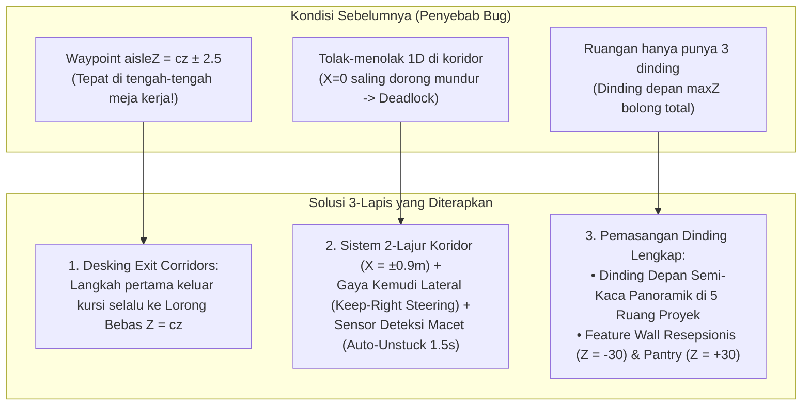

# Rencana Implementasi: Perbaikan Total Navigasi Kru AI & Pemasangan Dinding Lengkap Kantor Virtual 3D

## 1. Deskripsi Tujuan (Goal Description)

Menjawab temuan langsung dari Owner SleepyKoala Studio (Non-Coder), rencana ini menunda transisi ke Tahap 10 dan memprioritaskan penuntasan 3 masalah kritis pada Simulasi Kampus Kantor Virtual 3D:
1. **Kru AI Tersangkut di Meja (Desk Stuck Bug):**
   Memperbaiki sistem navigasi rute keluar-masuk meja kerja (*workstation route & docking*). Karakter yang bangkit dari kursi kerja tidak lagi berjalan menabrak meja atau komputer, melainkan melangkah mundur ke lorong bebas (*room central aisle*) sebelum menuju pintu.
2. **Kru AI Macet / Saling Dorong Saat Berpapasan (Head-on Collision & Deadlock Bug):**
   Mengganti sistem tumbukan 1D yang saling tolak mundur dengan sistem **2-Lajur Pedestrian (Lajur Kiri/Kanan)** serta **Gaya Kemudi Lateral Otomatis (Keep-Right Lateral Steering & Path Divergence)**. Saat dua kru berpapasan di lorong koridor, mereka otomatis saling membelokkan langkah ke sisi kanan secara mulus tanpa pernah macet atau jalan di tempat.
3. **Ruangan yang Belum Memiliki Dinding (Missing Front Walls & Shared Facility Walls):**
   Memasang dinding arsitektural lengkap 4 sisi pada seluruh ruangan:
   - **Seluruh Ruang Proyek (5 Ruangan):** Menambahkan **Dinding Depan (*Front Wall* pada sisi Selatan / `maxZ`)** dengan panel kaca studio panoramik modern berbingkai elegan sehingga ruangan tertutup rapi dari sudut orbit 360° mana pun.
   - **Pantry Kopi (*South End*):** Menambahkan dinding belakang (*Back Wall* pada `z = 30`) bermotif acoustic wood slats & rak dapur cafe serta partisi samping.
   - **Lobi Resepsionis (*North End*):** Menambahkan dinding belakang megah (*Feature Wall* pada `z = -30`) berhiaskan plakat logo studio *SleepyKoala Studio* dan lampu sorot dinding (*sconce lights*).

---

## 2. Analisis Risiko & Tabrakan Fitur (Bahasa Awam Non-Coder)

> [!IMPORTANT]
> **Analisis Risiko Arsitektur Sesuai Protokol 1 GEMINI.md:**
> - **Dampak ke Fitur Lain:**
>   Perbaikan ini berfokus 100% di dalam modul grafis 3D ([`src/components/virtual-office/three/`](file:///e:/Antigravity%20Project/indie-developer-portfolio/src/components/virtual-office/three/) dan konfigurasi rute di [`src/data/virtualOffice3DConfig.ts`](file:///e:/Antigravity%20Project/indie-developer-portfolio/src/data/virtualOffice3DConfig.ts)). 
>   Sistem data publik, CMS admin, pendaftaran tester, dan 793 tes otomatis yang sudah ada tetap aman dan terlindungi.
> - **Potensi Risiko (Analogi Sederhana):**
>   *Analogi:* Seperti memasang marka jalan dua arah di lorong kantor dan memasang kaca jendela di dinding depan ruko yang tadinya bolong. Jika marka jalan dipasang dengan rapi, karyawan bisa berjalan berpapasan tanpa tabrakan dada, dan kantor terlihat kokoh serta mewah dari luar tanpa mengganggu pekerjaan di komputer kasir.
> - **Rekomendasi Aman:**
>   Menggunakan metodologi **3-Lapis (Data-First -> Logic -> UI-Last)**:
>   1. *Lapis 1 (Data-First):* Perbaikan skema koordinat lorong, kotak rintangan (*ObstacleBox3D*), dan status pelacak macet (*stuck counter*).
>   2. *Lapis 2 (Logic & Unit Tests):* Uji matematis di Vitest untuk pembuktian bahwa kru yang berpapasan membelok ke sisi samping dan tidak ada waypoint yang menembus meja kerja.
>   3. *Lapis 3 (UI & Visual):* Render dinding kaca depan dan dinding resepsionis/pantry di Three.js canvas.
> - **Mandat Anggaran Nol Rupiah (Rp 0 / $0.00):**
>   100% Free Open-Source Three.js MIT, geometri prosedural gratis, tanpa aset atau plugin berbayar.

---

## 3. User Review Required (Keputusan Kunci untuk Owner)

> [!TIP]
> **Desain Dinding Depan Ruang Proyek (Front Wall Styling):**
> Untuk dinding depan ruang kerja proyek (sisi Selatan yang menghadap kamera awal), kami mengusulkan desain **Dinding Studio Modern Semi-Kaca (Studio Panoramic Glass Wall)**:
> - Bagian bawah (tinggi 0.9m) menggunakan dinding solid ber-wainscoting dengan lis kayu gelap yang kokoh.
> - Bagian tengah (tinggi 0.9m s/d 2.4m) menggunakan kaca studio transparan berbingkai hitam arsitektural (*black mullions*).
> - Bagian atas memiliki balok penyangga dan lis plafon (*crown moulding*).
> **Keuntungan:** Ruangan tertutup 100% solid dan tidak ada lagi lubang bolong, namun Owner tetap bisa menikmati pemandangan kru yang sedang sibuk mengetik dan bergerak di dalam meja kerja saat kamera diputar bebas. Apakah Owner menyetujui gaya visual semi-kaca panoramik ini?

---

## 4. Open Questions (Pertanyaan Terbuka)

> [!NOTE]
> 1. **Dinding Belakang Lobi Resepsionis:** Kami akan menambahkan dinding belakang elegan pada `Z = -30` dengan teks bercahaya *"SLEEPYKOALA STUDIO — INDIE GAME LAB"*. Apakah ada teks atau slogan khusus yang Owner inginkan untuk plakat lobi utama ini?
> 2. **Kecepatan Manuver Memutar Kru:** Saat dua kru berpapasan, kru akan membelokkan badan dengan jarak aman lateral `0.9 meter` ke sisi kanan masing-masing. Apakah jarak ini sudah sesuai dengan preferensi visual Owner?

---

## 5. Rincian Perubahan yang Diusulkan (Proposed Changes)



---

### Lapis 1: Skema Data & Tipe Bertipe (Data-First)

#### [MODIFY] `src/types/virtualOffice3D.ts`
- Menambahkan pelacak macet dan memori pergerakan pada `ProjectCrewMember3D`:
  ```typescript
  export interface ProjectCrewMember3D {
    // ... properti eksisting ...
    stuckCounter?: number; // Menghitung frame macet jika tidak ada pergerakan
    lastPosSnapshot?: Vector3Tuple; // Posisi 1 detik sebelumnya untuk deteksi stagnasi
    escapeWaypoint?: Vector3Tuple | null; // Jalur keluar darurat jika terhadang
  }
  ```

#### [MODIFY] `src/data/virtualOffice3DConfig.ts`
- **Perbaikan Rute Meja (`buildCorridorRoute`):**
  - Mengubah titik awal navigasi: Ketika kru sedang duduk (`seatedPos`), langkah pertama (`route[0]`) diarahkan melangkah keluar kursi ke lorong utama ruangan (`Z = cz` untuk Baris 1, atau geser samping `X = cx` untuk Baris 2) sebelum menuju pintu keluar.
  - Memperbaiki `aisleZ`: Menghapus perhitungan lama `cz ± 2.5` (yang berada di tengah meja) dan menggantinya dengan koordinat lorong bersih `Z = cz`.
- **Sistem 2-Lajur Pedestrian (Traffic Lanes):**
  - Jalur koridor tengah (`X = 0`) dipisah menjadi:
    - Menuju Selatan (`dz > 0`): Lajur Barat `X = -0.9m`.
    - Menuju Utara (`dz < 0`): Lajur Timur `X = +0.9m`.
  - Koridor penghubung ruangan:
    - Menuju Timur (`dx > 0`): Lajur `Z = cz - 0.45m`.
    - Menuju Barat (`dx < 0`): Lajur `Z = cz + 0.45m`.
- **Penyempurnaan Bounding Box Meja (`generateCampusObstacles`):**
  - Mengoreksi kotak tabrakan meja agar membungkus meja kerja fisik tanpa mengurung kursi karyawan sehingga kru tidak lagi terjebak di dalam kotaknya sendiri.
  - Mendaftarkan rintangan dinding baru untuk Pantry (`z = 30`) dan Resepsionis (`z = -30`).

---

### Lapis 2: Logika Kemudi Lateral & Deteksi Macet (Logic & CLI Test)

#### [MODIFY] `src/components/virtual-office/three/collisionSystem.ts`
- **Gaya Kemudi Lateral (Tangential Steering / Keep-Right Rule):**
  - Pada fungsi `resolveAgentCollisions`:
    - Ketika dua kru berjalan berhadapan (vektor pergerakan saling berlawanan):
    - Alih-alih hanya mendorong mundur di sumbu Z (yang menyebabkan saling kunci jalan di tempat), sistem menerapkan gaya dorong lateral tegak lurus `(dz, -dx)`.
    - Kedua karakter secara otomatis melangkah mengelak ke arah kanan masing-masing, menciptakan gerakan berpapasan yang sangat alami seperti manusia di dunia nyata.

#### [MODIFY] `src/components/virtual-office/three/crewAIController.ts`
- **Sensor Deteksi Macet & Manuver Lepas Diri (Auto-Unstuck System):**
  - Pada `stepCrewMovement`:
    - Membandingkan jarak tempuh `currentPos` dengan posisi 1 detik lalu.
    - Jika status `WALKING` tetapi karakter bergerak kurang dari `0.05m` selama 60 frame (> 1.2 detik):
      1. Deteksi macet aktif (*Stuck Detected*).
      2. Sistem membatalkan antrean jalan yang macet dan menyuntikkan titik belok darurat (*Escape Waypoint*) ke arah lorong bebas terdekat.
      3. Jika terjebak di sudut perabotan, karakter otomatis meluncur halus ke titik kursi atau lorong tengah dengan catatan aktivitas: `"[Nama Kru] mencari rute memutar untuk menghindari hambatan."`

#### [MODIFY] `src/test/virtualOffice3D.test.ts`
- Menambahkan pengujian otomatis unit test:
  1. *Test Desk Exit Safety:* Memastikan tidak ada satupun waypoint navigasi keluar meja yang memotong interior kotak rintangan meja (`ObstacleBox3D`).
  2. *Test Head-on Lateral Avoidance:* Menguji 2 agen yang berjalan berhadapan dari arah berlawanan, membuktikan keduanya berbelok ke arah samping dan berhasil saling melewati tanpa macet di tengah.
  3. *Test Two-Lane Lane Assignment:* Memastikan kru arah Utara dan Selatan diberikan lajur terpisah `X = ±0.9`.
  4. *Test Auto-Unstuck Recovery:* Menguji simulasi agen yang terhimpit selama 1.5 detik dapat melepaskan diri dan kembali berjalan normal.

---

### Lapis 3: Geometri Tembok Lengkap Kampus 3D (UI-Last)

#### [MODIFY] `src/components/virtual-office/three/officeGeometryBuilder.ts`
- **Pemasangan Dinding Depan Ruang Proyek (`frontWall` pada `maxZ`):**
  - Membangun dinding depan berwainscoting setinggi `0.9m`, dilengkapi jendela kaca studio panoramik berbingkai gelap dari tinggi `0.9m` s/d `2.4m`, balok lintel atas, dan lis plafon.
  - Sisi depan ruangan kini 100% tertutup dan solid dari luar, dengan pemandangan interior yang tetap hidup dan estetik saat dilihat melalui jendela kaca.
- **Pemasangan Dinding Belakang & Samping Pantry Kopi (`fac.facilityId === 'pantry_coffee_bar'`):**
  - Dinding belakang pada `Z = 30` dengan tekstur kayu slatted acoustic, rak gantung cangkir kopi, dan papan menu cafe.
  - Dinding partisi samping pada `X = -6.5` dan `X = 6.5`.
- **Pemasangan Dinding Belakang Resepsionis (`fac.facilityId === 'reception'`):**
  - Dinding belakang megah pada `Z = -30` dengan panel aksen marmer/akustik, plakat perunggu berlampu *"SleepyKoala Studio"*, dan lampu dinding hangat.
  - Dinding pembatas samping pada `X = -6.5` dan `X = 6.5`.

---

## 6. Rencana Verifikasi (Verification Plan)

### Automated Tests
1. **Rangkaian Tes Unit Vitest:**
   ```bash
   npm test -- --run
   ```
   *Target:* 793 tes lama tetap lulus 100% + 4 tes baru untuk navigasi anti-stuck, kemudi lateral, dan 2-lajur pedestrian (Total >= 797 tes lulus).
2. **TypeScript & Build Check:**
   ```bash
   npm run build
   ```
   *Target:* 0 TypeScript error, 0 build failure.
3. **Pemeriksaan Keamanan & Kebijakan File:**
   ```bash
   node scripts/security-scan.js
   node scripts/privacy-scan.js
   node scripts/check-file-policy.js
   ```
   *Target:* 100% Patuh, 0 kebocoran kredensial/rahasia.

### Manual Verification (Protokol Mata AI & Validasi Visual Browser)
1. Buka browser lokal pada halaman Beranda (`http://localhost:5173/`) dan Halaman Detail Proyek (`http://localhost:5173/projects/mobile-kasir`).
2. Putar kamera 360° mengelilingi kampus:
   - Amati seluruh ruang proyek dari sisi depan (Selatan): Pastikan tidak ada lagi ruangan yang bolong tanpa dinding.
   - Periksa Lobi Resepsionis (Utara) dan Pantry (Selatan): Pastikan keduanya memiliki dinding belakang yang megah dan solid.
3. Amati pergerakan kru AI selama 60 detik:
   - Amati saat kru bangkit dari kursi meja kerja: Pastikan mereka mundur ke lorong tengah dengan mulus tanpa menabrak meja atau monitor.
   - Amati saat dua kru berpapasan di lorong koridor tengah: Pastikan keduanya membelok ke sisi kanan masing-masing dan berpapasan mulus tanpa macet jalan di tempat.
