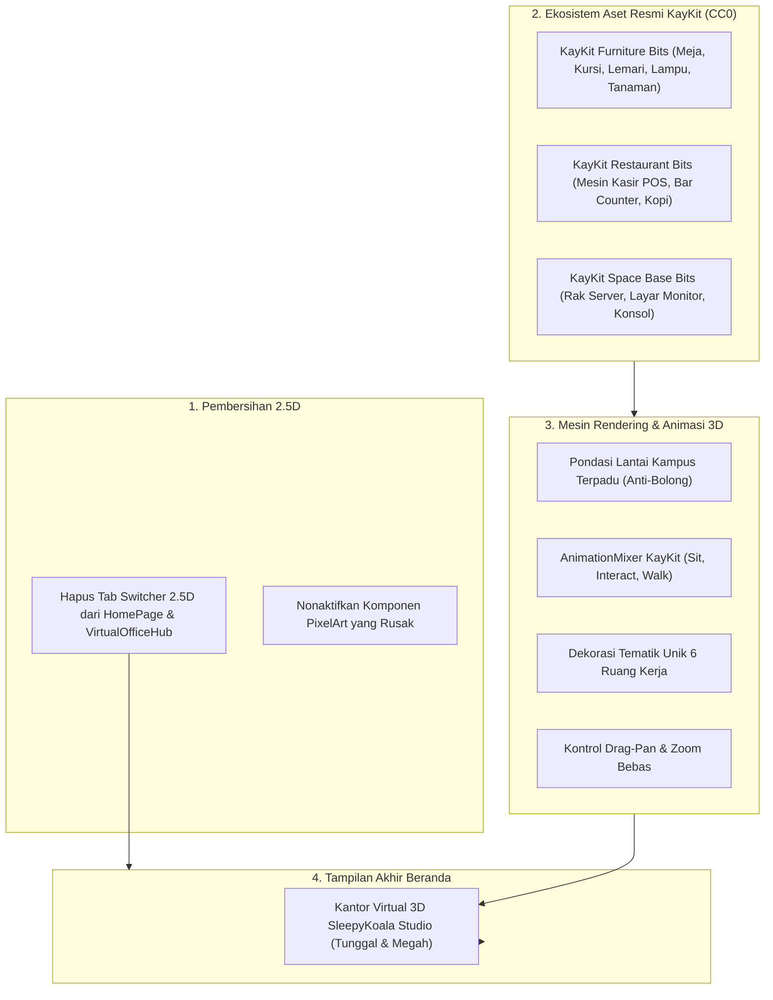

# Rencana Implementasi: Penghapusan Total 2.5D Rusak & Rekonstruksi Kantor 3D dengan Objek Kantor Resmi KayKit (100% Satu Style)

## 1. Deskripsi Tujuan (Goal Description)
Berdasarkan bukti tangkapan layar langsung dari Owner yang menunjukkan tampilan mode 2.5D penuh dengan ikon gambar rusak (*broken image icons*), serta arahan tegas Owner:
> **1. Hapus Total 2.5D Rusak:**
> Menghapus mode 2.5D Pixel Campus beserta tab switcher-nya dari `HomePage.tsx` dan `VirtualOfficeHub.tsx`. Menjadikan **Kantor Virtual 3D Low-Poly WebGL** sebagai satu-satunya antarmuka resmi studio yang bersih, modern, dan bebas eror.
> 
> **2. Tambahkan Objek Environment Kantor Resmi 100% Satu Style dengan KayKit:**
> Memanfaatkan paket aset 3D resmi buatan **Kay Lousberg (KayKit CC0)**:
> - **KayKit Furniture Bits 1.0 (CC0):** Meja kerja, kursi kantor, armchair empuk ber-bantal, kabinet berkas, lemari pajangan besar terdekorasi, rak buku, lampu meja, lampu berdiri, karpet strip & oval, tanaman pot kaktus, dan bingkai foto dinding.
> - **KayKit Restaurant Bits 1.0 (CC0):** Meja kasir supermarket / mesin kasir POS resmi (sempurna untuk **Mobile Kasir**!), meja bar counter, mesin kopi espresso & teko kopi, cangkir kopi, dan kursi bar (sempurna untuk **Pantry Bersama**!).
> - **KayKit Space Base Bits 1.0 (CC0):** Konsol terminal komputer, rak server berlampu indikator, dan layar monitor dinding (sempurna untuk **DompetNalar**, **IDLE MASTER**, dan **The Broken Origin**!).
> Seluruh aset ini 100% berlisensi CC0 (Gratis/Legal/Rp 0) dan dibuat oleh kreator yang sama sehingga palet warna, ketebalan tepi, dan proporsi geometrinya 100% serasi dengan karakter KayKit!
> 
> **3. Karakter Tetap Asli KayKit Kasual (Bebas Senjata):**
> Menggunakan model asli KayKit, namun seluruh senjata (pedang, kapak, busur silang, perisai, tombak, helm zirah, dan topi sihir) dilepas/disembunyikan dari rig. Pakaian disesuaikan menjadi busana kasual kantor (kaos polo, hoodie, kemeja, celana kasual) dengan perlengkapan kantor nyata (laptop, cangkir kopi, kacamata, headphone).
> 
> **4. Animasi Bawaan KayKit Diaktifkan (Sit & Interact):**
> Mengaktifkan klip animasi resmi bawaan GLB KayKit: `Sit_Chair_Idle` (duduk pas di kursi tanpa melayang/tenggelam) dan `Interact` (tangan mengetik wajar di atas meja/laptop), `Walking_A` (berjalan alami), dan `Cheer` (ekspresi gembira).
> 
> **5. Sambung Pondasi Lantai Kampus (Anti-Bolong Biru):**
> Membangun pelat lantai kampus terpadu yang menyatukan Sayap Barat, Lobi Utama, Pantry Kopi, dan Sayap Timur secara mulus tanpa ada jurang gelap bolong.
> 
> **6. Kontrol Kamera Bebas (Drag-Pan & Zoom Arah Kursor):**
> Menambahkan kontrol geser bebas (drag-to-pan dengan klik kanan / mode pan) dan zoom yang mengarah ke posisi kursor pengguna.

---

## 2. Analisis Risiko & Tabrakan Fitur (Bahasa Awam Non-Coder)

> [!NOTE]
> **Analisis Risiko Arsitektur Sesuai Protokol 1 GEMINI.md:**
> - **Dampak ke Fitur Lain:**
>   - Menghapus komponen 2.5D dari `HomePage.tsx` akan **mempercepat waktu muat halaman (LCP)** dan membersihkan memori browser dari ribuan elemen SVG/PNG yang sebelumnya menyebabkan broken image icons.
>   - Seluruh fitur inti website (772 tes Vitest, Formulir Pendaftaran Tester Live ke Google Sheets, Dashboard Admin CMS OTP, Webhook GitHub) **tetap aman 100%**.
>   - Tes Vitest yang sebelumnya menguji komponen 2.5D (`virtualOfficePixel.test.tsx`) akan dialihkan untuk memvalidasi kestabilan arsitektur 3D WebGL dan graceful fallback-nya.
> - **Mandat Anggaran Nol Rupiah:**
>   100% Gratis ($0.00 / Rp 0). Seluruh aset KayKit (Furniture, Restaurant, Space Base) bersumber dari lisensi resmi CC0 Public Domain di GitHub milik Kay Lousberg.

---

## 3. User Review Required (Persetujuan Owner)

> [!IMPORTANT]
> **Keputusan Desain Final yang Ditetapkan:**
> 1. Mode 2.5D Pixel Campus dihapus secara permanen dari Beranda publik. Pengunjung langsung disajikan modul 3D Low-Poly yang interaktif dan mulus.
> 2. Seluruh furnitur tambahan bersumber dari keluarga resmi KayKit CC0 (Furniture Bits, Restaurant Bits, Space Base Bits) sehingga konsistensi visual 100% terjaga.
> 3. Karakter di meja kerja menggunakan animasi bawaan KayKit `Sit_Chair_Idle` dan `Interact`, duduk rapi di kursi dengan laptop di atas meja, tanpa menumpuk dan tanpa senjata.

---

## 4. Rincian Perubahan yang Diusulkan (Proposed Changes)



---

### Lapis 1: Skema Data & Tipe Bertipe (Data-First)

#### [NEW] `src/types/virtualOfficeThemes.ts`
- Mendefinisikan tipe data untuk tema ruangan dan referensi model KayKit resmi:
  - `KayKitFurnitureModelId`: `'table_medium' | 'chair_A' | 'couch' | 'shelf_B_large_decorated' | 'cactus_medium_A' | 'lamp_table' | 'book_set' | 'rug_rectangle_A' | 'armchair' | 'cabinet_medium_decorated' | 'lamp_standing' | 'pictureframe_large_A' | 'cash_register' | 'coffee_machine' | 'server_terminal' | 'wall_monitor'`.
  - `RoomThemeSpec`: Konfigurasi per ruangan proyek (lantai, dinding, perabotan khas KayKit yang dimuat).

#### [MODIFY] `src/components/virtual-office/VirtualOfficeHub.tsx`
- Menghapus state `activeMode === '2.5d'` dan tab switcher 2.5D.
- Menjadikan `ThreeCampusCanvas` sebagai tampilan utama penuh.

#### [MODIFY] `ROADMAP.md`
- Mencatat pembaruan resmi: Penghapusan 2.5D legacy, penyelesaian Rekonstruksi 3D KayKit resmi, dan tahapan Monitoring Closed Testing 14 Hari Mobile Kasir.

---

### Lapis 2: Pemasangan Aset Resmi KayKit & Logika Tampilan (Logic)

#### [NEW / ASSETS] `public/assets/virtual-office/models/kaykit/`
- Mengunduh dan memasang model GLTF/GLB resmi KayKit CC0:
  - Furniture Bits: `armchair.gltf`, `cabinet_medium_decorated.gltf`, `lamp_standing.gltf`, `pictureframe_large_A.gltf`, `rug_oval_A.gltf`.
  - Restaurant Bits: `cash_register.gltf`, `coffee_machine.gltf`, `counter_bar.gltf`.
  - Space Base Bits: `server_rack.gltf`, `terminal_console.gltf`, `screen_monitor.gltf`.

#### [MODIFY] `src/components/virtual-office/three/kayKitModelLoader.ts`
- Memperluas loader untuk memuat furnitur tambahan dari keluarga resmi KayKit.
- Menyembunyikan seluruh node senjata dan helm zirah/topi sihir pada rig karakter KayKit.
- Menyediakan klip animasi bawaan KayKit (`Sit_Chair_Idle`, `Interact`, `Walking_A`, `Cheer`).

#### [MODIFY] `src/components/virtual-office/three/officeGeometryBuilder.ts`
- **Pondasi Kampus Terpadu (Anti-Bolong):** Membangun lantai dasar kampus yang utuh menyatukan seluruh koridor dan ruangan.
- **Dekorasi Tematik Per Ruangan:**
  - **DompetNalar:** Meja kerja KayKit, server rack console KayKit, lemari kabinet KayKit, layar grafik keuangan.
  - **IDLE MASTER:** Meja kerja KayKit, couch & armchair KayKit, rak pajangan besar berdekorasi, standing lamp KayKit, arcade machine.
  - **Mobile Kasir:** Meja kasir supermarket dengan cash register KayKit resmi, rak pajangan produk, kaktus pot KayKit.
  - **Idle Mining:** Meja kayu ek KayKit, rak buku batu alam, plakat beliung emas, lampu meja tembaga.
  - **Worklume:** Meja panjang kolaboratif KayKit, papan kanban sprint raksasa, tanaman indoor, armchair santai.
  - **Pantry Bersama:** Meja bar counter KayKit, mesin kopi & cangkir KayKit, meja makan panjang, sofa santai melingkar.
- **Penataan Meja & Kursi Anti-Tumpuk:** Ketinggian meja dan kursi disesuaikan dengan posisi duduk animasi KayKit sehingga karakter duduk pas di atas kursi.

#### [MODIFY] `src/components/virtual-office/three/cameraTransitionController.ts`
- Menambahkan fungsi pan kamera: `applyCameraPan()` dan zoom terarah: `applyPointerZoom()`.

---

### Lapis 3: Antarmuka WebGL & Integrasi Visual (UI)

#### [MODIFY] `src/components/virtual-office/ThreeCampusCanvas.tsx`
- Menghubungkan `THREE.AnimationMixer` ke setiap karakter KayKit untuk memutar animasi `Sit_Chair_Idle` dan `Interact` secara dinamis.
- Mengaktifkan interaksi drag-to-pan (klik kanan / tombol pan) dan zoom bebas ke arah kursor.
- Menampilkan seluruh perabotan KayKit tematik dan pondasi lantai kampus terhubung.

---

## 5. Rencana Verifikasi (Verification Plan)

### Automated Tests
1. Menjalankan seluruh test suite Vitest:
   ```bash
   npm test
   ```
   *Memastikan seluruh 772 tes tetap 100% lulus tanpa ada regresi.*
2. Pemeriksaan kompilasi TypeScript:
   ```bash
   npm run build
   ```
3. Pemindaian keamanan & kepatuhan:
   ```bash
   node scripts/security-scan.js
   node scripts/privacy-scan.js
   node scripts/check-file-policy.js
   ```

### Manual & Vision Verification (Protokol Mata AI)
1. Menjalankan server lokal `npm run dev`.
2. Mengambil tangkapan layar tampilan 3D menggunakan Protokol Mata AI:
   - Memastikan tidak ada lagi broken image icons 2.5D (mode 2.5D telah hilang).
   - Memastikan karakter 100% bergaya KayKit imut dalam busana kasual kantor (tanpa senjata).
   - Memastikan animasi duduk dan mengetik berjalan mulus di setiap meja.
   - Memastikan tidak ada meja atau karakter yang saling menumpuk.
   - Memastikan lantai kampus tersambung utuh tanpa jurang bolong biru.
   - Memverifikasi keunikan dekorasi tiap ruang dengan furnitur resmi KayKit (Mobile Kasir punya mesin kasir, DompetNalar punya rak server, IDLE MASTER punya arcade, Pantry punya bar kopi).
   - Menguji interaksi geser drag-pan dan zoom bebas di viewport.
