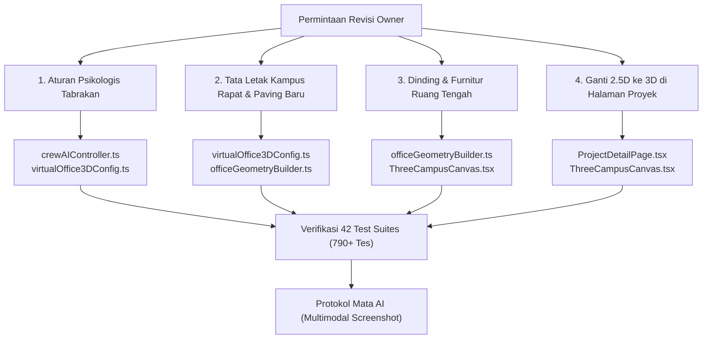

# Rencana Implementasi: Revisi Lanjutan Kantor Virtual 3D & Modernisasi Halaman Detail Proyek

> [!IMPORTANT]
> **PANDUAN KHUSUS UNTUK OWNER (NON-CODER):**
> Dokumen ini adalah cetak biru rencana perbaikan lengkap untuk mengatasi seluruh catatan Anda pada Kantor Virtual 3D:
> 1. Karakter tidak lagi saling bertabrakan atau tembus meja/kursi berkat penerapan **Aturan Psikologis Ruang Personal (*Personal Space / Proxemics*)**.
> 2. Jarak antar ruangan dirapatkan agar kampus studio terasa menyatu (*compact & cozy*), menghilangkan area hitam kosong yang membingungkan.
> 3. Lantai hijau mencolok di ruang tengah diganti dengan lantai arsitektural mewah, serta ruang tengah diberi **dinding partisi studio elegan & perabotan lengkap**.
> 4. Halaman detail tiap game/aplikasi (`/projects/:slug`) diperbarui total: **tampilan 2.5D lama diganti menjadi 3D Three.js modern** yang sama persis dengan yang ada di dashboard beranda!

---

## 1. Analisis Risiko & Tabrakan Fitur (Sebelum Menyentuh Kode)



- **Dampak ke Fitur Lain:**
  - *Sistem Pergerakan Kru (`crewAIController.ts`):* Menambahkan gaya tolak personal antar-karakter (*agent-agent repulsion*) dan rute sandar meja kerja (*docking approach point*). Fitur interaksi konsol pengunjung (Traktir Kopi, Kirim Pizza, Bangunkan) tetap berfungsi normal karena hanya mengatur status aktivitas.
  - *Tata Letak Kampus (`virtualOffice3DConfig.ts` & `officeGeometryBuilder.ts`):* Merapatkan jarak ruangan dari $x = \pm 26$ menjadi $x = \pm 17$. Koordinat collider dan rute koridor diselaraskan otomatis.
  - *Halaman Detail Proyek (`ProjectDetailPage.tsx`):* Menghubungkan panggung 3D terfokus (`ThreeCampusCanvas` dengan `initialFocusedSlug={project.slug}`) menggantikan modul lama `PixelProjectRoom`. Data roadmap, checklist Google Play, dan changelog tetap utuh di tempatnya.
- **Potensi Risiko (Analogi Awam):**
  - *Analogi Lalu Lintas:* Jika jarak antar ruangan dirapatkan tanpa aturan lalu lintas yang jelas, karakter bisa berdesakan di persimpangan pintu. Oleh karena itu, kita menerapkan "Aturan Papasan Kanan" (*Right-Hand Passing Rule*) dan jarak aman pribadi (*personal bubble* $\approx 1.1$ m), mirip seperti pejalan kaki di lorong kantor nyata.
- **Rekomendasi Aman:**
  - Menerapkan alur 3-Lapis secara disiplin: Skema data jarak baru $\rightarrow$ Tes headless Vitest $\rightarrow$ Pemasangan visual 3D & verifikasi Mata AI.
  - Mempertahankan mandat biaya Rp 0 dengan memanfaatkan model CC0 yang sudah ada di repositori.

---

## 2. Rincian Perubahan Berdasarkan 4 Masalah Utama

### A. Masalah 1: Tabrakan Karakter, Meja, dan Kursi (Aturan Psikologis Ruang Personal)
- **Akar Masalah:**
  1. Sebelumnya kode hanya memeriksa tabrakan dengan benda mati (`CampusObstacle3D`). Karakter tidak saling mendeteksi keberadaan satu sama lain, sehingga dua karakter bisa berjalan ke koordinat yang sama dan bertumpukan (*overlapping*).
  2. Bounding box meja sebelumnya belum mengunci kursi, sehingga karakter yang lewat bisa memotong dan menembus kursi rekan kerjanya.
- **Solusi yang Diterapkan:**
  1. **Gelembung Ruang Personal (*Proxemics / Social Force Model*):** Setiap karakter memiliki radius aman $0.9$ meter. Jika jarak antar dua karakter $< 1.1$ m, sistem menghitung vektor dorong lembut saling menjauh sehingga tidak ada karakter yang bisa menempel atau tembus badan karakter lain.
  2. **Aturan Papasan Berlawanan Arah (*Right-Hand Corridor Rule*):** Saat dua karakter berpapasan di lorong dalam jarak 2 meter, masing-masing otomatis menggeser langkah sedikit ke kanan untuk lewat dengan sopan.
  3. **Zona Duduk Meja Kerja Terkunci (*Occupied Workstation Zone*):** Meja kerja dan kursi dikunci sebagai rintangan utuh bagi karakter lain. Karakter yang bertugas memiliki titik sandar khusus dari belakang kursi (`approach point`), melangkah masuk, lalu duduk rapi menghadap monitor (`Math.PI`).

### B. Masalah 2: Tata Letak Rapat & Penghapusan Area Hitam Kosong
- **Akar Masalah:**
  - Ruangan sebelumnya diletakkan di $x = -26$ dan $x = +26$, menyisakan celah kosong selebar 32 meter di tengah yang gelap legam (`#090d16`).
- **Solusi yang Diterapkan:**
  1. Ruangan dirapatkan ke $x = -17$ (Sayap Barat) dan $x = +17$ (Sayap Timur). Dinding dalam ruangan kini langsung bersisian elegan dengan jalan kampus utama.
  2. Dasar fondasi kampus dilapisi ubin studio arsitektural terang terpadu (*seamless architectural floor paving*). Tidak ada lagi petak hitam bolong antar ruangan.
  3. Jalan setapak penghubung (*walkways*) dilapisi lantai kayu modern dengan lis tepi yang rapi.

### C. Masalah 3: Ruang Tengah (Collaboration Lounge) Berdinding Kaca & Furnitur Lengkap
- **Akar Masalah:**
  - Ruang tengah sebelumnya hanya berupa pelat karpet hijau polos tanpa dinding dan perabotannya minim.
- **Solusi yang Diterapkan:**
  1. Mengganti lantai hijau kaku dengan lantai kayu parket arsitektural mewah (*warm wood parquet*) dipadu karpet desainer bundar di area santai.
  2. Membangun **Dinding Kaca Studio (*Modern Glass Partition Walls*)**: dinding partisi transparan berbingkai hitam dengan pintu masuk terbuka di 4 sisi (Utara, Selatan, Barat, Timur).
  3. Menambahkan furnitur lengkap Kenney CC0:
     - Sofa desainer empuk & kursi santai (`loungeDesignSofa`, `loungeDesignChair`).
     - Meja kopi kayu bundar (`tableCoffee`).
     - Tanaman hias pot besar di sudut ruangan (`pottedPlant`).
     - Papan tulis presentasi / monitor TV dinding (`television`).
     - Lampu sudut lantai (`lampRoundFloor`).

### D. Masalah 4: Modernisasi Halaman Detail Proyek (`/projects/:slug`) ke Tampilan 3D
- **Akar Masalah:**
  - Halaman `ProjectDetailPage` masih menggunakan komponen 2.5D isometric pixel art lama (`PixelProjectRoom`), sedangkan di beranda sudah menggunakan 3D Three.js.
- **Solusi yang Diterapkan:**
  - Mengganti `PixelProjectRoom` di `src/pages/ProjectDetailPage.tsx` dengan panggung 3D interaktif yang terfokus langsung pada ruangan proyek yang dipilih (`ThreeCampusCanvas` dengan `initialFocusedSlug={project.slug}`).
  - Pengunjung halaman detail proyek akan melihat ruangan 3D yang megah lengkap dengan 5 kru KayKit beranimasi hidup, perabotan khas proyek, dan kamera yang bisa di-orbit 360° secara interaktif.

---

## 3. Rencana Berkas yang Disentuh (Proposed Changes)

### Lapis 1: Data-First
#### [MODIFY] `src/data/virtualOffice3DConfig.ts`
- Sesuaikan koordinat ruangan `calculateRoomCoordinates`: rapatkan dari $x = \pm 26$ ke $x = \pm 17$.
- Sesuaikan `buildCorridorRoute` dengan koordinat baru yang rapat.
- Perbarui `generateCampusObstacles`: tambahkan rintangan penuh workstation (meja + kursi) serta dinding ruang tengah.
- Tambahkan konstanta personal space `PERSONAL_SPACE_RADIUS = 0.9` dan `PERSONAL_COLLISION_DISTANCE = 1.1`.

### Lapis 2: Headless Logic & Unit Tests
#### [MODIFY] `src/components/virtual-office/three/crewAIController.ts`
- Implementasikan gaya tolak antar-karakter (*agent-agent repulsion*) dalam `stepCrewMovement`.
- Implementasikan aturan papasan koridor (*right-hand corridor deflection*).
- Tambahkan docking approach point dari belakang kursi saat karakter kembali ke meja kerja.
- Tambahkan detektor macet (*stuck detection & nudge recovery*).

#### [MODIFY] `src/test/virtualOffice3D.test.ts`
- Tambahkan skenario uji untuk tolakan personal space antar dua karakter yang berdekatan.
- Perbarui koordinat uji rute koridor untuk tata letak baru yang rapat.
- Uji docking meja kerja tanpa tabrakan.

### Lapis 3: UI-Last & 3D WebGL
#### [MODIFY] `src/components/virtual-office/three/officeGeometryBuilder.ts`
- Ubah tekstur lantai fondasi kampus menjadi ubin terang terpadu (hapus warna hitam legam).
- Ganti lantai hijau ruang tengah dengan parket kayu hangat dan karpet bundar desainer.
- Bangun dinding partisi kaca arsitektural untuk ruang tengah lengkap dengan archway pintu masuk.
- Pasang furnitur lengkap Kenney CC0 di ruang tengah.

#### [MODIFY] `src/pages/ProjectDetailPage.tsx`
- Hapus impor dan penggunaan `PixelProjectRoom`.
- Pasang panggung 3D `ThreeCampusCanvas` dengan `initialFocusedSlug={project.slug}` sehingga pengunjung halaman proyek langsung melihat ruang kerja 3D tim pengembang game/aplikasi tersebut.

#### [MODIFY] `src/test/virtualOfficePixel.test.tsx`
- Selaraskan tes yang memeriksa `ProjectDetailPage` agar memvalidasi panggung 3D yang baru tanpa merusak skenario tes lama.

---

## 4. Rencana Verifikasi End-to-End

### Pengujian Otomatis (CLI Test Runner)
```bash
# 1. Pengecekan tipe data TypeScript
tsc -b

# 2. Pengujian otomatis 42 Test Suites (Vitest)
npm test

# 3. Pemindaian integritas berkas, keamanan rahasia & privasi PII
node scripts/check-file-policy.js
node scripts/security-scan.js
node scripts/privacy-scan.js

# 4. Pengujian build produksi Vite
npm run build
```

### Verifikasi Visual Mandiri AI (Protokol Mata AI)
1. Jalankan pratinjau live di browser lokal.
2. Ambil screenshot beranda: pastikan kampus rapat, tidak ada ubin hitam kosong, lantai hijau telah berganti, dan ruang tengah berdinding rapi.
3. Pantau pergerakan kru selama 30 detik: pastikan karakter tidak saling menabrak dan duduk di kursi meja kerja dengan natural.
4. Buka halaman `/projects/dompetnalar` dan `/projects/mobile-kasir`: pastikan tampilan 2.5D lama telah berganti menjadi visual 3D Three.js yang hidup dan terfokus pada ruangan tersebut.

---

## 5. Keputusan yang Memerlukan Persetujuan Owner

> [!IMPORTANT]
> Mohon periksa poin-poin keputusan di bawah ini:
> 1. **Dinding Ruang Tengah:** Kami merencanakan dinding partisi kaca studio modern (*glass partition*) dengan aksen kusen hitam dan wainscoting di bagian bawah, serta bukaan pintu lebar di 4 penjuru. Apakah desain semi-terbuka ini Anda setujui?
> 2. **Lantai Pengganti Warna Hijau:** Kami merekomendasikan lantai kayu parket hangat (*warm herringbone parquet*) senada dengan nuansa studio indie, dipadukan karpet merah desainer di bawah sofa. Apakah Anda setuju?
> 3. **Modernisasi Halaman Proyek:** Tampilan 2.5D pixel art di setiap halaman detail proyek (`/projects/:slug`) akan digantikan 100% dengan panggung 3D Three.js resmi. Apakah Anda setuju?

Silakan tekan tombol **Proceed** atau berikan tanggapan untuk menyetujui rencana implementasi ini!
