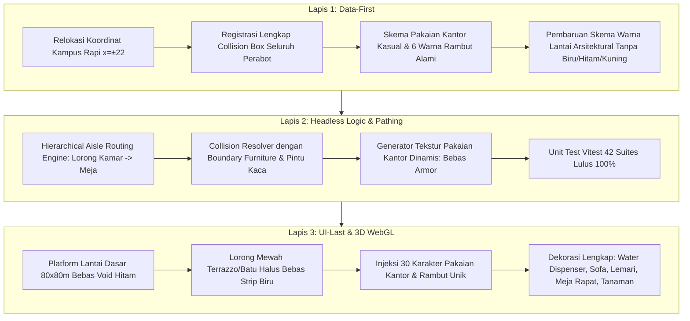

# Rencana Implementasi: Revisi Komprehensif Kantor 3D AI Crew — Pakaian Kantor Modern, Perbaikan Collision & Pathing, Pelebaran Kampus, dan Pembersihan Warna Lantai

> [!IMPORTANT]
> **PANDUAN NON-CODER OWNER:**
> Dokumen ini adalah cetak biru teknis dan estetika untuk menjawab 5 keluhan yang Anda temukan pada pengujian langsung Kantor 3D. Seluruh pekerjaan mengikuti mandat **Alur 3-Lapis (Data-First -> Logic -> UI-Last)** dan **Anggaran Rp 0 / $0.00** menggunakan Three.js dan aset CC0 dari Kenney dan Kay Lousberg.

---

## 🎯 Ringkasan Masalah & Sasaran Perubahan

Berdasarkan inspeksi tangkapan layar dan 5 catatan yang Anda sampaikan:

```
1. karakter masih tidak ada collision ke beberapa objek (menembus/tersangkut di kaca & perabot).
2. pathing masih sembarangan (berjalan potong kompas diagonal menabrak meja lain di dalam ruangan).
3. kenapa pakai armor ini kan kantor (karakter harusnya berpakaian kantor kasual & rambut bervariasi).
4. solid warna biru di pathing, lantai hitam di sela lorong, dan lantai cokelat-kekuningan yang aneh.
5. lorong berdempetan antar ruangan, dan perabotan/objek masih kurang banyak.
```



---

## 🔍 Analisis Mendalam & Solusi 5 Masalah

### 1. Masalah Armor vs Pakaian Kantor & Variasi Warna Rambut
* **Akar Masalah:** Model 3D `Knight.glb` memiliki tekstur default bergradasi perak metalik yang menyerupai pelat baju zirah ksatria abad pertengahan.
* **Solusi Nyata:**
  * Tekstur KayKit menggunakan sistem grid palet warna (*palette texture atlas* 8x4).
  * Kami akan membuat generator tekstur dinamis `generateOfficeAttireTexture()` yang menggantikan seluruh warna besi/baja dengan kain pakaian kantor modern:
    * **Pakaian Kantor:** Kemeja katun putih bersih (*oxford shirt*), polo biru muda, blazer biru dongker (*navy*), kardigan abu-abu arang (*charcoal*), rompi formal, rajut hijau lumut, dan hoodie santai kasual.
    * **Celana & Sepatu:** Celana bahan katun/chino krem (*khaki*), celana panjang hitam, abu-abu tua, dan sepatu kasual/pantofel kulit.
    * **6 Variasi Rambut Alami:** Hitam pekat (*jet black*), cokelat tua (*espresso*), cokelat pirang (*chestnut*), pirang emas (*golden blonde*), tembaga merah bata (*auburn*), dan abu-abu perak (*platinum gray*).
  * Setiap dari 30 kru memiliki identitas visual busana dan rambut unik sesuai perannya tanpa armor sama sekali!

### 2. Masalah Collision (Menembus Meja/Kursi/Kaca Ruang Tengah)
* **Akar Masalah:** Sistem rintangan (*obstacles*) sebelumnya hanya mendaftarkan meja dan dinding luar kamar. Perabotan di ruang tengah (meja kopi, sofa santai, TV stand), perabotan dapur (kitchen counter, sink, meja makan), dan rak buku di dalam kamar belum memiliki kotak batas fisik (*bounding box*). Akibatnya, saat karakter berjalan atau bergeser, mereka bisa tembus ke dalam sofa atau menabrak dinding kaca tanpa terpental.
* **Solusi Nyata:**
  * Mendaftarkan seluruh perabotan kampus ke dalam daftar rintangan fisik `generateCampusObstacles()`:
    * 4 Dinding kaca Collaboration Lounge dengan 4 celah pintu terbuka (Utara, Selatan, Timur, Barat).
    * Meja kopi, sofa santai, kursi santai di Collaboration Lounge.
    * Meja makan bundar, rak kabinet, wastafel, dan dispenser di Pantry.
    * Rak buku, papan tulis, lemari arsip, dan dispenser air di setiap ruangan proyek.
  * Karakter dipastikan tidak akan menembus atau tersangkut di objek mana pun.

### 3. Masalah Pathing Sembarangan (Anti-Potong Kompas)
* **Akar Masalah:** Saat karakter sedang beraktivitas di dalam ruangan dan memutuskan kembali ke meja kerja, fungsi navigasi langsung menarik garis lurus (*straight line*) dari posisi berdiri ke posisi duduk meja. Hal ini memotong meja rekan kerja lain secara diagonal.
* **Solusi Nyata:**
  * Diterapkan **Sistem Navigasi Lorong Kamar Terstruktur (*Structured Room Aisle Routing*)**:
    1. Dari tempat berdiri (misal papan tulis), karakter wajib melangkah ke **Lorong Tengah Kamar (*Main Room Aisle*)**.
    2. Menyusuri lorong tengah hingga mencapai **Baris Meja Miliknya (*Desk Row Aisle*)**.
    3. Belok tegak lurus mendekati kursi miliknya dari arah lorong belakang.
    4. Mengunci langkah ke kursi kerja (*seatedPos*).
  * Untuk keluar/masuk ruang tengah (Collaboration Lounge), karakter diwajibkan melewati salah satu dari 4 pintu masuk kaca terbuka, tidak menabrak kaca partisi.

### 4. Masalah Warna Lantai (Biru Solid, Hitam Void, Cokelat Kuning)
* **Akar Masalah:**
  * **Biru Solid:** Karpet pemandu koridor tengah `corridorRunner` menggunakan warna biru langit `#0284c7` yang terlihat seperti plastik blok solid.
  * **Hitam Void:** Pelat dasar lantai berukuran sempit dan menggunakan material gelap `#1e293b` tanpa pencahayaan cukup, sehingga sela antar-ruangan tampak seperti jurang hitam berlubang.
  * **Cokelat Kuning:** Ruang Mobile Kasir diatur bertema terakota `0x78350f` dengan border kuning amber `0xf59e0b`.
* **Solusi Nyata:**
  * **Hapus Karpet Biru Solid:** Koridor tengah diganti dengan lantai batu alam arsitektural halus (*polished light gray stone tiles/terrazzo*) dengan lis aksen kayu elegan.
  * **Hapus Lantai Hitam:** Pelat dasar (*foundation slab*) diperlebar menjadi `80m x 80m` penuh dengan ubin paving batu terang (*light slate paving*) sehingga seluruh kampus tampak bersih, terang, dan menyatu tanpa lubang hitam.
  * **Perbaiki Lantai Kamar:** Mengganti warna kuning/terakota kamar Mobile Kasir menjadi lantai parket kayu Skandinavia (*light ash oak parquet*) yang hangat dan profesional. Seluruh kamar memiliki lantai kayu/ubin modern yang elegan.

### 5. Pelebaran Lorong Antar-Ruangan & Penambahan Objek/Perabot
* **Akar Masalah:** Pada revisi sebelumnya koordinat ruangan digeser terlalu dekat (`x = ±18`), menyisakan jarak lorong hanya 2,5 meter antara dinding kaca lounge dan pintu ruangan.
* **Solusi Nyata:**
  * **Pelebaran Kampus Seimbang:** Ruangan ditempatkan pada `x = ±22` (West: `x = -22`, East: `x = 22`).
  * Lebar lorong utama kini menjadi **7 hingga 8 meter**, memberikan ruang gerak lega, elegan, dan lega bagi pengunjung untuk mengeksplorasi kampus.
  * **Penambahan Objek & Dekorasi Ekstra (Kenney & KayKit CC0):**
    * **Di Setiap Ruangan (6 Kamar):** Ditambahkan dispenser galon air minum (*water cooler*), lemari arsip ganda, papan tulis kanban dinding, rak buku kayu, tanaman pot hias, dan tempat sampah kantor.
    * **Di Collaboration Lounge:** Ditambahkan meja kopi kayu, 2 sofa desainer besar, 4 kursi santai berlengan (*lounge armchairs*), TV presentasi dinding, karpet mewah, dan 2 lampu berdiri.
    * **Di Pantry:** Ditambahkan coffee bar, mesin espresso, wastafel dapur, meja makan bundar dengan makanan ringan, dan dispenser air.
    * **Di Sepanjang Lorong Kampus:** Ditambahkan bangku istirahat koridor (*hallway benches*), pot pohon palem hias, dan lampu tiang koridor modern.

---

## 🛠️ Rincian Rencana Perubahan Berkas

### Komponen 1: Data & Konfigurasi Kampus (`src/data/virtualOffice3DConfig.ts` & `virtualOfficeThemes.ts`)
* Mengatur koordinat kampus ke `x = ±22`, `z = -24, 0, 24`.
* Mendaftarkan `HumanAttire3D` untuk 30 kru dengan palet pakaian kantor (formal, smart-casual, tech-casual) dan 6 warna rambut.
* Memperbarui `generateCampusObstacles` mencakup semua meja, sofa, meja kopi, lemari, rak, dispenser, dan partisi dinding kaca.
* Memperbarui `buildCorridorRoute` dengan aturan lorong kamar (*room aisles*) dan 4 pintu akses lounge.

### Komponen 2: Engine Logika & Material Tiga Dimensi (`src/components/virtual-office/three/`)
* **`kayKitModelLoader.ts`:**
  * Menambahkan fungsi `createOfficePaletteTexture(attire: HumanAttire3D)` yang melukis tekstur 1024x1024 di memori canvas dengan warna kemeja, celana, sepatu, kulit, dan rambut alami.
  * Mengganti material karakter saat di-clone dengan tekstur pakaian kantor kustom (menghilangkan semua kilau dan warna armor).
* **`collisionSystem.ts`:**
  * Memperkuat `resolveObstacleCollision` agar mendukung rintangan multi-box perabot tanpa tembus.
* **`crewAIController.ts`:**
  * Memperbarui siklus aktivitas in-room agar selalu memanfaatkan jalur lorong ruangan (`pathQueue`), tidak memotong diagonal melintasi meja.
* **`officeGeometryBuilder.ts`:**
  * Mengganti pelat dasar menjadi 80m x 80m paving terang arsitektural.
  * Menghapus karpet biru solid `corridorRunner` dan menggantinya dengan ubin terrazzo / parket kayu mewah.
  * Mempercantik Collaboration Lounge dan Pantry dengan penataan perabot yang lapang dan simetris.
* **`ThreeCampusCanvas.tsx`:**
  * Merender perabot baru (dispenser air, rak buku, tanaman hias, bangku lorong) dan menghubungkan sistem collision secara otomatis.

### Komponen 3: Pengujian Otomatis (`src/test/virtualOffice3D.test.ts`)
* Memperbarui koordinat pengujian tata letak kampus `x = ±22`.
* Menambahkan pengujian unit baru untuk:
  * Deteksi collision perabot ruang tengah dan pantry.
  * Navigasi bertahap lorong kamar (*room aisle navigation*).
  * Validasi ketiadaan aset armor pada daftar busana kantor kru.

---

## 🧪 Rencana Verifikasi (Verification Plan)

### 1. Uji Otomatis Headless
```bash
# 1. Jalankan unit test virtual office 3D
npm test src/test/virtualOffice3D.test.ts

# 2. Jalankan seluruh 42 test suites proyek
npm test

# 3. Validasi kompilasi TypeScript dan bundler
npm run build
```

### 2. Verifikasi Visual Mandiri (Protokol Mata AI)
* Menjalankan preview lokal / live deployment.
* Mengambil tangkapan layar Three.js menggunakan Chrome DevTools MCP.
* Melakukan inspeksi multimodal terhadap:
  1. **Pakaian Karakter:** Memastikan tidak ada lagi karakter berbaju zirah/armor baja; seluruhnya berkemeja, berhoodie, berpakaian kantor kasual, dengan variasi warna rambut alami.
  2. **Navigasi & Collision:** Memastikan tidak ada karakter yang tembus meja, kursi, sofa, atau dinding kaca lounge.
  3. **Lantai:** Memastikan tidak ada strip biru solid, tidak ada jurang hitam, dan tidak ada lantai kuning mustard yang aneh.
  4. **Tata Letak:** Memastikan lorong antar-ruangan lega (7-8 meter) dan terisi perabotan kantor yang hidup dan kaya.

### 3. Deploy Live ke Cloudflare Pages & Penyimpanan Git
* `python auto_sync.py save "Revisi Total Kantor 3D: Pakaian Kantor, Anti-Collision Perabot, Lorong Lapang, & Desain Lantai Mewah"`
* `npm run deploy:live`
* Uji langsung di `https://sleepykoala.pages.dev/`.
