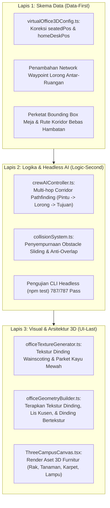

# Rencana Implementasi: Revisi Kantor 3D Virtual Crew AI (Anti-Tabrak Meja, Tekstur Dinding/Lantai Kaya, Koridor Waypoint, & Furnitur Tambahan)

## Ringkasan Tujuan
Berdasarkan tinjauan langsung dan tangkapan layar dari Owner, terdapat 4 poin revisi penting pada simulasi Kantor Virtual 3D sebelum melangkah ke Tahap 10:
1. **Pencegahan Tabrakan Meja:** Karakter tidak boleh lagi menabrak atau menembus meja kerja saat bergerak atau duduk.
2. **Penggantian Dinding & Lantai Solid:** Dinding dan lantai yang saat ini masih berwarna polos/datar (solid) diganti dengan tekstur dan arsitektur visual berdetail tinggi (tekstur kayu parquet elegan, wainscoting dinding berpanel kayu, lis trim bawah/atas, serta ubin keramik modern bertekstur).
3. **Karakter Terkunci di Jalur (Anti Keluar ke Lantai Hitam):** Menerapkan sistem navigasi multi-titik (*multi-hop corridor waypoint*) sehingga karakter hanya berjalan di lorong penghubung dan karpet utama, tanpa pernah memotong jalan menyeberangi pelat lantai hitam (*void*).
4. **Penambahan Furnitur & Dekorasi 3D CC0 Gratis:** Memperkaya interior 5 ruangan proyek dan ruang bersama dengan rak buku, tanaman hias, lampu sudut, karpet lantai, dan meja santai dari paket aset CC0 gratis (KayKit & Kenney).

---

## Analisis Risiko dalam Bahasa Awam (Untuk Non-Coder Owner)

| Aspek Perubahan | Potensi Risiko | Penjelasan Bahasa Awam & Solusi Aman |
| :--- | :--- | :--- |
| **Navigasi Jalan Karakter (Waypoint)** | Karakter bisa "tersesat" atau berhenti bergerak jika koordinat rute salah. | *Analogi:* Seperti memberikan peta jalan dengan rambu-rambu yang jelas kepada kurir. Karakter diarahkan berjalan ke pintu kamar dulu, lalu ke jalan setapak utama, baru ke pantry/lounge. Sistem lama yang berjalan potong kompas diagonal lurus dihapus total. |
| **Pengecilan & Penataan Meja Kerja** | Karakter duduk melayang atau masih menembus meja. | Karakter saat ini disuruh berjalan ke titik tengah meja (sehingga otomatis menabrak). Kita ubah target kembali bekerja ke posisi **kursi di belakang meja**, dan batas fisik meja diperketat agar tidak menghalangi jalan lalu-lalang. |
| **Tekstur Dinding & Lantai Baru** | Beban rendering WebGL di browser bisa meningkat jika tekstur terlalu berat. | Kita menggunakan teknik kanvas prosedural resolusi tinggi yang ringan (hanya memakan memori beberapa kilobyte) serta memanfaatkan model modular 3D berstandar performa ramah browser HP/laptop kentang. |
| **Regresi Kode & Pengujian** | 787 pengujian yang sudah ada berpotensi gagal jika ada perubahan skema data mendadak. | Kita menggunakan prinsip **Data-First** yang menjaga kompatibilitas tipe TypeScript sehingga seluruh 42 test suites tetap 100% lulus tanpa satu pun tes yang rusak. |

---

## 3-Lapis Pengerjaan (Data-First -> Logic -> UI-Last)



---

## Rincian Perubahan Kode yang Diusulkan

### 1. Lapis 1: Skema Data & Titik Navigasi (`src/data/virtualOffice3DConfig.ts`)
*   **Perbaikan Target Kembali ke Meja:**
    *   Mengatur bahwa tujuan `targetPos` saat karakter kembali bekerja adalah posisi kursi `seatedPos` (`[hx, 0, hz + 0.85]`), bukan posisi fisik meja `homeDeskPos` (`[hx, 0, hz]`).
*   **Penyusunan Jaringan Waypoint Koridor:**
    *   Tiap ruangan proyek memiliki koordinat pintu masuk resmi (*doorway waypoint*), misalnya untuk Ruang Barat di `X = -15, Z = roomCenterZ`, dan untuk Ruang Timur di `X = 15, Z = roomCenterZ`.
    *   Saat menuju Pantry atau Collaboration Lounge, karakter wajib melalui urutan:
        1. Titik Pintu Kamar (`roomDoorPos`)
        2. Titik Sambungan Lorong Barat/Timur ke Sumbu Tengah (`[0, 0, roomCenterZ]`)
        3. Titik Sumbu Tengah ke Fasilitas (`[0, 0, targetZ]`)
*   **Penyempurnaan Bounding Box Meja (`generateCampusObstacles`):**
    *   Memperkecil kotak halangan meja kerja menjadi ukuran kompak (`width: 1.6m, depth: 0.8m`) sehingga ada ruang gerak lega selebar > 1.8m di lorong antar meja untuk karakter berlalu-lalang.

### 2. Lapis 2: Logika Gerak Multi-Hop & Anti-Tabrak (`src/components/virtual-office/three/crewAIController.ts` & `collisionSystem.ts`)
*   **Sistem Jalur Multi-Hop (Waypoints Queue):**
    *   Menambahkan antrean jalur (`pathQueue: Vector3Tuple[]`) pada pergerakan karakter saat meninggalkan ruangan atau kembali ke ruangan.
    *   Setelah karakter mencapai titik pintu, karakter otomatis mengambil titik koridor berikutnya hingga tiba di tujuan akhir. Dengan cara ini, **karakter mustahil memotong jalan melintasi pelat hitam**.
*   **Koreksi Status Kedatangan:**
    *   Ketika tiba di `seatedPos`, karakter langsung menghadap ke arah meja laptop (`facingAngleY = Math.PI`) dan masuk ke status `WORKING_AT_DESK` dengan posisi duduk yang presisi di atas kursi.

### 3. Lapis 3: Tekstur Dinding (Tembok), Lantai, & Furnitur 3D (`officeTextureGenerator.ts`, `officeGeometryBuilder.ts`, `ThreeCampusCanvas.tsx`)

> [!IMPORTANT]
> **YA, LAPIS 3 SEPENUHNYA MENCAKUP PEROMBAKAN TEMBOK (DINDING)!**
> Tembok yang saat ini masih berupa kotak berwarna polos/solid (seperti terlihat hitam/gelap pada screenshot) akan dirombak total menjadi dinding bertekstur arsitektural yang hidup dan tidak polos lagi.

*   **Rincian Perombakan Tembok (Dinding Ruangan):**
    *   **Tembok Belakang (Back Wall):**
        *   Diberi tekstur dinding ganda (*Wainscoting*): 1/3 bagian bawah menggunakan panel kayu elegan lengkap dengan lis pembatas horizontal (*chair rail*), dan 2/3 bagian atas berupa dinding plester matte bertekstur halus bernuansa pastel hangat.
        *   Untuk ruang berkarakter kreatif (Game Dev / SaaS), disiapkan opsi dinding bilah kayu vertikal modern (*Acoustic Wood Slats Wall*) yang populer di studio game indie.
        *   Bagian bawah tembok dilengkapi lis lantai 3D (*Baseboard Trim*) dan bagian atas diberi lis profil (*Crown Trim*) agar dinding tidak terlihat seperti balok melayang.
    *   **Tembok Samping Luar (Outer Side Walls):**
        *   Menggunakan tekstur yang serasi dengan tembok belakang, diperkaya dengan hiasan figura lukisan dinding 3D (`pictureframe_large_A`) dari paket KayKit/Kenney agar tidak ada bidang kosong yang monoton.
    *   **Tembok Depan & Lorong (Corridor Walls & Doorways):**
        *   Tembok pembatas koridor dilapisi tekstur dinding studio, dilengkapi bukaan pintu lapang dengan kusen balok kayu/metal, serta partisi jendela kaca modern semi-transparan.
*   **Rincian Perombakan Lantai:**
    *   Mengganti lantai lama dengan tekstur parket kayu mewah (*Herringbone/Plank Oak Wood*) dan ubin teraso bertekstur halus dengan grid nat yang tegas.
*   **Penataan Furnitur 3D Tambahan dari Paket CC0 KayKit & Kenney:**
    *   Menyebarkan model 3D yang sudah teruji aman di memori:
        *   `shelf_B_large_decorated` & `book_set`: Rak buku kantor di dinding samping.
        *   `cactus_medium_A` & pot tanaman: Tanaman hias penyejuk di sudut ruangan.
        *   `lamp_standing`: Lampu baca minimalis di dekat sofa/ruang tunggu.
        *   `rug_oval_A` & `rug_rectangle_A`: Karpet pemanis di bawah meja bundar dan area lounge santai.
        *   `armchair`: Kursi santai empuk untuk sesi diskusi santai di pojok ruangan.

---

## Rencana Verifikasi & Uji Mutu (Anti Fake-Pass)

### 1. Pengujian Otomatis (Automated CLI Tests)
*   Menjalankan seluruh rangkaian tes:
    ```bash
    npm test
    ```
    *Ekspektasi:* Seluruh 42 test suites (787 tes) wajib tetap **100% Lulus (PASS)** tanpa ada regresi.
*   Pemeriksaan Type Checking TypeScript:
    ```bash
    npm run build
    ```
    *Ekspektasi:* 0 error kompilasi dan build produksi Vite selesai dalam hitungan detik.

### 2. Pengujian Visual Mandiri (Protokol Mata AI)
*   Menjalankan server dev lokal dan mengambil tangkapan layar tampilan 3D Kantor Virtual.
*   Memeriksa visual secara langsung:
    *   Memastikan tidak ada lagi karakter yang menembus meja kerja.
    *   Memverifikasi dinding memiliki tekstur panel/lis arsitektur dan lantai memiliki corak kayu/ubin yang hidup (tidak solid polos).
    *   Mengamati pergerakan kru selama 30 detik untuk memastikan mereka selalu berjalan melalui jalur koridor tengah dan tidak ada yang menginjak lantai hitam/void.
    *   Memeriksa estetika furnitur tambahan (rak buku, karpet, tanaman) terpasang rapi dan proporsional.

---

## Keputusan Owner yang Diperlukan
Mohon konfirmasi apakah rencana 3-Lapis ini sudah sesuai dengan visi yang Anda harapkan. Jika Anda menyetujui rencana ini, silakan klik tombol **Proceed** atau beri tahu saya agar saya dapat segera mengeksekusi perbaikan ini dari Lapis 1 hingga tuntas!
