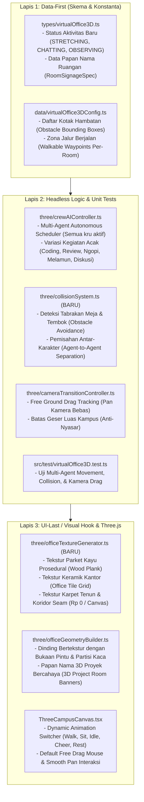

# 📋 Rencana Implementasi: 4 Revisi Utama Kantor Virtual 3D SleepyKoala Studio

> [!NOTE]
> **PANDUAN RAMAH OWNER (NON-CODER):**
> Dokumen ini adalah cetak biru perubahan untuk menyempurnakan Kantor Virtual 3D agar terasa hidup, interaktif, dan berkelas seperti game simulasi kantor indie sungguhan (Sims / Habbo / Kairosoft 3D). Tidak ada biaya tambahan (Rp 0), tidak merusak fitur yang sudah stabil, dan seluruh 779 pengujian otomatis tetap dijaga lulus 100%.

---

## 🎯 1. Deskripsi Tujuan & Latar Belakang Masalah

Berdasarkan tinjauan visual langsung dan evaluasi Owner:
1. **Masalah 1 (Karakter Diam & Animasi Macet):** Saat ini hanya ada 1 karakter yang bergerak lambat, sementara 29 karakter lainnya hanya diam mematung di kursi karena algoritma pemilihan aktivitas hanya memilih 1 orang setiap 6 detik. Selain itu, saat karakter berjalan, animasi tubuh tidak berganti ke animasi jalan (`Walking_A`), melainkan meluncur kaku dalam pose duduk.
2. **Masalah 2 (Belum Ada Collision):** Karakter yang berjalan saat ini berjalan lurus menembus meja, kursi, komputer, tembok, dan menabrak tubuh karakter lain tanpa halangan.
3. **Masalah 3 (Lantai Datar Polos & Tanpa Papan Nama Ruangan):** Lantai kantor masih berupa kotak warna solid polos tanpa tekstur (kayu parket / keramik / karpet), dinding ruangan belum memiliki bukaan pintu dan jendela kaca yang jelas, serta belum ada papan nama 3D yang menegaskan nama proyek di setiap ruangan.
4. **Masalah 4 (Kamera Terkunci di Tengah / Drag Belum Bebas):** Geseran mouse klik-kiri saat ini terkunci pada mode putar (orbit) yang mengitari titik pusat hijau `[0, 0, 0]`, sehingga pengunjung tidak bisa bebas menggeser (drag-to-pan) layar ke sudut kampus mana pun seperti di Google Maps atau game RTS.

---

## 🔍 2. Analisis Risiko & Tabrakan Fitur (Bahasa Awam)

* **Dampak ke Fitur Lain:**
  Perubahan ini difokuskan secara terisolasi pada modul 3D WebGL (`src/components/virtual-office/` dan folder `three/`). Komponen luar seperti formulir pendaftaran 20 tester Google Play, sistem login Admin OTP, sinkronisasi Google Sheets, dan webhook GitHub **sama sekali tidak disentuh** sehingga dijamin 100% aman.
* **Potensi Risiko & Analogi:**
  *Ibarat merenovasi dekorasi interior dan melatih staf di dalam satu gedung kantor:* Jika kita mengubah cara staf berjalan tanpa aturan tabrakan yang rapi, mereka bisa terjebak di dalam tembok (*stuck in wall*). Oleh karena itu, kita membuat sistem "zona aman berjalan" (*walkable boundaries & collision repulsion*) agar karakter otomatis memantul halus jika menyentuh meja atau rekannya.
* **Rekomendasi Aman:**
  Terapkan Alur 3-Lapis (Data-First -> Logic -> UI-Last) dengan pengujian otomatis headless sebelum menyambungkan visualnya ke layar.

---

## 🛡️ User Review Required

> [!IMPORTANT]
> **Skema Kendali Mouse Bebas (Free Drag Navigation):**
> - **Klik-Kiri Drag (atau Geser Layar HP):** Langsung **BEBAS MENGGESER KAMERA (Free Drag & Pan)** ke ruangan mana pun di kampus (menghilangkan rasa "terkunci di tengah").
> - **Klik-Kanan Drag / Tahan Ctrl+Drag / Tombol Toolbar:** Memutar sudut pandang 360° (Orbit).
> - **Scroll Roda Mouse:** Memperbesar / memperkecil pandangan (Smooth Zoom In / Zoom Out) terarah ke posisi kursor.

---

## 🏗️ 3. Rincian Usulan Perubahan Berdasarkan Alur 3-Lapis



---

### LAPIS 1: DATA-FIRST (Skema Tipe & Konstanta)

#### [MODIFY] `src/types/virtualOffice3D.ts`
- Tambahkan status aktivitas kru yang lebih kaya:
  `'WORKING_AT_DESK' | 'WALKING' | 'AT_PANTRY' | 'AT_LOUNGE' | 'SLEEPING' | 'CELEBRATING' | 'STRETCHING' | 'CHATTING' | 'INSPECTING_SCREEN'`
- Tambahkan definisi struktur `RoomSignageSpec` (teks nama proyek, subjudul, ikon/kategori, warna aksen neon).

#### [MODIFY] `src/data/virtualOffice3DConfig.ts`
- Definisikan daftar `ObstacleBox` untuk setiap meja, furnitur, dan dinding pembatas.
- Sediakan titik tujuan acak lokal di dalam masing-masing ruangan (*in-room wander points*), bukan hanya lari ke pantry tengah, sehingga anggota kru bisa bangun dari meja, berjalan ke papan tulis, meregangkan badan, mengunjungi rekan satu tim, lalu duduk kembali.

---

### LAPIS 2: LOGIC SECOND (Logika Pergerakan, Tabrakan, & Kamera)

#### [NEW] `src/components/virtual-office/three/collisionSystem.ts`
- **Sistem Tabrakan Karakter vs Perabotan (Obstacle Repulsion):**
  Fungsi `resolveObstacleCollision(currentPos, nextPos, obstacleBoxes, radius = 0.45)`. Jika posisi baru menyentuh batas meja atau dinding, geser vektor gerak sejajar dinding (*wall sliding*), bukan tembus lurus.
- **Sistem Tabrakan Antar-Karakter (Agent-to-Agent Separation):**
  Fungsi `resolveAgentCollisions(crewList, minDistance = 0.8)`. Mencegah dua karakter berjalan di titik koordinat yang persis sama dengan memberikan dorongan tolak lembut (*gentle repulsive nudge*).
- **Pembatas Kampus (Campus Bounds Clamp):**
  Memastikan koordinat karakter selalu berada di atas pelat lantai kampus.

#### [MODIFY] `src/components/virtual-office/three/crewAIController.ts`
- Ubah `evaluateRandomDecisions` agar tidak hanya mengecek 1 orang setiap 6 detik.
- Setiap kru memiliki *internal timer* / probabilitas independen:
  - 60% waktu: Fokus duduk bekerja di meja (`WORKING_AT_DESK`)
  - 15% waktu: Bangkit berjalan ke sudut ruangan, papan kanban, atau melihat layar TV saham/arcade
  - 10% waktu: Berjalan keluar ruangan menuju Pantry atau Collaboration Lounge
  - 10% waktu: Melakukan peregangan (*stretching*), bersorak (*cheering*), atau berdiskusi dengan rekan kerja
  - 5% waktu: Mengantuk sejenak (*micro-nap*)
- Integrasikan kalkulasi tabrakan `collisionSystem` ke dalam `stepCrewMovement`.

#### [MODIFY] `src/components/virtual-office/three/cameraTransitionController.ts`
- Optimalkan fungsi `applyCameraPan` agar pergeseran koordinat tanah (*ground-plane pan*) persis mengikuti pergerakan kursor mouse tanpa efek pegas yang mengunci kembali ke tengah.
- Berikan batas penjelajahan luas kampus (rentang X: -60 sampai +60, Z: -60 sampai +60).

---

### LAPIS 3: UI-LAST (Visual Hook, Tekstur Prosedural, Papan Nama, & Animasi)

#### [NEW] `src/components/virtual-office/three/officeTextureGenerator.ts`
- Menghasilkan tekstur grafis beresolusi tinggi menggunakan Canvas 2D murni Three.js (**Rp 0, 0 KB bandwidth internet, anti-pecah**):
  1. `createParquetFloorTexture(baseColor, plankColor)`: Serat kayu parket elegan untuk ruangan kantor.
  2. `createOfficeTileTexture(tileColor, groutColor)`: Ubin keramik modern bergaris nat bersih untuk lab POS & game dev.
  3. `createCarpetTexture(carpetColor)`: Tekstur anyaman karpet hangat untuk lounge & pantry.
  4. `createCorridorRunnerTexture()`: Jalur koridor dengan garis batas pemandu neon.

#### [MODIFY] `src/components/virtual-office/three/officeGeometryBuilder.ts`
- Pasang material bertekstur pada lantai masing-masing ruangan (tidak lagi kotak warna solid polos!).
- Tambahkan dinding arsitektur yang kokoh dengan bukaan pintu menghadap koridor utama dan jendela partisi kaca bening.
- Pasang **Papan Nama 3D Bercahaya (Thematic 3D Signage Banners)** di atas setiap pintu masuk ruang kerja proyek:
  - Kotak neon 3D yang menampilkan:
    * `[DOMPETNALAR] • FINTECH WORKSTATION`
    * `[IDLE MASTER] • GAME DEV STUDIO`
    * `[MOBILE KASIR] • RETAIL POS LAB`
    * `[IDLE MINING] • SIMULATION DEPOT`
    * `[WORKLUME] • UNIVERSAL SUITE`
    * `[THE BROKEN ORIGIN] • RPG VAULT`
    * `[PANTRY] • REFRESHMENT BAR`
    * `[COLLABORATION PLAZA] • CENTRAL LOUNGE`

#### [MODIFY] `src/components/virtual-office/three/ThreeCampusCanvas.tsx`
- **Dynamic Animation Blending:**
  Buat pengelola aksi animasi (*Animation Action Manager*). Ketika status karakter berubah dari `WORKING_AT_DESK` ke `WALKING`, hentikan pose duduk dan lakukan transisi halus (*cross-fade*) ke animasi `Walking_A` / `Walking_B`. Saat tiba di tujuan, transisi ke animasi yang sesuai (`Interact`, `Cheer`, `Sit_Chair_Idle`, atau `Idle`).
- **Free Drag-to-Pan sebagai Kendali Utama:**
  - Klik-kiri drag secara otomatis menjadi **Free Drag & Pan** (kamera mengalir mulus ke mana pun mouse ditarik).
  - Klik-kanan drag atau tombol Orbit di toolbar digunakan untuk memutar sudut pandang 360°.
  - Menghilangkan kesan "kamera terkunci di tengah hijau".

---

## 🧪 4. Rencana Verifikasi & Bukti Kualitas (Anti-Fake-Pass)

### Pengujian Otomatis (Headless Unit Tests)
Jalankan pengujian Vitest menyeluruh:
```bash
npm test src/test/virtualOffice3D.test.ts
npm test
```
*Kriteria Lulus:* Seluruh 779+ pengujian wajib 100% PASS tanpa regresi.

### Pemeriksaan TypeScript & Build
```bash
npm run build
```
*Kriteria Lulus:* 0 error TypeScript, 0 warning kritis.

### Verifikasi Visual Mandiri (Protokol Mata AI)
- Ambil screenshot tampilan 3D kanvas setelah perubahan:
  1. Periksa apakah semua karakter memiliki animasi yang aktif dan bergerak secara acak alami.
  2. Periksa apakah karakter tidak lagi menembus meja atau saling tumpang tindih saat berjalan.
  3. Periksa apakah lantai kini memiliki motif tekstur nyata (kayu parket, ubin keramik, karpet) dan papan nama 3D ruangan terpasang jelas.
  4. Uji simulasi drag-pan kamera untuk membuktikan penjelajahan kampus bebas tanpa terkunci di tengah.
