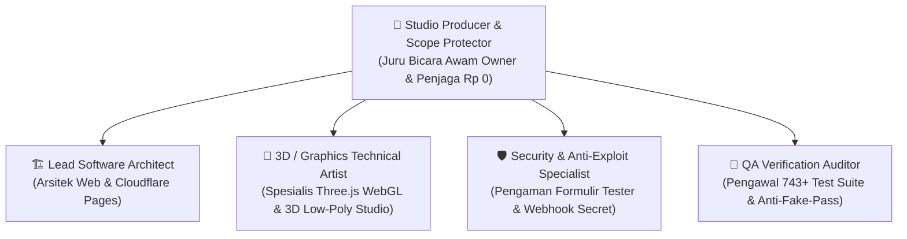

# Rencana Kerja Disetujui (Approved Plan): Tahap 7 & Kantor Virtual 3D

**Proyek:** SleepyKoala Studio — Indie Developer Portfolio  
**Status Proposal:** **DISETUJUI OWNER (APPROVED)**  
**Tanggal:** 2026-11-10  
**Mandat Biaya:** **Rp 0 / $0.00 (Zero-Cost 100% Free Open-Source)**  
**Target Eksekusi:** Percakapan Baru (*New Chat*)

---

## 1. Goal Description & Arahan Owner yang Terkunci

Owner telah menyetujui proposal pengembangan dengan arahan mutlak:
1. **Domain Website:** Menggunakan domain gratis Cloudflare Pages (`*.pages.dev`). Tidak ada pengeluaran uang untuk membeli domain (Anggaran Rp 0).
2. **Pendaftaran Penguji Coba (Tester):** Dibuka terbuka tanpa batas (unlimited) agar semua calon pemain dapat mendaftar closed beta Google Play.
3. **Peningkatan Kantor Virtual:** Menambahkan modul 3D Low-Poly Isometrik interaktif berbasis Three.js WebGL (seperti video TikTok `@cinematicbyaccident`), dengan kontrol putar (orbit) dan zoom, karakter hewan imut di meja kerja studio, mendampingi versi 2.5D piksel yang sudah stabil.
4. **Alur Transisi:** Memperbarui memori proyek di `CURRENT_CHECKPOINT.md` dan `ROADMAP.md`, lalu berpindah ke **New Chat** agar memori AI tetap segar dan anti-halusinasi.

---

## 2. Tim Persona Spesialis yang Ditetapkan

Sesuai aturan tata kelola sistem, pelaksanaan tugas ini akan dipimpin oleh tim spesialis terpadu:



| Persona | Tanggung Jawab Spesifik |
| :--- | :--- |
| **Studio Producer & Scope Protector** | Menjelaskan setiap kemajuan dalam bahasa awam tanpa istilah rumit, memastikan anggaran tetap Rp 0, dan menjaga agar fitur dikerjakan bertahap satu per satu. |
| **Lead Software Architect** | Mengintegrasikan konfigurasi domain gratis Cloudflare Pages dan routing komponen web portofolio. |
| **3D / Graphics Technical Artist** | Merancang dan memprogram kanvas 3D Low-Poly Three.js WebGL (meja studio, karakter hewan duduk, kontrol sentuh/mouse putar & zoom) dengan performa 60 FPS. |
| **Security & Anti-Exploit Specialist** | Mengamankan formulir pendaftaran tester tanpa batas agar terhindar dari spam bot serta menyusun panduan aman untuk webhook secret. |
| **QA Verification Auditor** | Memastikan seluruh 743 pengujian otomatis tetap lulus 100% tanpa ada fitur lama yang rusak (*zero regression*). |

---

## 3. Komponen yang Akan Dikerjakan di New Chat

### Komponen A: Eksekusi Tahap 7 (Persiapan Produksi & Domain Gratis)
- Memastikan konfigurasi rilis Cloudflare Pages siap pada domain gratis `*.pages.dev`.
- Memastikan formulir `RegistrationModal.tsx` melayani pendaftar tester tanpa batas kuota ke backend Google Sheets secara stabil.
- Menyusun panduan praktis bergambar bagi Owner untuk menyalin URL Webhook dan Secret ke GitHub Settings repositori `dompetnalar`.

### Komponen B: Kantor Virtual 3D Studio Isometrik (Three.js WebGL)
- Menggunakan library Three.js bawaan (FOSS/MIT, 0 rupiah).
- Membuat komponen [`LowPoly3DStudioCanvas.tsx`](file:///E:/Antigravity%20Project/indie-developer-portfolio/src/components/virtual-office/LowPoly3DStudioCanvas.tsx):
  - Ruangan studio isometrik: Ruang Ide, Ruang Visual, Ruang Produksi, dan Ruang Didi/Pemilik.
  - Karakter 3D hewan imut yang duduk di meja kerja dengan laptop menyala.
  - Interaksi kamera mulus: Geser mouse/layar sentuh untuk memutar sudut pandang (orbit) dan scroll untuk zoom.
- Menambahkan tombol pemilih tampilan di halaman website: Pengunjung bisa memilih mode **"2.5D Pixel Campus"** atau **"3D Low-Poly Studio"**.

---

## 4. Verification Plan di New Chat

### Automated Tests
```bash
npm test              # 743+ pengujian wajib lulus 100%
npx tsc -b            # 0 kesalahan tipe TypeScript
npm run lint          # 0 kesalahan linter
npm run security:scan # 0 kebocoran rahasia
```

### Manual Verification
1. Uji visual kanvas 3D di browser laptop & HP: pastikan putaran dan zoom mulus (60 FPS) tanpa crash.
2. Uji pendaftaran tester di website: pastikan data email tester tersimpan rapi di Google Sheets tanpa kendala batasan kuota.
