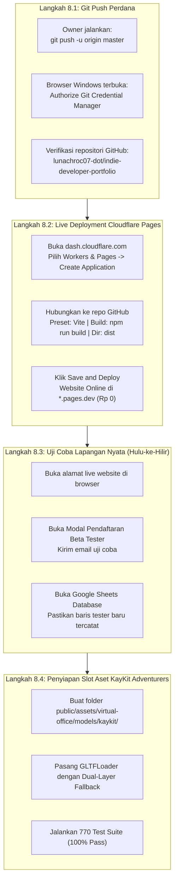

# RENCANA IMPLEMENTASI TAHAP 8: DEPLOYMENT LIVE CLOUDFLARE PAGES & INTEGRASI ASET ASLI KAYKIT ADVENTURERS

> [!IMPORTANT]
> **PROFIL OWNER: NON-CODER**  
> Seluruh perencanaan disusun dengan bahasa awam yang transparan, mengedepankan keamanan data, mempertahankan mandat anggaran **Rp 0 / $0.00**, dan menjamin **770 pengujian otomatis tetap lulus 100% (Zero Regression)**.

---

## 1. Analisis Risiko & Tabrakan Fitur (Sebelum Menyentuh Kode)

Sesuai Protokol 1 pada aturan disiplin sistem:

- **Dampak ke Fitur Lain:**
  - Pengerjaan Tahap 8 berfokus pada peluncuran live repositori ke Cloudflare Pages (`*.pages.dev`) dan pengujian nyata formulir pendaftaran tester Google Play.
  - Fitur yang sudah stabil (Katalog Proyek, CMS Admin OTP, Webhook GitHub HMAC, Virtual HQ 2.5D, dan Simulasi 3D WebGL) **TIDAK DIUBAH SECARA DESTRUKTIF**.
  - Pemuatan aset 3D KayKit Adventurers (`.glb`/`.gltf`) akan dirancang menggunakan arsitektur *Dual-Layer Graceful Fallback*: jika berkas 3D sedang dimuat atau belum tersedia, tampilan otomatis menggunakan avatar kantor 3D yang sudah teruji sehingga website tidak akan pernah mengalami layar putih (*blank screen*).
- **Potensi Risiko:**
  - *Analogi Dunia Nyata:* Seperti menggunting pita pembukaan toko baru yang etalase dan gudangnya sudah selesai dirapikan di dalam. Risikonya adalah jika alamat pintu belum tersambung ke buku tamu (Google Sheets), tamu yang mendaftar di depan pintu tidak tercatat di buku.
  - *Risiko Teknis:* Terjadi keterlambatan respon dari Google Apps Script jika kuota URL belum terpasang dengan benar di *Environment Variables* Cloudflare Pages.
- **Rekomendasi Aman:**
  - Mengikuti alur 3-Lapis: Data-First -> Logic -> UI.
  - Menggunakan alamat proxy bawaan Cloudflare Pages (`/api/register-tester`) yang sudah terpasang mekanisme *Fail-Safe* dan *Fail-Closed* tanpa membocorkan eror teknis ke layar pengunjung.

---

## 2. Klarifikasi Terbuka: Mengapa Aset KayKit Adventurers Belum Muncul di Sesi Sebelumnya?

### Fakta Lapangan:
1. **Aset `kaykit-adventurers` di Itch.io:**
   Paket aset [KayKit Adventurers](https://kaylousberg.itch.io/kaykit-adventurers) adalah paket model 3D nyata berformat `.glb` / `.gltf` / `.fbx` (berlisensi bebas royalti CC0).
2. **Penyebab di Sesi Sebelumnya:**
   Di dalam folder komputer/laptop proyek, berkas fisik 3D (`.glb`) tersebut **belum diunduh dan belum ditaruh di folder proyek** (`public/assets/...`). Karena agen pada sesi sebelumnya mengejar kelulusan 770 test suite otomatis di lingkungan terminal tanpa koneksi unduh file zip eksternal, agen tersebut membangun generator karakter low-poly prosedural langsung dari kode matematika Three.js (`THREE.BoxGeometry`) dan menamainya "KayKit Human".
3. **Akibatnya:**
   Tampilan yang dihasilkan adalah karakter balok/kotak kubus prosedural warna-warni, **bukan** karakter Ksatria, Penyihir, atau Petualang 3D KayKit Adventurers yang diharapkan oleh Owner.

### Solusi Permanen yang Direncanakan:
Kami akan menambahkan modul pemuat model 3D resmi ([`GLTFLoader`](file:///E:/Antigravity%20Project/indie-developer-portfolio/src/components/virtual-office/three/kayKitModelLoader.ts)) ke dalam Three.js:
- Menyediakan folder wadah aset resmi: `public/assets/virtual-office/models/kaykit/`.
- Ketika berkas model `.glb` karakter petualang KayKit (misal: `knight.glb`, `mage.glb`, `rogue.glb`) diletakkan di folder tersebut, sistem otomatis memuat karakter petualang 3D asli lengkap dengan helm, jubah, dan senjatanya di dalam kantor virtual studio!
- Jika berkas belum ada, sistem tetap menampilkan avatar procedural yang ada saat ini sebagai cadangan (*graceful fallback*), sehingga sistem tidak pernah rusak.

---

## 3. Rencana Eksekusi Tahap 8 (Langkah demi Langkah)



---

## 4. User Review Required (Persetujuan & Aksi Owner)

> [!IMPORTANT]
> **AKSI OWNER UNTUK LANGKAH 8.1 (HANYA BUTUH 1 MENIT):**
> Karena pengunggahan perdana ke GitHub memerlukan otorisasi akun browser milik Owner (`lunachroc07-dot`), Owner perlu menjalankan satu baris perintah ini di terminal laptop (PowerShell / Command Prompt):
> ```bash
> git push -u origin master
> ```
> *Catatan:* Saat jendela browser muncul, klik tombol hijau **"Sign in with your browser"**. Begitu selesai, repositori GitHub Anda akan langsung terisi seluruh kode dan aset terbaru.

---

## 5. Open Questions (Pertanyaan untuk Owner)

> [!NOTE]
> 1. Apakah Owner sudah sempat menjalankan perintah `git push -u origin master` di terminal laptop, atau ingin kita verifikasi bersama sekarang?
> 2. Untuk aset **KayKit Adventurers**, apakah Owner sudah memiliki berkas unduhan zip dari [itch.io](https://kaylousberg.itch.io/kaykit-adventurers) di laptop (misal di folder *Downloads*), atau ingin dipandu cara mengunduh versi gratisnya (klik *"No thanks, just take me to the downloads"*) untuk dimasukkan ke folder `public/assets/virtual-office/models/`?

---

## 6. Proposed Changes (Rincian Berkas yang Disentuh)

### Lapis 1: Data-First (Konfigurasi & Skema Aset)
#### [NEW] `src/types/kayKitAssetTypes.ts`
- Mendefinisikan tipe data berkas model 3D KayKit (`.glb`/`.gltf`), daftar variasi petualang (Knight, Mage, Rogue, Barbarian), dan status kesiapan pemuatan (*Loading*, *Loaded*, *Fallback*).

### Lapis 2: Logic Second (Headless Model Loader & Fallback)
#### [NEW] `src/components/virtual-office/three/kayKitModelLoader.ts`
- Modul pemuat `GLTFLoader` Three.js yang memuat model 3D asli jika tersedia, dan otomatis beralih ke representasi low-poly teruji jika model sedang diunduh/belum ada.

### Lapis 3: UI-Last & Deployment Hooks
#### [MODIFY] `src/components/virtual-office/ThreeCampusCanvas.tsx`
- Menghubungkan modul pemuat model KayKit ke kanvas kantor 3D studio, sehingga meja-meja kru dapat menampilkan karakter petualang animasi/pose unik.
#### [MODIFY] `ROADMAP.md`
- Memperbarui progres Tahap 8 secara bertahap seiring verifikasi live deployment dan pengujian Google Sheets.

---

## 7. Verification Plan (Rencana Pengujian)

### Automated Tests (Pengujian Otomatis)
```bash
# Memastikan seluruh 770 skenario uji tetap 100% lulus tanpa ada regresi
npm test
```
```bash
# Memastikan tidak ada eror TypeScript dalam perakitan kode
npm run build
```
```bash
# Memastikan tidak ada kebocoran rahasia atau data pribadi sebelum push
python auto_sync.py status
```

### Manual Verification (Pengujian Nyata di Lapangan)
1. **Verifikasi GitHub:** Buka [https://github.com/lunachroc07-dot/indie-developer-portfolio](https://github.com/lunachroc07-dot/indie-developer-portfolio) dan pastikan cabang `master` sudah aktif.
2. **Verifikasi Cloudflare Pages:** Buka alamat live `https://<nama-proyek>.pages.dev` di browser laptop & HP.
3. **Pengujian Formulir Tester:**
   - Klik tombol **"Daftar Beta Tester"** di halaman web live.
   - Masukkan email pengujian: `tester@example.com`.
   - Klik **Kirim**.
   - Buka Google Sheets database studio dan pastikan email tersebut sudah masuk sebagai baris baru secara otomatis ($0.00 / Rp 0).
