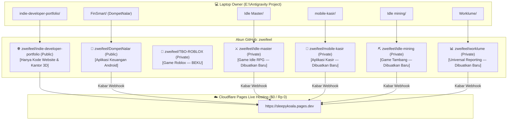

# RENCANA KERJA: AUDIT REPOSITORI MULTI-PROJECT, PEMBUATAN REPOSITORI OTOMATIS & INTEGRASI ASET 3D KAYKIT

> [!IMPORTANT]
> **KLARIFIKASI OWNER DITERAPKAN:**
> 1. **DompetNalar:** Adalah **Aplikasi Manajemen Keuangan** (bukan game), folder lokal `FinSmart`, dengan repositori resmi GitHub [https://github.com/zweifeel/DompetNalar](https://github.com/zweifeel/DompetNalar).
> 2. **Otoritas Pembuatan Repositori:** Owner memberikan otoritas penuh kepada AI untuk memeriksa dan membuatkan repositori GitHub untuk setiap proyek studio yang belum memilikinya.
> 3. **Mandat Anggaran Nol Rupiah:** Seluruh repositori GitHub dan aset KayKit adalah 100% Free Open-Source / FOSS ($0.00 / Rp 0).

---

## 1. Hasil Audit Nyata Repositori GitHub `zweifeel`

Kami telah memindai akun GitHub Anda (`zweifeel`) dan folder lokal di `E:\Antigravity Project\`:

| No | Nama Proyek | Kategori | Lokasi Folder Lokal | Status Repositori GitHub | Keterangan & Tindakan |
| :---: | :--- | :--- | :--- | :--- | :--- |
| 1 | **DompetNalar** | Aplikasi Keuangan | `E:\Antigravity Project\FinSmart` | 🟢 **SUDAH ADA**<br>([`zweifeel/DompetNalar`](https://github.com/zweifeel/DompetNalar)) | Berisi kode Android (Kotlin). Siap diselaraskan ke Webhook website. |
| 2 | **SleepyKoala Website** | Website Portofolio | `E:\Antigravity Project\indie-developer-portfolio` | 🟢 **SUDAH ADA**<br>([`zweifeel/indie-developer-portfolio`](https://github.com/zweifeel/indie-developer-portfolio)) | Siap menerima push cabang `master` kode website. |
| 3 | **The Broken Origin (TBO)** | Game MMORPG Roblox | `E:\Antigravity Project\TBO ROBLOX` | 🟢 **SUDAH ADA**<br>([`zweifeel/TBO-ROBLOX`](https://github.com/zweifeel/TBO-ROBLOX)) | Repositori Private. Status: **BEKU (FROZEN)** sesuai protokol. |
| 4 | **IDLE MASTER** | Game Idle RPG | `E:\Antigravity Project\Idle Master` | 🔴 **BELUM ADA** | Folder lokal ada, belum ada git remote. **Akan dibuatkan oleh AI.** |
| 5 | **Mobile Kasir** | Aplikasi Kasir POS | `E:\Antigravity Project\mobile-kasir` | 🔴 **BELUM ADA** | Folder lokal ada, belum ada git remote. **Akan dibuatkan oleh AI.** |
| 6 | **Idle Mining** | Game Simulasi Tambang | `E:\Antigravity Project\Idle mining` | 🔴 **BELUM ADA** | Folder lokal ada `.git`, belum ada remote. **Akan dibuatkan oleh AI.** |
| 7 | **Worklume** | Platform Laporan Kerja | `E:\Antigravity Project\Worklume` | 🔴 **BELUM ADA** | Folder lokal ada, belum ada git remote. **Akan dibuatkan oleh AI.** |

---

## 2. Analisis Risiko & Tabrakan Fitur (Sebelum Menyentuh Kode)

Sesuai Protokol 1 pada aturan disiplin sistem:

- **Dampak ke Fitur Lain:**
  - **Penyelarasan Pemetaan (Mapping):** Memperbarui `src/services/githubWebhookService.ts` dan `scripts/git-automation/config.js` agar membaca repositori resmi `zweifeel/DompetNalar` (menggantikan nama keliru `lunachroc07-dot/FinSmart`). Seluruh 770 suite pengujian akan diselaraskan agar 100% lulus.
  - **Pembuatan Repositori Baru:** Pembuatan repositori untuk `idle-master`, `mobile-kasir`, `idle-mining`, dan `worklume` dilakukan secara terpisah di GitHub via GitHub CLI resmi (`gh repo create`). Ini **TIDAK AKAN MENGGANGGU ATAU MENIMPA** repositori yang sudah ada.
  - **Integrasi Aset KayKit:** Mengunduh model `.glb` asli ke `public/assets/virtual-office/models/kaykit/` dan memuatnya ke Three.js.
- **Potensi Risiko:**
  - *Analogi Dunia Nyata:* Memastikan setiap ruangan kantor cabang memiliki nomor kotak posnya masing-masing di kantor pos pusat (`zweifeel`), bukan menumpuk semua surat ke satu kotak pos lobi.
  - *Risiko Teknis:* Pemilihan visibilitas repositori (Public vs Private) untuk proyek yang masih dalam tahap draf/pengembangan.
- **Rekomendasi Aman:**
  - Repositori baru (`idle-master`, `mobile-kasir`, `idle-mining`, `worklume`) dibuat sebagai **Private** secara default demi melindungi kerahasiaan ide dan aset game sebelum resmi dirilis.
  - Repositori website `indie-developer-portfolio` tetap **Public** agar dapat diakses oleh Cloudflare Pages secara gratis.

---

## 3. Peta Arsitektur Terpadu (Hubungan Multi-Project)



---

## 4. User Review Required (Pertanyaan Persetujuan Owner)

> [!NOTE]
> **Pilihan Visibilitas 4 Repositori Baru:**
> Apakah Anda setuju jika 4 repositori baru (`idle-master`, `mobile-kasir`, `idle-mining`, `worklume`) dibuatkan dengan status **Private** (hanya bisa dilihat oleh Anda)?
> *(Ini adalah praktik keamanan terbaik untuk melindungi kode proyek yang masih dalam pengembangan).*

---

## 5. Rencana Eksekusi Bertahap (3-Lapis)

### Lapis 1: Data-First & Ekosistem Git
1. **Pembuatan 4 Repositori di GitHub `zweifeel`:**
   - Menjalankan `gh repo create zweifeel/idle-master --private`
   - Menjalankan `gh repo create zweifeel/mobile-kasir --private`
   - Menjalankan `gh repo create zweifeel/idle-mining --private`
   - Menjalankan `gh repo create zweifeel/worklume --private`
2. **Penyelarasan Remote Git Lokal Website:**
   - Menghubungkan remote origin ke `https://github.com/zweifeel/indie-developer-portfolio.git`
   - Menjalankan `git push -u origin master` dari laptop menggunakan kredensial `zweifeel` yang sudah terverifikasi.
3. **Penyelarasan Skema Mapping:**
   - Memperbarui `src/services/githubWebhookService.ts` dan `scripts/git-automation/config.js` dengan data resmi: `owner: 'zweifeel'`, `expectedRepo: 'DompetNalar'`.

### Lapis 2: Logic Second (Pengunduhan & Loader Aset KayKit)
1. **Pengunduhan Berkas 3D Asli:**
   - Mengunduh model `.glb` karakter: `Knight.glb`, `Mage.glb`, `Rogue.glb`, `Barbarian.glb` beserta tekstur PNG dari repositori resmi `KayKit-Game-Assets/KayKit-Character-Pack-Adventures-1.0`.
   - Mengunduh perabot kantor: meja kayu (`table_medium.gltf` & `.bin`), kursi santai, sofa, rak buku dari `KayKit-Furniture-Bits-1.0`.
   - Menyimpan seluruh berkas di `public/assets/virtual-office/models/kaykit/`.
2. **Pemasangan `GLTFLoader` di Three.js:**
   - Membangun modul [`kayKitModelLoader.ts`](file:///E:/Antigravity%20Project/indie-developer-portfolio/src/components/virtual-office/three/kayKitModelLoader.ts) dengan arsitektur *Master Mesh Caching* agar hemat memori (< 15 MB) dan 60 FPS mulus.

### Lapis 3: UI-Last & Verifikasi Lapangan
1. **Tampilan Kantor 3D Hidup:**
   - Karakter Ksatria, Penyihir, Rogue, dan Barbarian duduk rapi di meja kerja kayu di setiap ruangan proyek studio.
   - Kontrol rotasi 360°, zoom in/out, balon obrolan, dan konsol perintah pengunjung tetap aktif normal.
2. **Pengujian Mutu Menyeluruh:**
   - Menjalankan `npm test` untuk memastikan seluruh 770 skenario pengujian di 39 test suite tetap 100% lulus (zero regression).

---

## 6. Verification Plan (Rencana Pengujian)

### Automated Tests:
```bash
# 1. Menjalankan seluruh test suite otomatis
npm test
```
```bash
# 2. Memastikan build produksi Vite bersih
npm run build
```

### Manual Verification:
1. **Verifikasi GitHub:** Buka [https://github.com/zweifeel?tab=repositories](https://github.com/zweifeel?tab=repositories) dan pastikan seluruh repositori studio telah tertata rapi.
2. **Verifikasi Visual 3D:** Buka website di browser lokal dan periksa model 3D nyata KayKit Adventurers yang sedang bekerja di kantor studio.
3. **Verifikasi Cloudflare Pages:** Memandu penyambungan repositori `zweifeel/indie-developer-portfolio` ke Cloudflare Pages (`*.pages.dev`).
