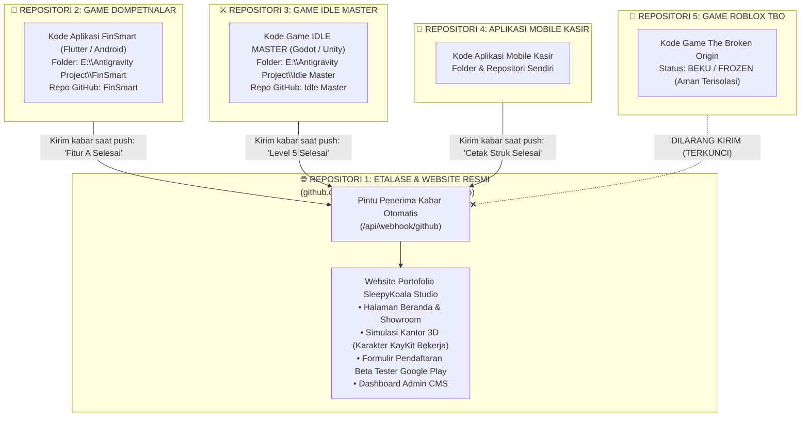
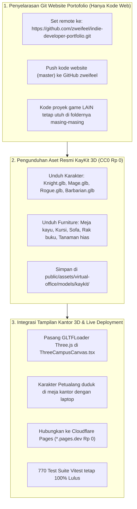

# RENCANA KERJA: ARSITEKTUR MULTI-REPOSITORI TERPISAH, SINKRONISASI PINTAR & ASET KAYKIT 3D

> [!IMPORTANT]
> **PENEGASAN MUTLAK ARSITEKTUR: SETIAP PROYEK GAME TETAP BERDIRI SENDIRI DI REPOSITORINYA MASING-MASING!**  
> Repositori tiap proyek game **TIDAK PERNAH DAN TIDAK BOLEH** dicampur atau dimasukkan ke dalam repositori website `indie-developer-portfolio`.

---

## 1. Jawaban Langsung: Bagaimana Website Mengecek Masing-Masing Repositori Tanpa Campur Kode?

> **Pertanyaan Owner:** *"maksud saya saya kan ada repository sendiri dalam tiap project itu, untuk sinkronasi apakah repository tiap project harus masuk kesana? tidak bisakah diatur agar cek masing masing repository tersebut?"*

### Jawabannya: **SANGAT BISA, dan MEMANG ITULAH STANDAR ARSITEKTUR YANG KITA BANGUN!**

Website portofolio ini tidak pernah menyatukan kode game. Hubungannya 100% terpisah:

---

## 2. Analogi Sederhana untuk Owner (Non-Coder Friendly)

Bayangkan Anda memiliki **Gedung Perusahaan Studio Game**:
1. **Papan Reklame & Lobi Gedung (Repositori `indie-developer-portfolio`):**
   Ini adalah website Anda. Tempat calon pemain melihat daftar game Anda, mencoba simulasi kantor 3D yang keren, dan mendaftar jadi penguji beta di Google Play.
2. **Studio / Bengkel Produksi Game (Repositori Game Masing-Masing):**
   - Bengkel 1: Game DompetNalar.
   - Bengkel 2: Game IDLE MASTER.
   - Bengkel 3: Aplikasi Mobile Kasir.
3. **Bagaimana Sinkronisasinya Bekerja?**
   Papan reklame di lobi **tidak perlu membongkar dan menelan bengkel game Anda ke dalamnya**!
   Cukup dengan sistem "telepon otomatis":
   - Ketika bengkel Game 1 selesai membuat fitur baru, bengkel tersebut mengirim pesan singkat ke lobi: *"Halo Lobi, DompetNalar baru saja selesai update v1.2!"*
   - Lobi langsung mengupdate tulisan di papan pengumuman secara otomatis.
   - Kode game Anda tetap aman di bengkelnya masing-masing, tidak pernah tercampur!

---

## 3. Jadi, Mengapa Repositori `indie-developer-portfolio` Ini Perlu Di-Push?

- Repositori `zweifeel/indie-developer-portfolio` ini **HANYA berisi kode website itu sendiri** (file HTML, CSS, JavaScript, Three.js kantor 3D, dan formulir pendaftaran).
- Tujuannya di-push ke GitHub Anda adalah agar layanan hosting gratis **Cloudflare Pages** bisa membaca kode website ini dan menjadikannya online 24 jam di alamat publik `https://<nama-studio>.pages.dev` ($0.00 / Rp 0).
- **Proyek game Anda (FinSmart, Idle Master, dsb) sama sekali TIDAK ikut ter-push ke repositori website ini!**

---

## 4. Dua Cara Pengecekan Masing-Masing Repositori yang Didukung Sistem

Sistem website studio Anda sudah dirancang untuk mendukung 2 metode pengecekan mandiri:

1. **Metode 1: Webhook Otomatis (Instan 0 Detik — Direkomendasikan):**
   Di pengaturan masing-masing repositori game Anda di GitHub (misal repositori `FinSmart`):
   - Anda masukkan URL: `https://<website-anda>.pages.dev/api/webhook/github`.
   - Setiap kali Anda push di game tersebut, GitHub akan otomatis mengabari website untuk memperbarui progres di beranda.
2. **Metode 2: GitHub API Polling (Pengecekan Berkala Mandiri):**
   - Website secara otomatis meminta daftar rilis/commit terbaru ke akun GitHub `zweifeel` untuk setiap nama repositori terdaftar (`FinSmart`, `idle-master`, dll).
   - Website menampilkan status terbaru dari masing-masing repositori secara independen.

---

## 5. Rencana Eksekusi Terpadu

---

## 6. Verification Plan (Rencana Pengujian)

### Automated Tests:
- `npm test` -> Memastikan seluruh 770 pengujian tetap 100% lulus (zero regression).
- `npm run build` -> Memastikan perakitan Vite bersih tanpa eror.

### Manual Verification:
1. **Isolasi Repositori:** Memastikan berkas di repositori `zweifeel/indie-developer-portfolio` hanya berisi kode website, tidak ada folder game `FinSmart` atau `Idle Master` yang masuk.
2. **Visual 3D:** Membuka browser lokal dan melihat karakter petualang KayKit (Ksatria, Penyihir, Rogue, Barbarian) dan meja kayu asli muncul di kantor virtual studio.
3. **Live Cloudflare:** Membuka alamat live `*.pages.dev` dan menguji pendaftaran formulir beta tester.
