# RENCANA KERJA TAHAP 9: VERIFIKASI CMS CHANGELOG GITHUB, PANDUAN CUSTOM DOMAIN Rp 0, & DEPLOY LIVE KANTOR 3D KE CLOUDFLARE PAGES

> [!IMPORTANT]
> **ANALISIS KHUSUS ATAS PERTANYAAN SCREENSHOT OWNER:**
> **"Apakah revisi terbaru masih belum di-deploy?"**
> **JAWABAN: YA, TEPAT SEKALI! REVISI TERBARU MEMANG BELUM DI-DEPLOY KE CLOUDFLARE PAGES.**
> 
> *Penjelasan Bahasa Awam:*
> Pada sesi sebelumnya, perbaikan 4 Poin Kantor Virtual 3D (30 kru bergerak aktif & beranimasi, anti-tabrak furniture, tekstur lantai & dinding berpintu/kaca, papan nama 3D bercahaya, dan navigasi drag-pan bebas) telah selesai 100%, lulus 781 pengujian otomatis, dan sudah di-push ke repositori GitHub master.
> 
> Namun, website produksi Anda di Cloudflare Pages (`https://sleepykoala.pages.dev`) menggunakan jalur **Direct Upload** (bukan otomatis build dari GitHub). Artinya, Cloudflare Pages hanya akan berubah tampilannya setelah kita menjalankan perintah unggah live (`npm run deploy:live`).
> Karena perintah deploy live tersebut belum dijalankan untuk commit terbaru, website `sleepykoala.pages.dev` saat ini masih menampilkan versi 5 hari lalu (lantai beige/kotak hijau polos, dinding belum bertekstur, dan karakter belum aktif bergerak).
> 
> **Langkah pertama setelah rencana ini disetujui adalah langsung mengeksekusi deployment live ke `sleepykoala.pages.dev` agar hasil visual terbaru langsung aktif di internet!**

---

## 1. Analisis Risiko & Tabrakan Fitur (Bahasa Awam Non-Coder — Protokol 1)

### A. Dampak ke Fitur Lain
1. **Fitur yang Disentuh:**
   - **Deployment Live Cloudflare Pages (`sleepykoala.pages.dev`):** Mengunggah aset web terbaru (`dist/`) hasil kompilasi revisi 4 Poin Kantor 3D ke Cloudflare Pages produksi.
   - **Verifikasi Alur CMS Web Admin (`/admin`):** Menguji alur masuk draf changelog dari Webhook GitHub, review oleh Admin, hingga penerbitan publik di etalase proyek (`/projects/:slug`).
   - **Panduan Custom Domain Studio:** Pembuatan dokumen panduan resmi non-coder (`PANDUAN_PENYAMBUNGAN_CUSTOM_DOMAIN_STUDIO.md`) tanpa merusak domain gratis default `sleepykoala.pages.dev`.
2. **Fitur Stabil yang Dijamin 100% Aman:**
   - Seluruh 781 pengujian otomatis (41 test suites) dijamin tetap 100% lulus.
   - Backend database Google Sheets, pendaftaran tester Google Play, dan login OTP Admin tetap berjalan tanpa gangguan.
   - Proyek game Roblox *The Broken Origin* tetap dikunci beku (**FROZEN / TIDAK DISENTUH**).

### B. Potensi Risiko & Analogi Kehidupan Nyata
- **Analogi Toko & Etalase Kaca:** Bayangkan sebuah toko buku. Di bengkel kerja (laptop lokal), kita sudah mendesain ruangan baru yang megah dengan lampu neon 3D dan staf yang bergerak ramah. Jika pintu toko depan (`sleepykoala.pages.dev`) belum dibuka dan perabotan baru belum diangkut ke toko fisik (belum di-deploy), pengunjung yang lewat di jalan raya masih melihat etalase lama. Dengan menjalankan `deploy:live`, seluruh perabotan dan lampu baru langsung dipasang di toko utama.
- **Risiko Draf Rahasia Bocor:** Jika alur webhook GitHub langsung mempublikasikan catatan commit programmer ke etalase publik tanpa melewati persetujuan Admin, catatan teknis rahasia atau bug yang belum siap bisa terbaca pengunjung umum. Sistem kita telah mengunci bahwa **semua event masuk wajib berstatus DRAFT** dan baru bisa tayang setelah Admin menekan tombol "Publikasikan".

### C. Rekomendasi Arsitektur Aman ($0.00 / Rp 0)
1. **Mandat Anggaran Rp 0:** Penambahan custom domain di Cloudflare Pages adalah $0.00 (gratis SSL otomatis, gratis bandwidth, gratis proteksi DDoS Cloudflare). Pengguna tetap bebas menggunakan domain bawaan `sleepykoala.pages.dev` tanpa perlu mengeluarkan uang sepeser pun.
2. **Prinsip 3-Lapis (Data-First -> Logic -> UI-Last):**
   - *Lapis 1 (Data-First):* Payload webhook GitHub divalidasi skemanya dan disimpan dengan atribut `publicationStatus: 'draft'`.
   - *Lapis 2 (Logic):* Layanan `cmsProgressService.ts` memproses transisi draf menjadi terbit (`transitionItemPublicationStatus`).
   - *Lapis 3 (UI-Last):* Halaman Admin CMS (`AdminProgressManager.tsx`) menyediakan antarmuka visual untuk me-review draf, dan halaman detail proyek (`ProjectDetailPage.tsx`) hanya menampilkan changelog yang statusnya sudah terbit (`PUBLISHED`).

---

## 2. Rincian Pelaksanaan 3 Tugas Utama

```mermaid
flowchart TD
    subgraph DEPLOY["🚀 1. Live Deployment Kantor 3D"]
        BUILD["Kompilasi TypeScript & Vite Build<br/>(dist/ bundle terbaru)"]
        CF_UPLOAD["Cloudflare Pages Direct Upload<br/>(wrangler pages deploy dist --project-name=sleepykoala --branch=main)"]
        LIVE_CHECK["Verifikasi Live Website<br/>https://sleepykoala.pages.dev"]
        BUILD --> CF_UPLOAD --> LIVE_CHECK
    end

    subgraph CMS_FLOW["⚙️ 2. Verifikasi Alur CMS Changelog GitHub"]
        WH["GitHub Webhook Event Masuk<br/>(Push commit baru dari repo game)"]
        DRAFT["Disimpan Otomatis sebagai DRAFT<br/>(Aman: Tidak bocor ke publik)"]
        ADMIN_REVIEW["Admin Review di /admin<br/>(Tab PROGRESS -> EVENTS)"]
        PUBLISH["Admin Klik Publikasikan<br/>(Status berubah menjadi PUBLISHED)"]
        ETALASE["Tampil di Etalase Publik<br/>(/projects/:slug linimasa perkembangan)"]
        WH --> DRAFT --> ADMIN_REVIEW --> PUBLISH --> ETALASE
    end

    subgraph DOMAIN["🌐 3. Panduan Custom Domain Rp 0"]
        DOC["Panduan Lengkap Non-Coder<br/>Artifact/PANDUAN_PENYAMBUNGAN_CUSTOM_DOMAIN_STUDIO.md"]
        DNS["Opsi Gratis Subdomain vs Domain Kustom Pribadi"]
        DOC --> DNS
    end
```



---

## 3. Rencana Komponen & File yang Dikerjakan

### Komponen 1: Eksekusi Live Deploy ke Cloudflare Pages
- **Perintah Eksekusi:** `npm run deploy:live`
- **Tindakan:** Mengunggah seluruh aset WebGL Kantor Virtual 3D terbaru, tekstur, model KayKit, dan antarmuka responsif langsung ke `https://sleepykoala.pages.dev`.
- **Verifikasi:** Mengecek response header dan ketersediaan bundle live di internet.

### Komponen 2: Uji Otomatis & Simulasi Alur CMS Changelog (Stage 9)
- **File Uji Baru:** `src/test/cmsChangelogFullFlowStage9.test.tsx` [NEW]
  - *Skenario 1:* Simulasi pengiriman push event commit dari repositori GitHub game (`mobile-kasir` / `dompetnalar`).
  - *Skenario 2:* Membuktikan item tersimpan dengan status `draft` dan TIDAK muncul di daftar publik (`fetchPublicProjectProgress`).
  - *Skenario 3:* Membuktikan Admin dapat melihat antrean draf tersebut di antarmuka Web Admin (`AdminProgressManager`).
  - *Skenario 4:* Membuktikan Admin dapat menyunting judul/deskripsi dan mengubah status publikasi menjadi `published`.
  - *Skenario 5:* Membuktikan changelog yang sudah dipublikasikan langsung tampil di halaman detail etalase publik (`ProjectDetailPage`).

### Komponen 3: Dokumen Panduan Custom Domain Resmi Studio ($0.00 / Rp 0)
- **File Artefak:** `Artifact/PANDUAN_PENYAMBUNGAN_CUSTOM_DOMAIN_STUDIO.md` [NEW]
  - Panduan ramah non-coder langkah demi langkah (dengan diagram dan analogi) cara menambahkan domain pribadi (misal `sleepykoalastudio.com` jika Owner sudah memilikinya) ke Cloudflare Pages tanpa tambahan biaya hosting sama sekali (Rp 0).
  - Menjelaskan perbedaan DNS CNAME / A record secara visual tanpa jargon membingungkan.
  - Memastikan konfigurasi `app-ads.txt` dan pendaftaran Google Play tester tetap aman jika domain kustom diaktifkan.

---

## 4. Rencana Verifikasi (Verification Plan)

### A. Uji Otomatis (Automated Tests)
1. Menjalankan seluruh test suites Vitest:
   ```bash
   npm test
   ```
   *Target: 781+ tes lulus 100% tanpa ada satu pun yang gagal.*
2. Menjalankan pemindai keamanan & privasi:
   ```bash
   node scripts/security-scan.js
   node scripts/privacy-scan.js
   node scripts/check-file-policy.js
   ```
   *Target: 0 kebocoran kredensial, 0 pelanggaran privasi, 0 file ilegal.*

### B. Verifikasi Manual (Manual Verification)
1. **Live Website Check:** Buka `https://sleepykoala.pages.dev` di browser dan periksa bahwa lantai bertekstur kayu/keramik/karpet, dinding berpintu 2.8m, papan nama 3D bercahaya, dan 30 kru bergerak aktif sudah tampil nyata.
2. **Admin CMS Review:** Masuk ke `/admin` -> tab `PROGRESS` -> `EVENTS` untuk melihat antarmuka manajemen changelog draf.
3. **Penyimpanan Status:** Jalankan `python auto_sync.py save "Tahap 9: Verifikasi CMS Changelog, Panduan Custom Domain, & Deploy Live Kantor 3D"` untuk mengunci checkpoint ke memori proyek.
