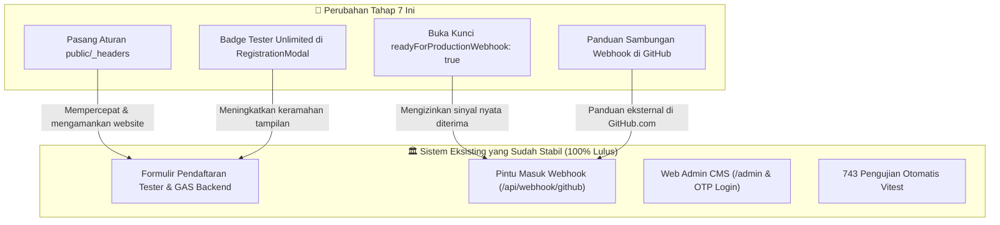

# RENCANA KERJA IMPLEMENTASI REVISI: TAHAP 7 (SINKRONISASI GITHUB & DEPLOY WEBSITE)

> [!NOTE]
> **Identitas Dokumen & Arahan Strategis Owner:**
> - **Proyek:** SleepyKoala Studio — Indie Developer Portfolio
> - **Fokus Saat Ini:** **Tahap 7 — Penuntasan Sinkronisasi GitHub & Persiapan Peluncuran (Deploy) Website**
> - **Penjadwalan Kantor Virtual 3D:** **DITUNDA KE TAHAP AKHIR** (dieksekusi di perangkat baru / sesi baru setelah sinkronisasi & deploy selesai sempurna dan checkpoint baru dibuat).
> - **Anggaran Biaya:** **Rp 0 / $0.00 (Zero-Cost 100% Free Open-Source & Cloudflare/Google Free Tier)**
> - **Status Pengujian Awal:** 743 / 743 Pengujian Otomatis Lulus (100% PASS)

---

## 1. Goal Description (Tujuan Pengerjaan Baru)

Sesuai arahan Owner, kita memfokuskan seluruh tenaga untuk menyelesaikan sistem inti dan meluncurkannya ke internet terlebih dahulu:

1. **Aktivasi Prasyarat Sinkronisasi GitHub ke Website (`dompetnalar` / `FinSmart`):**
   - Membuka kunci gerbang produksi (`readyForProductionWebhook: true`) pada pemetaan resmi `githubWebhookService.ts` dan `config.js`.
   - Mengubah status repositori game dari `VISIBILITY_UNVERIFIED` menjadi `VERIFIED (PRIVATE)` agar pintu Cloudflare Pages siap menerima laporan commit asli dari GitHub tanpa ditahan satpam.
2. **Pemasangan Aturan Header Keamanan & Kecepatan Cache Cloudflare Pages (`public/_headers`):**
   - Memasang file aturan resmi Cloudflare Pages untuk mengaktifkan proteksi dari serangan injeksi web (`nosniff`, `DENY`, `strict-origin`).
   - Mengatur caching berkas statis di folder `/assets/*` (1 tahun cache immutable) agar website memuat super cepat di HP maupun laptop tanpa memakan kuota berulang kali.
3. **Penegasan Pendaftaran Tester Google Play Tanpa Batas Kuota:**
   - Menambahkan badge ramah dan teks penjelas pada formulir pendaftaran (`RegistrationModal.tsx`): *"⭐ Pendaftaran Terbuka Tanpa Batas Kuota"*.
   - Memastikan tidak ada batasan jumlah penguji (unlimited) sehingga calon tester merasa nyaman mendaftar.
4. **Penyusunan Panduan Praktis Bergambar Sambungan Webhook GitHub:**
   - Membuat dokumen panduan klik-demi-klik bagi Owner untuk menyalin URL Webhook dan Secret ke GitHub Settings repositori `FinSmart`.
5. **Verifikasi Mutu Hulu-ke-Hilir (743+ Test PASS & Build):**
   - Menjalankan seluruh pengujian otomatis Vitest, linter, TypeScript check, scanner keamanan, dan build produksi Vite (`dist/`).
6. **Pembuatan Checkpoint Baru & Arsip Proyek:**
   - Memperbarui `CURRENT_CHECKPOINT.md` dan mencatat keberhasilan Tahap 7.
   - Melakukan sinkronisasi lokal menggunakan `auto_sync.py save`.
   - Setelah checkpoint ini terkunci rapi, Owner dapat melanjutkan pengerjaan modul Kantor Virtual 3D di perangkat baru dengan kondisi memori AI yang segar.

---

## 2. Analisis Risiko & Tabrakan Fitur (Sesuai Protokol 1)



### 🔍 Dampak ke Fitur Lain
- **Pintu Webhook Cloudflare (`/api/webhook/github`):**
  - Dampak: Positif. Repositori `FinSmart` yang sebelumnya ditahan dengan kode `STAGE3_PREREQUISITE_UNMET` kini diberikan lampu hijau untuk memproses event `push` dan `release`.
- **Repositori yang Dibekukan (`the-broken-origin`):**
  - Dampak: Nol. Kebijakan isolasi ketat terhadap TBO tetap **100% terkunci dan diblokir** tanpa ada kelonggaran sedikit pun.
- **Formulir Pendaftaran Tester:**
  - Dampak: Positif. Alur pengiriman data ke Google Sheets tetap sama persis dan tidak mengalami perubahan struktur payload.

### ⚠️ Potensi Risiko & Analogi Sederhana
- **Analogi Jembatan Kereta:**
  > *"Sebelumnya, rel kereta (kode webhook) sudah selesai dibangun dan sinyalnya sudah diuji di simulator (71 tes otomatis). Namun, palang pintunya masih ditutup karena menunggu izin jalur (konfirmasi status Private). Membuka kunci ini seperti mengangkat palang pintu rel secara resmi, sehingga saat kereta kiriman barang dari GitHub lewat, barang tersebut langsung masuk ke gudang draf tanpa terhalang palang."*

### 🛡️ Rekomendasi Aman
- Status progres yang masuk dari GitHub **SELALU berstatus "Draf"** (*fail-closed draft*), sehingga fitur yang baru di-commit tidak akan pernah langsung tayang di website publik sebelum Owner memeriksanya di Web Admin CMS (`/admin`).
- Seluruh 743 pengujian otomatis dijalankan ulang untuk memastikan zero regression.

---

## 3. User Review Required (Persetujuan Owner)

> [!IMPORTANT]
> **Hal yang Dikonfirmasi Owner:**
> 1. **Urutan Pengerjaan Baru:** Fokus 100% pada Tahap 7 (Sinkronisasi GitHub & Deploy Website). Modul Kantor Virtual 3D dipending dan akan dikerjakan di akhir / di perangkat baru setelah Checkpoint Tahap 7 terkunci.
> 2. **Status Repositori FinSmart:** Dikonfirmasi sebagai repositori **Private**, sehingga memenuhi syarat keamanan untuk membuka kunci integrasi produksi (`readyForProductionWebhook: true`).
> 3. **Alamat Domain Gratis:** Menggunakan bawaan Cloudflare Pages (`sleepykoala.pages.dev`), 100% gratis tanpa biaya beli domain.

---

## 4. Open Questions

> [!NOTE]
> Tidak ada pertanyaan yang memblokir. Strategi telah selaras sempurna dengan instruksi Owner.

---

## 5. Proposed Changes (Rincian Berkas yang Akan Dikerjakan)

Urutan pengerjaan mengikuti disiplin 3-lapis:

---

### Lapis 1: Data & Konfigurasi Sistem (Data-First)

#### [MODIFY] `src/services/githubWebhookService.ts`
- Perbarui konfigurasi pemetaan `STAGE3_REPOSITORY_MAP['dompetnalar']`:
  - `readyForProductionWebhook`: ubah dari `false` menjadi `true`.
  - `stage3Condition`: ubah dari `'VISIBILITY_UNVERIFIED'` menjadi `'VERIFIED'`.
  - `unmetPrerequisiteReason`: dikosongkan (prasyarat telah terpenuhi).

#### [MODIFY] `scripts/git-automation/config.js`
- Perbarui konfigurasi proyek `dompetnalar`:
  - `visibility`: ubah menjadi `'PRIVATE'`.
  - `mappingStatus`: ubah menjadi `RepoMappingStatus.VERIFIED`.
  - `blockReason`: dikosongkan.

---

### Lapis 2: Antarmuka Publik & Header Keamanan (UI & Delivery)

#### [NEW] `public/_headers`
- Pasang header keamanan Cloudflare Pages:
  ```http
  /*
    X-Content-Type-Options: nosniff
    X-Frame-Options: DENY
    Referrer-Policy: strict-origin-when-cross-origin
    Permissions-Policy: camera=(), microphone=(), geolocation=()
    Cache-Control: public, max-age=0, must-revalidate

  /assets/*
    Cache-Control: public, max-age=31536000, immutable
  ```

#### [MODIFY] `src/components/RegistrationModal.tsx`
- Tambahkan badge dan teks penjelas ramah:
  - *"⭐ Pendaftaran Terbuka Tanpa Batas Kuota"*
  - Memastikan calon tester mengetahui bahwa seluruh akun Google Play yang didaftarkan akan diterima dalam closed testing.

---

### Lapis 3: Panduan Operasional & Dokumentasi Nyata

#### [NEW] `Artifact/PANDUAN_SAMBUNGAN_WEBHOOK_GITHUB.md`
- Panduan lengkap berbahasa awam bagi Owner:
  1. Cara mengatur variabel rahasia `GITHUB_WEBHOOK_SECRET` di Cloudflare Pages Dashboard.
  2. Cara membuka menu Webhooks di repositori GitHub `FinSmart`.
  3. Cara memasukkan Payload URL (`https://sleepykoala.pages.dev/api/webhook/github`) dan memilih event `push`.
  4. Cara memeriksa respons awal *Ping Test* (HTTP 200 `PONG`).

#### [NEW] `src/test/stage7SyncAndDeployment.test.ts`
- Suite pengujian otomatis khusus Tahap 7:
  - Memverifikasi keberadaan dan aturan file `public/_headers`.
  - Memverifikasi status `readyForProductionWebhook` bernilai `true` untuk `dompetnalar`.
  - Menguji simulasi pengiriman webhook dari `lunachroc07-dot/finsmart` di mode produksi (`ENVIRONMENT = 'production'`) berhasil diterima tanpa hambatan prasyarat.
  - Memverifikasi pendaftaran tester tanpa batasan kuota.

---

## 6. Verification Plan (Rencana Pengujian Nyata)

### Automated Tests (Uji Otomatis Terminal)
```bash
# 1. Jalankan seluruh suite tes otomatis (743 + tes Tahap 7 baru)
npm test

# 2. Pengecekan status Git otomatis
npm run git:status

# 3. Kepatuhan tipe TypeScript
npx tsc -b

# 4. Standar kode linter
npm run lint

# 5. Pemindaian keamanan (rahasia, privasi, file policy)
npm run security:scan
npm run security:privacy
npm run security:files

# 6. Kompilasi produksi Vite
npm run build
```

### Manual Verification
1. Periksa berkas `dist/` hasil build untuk memastikan berkas `_headers` dan `_redirects` terdistribusi dengan benar.
2. Periksa modal pendaftaran di browser lokal: pastikan badge "Tanpa Batas Kuota" tampil anggun dan formulir bekerja mulus.
3. Periksa panduan webhook di `Artifact/PANDUAN_SAMBUNGAN_WEBHOOK_GITHUB.md` agar mudah dipraktikkan oleh Owner.

---

## 7. Langkah Setelah Tahap 7 Selesai (Transisi ke Perangkat Baru)

Setelah seluruh verifikasi di atas 100% PASS:
1. Jalankan `python auto_sync.py save "Stage 7 Complete: Production Rollout & Sync Ready"`.
2. Perbarui `CURRENT_CHECKPOINT.md` dengan status: *Tahap 7 Selesai — Siap Eksekusi Modul Kantor Virtual 3D di Perangkat Baru*.
3. Owner dapat mengunduh atau menyalin riwayat proyek ke perangkat baru, membuka New Chat di Antigravity, dan AI akan langsung melanjutkan pembuatan modul Kantor Virtual 3D dengan ruang memori yang 100% segar!
