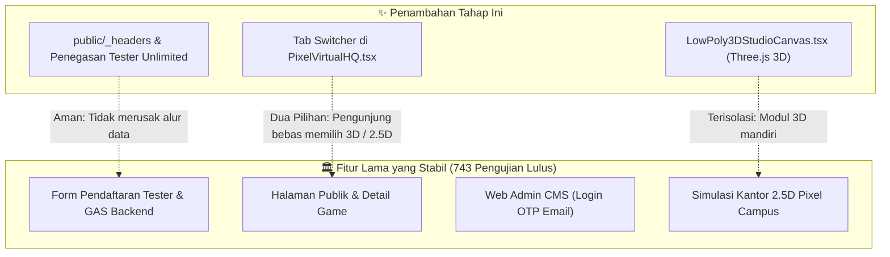
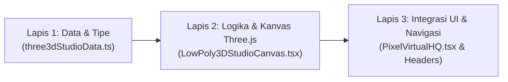

# RENCANA KERJA IMPLEMENTASI: TAHAP 7 & MODUL KANTOR VIRTUAL 3D LOW-POLY

> [!NOTE]
> **Identitas Dokumen & Mandat Proyek:**
> - **Proyek:** SleepyKoala Studio — Indie Developer Portfolio
> - **Tahap:** Tahap 7 (Production Rollout) + Modul Kantor Virtual 3D Isometrik
> - **Anggaran Biaya:** **Rp 0 / $0.00 (100% Free Open-Source & Cloudflare/Google Free Tier)**
> - **Status Pengujian Awal:** 743 / 743 Pengujian Otomatis Lulus (100% PASS)

---

## 1. Goal Description (Tujuan Pengerjaan)

Tahap ini memiliki dua sasaran utama yang saling melengkapi:

1. **Komponen A — Penyelesaian Tahap 7 (Persiapan Peluncuran Produksi Cloudflare Pages & Tester Tanpa Batas):**
   - Menyiapkan konfigurasi domain gratis bawaan Cloudflare Pages (`sleepykoala.pages.dev`) tanpa biaya langganan sepeser pun.
   - Memasang file aturan header keamanan & performa cache (`public/_headers`) agar website aman dari serangan siber dan memuat secepat kilat di seluruh dunia.
   - Memastikan formulir pendaftaran tester Google Play (`RegistrationModal.tsx`) menampilkan status kuota terbuka tanpa batas (*unlimited*), sehingga para calon penguji merasa disambut hangat dan tidak ragu mendaftar.
   - Menyediakan panduan praktis sambungan Webhook GitHub bagi Owner untuk menyambungkan pembaruan kode game dari repositori private ke website.

2. **Komponen B — Pembuatan Modul Kantor Virtual 3D Low-Poly Isometrik (Three.js WebGL):**
   - Terinspirasi dari video TikTok `@cinematicbyaccident`, membangun ruangan studio kantor 3D interaktif yang nyaman (*cozy*), hangat, dan estetik.
   - Menggunakan teknologi standar industri **Three.js** (100% *Free Open-Source Software* / Lisensi MIT).
   - Menghadirkan karakter hewan 3D low-poly yang imut (Koala, Kucing/Kelinci, Beruang, dan Rubah Koder) yang sedang duduk santai di meja kerja dengan laptop menyala, cangkir kopi, dan tanaman hias mini.
   - Memberikan kendali penuh kepada pengunjung: bisa memutar sudut pandang 360 derajat (putar/orbit), memperbesar/memperkecil (zoom), serta mengklik meja kerja tim untuk melihat fokus proyek dan perannya.
   - Menyediakan pemilih tampilan (*tab selector*) di website agar pengunjung bisa dengan mudah beralih antara tampilan **"3D Low-Poly Studio"** dan **"2.5D Pixel Campus"** yang sudah ada sebelumnya.

---

## 2. Analisis Risiko & Tabrakan Fitur (Sesuai Protokol 1)

Sesuai aturan ketat sistem, berikut analisis dampak dan risiko dalam bahasa awam yang ramah sebelum menyentuh kode:



### 🔍 Dampak ke Fitur Lain
1. **Formulir Pendaftaran Tester (`RegistrationModal.tsx`):**
   - **Dampak:** Positif. Tidak mengubah alur pengiriman data ke Google Sheets yang sudah stabil. Hanya menambahkan penegasan visual bahwa kuota pendaftaran tidak dibatasi (*unlimited*).
2. **Simulasi Kantor 2.5D yang Sudah Ada (`ProductionVirtualHQCampus.tsx`):**
   - **Dampak:** Nol (Zero Breaking Change). Modul 2.5D piksel tetap utuh 100%. Modul 3D baru disandingkan sebagai opsi tampilan alternatif melalui tombol tab yang elegan.
3. **Kinerja & Kecepatan Website:**
   - **Dampak:** Sangat aman. Geometri 3D dibuat secara prosedural (tanpa perlu mengunduh file 3D berukuran megabyte yang berat), sehingga memuat seketika (< 1 detik) dan ringan di ponsel pintar.

### ⚠️ Potensi Risiko & Analogi Kehidupan Nyata
- **Analogi Rumah:**
  > *"Menambahkan modul 3D ini seperti membangun teras kaca baru di samping ruang tamu utama yang sudah kokoh. Teras baru ini memiliki pondasi sendiri dan saklar lampu terpisah, sehingga meskipun teras baru sedang dinyalakan, aliran listrik di ruang tamu utama dan dapur (database tester) tetap menyala normal tanpa jeglek."*
- **Risiko Perangkat Lama (Tanpa Dukungan WebGL):**
  Jika ada pengunjung yang membuka website menggunakan laptop sangat tua atau ponsel yang menonaktifkan kartu grafis WebGL, modul 3D otomatis menampilkan pesan fallback yang ramah dan mengajak pengunjung melihat versi 2.5D piksel.

### 🛡️ Rekomendasi Aman
1. Pasang paket `three` dan `@types/three` murni via `npm` tanpa library wrapper tambahan yang berpotensi konflik dengan React 19.
2. Gunakan pembersihan memori (*cleanup & dispose geometry/material*) saat komponen ditutup agar tidak terjadi kebocoran memori RAM (*memory leak*).
3. Jalankan seluruh 743 pengujian otomatis sebelum dan sesudah pengerjaan untuk menjamin tidak ada satupun fitur lama yang terganggu (*zero regression*).

---

## 3. User Review Required (Persetujuan Owner)

> [!IMPORTANT]
> **Keputusan Desain yang Perlu Diketahui Owner:**
> 1. **Pilihan Tampilan Default:** Kami akan mengatur tampilan **"3D Low-Poly Studio"** sebagai tampilan unggulan pertama yang langsung menyapa pengunjung di Beranda, namun pengunjung dapat berpindah ke tampilan **"2.5D Pixel Campus"** kapan saja hanya dengan satu klik pada tombol tab.
> 2. **Karakter Hewan Studio SleepyKoala:**
>    - **Koala Didi (Ruang Didi / Executive):** Meja kayu ek, laptop perak, trofi studio.
>    - **Kucing / Kelinci Kreatif (Ruang Ide & Desain):** Meja ide, papan konsep cerita, sketsa game.
>    - **Beruang Artis (Ruang Seni & Animasi):** Meja artis grafis, dual monitor, tanaman hias hijau.
>    - **Rubah Programmer (Ruang Koding & Rekayasa):** Meja koder, monitor berpendar hijau/cyan, rak server mini retro.
> 3. **Anggaran Biaya:** Tetap **Rp 0 / $0.00**. Tidak memerlukan domain berbayar, server sewa, atau lisensi software apa pun.

---

## 4. Open Questions (Pertanyaan Terbuka untuk Owner)

> [!NOTE]
> Tidak ada pertanyaan yang memblokir. Kami telah merancang sistem ini agar langsung berjalan mulus sesuai seluruh persetujuan yang telah dicatat di `CURRENT_CHECKPOINT.md`.

---

## 5. Proposed Changes (Rincian Berkas yang Akan Diubah/Dibuat)

Pengerjaan mengikuti aturan mutlak **3-Lapis (Data-First -> Headless Logic -> UI-Last)**:



---

### Komponen A: Tahap 7 — Peluncuran Produksi & Tester Tanpa Batas

#### [NEW] `public/_headers`
- Menambahkan aturan header keamanan resmi untuk Cloudflare Pages:
  - `X-Content-Type-Options: nosniff`
  - `X-Frame-Options: DENY`
  - `Referrer-Policy: strict-origin-when-cross-origin`
  - `Cache-Control` optimal untuk berkas statis di folder `/assets/*` (1 tahun cache immutable) agar loading kilat.

#### [MODIFY] `src/components/RegistrationModal.tsx`
- Menambahkan badge ramah: *"⭐ Pendaftaran Terbuka Tanpa Batas Kuota"* pada header formulir pendaftaran closed testing.
- Memastikan calon penguji mengetahui bahwa semua pendaftar dengan akun Google Play akan diikutsertakan.

#### [NEW] `Artifact/PANDUAN_SAMBUNGAN_WEBHOOK_GITHUB.md`
- Panduan praktis bergambar/skema bagi Owner untuk menyalin URL Webhook dan Secret ke GitHub Settings repositori `dompetnalar`.

---

### Komponen B: Kantor Virtual 3D Low-Poly Isometrik (Three.js WebGL)

#### [NEW] `src/types/virtualOffice3D.ts`
- Definisi tipe data bertipe ketat (`--strict`):
  - Model data 4 Ruang Kerja Studio (`StudioZone3D`)
  - Karakter hewan pengembang (`AnimalCharacter3D`)
  - Pengaturan kamera isometrik & pencahayaan siang/malam (`LightingPreset3D`)

#### [NEW] `src/data/virtualOffice3DData.ts`
- Data deklaratif untuk 4 zona studio:
  1. `FOUNDER_LOUNGE`: Ruang Didi & Perencanaan Strategis
  2. `GAME_DESIGN_LAB`: Ruang Ide & Desain Mekanika Game
  3. `VISUAL_ART_STUDIO`: Ruang Seni 2D/3D & Animasi
  4. `ENGINEERING_HUB`: Ruang Koding, Server & Rilis Aplikasi

#### [NEW] `src/components/virtual-office/LowPoly3DStudioCanvas.tsx`
- Komponen Three.js WebGL murni:
  - Kanvas isometrik dengan `PerspectiveCamera` miring 45 derajat bersudut khas isometrik.
  - Geometri low-poly prosedural: Lantai kayu studio berpetak, dinding rendah berpola lembut, meja kerja kayu, laptop dengan layar berpendar, kursi santai, tanaman pot sukulen, mug kopi mini.
  - Karakter 3D hewan imut duduk di kursi mereka.
  - Kontrol interaktif orbit: seret mouse/swipe sentuh layar HP untuk memutar sudut pandang 360°, scroll/cubit untuk zoom.
  - Efek klik zona/meja: kamera bergerak halus (*smooth lerp*) menyorot ruangan yang diklik dan menampilkan kartu ringkasan tim.
  - Tombol kontrol di layar: Reset Sudut Pandang, Beralih Pencahayaan (Siang Hangat / Malam Cozy), dan Tutup Fokus.
  - Pembersihan (*cleanup lifecycle*) lengkap untuk mencegah kebocoran memori browser.

#### [MODIFY] `src/components/virtual-office/PixelVirtualHQ.tsx`
- Menambahkan tombol tab baru di bar navigasi mesin:
  - 🌟 **"3D Low-Poly Studio (WebGL)"** (Aktif sebagai default atau pilihan pertama)
  - 🏢 **"2.5D Pixel Campus (Live Aset)"**
  - 📐 **"Floorplan Spasial"**
- Menghubungkan kanvas 3D ke navigasi detail proyek.

#### [NEW] `src/test/virtualOffice3D.test.tsx`
- Skrip pengujian otomatis unit & integrasi untuk kanvas 3D:
  - Memverifikasi inisialisasi skema data 4 zona studio.
  - Memverifikasi penanganan event fallback jika WebGL tidak aktif.
  - Memverifikasi interaksi klik zona dan callback navigasi proyek.

---

## 6. Verification Plan (Rencana Pengujian Nyata)

### Automated Tests (Uji Otomatis Terminal)
Pekerjaan HANYA dinyatakan lulus jika seluruh perintah berikut lulus 100%:

```bash
# 1. Jalankan seluruh suite tes otomatis (743 pengujian lama + tes modul 3D baru)
npm test

# 2. Periksa ketat kepatuhan tipe data TypeScript (wajib 0 eror)
npx tsc -b

# 3. Periksa standar penulisan kode linter (wajib 0 peringatan/eror)
npm run lint

# 4. Pindai keamanan dari kebocoran rahasia dan privasi
npm run security:scan
npm run security:privacy
npm run security:files

# 5. Uji build produksi Vite
npm run build
```

### Manual Verification (Uji Lapangan & Visual)
1. **Verifikasi Visual 3D di Browser:**
   - Buka Beranda portofolio di browser lokal (`npm run dev`).
   - Periksa apakah kanvas 3D kantor low-poly muncul dengan pencahayaan hangat dan karakter hewan imut yang duduk di mejanya.
   - Seret mouse untuk memutar sudut pandang ruangan (orbit) dan gunakan scroll untuk zoom in/out.
   - Klik salah satu meja kerja (misal Ruang Koding / Mobile Kasir) dan pastikan kamera bergerak halus menyorot meja tersebut serta memunculkan kartu informasi.
   - Klik tombol toggle mode pencahayaan untuk mencoba suasana malam yang hangat dengan lampu meja menyala.
2. **Verifikasi Tombol Tab (Pilihan 3D vs 2.5D):**
   - Klik tab "2.5D Pixel Campus" dan pastikan tampilan kampus piksel lama tetap berjalan sempurna tanpa ada gangguan.
3. **Verifikasi Formulir Tester Google Play:**
   - Klik tombol "Daftar Penguji Mobile Kasir".
   - Pastikan muncul badge "Pendaftaran Terbuka Tanpa Batas Kuota".
   - Masukkan nama dan email penguji coba, lalu klik submit untuk memastikan alur pendaftaran berhasil diterima.
4. **Verifikasi Tampilan Ponsel (Mobile Responsive):**
   - Buka tampilan responsif ponsel di browser (F12 Mobile Mode).
   - Pastikan kanvas 3D bisa diputar mulus dengan sentuhan satu jari dan dizoom dengan dua jari tanpa lag (target 60 FPS).
