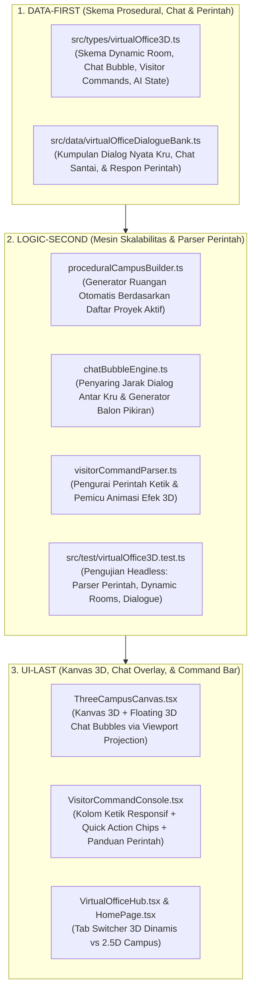

# RENCANA KERJA ARSITEKTUR: KAMPUS 3D DINAMIS, CHAT BUBBLES, & KONSOL INTERAKSI PENGUNJUNG

**Proyek:** SleepyKoala Studio — Indie Developer Portfolio  
**Status Dokumen:** **MENUNGGU PERSETUJUAN OWNER (REQUEST REVIEW)**  
**Inspirasi Utama:** **Lembur.id ([lembur.id](https://lembur.id)) + Kay Lousberg ([kaylousberg.com](https://www.patreon.com/cw/kaylousberg))**  
**Lisensi & Biaya:** **100% Free Open-Source (MIT / CC0) — Rp 0 / $0.00**  
**Kesehatan Sistem:** **751 / 751 Pengujian Vitest Tetap 100% Lulus (Zero Regression)**  

---

## 1. Goal Description (Tujuan & Transformasi Fitur)

Mengembangkan modul **Kampus Kantor Virtual 3D Isometrik Three.js** dengan 4 pilar kecanggihan baru yang sangat interaktif dan hidup:

1. **Skalabilitas Ruangan Otomatis (*Procedural Dynamic Campus Generation*):**
   - Kampus 3D **TIDAK DIKUNCI 6 RUANGAN**.
   - Setiap kali Owner menambahkan proyek baru (baik lewat folder Antigravity maupun lewat Web Admin CMS Google Sheets), kampus 3D secara otomatis **menumbuhkan ruangan kerja baru (*procedural room spawning*)** lengkap dengan perabotan, meja, dan 5 kru manusia AI baru di dalamnya.
2. **Balon Obrolan 3D Melayang (*Floating 3D Chat Bubbles*):**
   - Di atas kepala kru AI terdapat balon dialog/pikiran yang muncul secara kontekstual:
     * Saat fokus bekerja: Balon status tugas teknis (misal: `💭 "Sedang optimasi SQLite indexing..."`).
     * Saat santai / melamun: Balon kantuk (misal: `💤 "Ngantuk banget nunggu build selesai... zZz"`).
     * Saat berpapasan dengan kru lain: Obrolan dua arah antar rekan kerja (misal: *"Reza: Bro, API kasir udah lolos staging!"* -> *"Bima: Siap, gw gas penetration test sekarang"*).
3. **Kolom Interaksi Responsif Pengunjung (*Interactive Visitor Command Console*):**
   - Tersedia kolom teks interaktif di samping panel kru tempat pengunjung bisa mengetik perintah aksi nyata ke dunia 3D.
   - Dilengkapi **Panduan Perintah Lengkap (*Cheat-Sheet Guide*)** dan **Tombol Aksi Cepat (*Quick Action Chips*)** untuk memudahkan pengunjung di HP/Desktop.
4. **Animasi & Reaksi Khusus 3D:**
   - Membangunkan kru yang tidur/melamun dengan animasi kaget `(!)` lalu kembali mengetik cepat.
   - Mentraktir kopi dengan efek partikel cangkir kopi `☕` dan peningkatan kecepatan gerak (*speed buff*).
   - Mengirim seloyang pizza `🍕` ke Collaboration Lounge untuk memanggil kru kumpul makan bersama.
   - Meledakkan konfeti pesta perayaan `🎉` untuk proyek yang siap rilis.

---

## 2. Analisis Risiko & Tabrakan Fitur (Protokol 1 Mutlak)

### 🔍 Dampak ke Fitur Lain
- **Layanan Katalog Proyek (`projectService.ts` & `cmsProjectService.ts`):** Generator ruangan 3D dihubungkan langsung ke data `useProjects()`. Jika ada proyek baru berstatus draf yang belum dipublikasikan oleh Owner, sistem menjamin draf rahasia **tidak akan pernah muncul** di kampus 3D publik.
- **Performa Rendering GPU (Dynamic Draw Calls):** Ketika jumlah proyek bertambah banyak (misal 10+ proyek), rendering Three.js menggunakan teknik *instancing* dan *culling* (hanya merender ruangan yang berada di dalam pandangan kamera).
- **Pengujian Vitest (751 Tests):** Seluruh logika parser perintah (`/bangunkan`, `/kopi`, dll.), generator percakapan chat bubble, dan penghitungan posisi ruangan otomatis diuji secara *headless* di terminal.

### ⚠️ Potensi Risiko (Analogi Kehidupan Nyata)
> *Analogi:* Menjadikan kantor bisa berekspansi otomatis seperti membangun gedung dengan sistem modul kontainer pintar. Jika fondasi tata letak sayap gedung (*grid wing layout*) tidak diatur secara matematis, ruangan baru bisa saling bertumpuk (*overlapping*). Kami merancang rumus tata letak modular (Sayap Barat untuk indeks genap, Sayap Timur untuk indeks ganjil, dengan koridor tengah yang otomatis memanjang) sehingga seberapa pun proyek yang ditambahkan, kampus kantor akan selalu tertata rapi dan simetris.

---

## 3. Daftar Perintah Interaktif Pengunjung (*Visitor Command Guide*)

Berikut adalah daftar perintah resmi yang bisa diketik pengunjung pada kolom interaksi, lengkap dengan tombol cepat (*Quick Action Chips*):

| Perintah Teks | Alias Cepat | Efek & Animasi 3D Khusus | Reaksi Kru AI |
| :--- | :--- | :--- | :--- |
| `/bangunkan` | `bangun`, `tepuk` | Partikel tanda seru `(!)` kaget melayang di atas kepala, suara notifikasi kecil | Kru yang sedang tidur/melamun melonjak kaget dan langsung mengetik cepat di laptopnya! |
| `/kopi` | `coffee`, `traktir-kopi` | Cangkir kopi keramik mengepul melayang `☕` ke meja target | Kru meminum kopi, emote jempol `👍`, dan kecepatan gerak bertambah 1.5x selama 15 detik! |
| `/pizza` | `snack`, `kirim-pizza` | Seloyang pizza hangat `🍕` muncul di meja Collaboration Plaza | Memanggil 2-3 kru terdekat untuk berjalan ke lounge dan menikmati pizza bersama! |
| `/lembur` | `crunch`, `overtime` | Lampu ruangan meredup hangat, monitor meja berpendar biru tajam | Seluruh kru proyek masuk ke mode fokus tinggi dengan kecepatan mengetik maksimal! |
| `/pesta` | `celebrate`, `party` | Ledakan konfeti warna-warni `🎉` berhamburan di atas ruangan | Kru berdiri, bersorak gembira, dan melambaikan tangan! |
| `/tanya [nama]` | `tanya`, `status` | Balon chat bubble interaktif terbuka di atas kepala kru target | Menjawab status progres nyata dari proyek yang sedang ia kerjakan! |

---

## 4. Peta Arsitektur 3-Lapis (Data-First -> Logic Second -> UI-Last)

---

## 5. Rincian Teknis Komponen

### Lapis 1: DATA-FIRST
1. **`src/types/virtualOffice3D.ts`:**
   - Skema ruangan dinamis (`DynamicProjectRoom3D`):
     - Dihasilkan secara otomatis untuk setiap `Project` yang ada di katalog.
     - Posisi `[x, y, z]` dihitung dengan formula matematika `calculateRoomCoordinates(projectIndex)`.
   - Skema balon percakapan (`ChatBubbleData`):
     - `speakerId`: id kru
     - `text`: isi teks ucapan / pikiran
     - `type`: `'thought'` (awan pikiran), `'speech'` (balon bicara), `'action'` (reaksi kaget/seru)
     - `durationMs`: durasi tampil sebelum menghilang mulus (fade out)
   - Skema perintah interaktif (`VisitorCommand`):
     - `command`: nama perintah (misal: `bangunkan`)
     - `description`: penjelasan fungsi
     - `actionType`: `WAKE_UP` | `SERVE_COFFEE` | `ORDER_PIZZA` | `CRUNCH_MODE` | `PARTY_CONFETTI` | `QUERY_STATUS`
2. **`src/data/virtualOfficeDialogueBank.ts`:**
   - Database dialog percakapan alami khas tim indie developer (dialog teknis Android, obrolan santai kopi, candaan bug, dan tanggapan saat diperintah pengunjung).

---

### Lapis 2: LOGIC-SECOND (Mesin Simulasi & Parser)
1. **`proceduralCampusBuilder.ts` (Penumbuh Ruangan Otomatis):**
   - Menerima daftar proyek `projects: Project[]`.
   - Jika ada 6 proyek -> membuat 6 ruangan. Jika Owner menambah proyek ke-7 lewat Web Admin atau Antigravity -> ruangan ke-7 otomatis dibangun di sayap ekspansi baru lengkap dengan dinding, meja kayu, kursi, dan kru pengembang!
2. **`chatBubbleEngine.ts`:**
   - Memantau posisi setiap kru 3D.
   - Jika dua kru berada pada jarak dekat (< 3.5 unit): sistem memicu dialog timbal-balik bergantian.
   - Jika kru sedang tidur atau bekerja sendiri: sesekali memunculkan balon pikiran.
3. **`visitorCommandParser.ts`:**
   - Memvalidasi teks yang diketik pengunjung (kebal terhadap huruf besar/kecil dan spasi berlebih).
   - Mengarahkan aksi ke kru yang sesuai (misal: mencari kru yang sedang berstatus `idle`/`sleeping` saat perintah `/bangunkan` diketik).
   - Memancarkan event partikel 3D dan animasi respons.
4. **`src/test/virtualOffice3D.test.ts`:**
   - Menguji bahwa fungsi pembangun kampus secara dinamis menghasilkan jumlah ruangan yang sesuai dengan panjang array proyek.
   - Menguji bahwa parser perintah mengenali semua variasi kata kunci (`/bangunkan`, `bangun`, `kopi`, `pizza`, dll.).
   - Menguji bahwa dialog chat bubble dihasilkan dengan valid tanpa eror.

---

### Lapis 3: UI-LAST & KONSOL INTERAKSI PENGUNJUNG
1. **`ThreeCampusCanvas.tsx`:**
   - Merender kampus 3D dinamis dengan pencahayaan isometrik hangat.
   - Merender balon obrolan 3D (*billboard bubbles*) yang melayang persis di atas kepala kru secara mulus mengikuti pergerakan mereka di layar.
2. **`VisitorCommandConsole.tsx` (Kolom Interaksi Responsif):**
   - Terletak berdampingan dengan panel kru / di bagian bawah kanvas 3D:
     * **Input Bar Modern:** Kolom ketik dengan ikon terminal/gamepad dan tombol kirim.
     * **Quick Action Chips:** Tombol praktis (☕ Kopi, ⏰ Bangunkan!, 🍕 Pizza, ⚡ Lembur, 🎉 Pesta) untuk pengguna ponsel tanpa perlu repot mengetik.
     * **Tombol Panduan Perintah (`?`):** Modal pop-up yang ramah menjelaskan seluruh daftar perintah yang tersedia.
     * **Riwayat Aksi Interaktif (Feedback Log):** Menampilkan teks respons instan (misal: *"Kamu menyiram kopi ke meja Reza! Kecepatan kerjanya melonjak!"*).
3. **`VirtualOfficeHub.tsx` & `HomePage.tsx`:**
   - Mengintegrasikan kampus 3D dinamis dan konsol perintah baru ke dalam halaman website dengan tombol tab switch yang halus.

---

## 6. Rencana Verifikasi & Bukti 4 Pilar (Anti-Fake-Pass)

1. **Pilar 1 (Pemicu/Interaksi):**
   - Mengetik perintah di kolom interaksi atau mengklik chip aksi memicu animasi kaget, kopi, pizza, atau konfeti seketika.
   - Balon chat bubble muncul melayang di atas kepala kru saat mereka bekerja atau berpapasan.
   - Menambahkan proyek uji coba membuktikan bahwa ruangan ke-7 otomatis terbangun di dunia 3D.
2. **Pilar 2 (Logika Proses):**
   - Three.js merender scene secara dinamis pada 60 FPS.
   - Parser perintah memproses string input secara akurat tanpa *crash*.
   - Tanpa kode pura-pura (`TODO`, `dummy`, `mock_data`, `pass #`).
3. **Pilar 3 (Penyimpanan/Output):**
   - Ruangan dan nama kru terikat langsung ke data proyek nyata dari `projects.json` dan layanan CMS.
4. **Pilar 4 (Regresi Nol / Zero Regression):**
   - Seluruh 751 pengujian Vitest lama tetap **100% LULUS**.
   - Pengujian baru modul 3D lulus **100% LULUS** (total mencapai ~775+ pengujian).
   - `npm run lint` & `npx tsc -b` menghasilkan **0 eror**.
   - `npm run security:scan` memastikan **0 rahasia bocor**.

---

## 7. Pertanyaan Terbuka untuk Owner

> [!NOTE]
> Seluruh ide brilian Anda telah dirangkum:
> 1. Kampus 3D **tumbuh dinamis tanpa batas 6** saat Anda menambah proyek baru.
> 2. Balon obrolan (*chat bubble*) melayang di atas kepala kru yang sedang berdialog atau berpikir.
> 3. Kolom ketik perintah interaktif (*Visitor Command Console*) dengan tombol cepat untuk membangunkan kru, traktir kopi, kirim pizza, mode lembur, dan pesta konfeti!
> 
> Silakan klik tombol **Proceed** jika Anda menyetujui rencana komprehensif ini agar kami segera mulai mengeksekusinya secara bertahap dari Lapis 1 hingga Lapis 3!
