# LAPORAN PENYELESAIAN: KANTOR VIRTUAL 3D LOW-POLY ISOMETRIK (THREE.JS)

**Proyek:** SleepyKoala Studio — Indie Developer Portfolio  
**Status Fitur:** **SELESAI & TERVERIFIKASI PENUH (100% PASS E2E)**  
**Waktu Penyelesaian:** 2026-11-10 02:15:00  
**Lisensi & Biaya:** **100% Free Open-Source (MIT & CC0) — Rp 0 / $0.00**  
**Kesehatan Sistem:** **770 / 770 Pengujian Lulus (39 Test Suites, Zero Regression)**  

---

## 1. Ringkasan yang Telah Diselesaikan

Modul **Kantor Virtual 3D Isometrik Three.js** telah selesai dibangun dengan memadukan inspirasi dinamis dari **lembur.id** dan kehangatan estetika karakter manusia berpakaian kantor bergaya **Kay Lousberg ([kaylousberg.com](https://www.patreon.com/cw/kaylousberg))**:

1. **Skalabilitas Dinamis Tanpa Batas Ruangan:**
   - Ruang kantor tidak di-hardcode 6, melainkan dihasilkan secara otomatis (*procedural spawning*) mengikuti daftar proyek yang aktif di `projects.json` maupun CMS Google Sheets.
   - Jika Owner menambah proyek baru, ruangan ke-7 otomatis terbangun di sayap gedung baru lengkap dengan meja, perabotan, dan 5 kru manusia AI baru.
2. **Kru Manusia AI Otonom Bergaya Kay Lousberg (30+ Kru):**
   - Setiap proyek memiliki tim sendiri (Planner, Developer, Tester, Reviewer, Publisher) berpakaian kantor rapi (kemeja oxford berkerah, dasi navy, cardigan, blazer sage green, rompi rajut, celana bahan, sepatu pantofel, dan lanyard ID badge studio).
3. **Simulasi Perilaku Acak Nyata (*Truly Random AI Wandering*):**
   - Kru AI bergerak secara otonom di seluruh kampus: kadang fokus mengetik di meja, tertidur sejenak karena lelah kompilasi, berjalan ke Pantry untuk menyeduh kopi, atau santai di sofa Collaboration Lounge.
4. **Balon Obrolan 3D Melayang (*Contextual 3D Floating Bubbles*):**
   - Teks obrolan dan balon pikiran melayang persis di atas kepala masing-masing kru. Saat dua kru berpapasan di koridor atau lounge, mereka saling bertukar dialog teknis seputar proyek studio.
5. **Konsol Perintah Interaktif Pengunjung (*Visitor Command Console*):**
   - Kolom ketik responsif di samping kanvas tempat pengunjung dapat mengetik perintah:
     * `/bangunkan` (⏰ Bangunkan!): Menegur kru yang tidur/melamun dengan animasi kaget `(!)` dan langsung kembali mengetik cepat.
     * `/kopi` (☕ Traktir Kopi): Mengirimkan cangkir kopi mengepul `☕` ke meja kru untuk meningkatkan kecepatan kerja `+50% SPD`.
     * `/pizza` (🍕 Kirim Pizza): Mengirim seloyang pizza hangat ke Collaboration Lounge dan memanggil rekan berkumpul.
     * `/lembur` (⚡ Mode Lembur): Mengaktifkan mode fokus tinggi dengan monitor berpendar biru terang.
     * `/pesta` (🎉 Pesta Rilis): Meledakkan konfeti perayaan atas pencapaian milestone.
     * `/tanya` (💬 Tanya Kabar): Menanyakan kabar progres langsung ke kru terdekat via chat bubble.
   - Dilengkapi 6 tombol aksi cepat (*Quick Action Chips*) untuk pengguna ponsel dan modal panduan perintah (*cheat-sheet*).
6. **Kamera Zoom-In & Kunci Paten Ruang Proyek:**
   - Memilih ruangan memicu transisi kamera zoom-in yang mulus (lerp) dan mengunci sudut pandang (*paten*) ke ruangan tersebut, disertai drawer rincian siapa kru yang sedang di meja dan siapa yang sedang keluar.
7. **Bilah Tab Switcher Terpadu:**
   - Tersedia tombol tab di website: **"🏢 Kantor Virtual 3D (Three.js)"** dan **"🎨 2.5D Pixel Campus"** yang tersimpan di memori browser pengunjung.

---

## 2. Struktur Berkas yang Dibuat & Dimodifikasi

```mermaid
flowchart TD
    subgraph DATA_LAYER ["Lapis 1: Data Contracts & Presets"]
        T1["src/types/virtualOffice3D.ts<br/>(Skema Prosedural, 30+ Kru, Chat Bubble, Visitor Command)"]
        T2["src/data/virtualOffice3DConfig.ts<br/>(Fasilitas Bersama, Waypoints, Procedural Campus Generator)"]
        T3["src/data/virtualOfficeDialogueBank.ts<br/>(Bank Dialog Alami, Balon Pikiran, Respon Perintah)"]
    end

    subgraph LOGIC_LAYER ["Lapis 2: Headless Logic & Three.js Engine"]
        L1["officeGeometryBuilder.ts<br/>(Model Geometri KayKit Human, Meja Kayu, Props)"]
        L2["crewAIController.ts<br/>(Simulasi Pergerakan Acak, Waypoint Graph, State Transitions)"]
        L3["chatBubbleEngine.ts<br/>(Penyaring Jarak Obrolan, Pembersih Balon Kadaluarsa)"]
        L4["visitorCommandParser.ts<br/>(Pengurai Perintah Ketik, Logika Buff Kopi & Bangunkan)"]
        L5["cameraTransitionController.ts<br/>(Kamera Orbit 360°, Interpolasi Zoom-In Ruangan)"]
        L6["proceduralCampusBuilder.ts<br/>(Perakit Scene Three.js Lengkap & Sinkronisasi Mesh)"]
        TEST["src/test/virtualOffice3D.test.ts<br/>(19 Unit Tests Headless 100% PASS)"]
    end

    subgraph UI_LAYER ["Lapis 3: Visual Components & Integration"]
        U1["ThreeCampusCanvas.tsx<br/>(Kanvas 3D WebGL, 3D Projected Chat Bubbles, Drawer Proyek)"]
        U2["VisitorCommandConsole.tsx<br/>(Kolom Ketik Responsif, Quick Chips, Modal Panduan)"]
        U3["VirtualOfficeHub.tsx<br/>(Wadah Pengalih Tab 3D vs 2.5D dengan Memori Browser)"]
        U4["src/pages/HomePage.tsx<br/>(Integrasi Beranda Website)"]
    end

    DATA_LAYER --> LOGIC_LAYER
    LOGIC_LAYER --> UI_LAYER
```

---

## 3. Hasil Validasi & Pengujian Sistem

1. **Uji Otomatis Vitest:**
   - **39 Test Suites LULUS (39 passed, 0 failed)**
   - **770 Tests LULUS (770 passed, 0 failed)**
   - Waktu eksekusi: 43.54 detik
2. **Pemeriksaan Kualitas Kode:**
   - `npx tsc -b`: 0 Eror TypeScript.
   - `npm run lint`: 0 Eror Linter.
   - `npm run build`: Kompilasi produksi `dist/` selesai bersih dalam 1.68 detik.
3. **Pemeriksaan DevSecOps & Keamanan:**
   - `npm run security:scan`: 0 Rahasia / Token Bocor (2.420 berkas).
   - `npm run security:privacy`: 0 Data Pribadi / PII Bocor (2.420 berkas).
   - `npm run security:files`: 2.515 berkas patuh aturan kebijakan berkas.
4. **Mandat Anggaran Nol Rupiah:**
   - Total Biaya: **Rp 0 / $0.00**.
   - Memanfaatkan Three.js (MIT) dan gaya modular Kay Lousberg (CC0 Public Domain).
