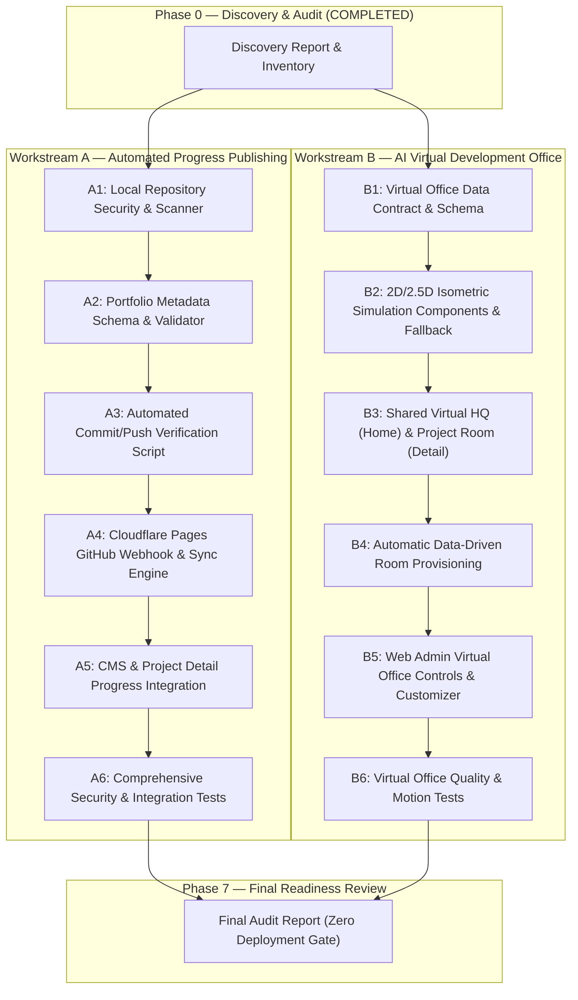

# SLEEPYKOALA STUDIO — IMPLEMENTATION DISCOVERY REPORT
## AUTOMATED PROGRESS PUBLISHING & AI VIRTUAL DEVELOPMENT OFFICE
**Date:** 2026-11-07  
**Stage:** Phase 0 — Discovery and Inventory Audit (GATE 0)  
**Execution Mode:** STRICT READ-ONLY AUDIT — ZERO SOURCE CODE MUTATION — ZERO DEPLOYMENT  
**Primary Source of Truth:** `roadmap_sleepykoala_updated.md` (Baseline Design & Requirements Locked)

---

## 1. KONDISI AKTUAL WORKSPACE & REPOSITORY

### 1.1 Status Workspace Utama (`indie-developer-portfolio`)
- **Root Path:** `E:\Antigravity Project\indie-developer-portfolio`
- **Active Git Branch:** `master`
- **Git Remote:** *None configured* (`git remote -v` menghasilkan output kosong).
- **Git Credential Helper:** `manager` (Git Credential Manager for Windows terkonfigurasi pada level global/sistem).
- **Git Identity:**
  - `user.name`: `lunachroc07-dot`
  - `user.email`: `lunachroc07@gmail.com`
- **GitHub CLI (`gh`):** *Not Installed* (Perintah `gh` tidak ditemukan di environment Windows).
- **Local Working Tree:** Bersih dari error kompilasi; seluruh 447 test lulus (23 test suites), `tsc -b` 0 error, `oxlint` 0 error. Terdapat sejumlah file uncommitted/untracked dari Milestone 6.6, 6.6.1, dan AdMob app-ads.txt setup.

### 1.2 Status Workspace Project Portofolio Lain di `E:\Antigravity Project\`
Pemeriksaan struktur folder pada root `E:\Antigravity Project\` menemukan:

| Project Portofolio | Direktori Lokal Aktual | Status Repository Git Lokal (`.git`) | Catatan Onboarding |
| :--- | :--- | :---: | :--- |
| **DompetNalar** | `E:\Antigravity Project\FinSmart` | **Ada (`.git` = True)** | Nama folder lokal adalah `FinSmart`. Sudah memiliki repository Git lokal. |
| **IDLE MASTER** | `E:\Antigravity Project\Idle Master` | **Belum Ada (`.git` = False)** | Folder tersedia tetapi belum diinisialisasi Git repository. |
| **Mobile Kasir** | `E:\Antigravity Project\mobile-kasir` | **Belum Ada (`.git` = False)** | Folder tersedia tetapi belum diinisialisasi Git repository. |
| **Idle Mining** | `E:\Antigravity Project\Idle mining` | **Ada (`.git` = True)** | Folder memiliki Git repository lokal. |
| **The Broken Origin** | `E:\Antigravity Project\TBO ROBLOX` | **Ada (`.git` = True)** | Proyek terhubung dengan workspace Roblox/Godot TBO. |
| **Worklume** | `E:\Antigravity Project\Worklume` | **Belum Ada (`.git` = False)** | Folder tersedia tetapi belum diinisialisasi Git repository. |

---

## 2. INVENTARISASI FITUR EKSISTING (YANG SUDAH TERSEDIA)

### 2.1 Frontend Portofolio & Routing
- **Framework:** React 19 + TypeScript + Vite 8 + Tailwind CSS 4 + Lucide Icons.
- **Routing (`src/App.tsx`):**
  - `/` (`HomePage.tsx`): Hero section, ringkasan metrik dev cycle, project showcase, profil developer.
  - `/projects` (`ProjectsPage.tsx`): Katalog proyek dengan filter status (*Siap Rilis*, *Closed Testing*, *Dalam Pengembangan*).
  - `/projects/:slug` (`ProjectDetailPage.tsx`): Detail proyek, icon, galeri preview 16:9, Google Play testing registration modal, compliance cards.
  - `/about` (`AboutPage.tsx`): Filosofi, bio pengembang, dan roadmap visi.
  - `/admin` (`AdminPage.tsx`): Web Admin 5-tab system (Katalog Proyek, Pustaka Media, Audit Log, Pengaturan Website, Google Play Compliance).
  - `/projects/:slug/privacy` & `/delete-account`: Halaman kepatuhan Google Play Console.
- **Test Suite:** 23 test suites dengan 447 automated tests mencakup isolated E2E, mock Apps Script, sanitasi media, dan fail-closed resilience.

### 2.2 CMS & Backend Edge Layer
- **Cloudflare Pages Functions (`functions/api/`):**
  - Proksi autentikasi admin via OTP dengan HttpOnly cookie session dan CSRF defense-in-depth header (`X-SleepyKoala-Admin: 1`).
  - Endpoints publik: `/api/projects`, `/api/projects/[slug]`, `/api/media/[mediaId]`, `/api/settings`, `/api/compliance/[slug]`, `/api/register-tester`.
  - Endpoints admin: `/api/admin/projects`, `/api/admin/media`, `/api/admin/settings`, `/api/admin/compliance`, `/api/admin/audit-logs`.
- **Database Sheets Upstream (`backend/gas/Code.gs`):**
  - `CMS_Projects`: Penyimpanan kanonikal data 6 proyek.
  - `CMS_Media`: Metadata aset media (Google Drive File ID, SHA-256 hash, role, visibility).
  - `CMS_Settings`: Konfigurasi dinamis branding, hero, about, navigasi, footer, SEO.
  - `CMS_Compliance`: Dokumen kebijakan privasi dan instruksi hapus akun.
  - `CMS_Logs`: Audit trail administratif.
  - `TesterRegistrations`: Data penguji closed testing Google Play.

---

## 3. GAP ANALYSIS: FITUR YANG BELUM TERSEDIA

### 3.1 Workstream A — Automated Progress Publishing
1. **Repository Security & Scanner Lokal (Tahap A1):**
   - Belum ada script/pre-commit tool lokal untuk secret scanning (mendeteksi API key, private key, keystore, token, `.env`) dan privacy scanning (PII, data pelanggan/tester).
   - Aturan allowlist/denylist per repository belum didefinisikan.
2. **Metadata Progres Schema (Tahap A2):**
   - Belum ada struktur `docs/portfolio/roadmap.json`, `docs/portfolio/features.json`, dan `docs/portfolio/screenshots/README.md`.
   - Belum ada skema data TypeScript untuk item roadmap/fitur dengan pemisahan status implementasi (`planned`, `in_progress`, `completed`, `on_hold`, `cancelled`) dan status publikasi (`draft`, `public`, `hidden`).
3. **Automated Commit & Push Tooling (Tahap A3):**
   - Belum ada runner script/CLI yang menjalankan 18 langkah verifikasi (test, lint, secret scan, privacy scan, diff review, validasi screenshot, commit, push).
4. **Backend GitHub Integration & Webhook Sync (Tahap A4):**
   - Belum ada endpoint penerima webhook push GitHub di Cloudflare Pages Functions (`functions/api/webhook/github.ts`).
   - Belum ada mekanisme verifikasi tanda tangan webhook (`X-Hub-Signature-256`).
   - Belum ada server-side GitHub fetcher yang mengambil metadata whitelist dari repository private tanpa mengekspos token.
5. **Integrasi CMS & Halaman Detail (Tahap A5):**
   - Halaman detail proyek (`ProjectDetailPage.tsx`) belum menampilkan section roadmap progres, fitur terverifikasi, dan galeri screenshot progres.
   - Web Admin (`AdminPage.tsx`) belum memiliki sub-tab atau kontrol untuk mengelola repository mapping, status sync GitHub, dan persetujuan publikasi item (publish/hide/unpublish).

### 3.2 Workstream B — AI Agent Crew: Virtual Development Office
1. **Data Model & Schema Konfigurasi (Tahap B1):**
   - Belum ada schema data TypeScript untuk `VirtualHQConfig`, `ProjectRoomConfig`, `AgentCrewConfig`, `AgentSpecialization`, dan `RoomThemePreset`.
2. **Komponen Visual 2D/2.5D Isometrik (Tahap B2):**
   - Belum ada komponen visual berbasis SVG/CSS/Canvas ringan untuk kantor virtual.
   - Belum ada label wajib **AI Agent Crew — Simulation**.
   - Belum ada fallback statis dan dukungan `prefers-reduced-motion`.
3. **Virtual HQ Dashboard & Close-Up Project Room (Tahap B3):**
   - `HomePage.tsx` belum mengintegrasikan kanvas Virtual HQ interaktif dengan navigasi antar-ruangan.
   - `ProjectDetailPage.tsx` belum menampilkan close-up Project Room yang berbagi konfigurasi identitas dengan Virtual HQ.
4. **Automatic Project Room Provisioning (Tahap B4):**
   - Handler pembuatan/pembaruan proyek di CMS belum menghasilkan konfigurasi 5 agent inti secara otomatis berdasarkan kategori dan deskripsi proyek.
5. **Kontrol Pengelolaan Web Admin (Tahap B5):**
   - Web Admin belum memiliki interface untuk preview HQ/Room, penyesuaian spesialisasi agent, pemilihan tema dekorasi, atau saklar animasi/fallback statis.

---

## 4. RISIKO KEAMANAN & PRIVASI

1. **Risiko Kebocoran Secret dalam Push Otomatis:**
   - Otomatisasi commit/push pada project workspace berisiko memasukkan file Android keystore (`*.jks`, `*.keystore`), Google Services JSON (`google-services.json`), file `.env`, atau secret Apps Script jika tidak disaring oleh scanner pre-commit yang ketat.
2. **Risiko Paparan Kredensial GitHub:**
   - Token GitHub (Fine-grained PAT / GitHub App private key) dilarang keras berada di client-side bundle atau Git repository. Token hanya boleh disimpan di Cloudflare Secrets storage / backend environment variables.
3. **Risiko Kebocoran Data Pengunjung & Tester dalam Screenshot Progres:**
   - Screenshot yang diunggah sebagai progres implementasi berisiko memuat data pribadi (email tester, nomor transaksi, nama pengguna, data log internal).
4. **Risiko Spoofing Webhook GitHub:**
   - Endpoint webhook di Cloudflare Functions harus memvalidasi secret hash HMAC-SHA256 sebelum memproses payload apa pun untuk mencegah injeksi metadata palsu.
5. **Risiko Salah Paham Simulasi Virtual Office:**
   - Pengunjung dapat mengira terdapat AI runtime sungguhan atau proses live agent. Label **AI Agent Crew — Simulation** harus tertera secara persisten dan tidak dapat disembunyikan.

---

## 5. RISIKO BIAYA & LIMITASI FREE-TIER (ZERO-COST LOCK)

| Layanan / Komponen | Batas Kuota Gratis (Free Tier) | Strategi Mitigasi SleepyKoala |
| :--- | :--- | :--- |
| **GitHub Private Repositories** | Unlimited repos, 500 MB storage/repo | Menyimpan source code project tanpa binary raksasa; metadata terdistribusi. |
| **GitHub API Rate Limits** | 5,000 requests/hour (Authenticated) | Sinkronisasi berbasis Webhook event-driven (bukan polling berulang); caching metadata. |
| **Cloudflare Pages Functions** | 100,000 requests/day | Caching respons publik; fail-closed jika limit tercapai; $0.00 / Rp0. |
| **Google Apps Script** | 20,000 URL Fetch calls/day, 6 menit timeout | Hanya memproses ringkasan data; tidak menjalankan scanning berat di GAS. |
| **Virtual Development Office** | $0.00 (Pure Client-side 2D/2.5D Web Tech) | Bebas dari AI inference runtime, server VPS, atau WebGL library berbayar. |

---

## 6. RENCANA IMPLEMENTASI BERDASARKAN DEPENDENSI

---

## 7. FILE YANG AKAN DIBUAT DAN DIUBAH

### File Baru yang Akan Dibuat
1. **Workstream A:**
   - `scripts/security-scan.js`: Scanner keamanan lokal (regex engine untuk API key, keystore, token, PII).
   - `scripts/auto-progress-push.js`: Pipeline 18 langkah commit/push terverifikasi.
   - `src/types/portfolioProgress.ts`: Definisi tipe data roadmap, fitur, dan screenshot.
   - `src/services/portfolioProgressService.ts`: Layanan client untuk query progres publik.
   - `functions/api/webhook/github.ts`: Penerima webhook Cloudflare Pages Functions dengan validasi HMAC-SHA256.
   - `functions/api/progress/[slug].ts`: Endpoint publik untuk menyajikan metadata progres yang berstatus `public`.
   - `src/test/portfolioProgress.test.ts`: Unit test untuk schema, status publikasi, dan validator.
   - `src/test/securityScanner.test.ts`: Unit test untuk scanner secret dan privacy.
2. **Workstream B:**
   - `src/types/virtualOffice.ts`: Definisi tipe data Virtual HQ, 5 Agent Inti, preset tema, dekorasi, dan konfigurasi ruangan.
   - `src/data/virtualOfficePresets.ts`: Preset tema ruangan (Android, Game, Business, Web, Universal) dan spesialisasi agent.
   - `src/services/virtualOfficeService.ts`: Generator otomatis room berbasis data proyek dan fallback universal.
   - `src/components/virtual-office/VirtualHQView.tsx`: Komponen visual kantor pusat untuk `HomePage.tsx`.
   - `src/components/virtual-office/ProjectRoomView.tsx`: Komponen visual close-up ruangan untuk `ProjectDetailPage.tsx`.
   - `src/components/virtual-office/AgentAvatar.tsx`: Visual 2D/2.5D representasi 5 agent inti dengan animasi CSS/SVG.
   - `src/test/virtualOffice.test.tsx`: Pengujian provisioning otomatis, persistensi room, reduced motion, dan fallback statis.

### File Eksisting yang Akan Diintegrasikan
- `src/pages/HomePage.tsx`: Integrasi Virtual HQ visual simulation section dengan label wajib.
- `src/pages/ProjectDetailPage.tsx`: Integrasi Project Room close-up dan section Roadmap/Fitur Progres.
- `src/pages/AdminPage.tsx`: Penambahan kontrol konfigurasi Virtual Office dan GitHub Progress Publishing.
- `src/types/project.ts`: Perluasan tipe data proyek untuk referensi `githubRepo`, `roomConfig`, dan `progressConfig`.
- `package.json`: Penambahan npm scripts untuk scanner lokal dan pengujian.

---

## 8. KENDALA & KEBUTUHAN AKSI PEMILIK PROYEK

1. **Penyediaan Akun/Repository GitHub Private:**
   - Repository GitHub Private untuk masing-masing 6 proyek (`dompetnalar`, `idle-master`, `mobile-kasir`, `idle-mining`, `the-broken-origin`, `worklume`) belum dipetakan ke remote URL GitHub. Pemilik proyek perlu menyediakan remote URL GitHub yang valid saat integrasi remote live dijalankan.
2. **Inisialisasi Git pada Folder Proyek:**
   - Folder `Idle Master`, `mobile-kasir`, dan `Worklume` saat ini belum memiliki folder `.git`. Standarisasi lokal (Tahap A1) akan menginisialisasi repository lokal dan `.gitignore` pelindung.
3. **Kredensial GitHub Webhook / PAT:**
   - Untuk pengujian lokal (Tahap A1-A3, B1-B6), sistem dapat diimplementasikan dan diuji secara penuh menggunakan mock/fixture tanpa memerlukan kredensial sungguhan.
   - Untuk integrasi live Cloudflare Pages Functions ke GitHub (Tahap A4 live), pemilik proyek nantinya akan mengatur `GITHUB_WEBHOOK_SECRET` dan GitHub Token di Cloudflare Environment Variables.

---

## 9. KESIMPULAN GATE 0

Tahap 0 (Discovery dan Inventarisasi Read-Only) telah selesai dilaksanakan sesuai aturan **GATE 0**:
- **Zero source code mutation.**
- **Zero Git commit / push.**
- **Zero production deployment.**
- Seluruh kebutuhan roadmap telah dipetakan secara terstruktur ke dalam dependensi implementasi modular.

Dokumen ini menjadi acuan resmi untuk melanjutkan ke **Tahap A1 (Standar Repository & Keamanan Lokal)** dan **Tahap B1 (Virtual Office Data Contract)**.
