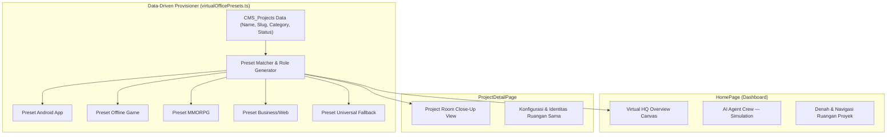

# SLEEPYKOALA STUDIO — VIRTUAL DEVELOPMENT OFFICE DESIGN CONTRACT (B1, B2, & B3)
## DATA MODEL, PIXEL ART VISUAL SPECIFICATION & WEBSITE INTEGRATION

**Status:** Desain Dikunci & Terintegrasi Penuh ke Website Produksi (Milestone B3)  
**Arah Visual Utama:** Cozy Isometric Pixel Art + Modern Professional Website UI (Hybrid Experience)  
**Prinsip Utama:** 2D/2.5D Isometrik Ringan, Zero AI Runtime, Zero Paid API ($0.00 / Rp0), Data-Driven, WCAG AA Accessible

---

## 1. TUJUAN & BATASAN SISTEM

Fitur **Virtual Development Office** adalah pengalaman visual interaktif pada website SleepyKoala Studio yang menggambarkan kantor pengembangan virtual.

### Batasan Wajib (Strict Boundaries):
1. **Simulasi Browser Murni:** Bukan sistem AI agent runtime sungguhan, bukan framework CrewAI, dan bukan pemantauan aktivitas Antigravity secara real-time.
2. **Label Mandatori:** Seluruh tampilan visual kantor dan ruangan **wajib menyertakan label persisten**:
   ```
   AI Agent Crew — Simulation
   ```
3. **Teknologi Ringan (Bukan 3D / WebGL):** Menggunakan kombinasi SVG, CSS responsif, dan React murni. Bebas dari engine 3D berat (Three.js, WebGL) untuk menjamin beban ringan pada perangkat mobile.
4. **Zero-Cost Lock:** Tanpa server VPS, tanpa API AI berbayar, tanpa biaya langganan ($0.00 / Rp0).
5. **Aksesibilitas & Fallback:** Mendukung `prefers-reduced-motion` dan mode fallback statis informatif untuk perangkat berdaya rendah.

---

## 2. ARSITEKTUR RUANGAN: ONE VIRTUAL HQ, MULTIPLE PROJECT ROOMS



- **Virtual HQ (Dashboard Utama):** Menampilkan denah kantor secara menyeluruh dengan area kerja 5 agent inti, navigasi ruangan, dan transisi kamera ringan.
- **Project Room (Halaman Detail):** Menampilkan close-up/zoom dari ruangan proyek yang sama. **Dilarang membuat dua ruangan terpisah atau berbeda untuk satu proyek**.

---

## 3. LIMA AGENT INTI (CORE 5 AGENTS)

Setiap ruangan dan kantor pusat memiliki tepat **lima agent inti** dengan peran kanonikal yang konsisten:

| # | Role Kanonikal | Peran Utama | Contoh Spesialisasi (Android App) | Contoh Spesialisasi (Game Dev) |
|---|---|---|---|---|
| 1 | `PLANNER` | Perencanaan & Backlog | Mobile App Architect | Lead Game Designer |
| 2 | `DEVELOPER` | Implementasi Kode & Fitur | Android Engineer (Jetpack Compose) | Gameplay & Physics Programmer |
| 3 | `TESTER` | Pengujian & Verifikasi | Device Matrix & QA Tester | Balance & Difficulty Tester |
| 4 | `REVIEWER` | Review Kualitas, UX & Kode | UX & Accessibility Reviewer | Game Feel & Audio Reviewer |
| 5 | `PUBLISHER` | Kepatuhan & Kesiapan Rilis | Google Play Release Manager | ASO & Release Coordinator |

*Catatan: Jumlah agent inti selalu tetap lima. Spesialisasi kontekstual menyesuaikan kategori proyek.*

---

## 4. PRESET TEMA & DEKORASI KATEGORI

Sistem menyediakan 5 preset tema ruangan:
1. `preset_android_app`: Nuansa studio mobile Android (slate/cyan), whiteboard arsitektur, server build, coffee station.
2. `preset_offline_game`: Nuansa studio game development (purple/violet), poster concept art, trofi, whiteboard game loop.
3. `preset_mmorpg`: Nuansa command hub multipemain (emerald/dark green), server cluster rack, rak buku lore.
4. `preset_business_web`: Nuansa eksekutif profesional (amber/stone), whiteboard alur data, manual kepatuhan.
5. `preset_universal` (*Fallback*): Nuansa khas SleepyKoala Studio (slate/cyan) untuk kategori baru atau yang tidak dikenali.

---

## 5. SKALABILITAS DATA-DRIVEN (N-PROJECT PROVISIONING)

- Pembuatan ruangan dilakukan secara **data-driven** melalui fungsi:
  ```ts
  provisionProjectRoom(projectData): ProjectRoomConfig
  ```
- Ketika proyek baru (misalnya proyek ke-7, ke-20) ditambahkan melalui CMS Web Admin, ruangan dan lima agent inti otomatis terbentuk tanpa memerlukan edit kode sumber khusus untuk proyek tersebut.
- Ruangan proyek berstatus `draft` atau `hidden` tidak akan ditampilkan ke publik.

---

## 6. STRUKTUR KOMPONEN PROTOTIPE VISUAL (PHASE B2)

Komponen visual prototipe Phase B2 diimplementasikan secara terisolasi di direktori `src/components/virtual-office/` tanpa mengubah `HomePage.tsx`, `ProjectDetailPage.tsx`, atau `AdminPage.tsx` sebelum otorisasi Tahap B3:

```
src/components/virtual-office/
├── AgentAvatar.tsx           # Karakter Koala Agent 2D/2.5D SVG dengan aksesori peran & status pill
├── IsometricRoomCanvas.tsx   # Kanvas SVG Isometrik 2.5D, grid ubin, dinding, dekor, & benang komunikasi
├── VirtualHQOverview.tsx     # Overview kantor pusat, status counter, kartu viewport, & room selector
├── ProjectRoomView.tsx       # Tampilan close-up ruangan proyek dengan inspector agent, tab dekor & log
└── VirtualOfficePrototype.tsx # Container interaktif dengan toggle mode HQ/Room, Reduced Motion, & Static Fallback
```

### Fitur Aksesibilitas & Fallback (B2)
1. **Reduced Motion (`reducedMotion: true`):**
   - Menghilangkan pulsing CSS, animasi komunikasi berkedip, dan transisi pergerakan.
   - Mengubah garis aliran komunikasi menjadi garis putus-putus statis.
2. **Static Fallback (`staticFallback: true`):**
   - Menggantikan render animasi dinamis dengan representasi kartu/SVG statis.
   - Menampilkan banner edukatif: `Mode Fallback Statis Aktif — Menampilkan representasi 5 agent inti tanpa animasi.`
   - Kompatibel dengan browser tanpa akselerasi grafis atau mode hemat daya ekstrim.

---

## 7. MILESTONE B3 — COZY ISOMETRIC PIXEL ART REDESIGN & WEBSITE INTEGRATION

Pada Milestone B3, seluruh tampilan Virtual Office telah ditingkatkan dari prototipe SVG generik menjadi sistem visual **Cozy Isometric Pixel Art**:

### A. Struktur Komponen B3
```
src/components/virtual-office/
├── PixelAgentAvatar.tsx      # Sprite Koala pixel art 32x40, kostum peran, status pill modern, & fokus keyboard
├── PixelIsometricCanvas.tsx   # Kanvas dimetrik 2:1 berubin parket/slate/karpet, dinding plester, meja kayu, & props
├── PixelVirtualHQ.tsx         # Overview Virtual HQ di HomePage dengan pemilih ruangan proyek & status counter
├── PixelProjectRoom.tsx       # Ruangan kerja detail di ProjectDetailPage dengan agent inspector & log aktivitas
├── AgentAvatar.tsx           # Adapter backward-compatible yang merender PixelAgentAvatar
└── IsometricRoomCanvas.tsx   # Adapter backward-compatible yang meneruskan props ke PixelIsometricCanvas
```

### B. Integrasi Halaman Website
1. **`src/pages/HomePage.tsx`**:
   - Bagian Virtual HQ disematkan setelah Hero Section dan sebelum Project Grid.
   - Mengambil data proyek nyata dari CMS dan memprovisioning ruangan secara otomatis melalui `provisionVirtualHQ(allProjects)`.
   - Menghubungkan klik tombol "Masuk Ruangan Proyek" langsung ke rute `/projects/:slug`.
2. **`src/pages/ProjectDetailPage.tsx`**:
   - Bagian Project Room disematkan setelah Deskripsi & Screenshot Proyek, sebelum Technical Architecture / Specs.
   - Menggunakan identitas ruangan kanonikal yang sama persis dengan yang ada di Virtual HQ (`room.id === 'room_' + project.slug`).
   - Menyajikan 5 agent inti dengan spesialisasi kontekstual yang disesuaikan dengan kategori proyek (misal: Android Jetpack Compose untuk DompetNalar, Godot/Multiplayer Engine untuk The Broken Origin).

### C. Aset Pixel Art Orisinal (24 File SVG)
Seluruh aset visual disimpan di `public/assets/virtual-office/` dengan atribut `shape-rendering="crispEdges"` dan CSS `image-rendering: pixelated;`.
Dokumentasi lengkap aset tercatat di `PIXEL_ART_ASSET_INVENTORY.md` dan panduan visual di `PIXEL_ART_VISUAL_GUIDELINES.md`.
