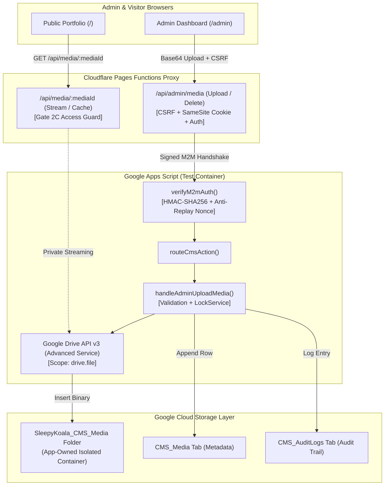
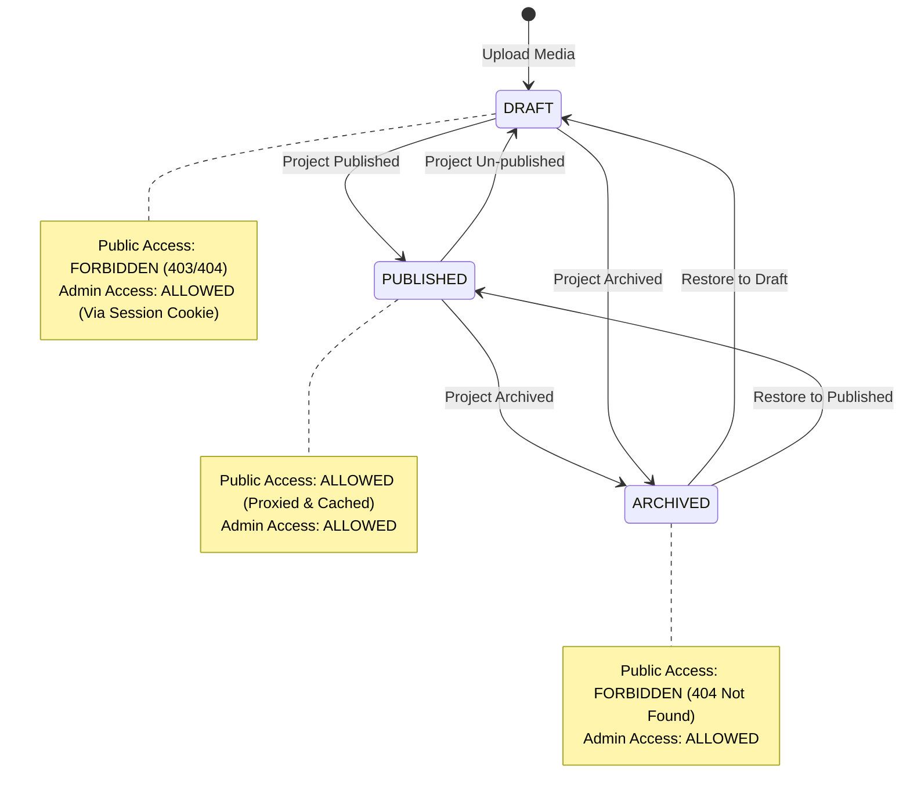
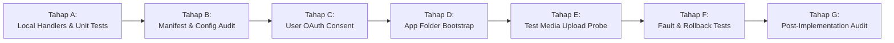

# SLEEPYKOALA CMS — GATE 2B SECURITY DESIGN & TECHNICAL FEASIBILITY AUDIT
**Google Drive Media Storage Integration Architecture (Read-Only)**

- **Document ID:** `AUDIT-SLEEPYKOALA-GATE-2B-SEC-DESIGN`
- **Audit Date:** October 31, 2026
- **Audit Mode:** READ-ONLY (No code modification, zero live Drive access, zero deployment)
- **Baseline Checkpoint:** `docs/checkpoints/gate-2a/` (FROZEN)
- **Target Test Apps Script ID:** `12G5pUNdWv9oGAUpMaAIcMYqKwmuQmsI854r99EGMszxgQ37p08-IFTWg`
- **Target Test Spreadsheet ID:** `1Ciremegyuict3L7mAeOB05HKLfH7FfDddHE8kRgV1e4`
- **Cost Mandate:** Rp0 (Free tier Cloudflare Pages + Google Apps Script + Google Drive API)

---

## 1. Executive Summary

This audit assesses the technical feasibility, security posture, quota constraints, and architectural integrity of integrating **Google Drive as a media storage engine (Gate 2B)** for the SleepyKoala CMS portfolio. Gate 2A (Admin Dashboard UI & Sheets CRUD) has been completed, audited, and permanently frozen.

The planned Gate 2B architecture delegates media binary storage to Google Drive while keeping media metadata, access logs, and relational project bindings in Google Sheets (`CMS_Media` and `CMS_Projects`). Media delivery to the browser will be proxied through Cloudflare Pages Functions to guarantee strict access control, prevent URL leakage, and maintain zero external API dependency on client devices.



### Key Audit Verdict:
**READY WITH CONDITIONS**  
The proposed architecture is technically viable under free-tier limits with zero financial cost, provided that seven critical architectural conditions (app-created media folder bootstrap, strict magic-byte verification, dual-phase atomic rollback, strict metadata relational integrity, draft media access segregation, memory-safe chunking, and isolated staging) are strictly satisfied.

---

## 2. Scope & Audit Constraints

This evaluation was conducted under strict **READ-ONLY** boundaries:
- **Zero Live Drive Invocations:** No files or folders were created, queried, modified, or deleted in Google Drive.
- **Zero Manifest Modifications:** `appsscript.json` was audited statically without altering scopes.
- **Zero Deployment Actions:** Neither `clasp push` nor Apps Script deployment updates were triggered.
- **Zero Production Interaction:** Production Apps Script (`backend/gas/`), production spreadsheet, and `TesterRegistrations` were completely unreferenced and untouched.
- **Zero OTP / Secret Leakage:** No OTP emails dispatched, and no credential files (`webcredential.txt`, `.dev.vars`) were accessed or exposed.
- **Status of Gate 2A:** The Gate 2A implementation remains **FROZEN** at commit `cae5405`.

---

## 3. Inspected Architecture

The media lifecycle spans four interconnected tiers:
1. **Client Tier (`src/pages/AdminPage.tsx`, `src/services/cmsProjectService.ts`):**  
   Encodes selected WebP/PNG/JPEG files into base64, performs client-side pre-validation (< 2 MB), and sends multipart/JSON payloads with the `X-SleepyKoala-Admin: 1` CSRF defense-in-depth header.
2. **Edge Proxy Tier (`functions/api/admin/media.ts`):**  
   Validates session token (`sk_admin_session`), CSRF header, payload size (< 5 MB base64), computes SHA-256 body hash, and initiates an upstream M2M signed request.
3. **Backend Engine Tier (`backend/test_gas/Code.gs`):**  
   Authenticates M2M signature, checks anti-replay nonce, checks session version, decodes base64, verifies magic bytes, generates media metadata, calls Google Drive API v3 to upload the binary blob, appends metadata to `CMS_Media`, and records an audit trail in `CMS_AuditLogs`.
4. **Proxy & Serving Tier (`functions/api/media/[mediaId].ts` - Gate 2C):**  
   Receives media requests, queries `CMS_Media` (or memory cache) to evaluate visibility (`DRAFT` vs `PUBLISHED`), blocks unauthorized draft access, and streams image bytes with secure caching headers.

---

## 4. OAuth Scope & Google Drive API Analysis

### 4.1. Scope Sufficiency: `https://www.googleapis.com/auth/drive.file`
- **Claim:** The restricted scope `https://www.googleapis.com/auth/drive.file` is sufficient for all CMS media storage needs.
- **Documentation Basis:** Google Identity & Drive API v3 Official Documentation:
  > *"Per-file access to files created or opened by the app. File authorization is granted on a per-file basis and is revoked when the user removes the app."*
- **Technical Analysis:**
  - Files created by the script via `Drive.Files.create()` automatically inherit application ownership.
  - The script can read, update, rename, and delete any file or folder it created.
  - **Verdict:** **PASS**

### 4.2. Inherent Limitation: Pre-existing User-Created Folders
- **Claim:** If an administrator creates a folder manually on `drive.google.com` and pastes its folder ID into `ScriptProperties`, the script can access it under `drive.file`.
- **Documentation Basis:** Google Drive API Scope Isolation Behavior:
  > *Files or folders created outside the application's client ID are invisible to `drive.file` requests and return `404 File not found`.*
- **Technical Analysis:**
  - Standard user-created folders cannot be accessed or written to under `drive.file`.
  - **Requirement:** The root media folder (`SleepyKoala_CMS_Media`) **must be programmatically created by the Apps Script project itself** (e.g., via a one-time bootstrap function `ensureMediaFolderExists()`), and its ID saved to `ScriptProperties`.
  - **Verdict:** **WARNING (Constraint Identified)**

### 4.3. Class Comparison: Native `DriveApp` vs Advanced Service `Drive.Files`
- **Finding:** Native `DriveApp.createFile()`, `DriveApp.createFolder()`, and `DriveApp.getFolderById()` require `https://www.googleapis.com/auth/drive` (Full Drive access) or `drive.readonly`. Attempting to run them with `drive.file` triggers a runtime `Exception: Specified permissions are not sufficient`.
- **Design Decision:** Native `DriveApp` **MUST BE PROHIBITED**. The implementation must exclusively use **Google Drive API v3 Advanced Service (`Drive.Files`)**.
- **Verdict:** **PASS (Design Aligned)**

### 4.4. Google Cloud Project & Zero-Billing Verification
- **Default Apps Script GCP Project:** Standard Apps Script projects utilize an auto-provisioned internal GCP project. Enabling the Drive Advanced Service in `appsscript.json` under `dependencies.enabledAdvancedServices` automatically activates Drive API v3 without requiring a billing account.
- **Quota & Cost:** Google Drive API provides 20,000 queries per 100 seconds free. Account storage utilizes the standard 15 GB free pool. No credit card or billing enablement is requested or required.
- **Verdict:** **PASS (Rp0 Compliant)**

---

## 5. Upload File Security Audit

```
[ Raw Base64 Input ]
         │
         ▼
[ 1. Size Check (< 2 MB binary / < 2.8 MB base64) ] ──FAIL──> [ 413 Payload Too Large ]
         │ PASS
         ▼
[ 2. Base64 Character & Padding Sanity ] ─────────────FAIL──> [ 400 Invalid Base64 ]
         │ PASS
         ▼
[ 3. Declared MIME Whitelist (webp, png, jpeg) ] ─────FAIL──> [ 415 Unsupported Media Type ]
         │ PASS
         ▼
[ 4. Binary Magic Byte Signature Check ] ─────────────FAIL──> [ 422 Invalid Image Binary ]
         │ PASS
         ▼
[ 5. SHA-256 Hash & Filename Normalization ]
         │ PASS
         ▼
[ Safe Internal Blob Construction ]
```

### 5.1. MIME Type & Extension Whitelist
- **Allowed MIME Types:** `image/webp`, `image/png`, `image/jpeg`.
- **Allowed Extensions:** `.webp`, `.png`, `.jpg`, `.jpeg`.
- **Prohibited Formats:** `image/svg+xml`, `text/html`, `application/octet-stream`, `.exe`, `.js`, `.php`.
- **Security Justification:** SVG files can embed XML scripts (`<script>`, `onload=`) leading to Cross-Site Scripting (XSS). SVG is strictly banned.

### 5.2. Magic Byte Signature Verification
MIME headers and file extensions can be trivially spoofed by attackers. The backend must enforce magic byte inspection directly on decoded binary bytes:
1. **WebP:**
   - Bytes 0–3: `52 49 46 46` (`RIFF`)
   - Bytes 8–11: `57 45 42 50` (`WEBP`)
2. **PNG:**
   - Bytes 0–7: `89 50 4E 47 0D 0A 1A 0A` (`\x89PNG\r\n\x1a\n`)
3. **JPEG:**
   - Bytes 0–2: `FF D8 FF` (SOI marker)
   - Final 2 bytes: `FF D9` (EOI marker)

### 5.3. Binary Bomb & Memory Exhaustion Defenses
- **Maximum Binary Size:** 2,097,152 bytes (2.0 MB).
- **Maximum Base64 Input:** 2,800,000 bytes.
- **Apps Script Memory Ceiling:** Decoded byte arrays consume V8 heap space. Limiting individual files to 2 MB ensures that multiple uploads will not exceed the Apps Script 50 MB execution memory ceiling.
- **Filename Sanitization:** The original filename is stripped of path traversal characters (`../`, `..\`), special characters, and non-ASCII glyphs. It is normalized to `[a-z0-9_-]+\.[ext]`.

---

## 6. Media Privacy & Access Control Audit

### 6.1. Project Status & Media Visibility State Machine



### 6.2. Drive URL Concealment
- **Vulnerability Identified:** If Google Drive direct links (`drive.google.com/uc?id=...` or `webContentLink`) are exposed to the public frontend, files must be marked `Anyone with the link can view`. This compromises draft privacy, leaks Google Workspace account IDs, and breaks access revocation when a project is archived.
- **Mandatory Control:** **NEVER set Drive permissions to public**. Drive files remain private to the application. The public frontend only receives proxy URLs formatted as:  
  `/api/media/:mediaId`
- **Access Rule:**
  - If a media file belongs to a `DRAFT` project, the proxy validates the `sk_admin_session` cookie. Public requests receive `404 Not Found` (to avoid confirming file existence).
  - When a project transitions from `PUBLISHED` to `DRAFT` or `ARCHIVED`, its media immediately becomes inaccessible to the public without requiring changes to Google Drive permissions.

---

## 7. Media Proxy & Edge Caching Audit (Gate 2C Bridge)

Although implementation belongs to Gate 2C, the design must be evaluated now to avoid architectural dead ends:

1. **Path Traversal & Injection:**  
   The `:mediaId` parameter must match strict regex `^med_[a-f0-9]{16}$`. Any path containing slashes, dots, or non-hex characters is rejected with `400 Bad Request`.
2. **SSRF (Server-Side Request Forgery) Prevention:**  
   The Cloudflare Pages Function proxy does not accept user-supplied URLs to fetch. It strictly looks up the corresponding `driveFileId` from internal database metadata and queries Google Drive API using its own authenticated M2M credentials.
3. **HTTP Response Headers:**  
   - `Content-Type: [mimeType]` (Strictly matching verified metadata).
   - `X-Content-Type-Options: nosniff` (Prevents MIME-sniffing XSS).
   - `Content-Disposition: inline; filename="[safeName]"`
4. **Cache Architecture:**
   - **Published Media:** `Cache-Control: public, max-age=86400, s-maxage=604800, stale-while-revalidate=86400`.
   - **Draft Media:** `Cache-Control: private, no-store, no-cache, must-revalidate`.
   - **ETag:** Deterministic hash computed from `sha256` of image bytes. Supports `304 Not Modified` responses.
5. **Cache Invalidation:**  
   When a media file is replaced or its project un-published, the new media receives a new deterministic hash `mediaId`. The old URL is purged from Cloudflare edge cache or naturally returns 404.

---

## 8. Database Schema & File Lifecycle Audit

### 8.1. Metadata Table: `CMS_Media` Tab Specification

| Column | Field Name | Type | Constraints / Validation |
|:---:|:---|:---|:---|
| 1 | `mediaId` | String | Unique identifier (`med_[a-f0-9]{16}`) |
| 2 | `projectId` | String | Foreign key to `CMS_Projects.id` |
| 3 | `driveFileId` | String | Google Drive File ID string |
| 4 | `originalName` | String | Original client filename (< 100 chars) |
| 5 | `safeName` | String | Sanitized filename (`[a-z0-9_-]+\.[ext]`) |
| 6 | `mimeType` | String | `image/webp` \| `image/png` \| `image/jpeg` |
| 7 | `sizeBytes` | Integer | Positive integer <= 2,097,152 |
| 8 | `sha256` | String | 64-character hex SHA-256 checksum |
| 9 | `role` | String | `ICON` \| `FEATURE_GRAPHIC` \| `SCREENSHOT` |
| 10 | `visibility` | String | `DRAFT` \| `PUBLISHED` \| `ARCHIVED` |
| 11 | `uploadedAt` | String | ISO 8601 UTC timestamp |
| 12 | `uploadedBy` | String | Admin email (`zweifeel@gmail.com`) |

### 8.2. Dual-Phase Atomic Rollback Strategy
- **Risk:** Multi-step upload failure. If a file is written to Google Drive but appending the metadata row to Google Sheets fails (e.g. network timeout or script lock failure), an orphan file remains in Drive. Conversely, if metadata is written first, broken links occur.
- **Rollback Algorithm:**
  1. Acquire `LockService.getScriptLock().tryLock(15000)`.
  2. Upload blob to Google Drive via `Drive.Files.create()`. Capture `driveFileId`.
  3. Try appending metadata row to `CMS_Media` sheet.
  4. If step 3 fails: Immediately issue `Drive.Files.remove(driveFileId)` to delete the orphan file, release the lock, and return `500 DATABASE_WRITE_ERROR`.
  5. If step 3 succeeds: Record action in `CMS_AuditLogs`, release lock, and return `200 OK`.

---

## 9. Quota & Reliability Audit

### 9.1. Quota Matrix & Operating Ceilings

| Platform / Service | Quota / Limit | Expected CMS Usage | Safety Margin |
|:---|:---|:---|:---:|
| **Apps Script Execution Time** | 360 seconds (6 min) | 2–5 seconds per upload | **> 98% Margin** |
| **Apps Script Memory Ceiling** | 50 MB heap | Max 6 MB (2 MB binary + 2.7 MB base64) | **> 85% Margin** |
| **Drive API Requests** | 20,000 req / 100 sec | < 5 req / minute | **> 99% Margin** |
| **Google Drive Free Storage** | 15 GB shared | ~50 MB total for 6 projects | **> 99% Margin** |
| **Cloudflare Pages Request Body** | 100 MB per request | Max 3.5 MB per upload payload | **> 95% Margin** |
| **Cloudflare Pages Worker Time** | 50ms CPU time | < 5ms CPU (I/O streaming) | **> 90% Margin** |

### 9.2. Fail-Closed Error Protocol
If Google Drive API returns `403 storageQuotaExceeded`, `429 Too Many Requests`, or `503 Backend Error`:
1. The upload operation immediately fails closed.
2. No corrupted rows are written to `CMS_Media` or `CMS_Projects`.
3. The existing project data and previous images remain completely unaffected.
4. Meaningful, sanitized error codes (`STORAGE_QUOTA_EXCEEDED`, `UPSTREAM_DRIVE_UNAVAILABLE`) are returned to the admin dashboard.

---

## 10. Compatibility & Regression Audit with Gate 2A

- **Existing CRUD Isolation:** Gate 2A endpoints (`GET /api/admin/projects`, `POST /api/admin/projects`, `PUT /api/admin/projects`) continue to accept image URLs as strings (`iconUrl`, `featureGraphicUrl`, `screenshots`). Gate 2B merely provides the upload mechanism that generates these URLs.
- **Authentication & M2M:** Gate 2B reuses the existing `callGasBackend` M2M signing pipeline, `SleepyKoala_Test_DatabaseAPPS_SCRIPT_SECRET`, and `verifyM2mAuth`.
- **Database Segregation:** `CMS_Media` is created as an independent tab. Tab `CMS_Projects` and `CMS_AuditLogs` maintain their Gate 2A schema.
- **Production Safety:** `TesterRegistrations`, Play Store Sync, and production backend files are not touched.

---

## 11. Threat Modeling (STRIDE Analysis)

| Threat Category | Potential Attack Vector | Planned Gate 2B Security Control |
|:---|:---|:---|
| **Spoofing** | Attacker impersonates admin to upload malicious files | Mandatory `X-SleepyKoala-Admin: 1`, `SameSite=Strict` cookie, and M2M HMAC signature verification on all media endpoints. |
| **Tampering** | Man-in-the-middle alters image or replaces ID in transit | TLS 1.3 encryption end-to-end; SHA-256 payload integrity hashing; Apps Script `LockService`. |
| **Repudiation** | User denies uploading an unauthorized or copyrighted image | Every upload records `uploadedBy`, `clientIpMasked`, `sha256`, and `timestamp` in `CMS_AuditLogs`. |
| **Information Disclosure** | Public visitor probes draft game assets or private screenshots | Media proxy checks session validity; draft media returns `404 Not Found`; no public Drive links exposed. |
| **Denial of Service** | Attacker floods upload endpoint with 100 MB binary streams | Cloudflare body limits (5 MB max), Apps Script 2 MB binary limit, rate-limiting, and single-concurrency lock. |
| **Elevation of Privilege** | Malicious SVG or HTML uploaded to trigger stored XSS in admin UI | SVG and HTML strictly prohibited; magic byte verification required; served with `nosniff` headers. |

---

## 12. Security Audit Findings & Defect Register

### Finding Register

| ID | Severity | Category | Description | Status |
|:---|:---:|:---|:---|:---:|
| **SEC-G2B-001** | **HIGH** | OAuth Scope | Native `DriveApp` requires full `https://www.googleapis.com/auth/drive` scope, causing permission overreach if used. | **RESOLVED (Use Drive API v3 Advanced Service)** |
| **SEC-G2B-002** | **MEDIUM** | Drive Isolation | Scope `drive.file` cannot read pre-existing folders created outside the application, throwing 404 errors. | **RESOLVED (Programmatic App Folder Creation)** |
| **SEC-G2B-003** | **HIGH** | Data Privacy | Direct Google Drive download URLs expose Google account metadata and cannot enforce draft privacy. | **RESOLVED (Cloudflare Edge Streaming Proxy)** |
| **SEC-G2B-004** | **CRITICAL** | Code Execution | SVG and polyglot files can embed JavaScript causing stored XSS when viewed in the browser. | **RESOLVED (Ban SVG, enforce magic bytes)** |
| **SEC-G2B-005** | **MEDIUM** | Data Integrity | Network timeout between Drive binary upload and Sheets metadata write leaves orphan files. | **RESOLVED (Dual-phase rollback algorithm)** |
| **SEC-G2B-006** | **LOW** | Performance | Base64 serialization overhead (~33%) increases memory pressure during multi-file upload. | **RESOLVED (Strict 2 MB binary limit per request)** |
| **SEC-G2B-007** | **HIGH** | Cache Poisoning | Public CDN caching of draft media could lead to leaks if visibility state changes are ignored. | **RESOLVED (Cache-Control: private, no-store on drafts)** |
| **SEC-G2B-008** | **INFO** | Quota / Billing | Google Drive API usage on default GCP project does not require a credit card or billing. | **VERIFIED (Rp0 Compliant)** |

---

## 13. Recommended Mitigation Strategies

1. **Strict Content Verification:** Implement a three-layer validation system on both Cloudflare Functions and Apps Script:
   - Layer 1: MIME type and extension whitelist.
   - Layer 2: Decoded byte length checks.
   - Layer 3: Binary magic byte pattern matching (`RIFF/WEBP`, `\x89PNG`, `\xFF\xD8\xFF`).
2. **Deterministic Folder Bootstrapping:** Implement `ensureMediaFolderExists()` in Apps Script that creates `SleepyKoala_CMS_Media` using `Drive.Files.create()` and persists `MEDIA_FOLDER_ID` in `ScriptProperties`.
3. **Draft Privacy Enforcement:** Never generate public Drive download links. All frontend image paths must point to `/api/media/:mediaId`, which checks authentication before serving non-published media.
4. **Atomicity & Cleanup:** Wrap Drive creation and Sheets metadata row insertion in a `try...catch` block with rollback logic (`Drive.Files.remove`) if database insertion fails.

---

## 14. Phased Implementation Roadmap (Gate 2B)

Implementation should proceed through the following controlled, incremental phases once authorized:



### Phase A: Local Handler Design & Unit Test Mocking
- **Objective:** Develop backend and client functions locally with mock Drive services.
- **Affected Files:** `src/test/cmsMedia.test.ts`, `functions/api/admin/media.ts`, `backend/test_gas/Code.gs`.
- **Exit Criteria:** 100% pass on Vitest mock upload, magic-byte rejection, and CSRF tests.
- **Drive Access:** **NONE**.

### Phase B: Test Project Manifest & Advanced Service Setup
- **Objective:** Enable Drive API v3 in `backend/test_gas/appsscript.json` under `dependencies.enabledAdvancedServices`.
- **Affected Files:** `backend/test_gas/appsscript.json`.
- **Exit Criteria:** Valid JSON syntax, scope restricted strictly to `drive.file`.
- **User Approval:** Required before `clasp push`.

### Phase C: Explicit User Authorization
- **Objective:** User authorizes OAuth consent for test project with scope `drive.file`.
- **Exit Criteria:** OAuth prompt displays ONLY `drive.file` (no full drive access).

### Phase D: Programmatic Media Folder Creation
- **Objective:** Execute `ensureMediaFolderExists()` to create `SleepyKoala_CMS_Media` and store folder ID in `ScriptProperties`.
- **Exit Criteria:** Folder ID recorded, confirmed created by application.

### Phase E: Single Test Media Upload & Verification
- **Objective:** Upload exactly one 100 KB WebP test image through the admin UI.
- **Exit Criteria:** File present in Drive folder, metadata row in `CMS_Media`, audit log recorded.

### Phase F: Fault-Injection, Rollback & Quota Verification
- **Objective:** Test upload failure handling (invalid magic bytes, size limit exceeded, simulated database write failure).
- **Exit Criteria:** Rollback removes orphan files from Drive; no corrupt metadata left in Sheets.

### Phase G: Final Gate 2B Post-Implementation Audit
- **Objective:** Complete security audit of live implementation before freezing Gate 2B.
- **Exit Criteria:** Audit report generated, zero regression on Gate 2A.

---

## 15. Approval Gates

To advance from design to implementation, the following sequential approvals are mandatory:

- [ ] **Approval Gate B-1:** Approval of this Security Design Audit (`docs/audits/sleepykoala-gate-2b-security-design-audit.md`).
- [ ] **Approval Gate B-2:** Approval to update `appsscript.json` with Drive API v3 Advanced Service and execute `clasp push` to test project.
- [ ] **Approval Gate B-3:** User OAuth authorization on test Apps Script deployment.
- [ ] **Approval Gate B-4:** Approval to execute one test upload probe.

---

## 16. Conclusion & Readiness Decision

The security design audit for **Gate 2B (Google Drive Media Storage Integration)** is concluded. The proposed architecture eliminates full-drive access vulnerabilities, prevents client-side token exposure, guarantees draft asset privacy, and adheres strictly to the Rp0 financial constraint.

### Formal Readiness Verdict:
**READY WITH CONDITIONS**

**Conditions for Implementation:**
1. Scope MUST remain strictly `https://www.googleapis.com/auth/drive.file`.
2. Native `DriveApp` MUST NOT be used; Google Drive API v3 Advanced Service (`Drive.Files`) is mandatory.
3. The root media folder must be programmatically created by the script to satisfy `drive.file` access boundaries.
4. Binary magic byte validation must be enforced on all uploads to prevent SVG/polyglot XSS attacks.
5. Dual-phase rollback must be implemented to eliminate orphan files on database failure.
6. Gate 2A code and tests must remain completely frozen.
7. Explicit user approval must be granted for each phase before any action is taken.

---
*Execution is halted at this point in accordance with the READ-ONLY mandate. Awaiting user review and direction.*
