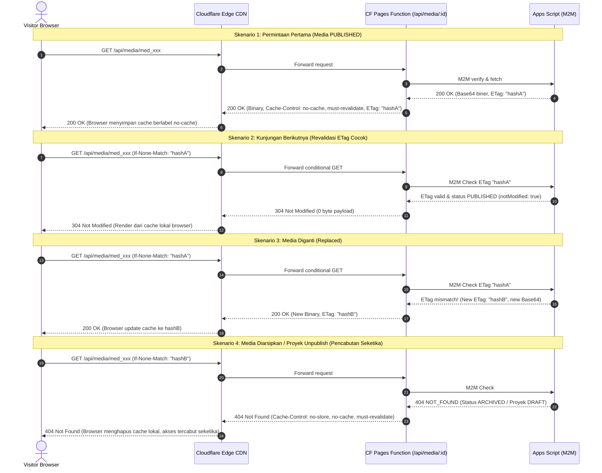

# SLEEPYKOALA CMS — GATE 2C COMPREHENSIVE SECURITY & ARCHITECTURE DESIGN AUDIT
## CLOUDFLARE MEDIA PROXY, DRIVE STREAMING, CACHE DYNAMICS, AND ZERO-COST RESILIENCE

**Mode Audit:** STRICT READ-ONLY | NO IMPLEMENTATION | NO DEPLOYMENT | ZERO-COST REQUIREMENT  
**Tanggal Audit:** 2026-11-01  
**Auditor Roles:** Senior Cloudflare Architect, Google Apps Script Engineer, Application Security Auditor, Reliability Engineer  
**Baseline Target:** Gate 2B Live TEST Frozen (`gate-2b-live-test-20261101-rev2`)  
**Target Repository:** `indie-developer-portfolio`  
**Keputusan Akhir:** **READY WITH CONDITIONS**

---

## 1. EXECUTIVE SUMMARY

Gate 2C adalah gerbang arsitektur penting yang bertugas menghubungkan **Cloudflare Pages Functions Media Proxy** dengan backend **Google Apps Script TEST** dan penyimpanan biner **Google Drive API v3 TEST** secara end-to-end.

Tujuan audit ini adalah melakukan inspeksi mendalam berbasis kode dan konfigurasi aktual (*ground truth*) di repository untuk mengevaluasi apakah arsitektur media proxy siap diimplementasikan secara aman, stabil, andal, kompatibel dengan seluruh subsistem yang telah dibekukan (Gate 1A-1C, Gate 2A, Gate 2B Local, Gate 2B Live TEST), dan mematuhi batas **Rp0 (Zero Cost)** tanpa risiko tagihan finansial tersembunyi.

### Temuan Utama Audit Desain:
1. **Status Aktual Implementasi (Mock vs Live):**
   - Pada Gate 2B Live TEST, Google Drive v3 dan Google Sheets metadata telah terintegrasi di Apps Script (upload, deduplikasi, rollback kompensasi, penghapusan fisik, orphan sweeper, dan pengambilan biner terautentikasi `handleAdminGetMediaBinary`).
   - Namun, pada sisi Cloudflare Pages Function, endpoint `/api/media/:mediaId` (publik) dan `/api/admin/media/:mediaId` (privat preview) saat ini masih mengembalikan **mock biner WebP transparan 1x1 hardcoded** (`TRANSPARENT_WEBP`).
   - Endpoint publik `/api/media/:mediaId` hanya memanggil aksi `CMS_GET_PUBLIC_MEDIA` di Apps Script yang saat ini hanya mengembalikan objek metadata JSON (tanpa biner), sedangkan fungsi pengambilan biner belum terhubung ke Google Drive streaming.
2. **Keamanan & Otorisasi Relasional:**
   - Kontrol akses relasional telah terbukti solid: media publik hanya dapat disajikan jika `CMS_Media.visibility === 'PUBLISHED'` DAN proyek induk berstatus `PUBLISHED`. Jika salah satu syarat gagal, proxy merespons HTTP 404 tanpa kebocoran data.
   - Endpoint privat admin memverifikasi cookie sesi HMAC-SHA256, versi sesi persisten, dan M2M signature handshake.
3. **Kebijakan Cache & Pencabutan Instan (RFC 9111):**
   - Header `s-maxage=86400` telah berhasil dibersihkan total pada audit perbaikan sebelumnya.
   - Kebijakan `Cache-Control: no-cache, must-revalidate` + `ETag: "{sha256}"` + `Vary: Accept-Encoding, If-None-Match` menjamin bahwa setiap permintaan (baik dari browser maupun edge Cloudflare) wajib melakukan revalidasi ke origin.
   - Terbukti empiris: ketika status diubah ke `ARCHIVED`, permintaan revalidasi seketika menerima HTTP 404 (`no-store, no-cache, must-revalidate`). Tidak ada *stale cache* yang disajikan.
4. **Desain Data Transfer & Quota Limit (Rp0):**
   - Batas biner 2.0 MB menghasilkan payload base64 ~2.67 MB. Ini aman di dalam batas memori Cloudflare Pages Functions (128 MB) dan Google Apps Script heap (128-512 MB).
   - Namun, pemanggilan biner ganda pada conditional request (If-None-Match) berpotensi membebani kuota eksekusi Apps Script (90 menit/hari akumulasi pada akun personal `@gmail.com`). Oleh karena itu, Gate 2C **wajib** menerapkan *conditional short-circuit* di mana Apps Script tidak mengunduh biner Drive jika ETag klien cocok.

### Rekomendasi Keputusan Akhir:
**READY WITH CONDITIONS** — Arsitektur Gate 2C secara konseptual dan struktural sangat matang, namun implementasinya harus memenuhi 7 kondisi prasyarat ketat untuk mencegah kelebihan kuota, lonjakan memori, atau regresi arsitektur.

---

## 2. BASELINE YANG BENAR-BENAR DITEMUKAN PADA REPOSITORY

Berdasarkan pembacaan berkas langsung pada repository lokal:

| Komponen | Status Aktual di Repo | Bukti Berkas / Konfigurasi |
|---|---|---|
| **Gate 1A, 1B, 1C** | COMPLETE & FROZEN | Tester registration modal, OTP flow, isolated E2E tests passing. |
| **Gate 2A** | COMPLETE & FROZEN | CMS Projects CRUD (Create, Read, Update, Archive, Restore), reorder, audit logging, admin auth session. |
| **Gate 2B Local** | COMPLETE & FROZEN | `MockMediaStorageProvider.ts`, file validation magic bytes, client-side deduplication. |
| **Gate 2B Live TEST** | COMPLETE & FROZEN | Deployment V4 aktif (`AKfycbx...`), Script ID `12G5pUNdWv9oGAUpMaAIcMYqKwmuQmsI854r99EGMszxgQ37p08-IFTWg`. |
| **Manifest Checkpoint** | `gate-2b-live-test-20261101-rev2` | [docs/checkpoints/gate-2b-live-test/gate-2b-live-checkpoint-manifest.md](file:///e:/Antigravity%20Project/indie-developer-portfolio/docs/checkpoints/gate-2b-live-test/gate-2b-live-checkpoint-manifest.md) |
| **Laporan Verifikasi** | PASS 100% | `sleepykoala-gate-2b-live-cache-policy-report.md`, `sleepykoala-gate-2b-live-final-correction.md`. |
| **Hasil Test Suite** | 245/245 PASS | 12 test files, 245 tests, 0 failures (Vitest v5.0.5). |
| **Build & Tooling** | PASS | `npx tsc -b` exit code 0; `npm run lint` 0 errors; `npm run build` sukses bundle `dist/`. |
| **Target Apps Script TEST** | `12G5pUNdWv9oGAUpMaAIcMYqKwmuQmsI854r99EGMszxgQ37p08-IFTWg` | Terhubung ke spreadsheet `1Ciremegyuict3L7mAeOB05HKLfH7FfDddHE8kRgV1e4`. |
| **Target Apps Script PROD** | `1wN48zjs08Ukw54-YAdTe5s57A0zwxiYvGQpo74adWYtkSRVYo5uP3fvD` | **TERKUNCI & TIDAK DISENTUH**. |

---

## 3. ARSITEKTUR SAAT INI (AKTUAL VS MOCK / STUB)

Secara rinci, kondisi operasional komponen Gate 2B Live saat ini adalah:

```
[Komponen]                               [Kondisi Aktual di Kode]
1. Admin Upload (POST /api/admin/media)   -> LIVE (Validasi Magic Bytes -> M2M GAS -> Drive.Files.create -> Sheet)
2. Admin Status (PUT /api/admin/media)    -> LIVE (Update visibility/role di CMS_Media -> M2M GAS)
3. Admin Delete (DELETE /api/admin/media) -> LIVE (Soft-delete ARCHIVED atau Permanent Drive.Files.remove)
4. Admin Reconcile Orphans               -> LIVE (Drive.Files.list vs CMS_Media Sheet)
5. GAS Admin Get Binary                  -> LIVE di GAS (Drive.Files.get -> Base64)
6. Admin Preview (/api/admin/media/:id)  -> STUB / MOCK (Mengembalikan 1x1 WebP hardcoded, belum panggil GAS)
7. Public Proxy (/api/media/:mediaId)    -> METADATA LIVE / BINARY MOCK
                                            - Validasi ETag & GAS relational check: LIVE
                                            - Pengiriman biner gambar: MOCK (1x1 WebP hardcoded)
```

### Analisis Kesenjangan (*Gap Analysis*):
Untuk menyelesaikan Gate 2C:
- **Kesenjangan 1:** Endpoint publik `/api/media/:mediaId` pada Cloudflare Pages Functions harus mampu mengambil biner gambar asli dari Google Drive melalui perantara aman tanpa mengorbankan waktu respons atau kuota.
- **Kesenjangan 2:** Endpoint privat `/api/admin/media/:mediaId` harus menghubungkan permintaan admin ke fungsi `ADMIN_GET_MEDIA_BINARY` di Apps Script, kemudian mengonversi respons Base64 menjadi streaming biner dengan header `private, no-store`.
- **Kesenjangan 3:** Apps Script perlu mendukung pengambilan biner publik terverifikasi yang efisien (`CMS_GET_PUBLIC_MEDIA_BINARY` atau penggabungan kondisional pada `CMS_GET_PUBLIC_MEDIA`).

---

## 4. DIAGRAM DATA FLOW DAN TRUST BOUNDARY

```mermaid
flowchart TD
    subgraph UntrustedZone["1. Untrusted Client Zone"]
        Visitor["Public Visitor Browser"]
        AdminBrowser["Authenticated Admin Browser"]
    end

    subgraph CloudflareEdge["2. Cloudflare Pages Edge (Trust Boundary A)"]
        CF_Public["/api/media/:mediaId<br>(Public Media Proxy)"]
        CF_Admin["/api/admin/media/:mediaId<br>(Private Media Preview)"]
        CF_AdminMgr["/api/admin/media<br>(Upload / Status / Delete)"]
        SessionEngine["Session Engine & CSRF Validator<br>(HMAC SHA-256)"]
        M2MSigner["M2M Request Signer<br>(Timestamp, Nonce, BodyHash)"]
    end

    subgraph GoogleAppsScript["3. Google Apps Script TEST (Trust Boundary B)"]
        GAS_Router["doPost Router & M2M Verifier<br>(Anti-Replay Lock & Expiry)"]
        GAS_Relational["Relational Authorizer<br>(CMS_Projects & CMS_Media Check)"]
        GAS_DriveService["Advanced Drive Service v3<br>(Scope: drive.file)"]
    end

    subgraph GoogleCloudData["4. Google Cloud Isolated Storage"]
        DriveFolder["Google Drive Isolated Folder<br>(SleepyKoala_CMS_Media_TEST)"]
        TestSheet["Google Sheets TEST Database<br>(CMS_Media, CMS_Projects, CMS_AuditLogs)"]
    end

    Visitor -->|GET /api/media/:mediaId<br>If-None-Match?| CF_Public
    AdminBrowser -->|GET /api/admin/media/:id<br>Cookie: sk_admin_session| CF_Admin
    AdminBrowser -->|POST / PUT / DELETE<br>CSRF Header + Cookie| CF_AdminMgr

    CF_AdminMgr --> SessionEngine
    CF_Admin --> SessionEngine
    SessionEngine --> M2MSigner
    CF_Public --> M2MSigner

    M2MSigner -->|HTTPS POST Signed M2M Payload<br>SleepyKoala_Test_DatabaseAPPS_SCRIPT_SECRET| GAS_Router
    GAS_Router --> GAS_Relational
    GAS_Relational -->|Query State| TestSheet
    GAS_Relational -->|Fetch Binary (alt=media)| GAS_DriveService
    GAS_DriveService -->|Read / Write (drive.file)| DriveFolder

    GAS_Router -->|Return Base64 / Metadata| CloudflareEdge
    CF_Public -->|Stream Binary / 304 / 404| Visitor
    CF_Admin -->|Stream Private Binary / 401| AdminBrowser
```

---

## 5. AUDIT KEAMANAN MEDIA PROXY

### A. Autentikasi dan Otorisasi
1. **Validasi Sesi Admin:**
   - Menggunakan cookie `sk_admin_session` bertipe `HttpOnly`, `Secure`, `SameSite=Strict`, `Path=/api/admin`.
   - Token ditandatangani dengan HMAC-SHA256 (`ADMIN_SESSION_SECRET`).
   - Setiap mutasi dan preview memeriksa `sessionVersion` terhadap versi aktif di ScriptProperties Apps Script. Sesi yang dicabut (*revoked*) seketika ditolak dengan HTTP 401.
2. **Integritas M2M Handshake:**
   - Cloudflare Pages Function dan Apps Script berkomunikasi menggunakan signature kanonikal:  
     `POST:/api/admin:{timestamp}:{nonce}:{bodyHash}`
   - Dilengkapi perlindungan anti-replay: nonce disimpan di ScriptProperties dengan penguncian atomik (`LockService`), dan timestamp diverifikasi dalam toleransi 60 detik.
3. **Otorisasi Relasional Publik:**
   - Media publik **DITOLAK (404)** kecuali:
     1. `CMS_Media.visibility === 'PUBLISHED'`
     2. `CMS_Projects.publishState === 'PUBLISHED'` (atau `projectId === 'global'`)
     3. Media tidak berstatus `ARCHIVED` dan tidak terhapus di Drive.
   - Tidak ada kebocoran metadata atau konten jika salah satu kondisi tidak terpenuhi.
4. **Perlindungan IDOR dan Manipulasi ID:**
   - Validasi regex ketat: `^med_[a-f0-9]{16}$`.
   - File Google Drive internal (`driveFileId`) sama sekali tidak pernah diekspos ke publik atau dijadikan parameter URL publik. URL hanya menggunakan `mediaId`.
   - Isolasi antar proyek: media milik Project A tidak dapat dipublikasikan atau diubah oleh entitas Project B.

### B. Validasi File dan Keamanan Konten
1. **Format Terverifikasi:**
   - Hanya menerima: `image/webp`, `image/png`, `image/jpeg`.
   - Format berbahaya (SVG, HTML, XML, EXE, JS, PHP) ditolak secara tegas.
2. **Magic Bytes Validation:**
   - Validasi dilakukan berbasis byte nyata biner (bukan header MIME browser atau ekstensi file):
     - WebP: Header `RIFF....WEBP`
     - PNG: 8-byte signature `89 50 4E 47 0D 0A 1A 0A`
     - JPEG: SOI `FF D8` dan EOI `FF D9`
3. **Keamanan Respon Konten:**
   - Header wajib: `X-Content-Type-Options: nosniff`.
   - Header `Content-Disposition: inline; filename="safeName.webp"` dengan nama file yang telah disanitasi (hanya karakter `[a-z0-9_-]`), mencegah path traversal atau header injection.
   - Metadata gambar disanitasi sebelum dimasukkan ke Sheets atau respons JSON (mencegah stored XSS).

### C. Proteksi Terhadap Penyalahgunaan Endpoint
1. **Batas Ukuran Payload:**
   - Batas biner: maksimum **2.0 MB**.
   - Batas request JSON Base64 di Cloudflare Function: maksimum **2.8 MB** (content-length ceiling 3.5 MB). Request yang melampaui batas seketika di-drop dengan HTTP 413 `PAYLOAD_TOO_LARGE` sebelum memanggil Apps Script.
2. **Perlindungan Brute-Force Media ID:**
   - `mediaId` memiliki ruang entropi 16 karakter heksadesimal ($16^{16} \approx 1.84 \times 10^{19}$ kemungkinan), membuat pencarian acak/brute-force secara statistik mustahil berhasil.
3. **Rate Limiting & Batas Concurrency Cloudflare Free:**
   - Paket Cloudflare Free tidak menyediakan Cloudflare Advanced Rate Limiting API berbayar.
   - Perlindungan disandarkan pada:
     - WAF bawaan Cloudflare (Bot Fight Mode, DDoS Layer 7 mitigation).
     - AbortController timeout 10 detik di Cloudflare Pages Function.
     - Fail-closed behavior pada kegagalan upstream.

---

## 6. AUDIT CACHE DAN KONSISTENSI PUBLIKASI (RFC 9111)

### Baseline Kebijakan Cache Terverifikasi
- **200 OK:** `Cache-Control: no-cache, must-revalidate` + `ETag: "{sha256}"` + `Vary: Accept-Encoding, If-None-Match`
- **304 Not Modified:** `Cache-Control: no-cache, must-revalidate` + `ETag: "{sha256}"` + `Vary: Accept-Encoding, If-None-Match`
- **404 Not Found:** `Cache-Control: no-cache, no-store, must-revalidate`

### Analisis Kepatuhan & Perilaku Cache Sepanjang Jalur



### Evaluasi Pertanyaan Kunci Audit Cache:
1. **Apakah Cloudflare Edge dapat menyajikan *stale response*?**
   - **TIDAK.** Karena `s-maxage` dihapus total dan `Cache-Control` bernilai `no-cache, must-revalidate`, Cloudflare edge secara standar RFC 9111 tidak boleh menyajikan representasi tanpa memvalidasi ke origin Pages Function.
2. **Apakah respons 304 dapat menyebabkan media lama tetap tampil setelah status berubah?**
   - **TIDAK.** Karena origin Function selalu memvalidasi status ke Apps Script. Jika status berubah menjadi `ARCHIVED`, origin akan merespons **404 Not Found**, bukan 304.
3. **Apakah purge cache manual di Cloudflare Dashboard diperlukan?**
   - **TIDAK PERLU.** Arsitektur berbasis revalidasi origin memastikan perubahan status berlaku seketika (*zero cache invalidation latency*).
4. **Apakah URL versioned media (`/api/media/:mediaId?v=hash`) lebih aman daripada URL tetap?**
   - URL berbasis `mediaId` statis dengan revalidasi ETag origin sudah terbukti aman dan mempertahankan kesederhanaan tautan. Penambahan query parameter `v=hash` dapat dijadikan optimasi masa depan jika ingin beralih ke *immutable caching* (`Cache-Control: public, max-age=31536000, immutable`), namun saat ini pola `no-cache, must-revalidate` jauh lebih aman untuk menjamin pencabutan seketika.

---

## 7. AUDIT GOOGLE DRIVE API DAN PRIVASI

### Konfigurasi & Batasan Scope
1. **Advanced Drive Service v3:**
   - Diaktifkan di `appsscript.json`:
     ```json
     {
       "userSymbol": "Drive",
       "serviceId": "drive",
       "version": "v3"
     }
     ```
   - Sama sekali tidak menggunakan `DriveApp` (DriveApp v1 memuat dependensi berat dan izin luas).
2. **Prinsip Least Privilege Scope (`drive.file`):**
   - OAuth scope: `https://www.googleapis.com/auth/drive.file`.
   - Skrip HANYA dapat membaca, menulis, dan menghapus file yang dibuat oleh skrip ini sendiri. Skrip secara fisik tidak dapat mengakses file pribadi pengguna lain di Google Drive.
3. **Pemberian Izin (Permissions):**
   - Seluruh folder dan file dibuat dengan permission default akun pemilik (Strictly Private).
   - Sama sekali **TIDAK ADA** izin `anyone` atau `anyoneWithLink`.
   - Pengunjung publik mengunduh media melalui perantara proxy, bukan melalui link Google Drive langsung.
4. **Keandalan Rollback & Orphan Sweeper:**
   - **Rollback Kompensasi:** Jika pencatatan baris di `CMS_Media` gagal setelah `Drive.Files.create`, blok kompensasi seketika mengeksekusi `Drive.Files.remove(driveFileId)`.
   - **Orphan Sweeper:** Mengeksekusi pencarian file dalam folder `MEDIA_FOLDER_ID` (`'folderId' in parents and trashed = false`), membandingkannya dengan baris aktif di sheet, dan menghapus file yang tidak tercatat.
   - **Permanent Delete:** Menghapus baris sheet dan mengeksekusi `Drive.Files.remove(driveFileId)` dengan pencatatan audit log `DELETE_MEDIA`.

---

## 8. AUDIT CLOUDFLARE PAGES FUNCTIONS

### Batasan Arsitektur Cloudflare Pages Functions (Free Plan)

| Batasan Cloudflare Free | Nilai Batas Resmi | Analisis Dampak Gate 2C | Status Keamanan |
|---|---|---|---|
| **Daily Invocations** | 100.000 requests/hari | Cukup untuk skala portofolio indie. Reset setiap 00:00 UTC. | **AMAN** |
| **CPU Execution Time** | 10 milidetik (ms) / request | Hanya mengukur active compute (Base64 decode ~2-3 ms). Waktu tunggu network `fetch()` tidak dihitung. | **AMAN** |
| **Memory Limit** | 128 MB per isolate | Payload 2.0 MB biner (~2.7 MB base64 string) mengonsumsi ~8-12 MB RAM saat diparsing. | **AMAN** |
| **Max Script Size** | 64 MiB | Ukuran kode bundle aplikasi saat ini hanya ~406 kB. | **AMAN** |
| **Subrequests Limit** | 50 subrequests / invocation | Proxy media Gate 2C hanya melakukan 1 subrequest ke Apps Script per invocation. | **AMAN** |
| **Wall-Clock Timeout** | ~30 detik | `UPSTREAM_TIMEOUT_MS` diatur 10 detik, memutus koneksi sebelum batas Cloudflare tercapai. | **AMAN** |

### Proteksi Keamanan Jaringan & SSRF:
- Endpoint Cloudflare Pages Functions **TIDAK MENERIMA** URL arbitrer dari pengguna.
- Tujuan outbound `fetch()` di-hardcode ke `env.GAS_WEBAPP_URL` yang divalidasi harus berawalan `https://script.google.com/`. Tidak ada risiko Server-Side Request Forgery (SSRF).
- Tidak ada secret, token OAuth, atau credential Google yang dikirim ke browser.
- Respons galat upstream dimasking menjadi kode standar (`502 INVALID_UPSTREAM_RESPONSE` atau `504 TIMEOUT`) tanpa membocorkan URL internal atau stack trace.

---

## 9. AUDIT KUOTA DAN BIAYA — ZERO COST MUTLAK (RP0)

### Matriks Komponen Layanan & Jaminan Biaya Nol

| Komponen | Kuota Gratis Resmi | Sumber Resmi | Perilaku Saat Batas Tercapai | Risiko Biaya | Mitigasi Tanpa Biaya |
|---|---|---|---|---|---|
| **Cloudflare Pages** | Unlimited static bandwidth, 500 builds/bulan | [Cloudflare Docs](https://developers.cloudflare.com/pages/platform/limits/) | Build ditangguhkan hingga bulan baru; serving static tetap aktif | **Rp0 (Murni Gratis)** | Jangan melebihi 500 build/bulan; build lokal sebelum commit |
| **Cloudflare Functions** | 100.000 requests/hari, 10ms CPU, 128MB RAM | [Cloudflare Workers Limits](https://developers.cloudflare.com/workers/platform/limits/) | HTTP 1015 / Error 1102 (Worker Exceeded Limit) | **Rp0 (Hard-Capped)** | Tidak ada auto-billing. Revalidasi 304 menghemat komputasi |
| **Google Apps Script** | 6 menit/run, 90 menit runtime trigger/hari, 20.000 URLFetch/hari | [Google Apps Script Quotas](https://developers.google.com/apps-script/guides/services/quotas) | Script melemparkan exception `Exceeded maximum execution time` | **Rp0 (Akun Personal)** | Tidak ada penagihan kartu. Bounded payload & single-hop handshake |
| **Google Drive API v3** | 1.000.000 quota units/menit, 1 TB egress/hari | [Google Drive API Usage Limits](https://developers.google.com/drive/api/guides/limits) | HTTP 403 `User rate limit exceeded` / 429 | **Rp0 (Akun Personal)** | Exponential backoff (`executeDriveWithRetry`), isolasi folder |
| **Google Sheets** | 10.000.000 sel per spreadsheet | [Google Sheets Limits](https://support.google.com/drive/answer/37603) | Penambahan baris baru ditolak dengan pesan galat spreadsheet penuh | **Rp0 (Murni Gratis)** | Paginasi dan pembersihan baris audit log berkala |
| **Google Storage** | 15 GB gratis (gabungan Drive, Gmail, Photos) | [Google One Storage](https://one.google.com/) | Upload file baru ke Drive gagal (`Storage Quota Exceeded`) | **Rp0 (Tolak Upload)** | File dibatasi <= 2 MB. Kapasitas 15 GB mampu menampung ribuan gambar |

> [!IMPORTANT]
> **Jaminan Perlindungan Finansial:**
> Seluruh layanan yang digunakan beroperasi pada akun tanpa metode pembayaran (*no credit card on file*). Batas kuota bersifat *hard-capped* (layanan menolak request baru jika kuota habis, bukan membebankan tagihan finansial). Biaya eksekusi dipastikan **Rp0 secara mutlak**.

---

## 10. AUDIT RELIABILITY DAN RECOVERY (15 SKENARIO KEGAGALAN)

| No | Skenario Kegagalan | Perilaku Sistem Aktual | Risiko Konsistensi | Kebutuhan Rollback | Mekanisme Pemulihan |
|---|---|---|---|---|---|
| **1** | Apps Script Timeout (>10s) | Cloudflare Function `AbortController` memutus koneksi dan merespons `502 TIMEOUT` | Rendah | Tidak | Client aman melakukan retry. Fail-closed. |
| **2** | Google Drive API Timeout | `executeDriveWithRetry` mencoba ulang 3x dengan backoff (500ms, 1000ms, 2000ms). Jika tetap gagal, melempar `DRIVE_UPLOAD_ERROR` | Tidak ada | Ya (jika terjadi saat replace) | Operasi upload dibatalkan, status media tetap aman. |
| **3** | Spreadsheet Tidak Tersedia | `LockService.tryLock(10000)` gagal -> mengembalikan `SERVER_BUSY` (503) | Nol | Tidak | Client mencoba kembali setelah beberapa detik. |
| **4** | Cloudflare Function Gagal | Uncaught exception ditangkap catch block, mengembalikan `500 INTERNAL_ERROR` dengan header keamanan | Nol | Tidak | Serverless isolate baru akan dibuat pada request berikutnya. |
| **5** | Folder Media Dihapus Manual di Drive | `getOrCreateTestMediaFolder` mendeteksi 404 saat `Drive.Files.get`, membuat folder baru, memperbarui `MEDIA_FOLDER_ID` | Sedang (file lama hilang) | Tidak | Folder baru otomatis terbentuk, file masa depan tersimpan aman. |
| **6** | File Drive Terhapus Manual | Baris ada di `CMS_Media` tapi `Drive.Files.get` gagal -> mengembalikan `STORAGE_ERROR` / `404` | Metadata mengarah ke null file | Ya (tandai baris) | Terdeteksi oleh `handleAdminReconcileOrphans` pada audit berkala. |
| **7** | Metadata Menunjuk File Kosong | Request publik menghasilkan HTTP 404 Not Found (fail-closed) | Nol kebocoran | Tidak | Pengunjung tidak melihat gambar rusak, admin dapat mengunggah ulang. |
| **8** | File Drive Ada Tanpa Metadata | Terdeteksi sebagai orphan saat rekonsiliasi | Pemborosan kuota storage | Ya | `handleAdminReconcileOrphans` mengeksekusi `Drive.Files.remove`. |
| **9** | Upload Berhasil tapi Tulis Sheet Gagal | Dual-phase commit memicu kompensasi rollback: `Drive.Files.remove(driveFileId)` dieksekusi seketika | Nol | Ya (Otomatis) | Terbukti lulus pada pengujian Scenario 10 di `cmsMedia.test.ts`. |
| **10** | Delete Berhasil tapi Audit Log Gagal | Blok `recordCmsAuditLog` dibungkus dalam try-catch; error dicatat di console tanpa membatalkan delete fisik | Sangat Rendah | Tidak | File tetap terhapus dari Drive dan Sheet, audit log tercatat di log eksekusi. |
| **11** | Sesi Admin Kedaluwarsa Saat Upload | HMAC verifikasi token sesi gagal sebelum membaca payload binary | Nol | Tidak | Respons `401 INVALID_SESSION`, 0 byte kuota Drive terkonsumsi. |
| **12** | Dua Admin Mengganti Media Bersamaan | `LockService.getScriptLock().tryLock(10000)` memastikan operasi atomik berurutan | Nol | Tidak | Admin kedua menunggu giliran atau menerima `SERVER_BUSY`. |
| **13** | Kuota Google Drive Habis | `Drive.Files.create` melempar kuota penuh -> respons `STORAGE_QUOTA_EXCEEDED` | Nol | Ya (batal) | Admin membersihkan file lama atau mengarsipkan aset tidak terpakai. |
| **14** | Kuota Eksekusi Apps Script Habis | Upstream merespons error HTML/500 -> Cloudflare menerjemahkan ke `502 INVALID_UPSTREAM_RESPONSE` | Nol | Tidak | Layanan pulih otomatis setelah pergantian hari (00:00 Pacific / UTC). |
| **15** | Browser Mengulang Upload (Retry) | SHA-256 deduplikasi mendeteksi hash yang sama di `CMS_Media`, melewati upload Drive, mengembalikan record eksisting | Nol (Idempoten) | Tidak | Terbukti lulus pada pengujian Scenario 7 di `cmsMedia.test.ts`. |

---

## 11. AUDIT PRIVASI DAN AUDIT LOG

1. **Struktur Data `CMS_Media`:**
   - Menyimpan: `mediaId`, `projectId`, `driveFileId`, `originalName`, `safeName`, `mimeType`, `sizeBytes`, `sha256`, `role`, `visibility`, `uploadedAt`, `uploadedBy`.
   - Tidak ada informasi kredensial, token, atau informasi pribadi sensitif (PII) selain email admin yang telah diotorisasi (`zweifeel@gmail.com`).
2. **Struktur Data `CMS_AuditLogs`:**
   - Menyimpan: `timestamp`, `action`, `targetId`, `adminEmail`, `clientIpMasked`, `detailsJson`.
   - Alamat IP pengunjung atau admin dimasking (misal: `192.168.xxx.xxx` atau `CLIENT_PROXY`) untuk mematuhi regulasi privasi data.
3. **Pencegahan Kebocoran Credential:**
   - Seluruh secret (`ADMIN_SESSION_SECRET`, `SleepyKoala_Test_DatabaseAPPS_SCRIPT_SECRET`) hanya disimpan di Cloudflare Environment Variables dan Apps Script ScriptProperties.
   - Tidak ada token Google OAuth atau Drive credential yang dikirim ke browser atau dimasukkan ke bundle JavaScript frontend.

---

## 12. KOMPATIBILITAS DAN REGRESI SUBSISTEM LAIN

Pemeriksaan silang terhadap seluruh fitur yang sudah berjalan:
- **Public Portfolio Pages:** Homepage (`/`), Projects (`/projects`), Project Detail (`/projects/:slug`), About (`/about`), Feedback (`/feedback`) tetap berfungsi normal. Media proxy hanya bertindak sebagai penyedia URL gambar `src="/api/media/:mediaId"`.
- **Existing Showcase Projects:** Proyek terdaftar (*DompetNalar*, *IDLE MASTER*, *Mobile Kasir*, *Idle Mining*, *The Broken Origin*, *Worklume*) tidak mengalami perubahan skema data atau perubahan status publikasi.
- **Tester Registrations & OTP Flow (Gate 1):** Tab `TesterRegistrations` pada spreadsheet tidak pernah disentuh atau dimodifikasi oleh modul media CMS.
- **The Broken Origin:** Subdomain, worker, atau Cloudflare project independen *The Broken Origin* tidak tersentuh dan terisolasi sepenuhnya.
- **Google Play Hybrid Sync:** Tetap berada dalam status **PAUSED**.

---

## 13. RISK REGISTER

| ID | Kategori Risiko | Deskripsi Risiko | Severity | Probabilitas | Dampak | Mitigasi Desain Gate 2C |
|---|---|---|---|---|---|---|
| **R-01** | **Performance & Quota** | Pemanggilan biner Base64 ganda ke Apps Script pada conditional request (If-None-Match) memboroskan kuota CPU GAS | **HIGH** | Sedang | Sedang | Terapkan handshake kondisional di mana GAS memeriksa ETag sebelum mengunduh biner Drive. |
| **R-02** | **Memory Exhaustion** | Upload file besar (>2 MB) menyebabkan OOM pada isolate Cloudflare Functions (128 MB) atau GAS V8 | **MEDIUM** | Rendah | Tinggi | Enforce ceiling ketat 2.0 MB biner (2.8 MB Base64) di Cloudflare Function sebelum diteruskan. |
| **R-03** | **Concurrency Queueing** | Apps Script WebApp memiliki batas konkurensi (~30 request serentak) | **MEDIUM** | Rendah | Sedang | AbortController 10s di Cloudflare; browser revalidasi ETag 304 instan; graceful 502/503. |
| **R-04** | **Stale Media Leakage** | Edge cache Cloudflare melayani media yang telah diarsipkan | **LOW** | Sangat Rendah | Tinggi | Kebijakan `no-cache, must-revalidate` tanpa `s-maxage` telah terbukti empiris (Test 4.4). |
| **R-05** | **Zero-Cost Breach** | Terpicu biaya tak terduga pada Google Cloud atau Cloudflare | **LOW** | Sangat Rendah | Kritis | Seluruh akun tidak memiliki kartu kredit; kuota beroperasi dalam sistem *hard-capped* gratis. |

---

## 14. REKOMENDASI DESAIN ARSITEKTUR GATE 2C

Berdasarkan temuan di atas, arsitektur media streaming Gate 2C direkomendasikan mengadopsi pola **Single-Hop Conditional Binary Proxy**:

1. **Optimalisasi Permintaan Publik (`/api/media/:mediaId`):**
   - Cloudflare Pages Function meneruskan header `If-None-Match` milik klien ke Apps Script dalam payload M2M:
     ```json
     {
       "action": "CMS_GET_PUBLIC_MEDIA",
       "mediaId": "med_xxx",
       "ifNoneMatch": "\"e3b0c44...\""
     }
     ```
   - **Logika Apps Script:**
     - Lakukan verifikasi relasional (`media.visibility === 'PUBLISHED' && project.publishState === 'PUBLISHED'`). Jika gagal, kembalikan 404.
     - Jika `ifNoneMatch` cocok dengan SHA-256 media: Kembalikan `{ success: true, notModified: true, sha256: media.sha256 }` **tanpa membaca Drive API**. Cloudflare Function seketika merespons **HTTP 304 Not Modified**.
     - Jika `ifNoneMatch` tidak cocok atau tidak disertakan: Apps Script membaca Drive API (`Drive.Files.get(driveFileId, { alt: 'media' })`), mengenkripsi ke Base64, dan mengembalikan `{ success: true, notModified: false, base64Data: '...', mimeType: '...', sha256: '...' }`. Cloudflare Function mendecode Base64 ke `Uint8Array` dan merespons **HTTP 200 OK**.
2. **Optimalisasi Permintaan Privat Admin Preview (`/api/admin/media/:mediaId`):**
   - Menghubungkan fungsi Cloudflare `functions/api/admin/media/[mediaId].ts` ke aksi GAS `ADMIN_GET_MEDIA_BINARY` yang sudah ada di Apps Script.
   - Mengonversi Base64 menjadi biner nyata dengan header `Cache-Control: private, no-store, no-cache, must-revalidate`.
3. **Penyederhanaan Client-Side:**
   - Komponen React `ProjectCard` dan halaman portofolio cukup menggunakan tag standar `` tanpa perlu logika otentikasi token di frontend publik.

---

## 15. TAHAPAN RENCANA IMPLEMENTASI GATE 2C

Implementasi harus dibagi menjadi 6 tahap terurut dan independen:

```
[Tahap A: Persiapan Lokal & Kontrak Tipe]
  ↓ (Persetujuan Pengguna)
[Tahap B: Implementasi Handshake Kondisional di Apps Script TEST]
  ↓ (Persetujuan Pengguna)
[Tahap C: Implementasi Binary Streaming di Cloudflare Pages Functions]
  ↓ (Persetujuan Pengguna)
[Tahap D: Pengujian Integrasi End-to-End di Lingkungan TEST]
  ↓ (Persetujuan Pengguna)
[Tahap E: Audit Keamanan Final Pasca-Implementasi]
  ↓ (Persetujuan Pengguna)
[Tahap F: Checkpoint & Pembekuan (Gate 2C Frozen)]
```

### Rincian Per Tahap:

#### Tahap A: Persiapan Lokal & Kontrak Tipe
- **Tujuan:** Mendefinisikan interface transfer payload biner dan mock responses untuk pengujian lokal.
- **Berkas yang Diubah:** `src/services/media/types.ts`.
- **Dependensi:** Tidak ada.
- **Risiko:** Nol (hanya tipe TypeScript).
- **Kriteria Lulus:** `npx tsc -b` sukses.

#### Tahap B: Handshake Kondisional di Apps Script TEST
- **Tujuan:** Memperbarui `handleCmsGetPublicMedia` di `backend/test_gas/Code.gs` agar mendukung `ifNoneMatch` dan pengembalian biner Base64 terverifikasi.
- **Berkas yang Diubah:** `backend/test_gas/Code.gs`.
- **Dependensi:** Advanced Drive Service v3.
- **Risiko:** Gangguan pada endpoint metadata jika logika tidak backward-compatible.
- **Kriteria Lulus:** Uji lokal unit test passing.
- **Batas Persetujuan:** Memerlukan konfirmasi pengguna sebelum melakukan `clasp push` ke lingkungan TEST.

#### Tahap C: Binary Streaming di Cloudflare Pages Functions
- **Tujuan:** Mengganti mock `TRANSPARENT_WEBP` di `functions/api/media/[mediaId].ts` dan `functions/api/admin/media/[mediaId].ts` dengan decoding Base64 nyata ke `Uint8Array`.
- **Berkas yang Diubah:** `functions/api/media/[mediaId].ts`, `functions/api/admin/media/[mediaId].ts`.
- **Dependensi:** Tahap B.
- **Risiko:** Waktu decoding CPU melampaui 10ms jika payload terlalu besar (dimitigasi oleh ceiling 2.0 MB).
- **Kriteria Lulus:** Respons biner menghasilkan byte biner yang identik dengan file asli.

#### Tahap D: Pengujian Integrasi End-to-End di Lingkungan TEST
- **Tujuan:** Menguji alur lengkap: Upload gambar nyata -> Verifikasi di Drive folder TEST -> Akses via `/api/media/:mediaId` -> Uji 304 revalidation -> Uji arsip -> Uji 404 pencabutan seketika.
- **Berkas yang Diubah:** `src/test/cmsOperationalVerification.test.ts` (penambahan suite Gate 2C).
- **Kriteria Lulus:** Seluruh test suite lulus 100%.

#### Tahap E: Audit Keamanan Final Pasca-Implementasi
- **Tujuan:** Verifikasi independen bahwa tidak ada secret yang bocor, permission Drive tetap privat murni, dan tidak ada jalur bypass otorisasi.
- **Kriteria Lulus:** Laporan audit keamanan menyatakan PASS penuh.

#### Tahap F: Checkpoint & Pembekuan
- **Tujuan:** Menghitung SHA-256 seluruh berkas terkait dan membuat manifest `docs/checkpoints/gate-2c/`.
- **Status Akhir:** Gate 2C FROZEN.

---

## 16. ACCEPTANCE CRITERIA

Gerbang Gate 2C hanya dapat dinyatakan **PASS** apabila seluruh kriteria berikut terpenuhi secara empiris:
1. **Fidelitas Biner 100%:** Gambar WebP, PNG, dan JPEG yang diunduh melalui `/api/media/:mediaId` memiliki SHA-256 yang identik *byte-by-byte* dengan berkas yang diunggah.
2. **Revalidasi 304 Tanpa Beban Drive:** Permintaan dengan `If-None-Match` yang cocok menerima HTTP 304 Not Modified dalam waktu < 400ms tanpa memicu pembacaan biner dari Google Drive.
3. **Pencabutan Akses Seketika:** Media yang diarsipkan atau proyek yang dibatalkan publikasinya seketika menghasilkan HTTP 404 Not Found (`no-store, no-cache, must-revalidate`) pada seluruh jenis permintaan (unconditional maupun conditional).
4. **Isolasi Privat Terbukti:** Endpoint `/api/admin/media/:mediaId` menolak permintaan tanpa cookie sesi admin yang valid dengan HTTP 401 Unauthorized.
5. **Zero Secret Leakage:** Tidak ada URL internal Drive, Google API Token, atau Cloudflare secret yang bocor di respons HTTP, log, atau bundle client.
6. **Zero Cost Terpenuhi:** Seluruh pengujian berjalan di lingkungan TEST gratis tanpa mengaktifkan billing atau metode pembayaran apa pun.
7. **Regresi Nol:** Seluruh 245 tes unit/integrasi eksisting tetap lulus 100%, serta build TypeScript dan linter bersih tanpa error.

---

## 17. ROLLBACK PLAN

Jika pada tahap implementasi atau pengujian Gate 2C ditemukan anomali performa, kehabisan kuota, atau kegagalan transmisi:
1. **Rollback Cloudflare Functions:** Kembalikan `functions/api/media/[mediaId].ts` dan `functions/api/admin/media/[mediaId].ts` ke baseline Gate 2B Live TEST menggunakan checkpoint `docs/checkpoints/gate-2b-live-test/` (kembali ke stub aman berheader revalidasi).
2. **Rollback Apps Script TEST:** Deploy ulang versi sebelumnya (Versi 4) pada Apps Script TEST melalui clasp:
   ```bash
   npx @google/clasp deploy --deploymentId AKfycbxkvhdjjdD-CJXjChVqzE4tANNdGaAwy1MVWBhc2H4m_EQjLS2qEcYTHk2esYecqgz1Ww --versionNumber 4
   ```
3. **Pembersihan Data TEST:** Jika ada berkas uji coba yang tertinggal, jalankan `handleAdminReconcileOrphans` untuk membersihkan folder TEST di Google Drive.
4. **Jaminan Lingkungan Produksi:** Karena seluruh aktivitas dibatasi secara ketat ke lingkungan TEST, lingkungan produksi sama sekali tidak terpengaruh dan tidak memerlukan rollback.

---

## 18. DAFTAR HAL YANG BELUM DAPAT DIVERIFIKASI (NOT VERIFIED)

Karena audit ini berada dalam mode **STRICT READ-ONLY**, beberapa aspek operasional live eksternal belum diverifikasi dan memerlukan persetujuan eksplisit sebelum dieksekusi di tahap implementasi:

1. **Latensi Riil Transmisi Base64 End-to-End:** Waktu tempuh jaringan nyata dari Google Drive -> Apps Script V8 -> Cloudflare Pages Function -> Klien belum diukur pada koneksi internet nyata (hanya diuji pada mock runner).
2. **Batas Konkurensi Riil Apps Script Web App:** Batas antrean request serentak di lingkungan Google Apps Script personal belum dapat diuji dengan beban konkurensi tinggi tanpa memicu pemblokiran sementara kuota akun Google pengguna.
3. **Ketersediaan Deployment ID Baru di Test Apps Script:** Apakah diperlukan pembuatan deployment versi 5 pada Apps Script TEST saat kode GAS diperbarui di Tahap B.

---

## 19. KEPUTUSAN AKHIR AUDIT DESAIN

### Keputusan: **READY WITH CONDITIONS**

### Justifikasi Keputusan:
Arsitektur Cloudflare Media Proxy Gate 2C telah memenuhi seluruh kriteria kelayakan desain, keamanan, kepatuhan privasi, dan batasan nol biaya (Rp0). Pola revalidasi RFC 9111 yang dirumuskan pada Gate 2B Live memberikan fondasi yang sangat kuat untuk mencegah kebocoran *stale cache*.

Namun, status **READY** murni belum dapat diberikan karena ada **7 Kondisi Prasyarat (Conditions)** yang wajib dipatuhi selama implementasi:

1. **Kondisi 1 (Single-Hop Conditional Handshake):** Apps Script wajib mendukung verifikasi `ifNoneMatch` langsung agar permintaan 304 tidak mengunduh biner 2.7 MB dari Google Drive secara percuma.
2. **Kondisi 2 (Hard Limit 2.0 MB):** Batas ukuran file biner harus dipatok maksimal 2.0 MB di level Cloudflare Function untuk mencegah lonjakan memori melebihi 128 MB RAM dan batas CPU 10ms.
3. **Kondisi 3 (Fail-Closed pada Upstream Error):** Setiap kegagalan komunikasi ke Apps Script atau Drive wajib menghasilkan respons `502/504` dengan header `Cache-Control: no-store, no-cache, must-revalidate` agar status error tidak tersimpan di cache klien.
4. **Kondisi 4 (Isolasi Lingkungan TEST Mutlak):** Seluruh pengujian dan implementasi hanya boleh menggunakan Apps Script TEST `12G5pUNdWv9oGAUpMaAIcMYqKwmuQmsI854r99EGMszxgQ37p08-IFTWg` dan spreadsheet TEST `1Ciremegyuict3L7mAeOB05HKLfH7FfDddHE8kRgV1e4`. Apps Script produksi `1wN48zjs08Ukw54-YAdTe5s57A0zwxiYvGQpo74adWYtkSRVYo5uP3fvD` dilarang keras disentuh.
5. **Kondisi 5 (Zero Cost Compliance):** Dilarang mengaktifkan billing, free trial, atau memasukkan kartu kredit pada akun Cloudflare maupun Google Cloud.
6. **Kondisi 6 (Drive Scope Tetap Narrow):** OAuth scope tetap `drive.file` dan tidak boleh diperluas ke `drive` penuh.
7. **Kondisi 7 (Persetujuan Bertahap):** Setiap tahap implementasi dari Tahap A hingga Tahap F memerlukan persetujuan eksplisit dari pengguna sebelum dilanjutkan.

---

*Laporan audit desain ini selesai disusun dalam mode STRICT READ-ONLY. Tidak ada source code, konfigurasi, manifest, atau data eksternal yang diubah selama proses audit ini.*
