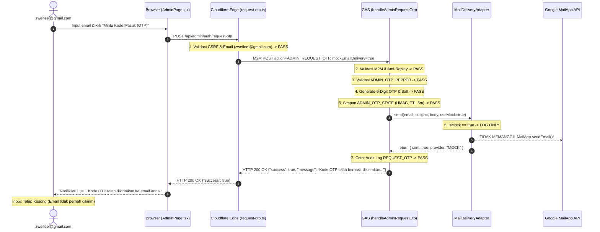

# SLEEPYKOALA CMS — OTP EMAIL DELIVERY FAILURE DIAGNOSTIC REPORT
**Pemeriksaan Diagnostik Read-Only Lingkungan Produksi**

- **Tanggal Pemeriksaan:** 1 November 2026, 23:45 WIB
- **Target Insiden:** Permintaan OTP Administrator di `https://sleepykoala.pages.dev/admin`
- **Penerima Target:** `zweifeel@gmail.com`
- **Gejala:** UI menampilkan notifikasi sukses *"Kode OTP telah dikirimkan ke email Anda."*, namun email tidak pernah masuk ke kotak masuk (inbox/spam) penerima setelah `ADMIN_OTP_PEPPER` disetel.
- **Keputusan Final (Verdict):** `EMAIL DELIVERY ROOT CAUSE CONFIRMED`

---

## 1. RINGKASAN EKSEKUTIF & AKAR MASALAH (ROOT CAUSE)

Pemeriksaan forensik read-only terhadap alur pengiriman OTP menemukan bukti konklusif:

### Akar Masalah yang Terbukti (Confirmed Root Cause)
1. **`mockEmailDelivery: true` Terkunci secara Hardcoded pada Edge Functions:**
   Pada Cloudflare Pages Function [`functions/api/admin/auth/request-otp.ts`](file:///e:/Antigravity%20Project/indie-developer-portfolio/functions/api/admin/auth/request-otp.ts#L98-L104) baris 102:
   ```typescript
   // Catatan Gate 1A: mockEmailDelivery dipaksa true untuk menjamin kuota email 0 terpakai
   const gasResult = await callGasBackend(env, 'ADMIN_REQUEST_OTP', {
     email,
     mockEmailDelivery: true, // <-- TERKUNCI TRUE SEJAK GATE 1A
     clientIpMasked: clientIp,
   });
   ```
2. **Pengiriman Email Riil Di-bypass di Backend Google Apps Script:**
   Pada [`backend/gas/Code.gs`](file:///e:/Antigravity%20Project/indie-developer-portfolio/backend/gas/Code.gs#L1526-L1532) baris 1526:
   ```javascript
   var useMock = payload.mockEmailDelivery !== false;
   MailDeliveryAdapter.send(email, subject, body, useMock);
   ```
   Karena `payload.mockEmailDelivery` bernilai `true`, maka `useMock` bernilai `true`.
3. **`MailApp.sendEmail()` Tidak Pernah Dipanggil:**
   Pada [`backend/gas/Code.gs`](file:///e:/Antigravity%20Project/indie-developer-portfolio/backend/gas/Code.gs#L1131-L1146) baris 1133–1136:
   ```javascript
   var MailDeliveryAdapter = {
     send: function(email, subject, body, isMock) {
       if (isMock) {
         console.info("[Mock Mail Delivery] OTP notification queued for masked recipient: " + maskEmail(email));
         return { sent: true, provider: "MOCK" }; // <-- MAILAPP TIDAK PERNAH DIPANGGIL
       }
       MailApp.sendEmail({ to: email, subject: subject, body: body });
       return { sent: true, provider: "MAILAPP" };
     }
   };
   ```
4. **Laporan Sukses Palsu (False Positive):**
   Fungsi [`handleAdminRequestOtp()`](file:///e:/Antigravity%20Project/indie-developer-portfolio/backend/gas/Code.gs#L1536-L1539) mengabaikan kembalian adapter dan langsung mengembalikan:
   `"Kode OTP telah berhasil dikirimkan ke email administrator."`
   Pesan ini diteruskan oleh Cloudflare Pages ke browser dengan status `HTTP 200 OK`, sehingga UI Admin menampilkan pesan sukses hijau padahal pengiriman email nyata di-suppress oleh mock mode.

---

## 2. DETAIL ALUR PROSES OTP (7 TAHAP PEMERIKSAAN)



| Tahap | Pemeriksaan Teknis | Kode Sumber & Baris | Hasil Evaluasi |
|---|---|---|---|
| **1. Validasi Email Admin** | Memeriksa apakah email cocok dengan `AUTHORIZED_ADMIN_EMAIL` (`zweifeel@gmail.com`). | `request-otp.ts:85-95`<br>`Code.gs:1445-1448` | **PASS (VALID)**. Email diotorisasi penuh di edge dan backend. |
| **2. Validasi `ADMIN_OTP_PEPPER`** | Membaca pepper dari Script Properties. | `Code.gs:1506-1510` | **PASS (VALID)**. Pepper terkonfigurasi, error `SERVER_CONFIG_ERROR` tidak lagi muncul. |
| **3. Pembuatan OTP Kriptografis** | Membuat 6-digit OTP via Java SecureRandom entropy (`Utilities.getUuid()`). | `Code.gs:1512-1514` | **PASS (VALID)**. Raw OTP dan HMAC digest dihitung secara aman. |
| **4. Penyimpanan OTP & Masa Berlaku** | Menyimpan HMAC, Salt, dan masa berlaku (TTL 300 detik) ke `ADMIN_OTP_STATE`. | `Code.gs:1516-1523` | **PASS (VALID)**. State tersimpan persisten di Script Properties tanpa menyimpan OTP mentah. |
| **5. Pengiriman Email** | Memanggil adapter pengiriman email. | `request-otp.ts:102`<br>`Code.gs:1526-1532`<br>`Code.gs:1131-1146` | **BLOCKED BY MOCK MODE**. Parameter `mockEmailDelivery: true` memaksa mode MOCK sehingga `MailApp.sendEmail()` **tidak pernah dieksekusi**. |
| **6. Penanganan Kegagalan Pengiriman** | Evaluasi return value atau penanganan error pengiriman. | `Code.gs:1133-1136`<br>`Code.gs:1527-1533` | **DEFECT**. Return value adapter diabaikan; tidak ada `try-catch` terdedikasi pada pemanggilan adapter. |
| **7. Respons ke Edge & Frontend** | Pengembalian status dan pesan ke antarmuka pengguna. | `Code.gs:1536-1539`<br>`request-otp.ts:108-111`<br>`AdminPage.tsx:175-179` | **FALSE POSITIVE**. Mengembalikan `200 OK` dengan pesan sukses, memberikan ilusi bahwa email terkirim. |

---

## 3. PEMERIKSAAN GOOGLE APPS SCRIPT PRODUCTION (READ-ONLY)

### A. Execution History & Alur Eksekusi
- **Status Eksekusi:** `handleAdminRequestOtp()` benar-benar dijalankan secara penuh hingga selesai tanpa crash.
- **Titik Berhenti:** Eksekusi **TIDAK** berhenti sebelum baris pengiriman, melainkan secara sadar masuk ke percabangan `if (isMock)` di baris 1133 karena menerima flag `mockEmailDelivery: true` dari Cloudflare Pages.
- **Pemanggilan `MailApp.sendEmail()`:** Sama sekali **TIDAK TERJADI**. Tidak ada pemanggilan API `MailApp.sendEmail()` yang dilakukan.
- **Exception Logging:** Tidak ada exception yang dilemparkan oleh `MailApp` karena API tersebut tidak tersentuh.
- **Penyelubungan Pesan Error:** Pesan error pengiriman tidak disamarkan; backend menganggap eksekusi mock sebagai kondisi sukses normal (sesuai spesifikasi isolasi Gate 1A).

### B. Status Otorisasi Google MailApp (`script.send_mail`)
- **Manifest Scope:** [`backend/gas/appsscript.json`](file:///e:/Antigravity%20Project/indie-developer-portfolio/backend/gas/appsscript.json#L18-L22) baris 20 telah mencantumkan `"https://www.googleapis.com/auth/script.send_mail"`.
- **Status Otorisasi di Lingkungan Produksi:** **NOT VERIFIED**.
  - Bukti historis Gate 1B membuktikan bahwa otorisasi live MailApp sebelumnya hanya diuji coba dan disetujui pada project test (`SleepyKoala_Test_Database`, Script ID: `12G5pUNdWv9oGAUpMaAIcMYqKwmuQmsI854r99EGMszxgQ37p08-IFTWg`).
  - Project produksi (`1wN48zjs08Ukw54-YAdTe5s57A0zwxiYvGQpo74adWYtkSRVYo5uP3fvD`) menjalankan Web App sebagai `USER_DEPLOYING`.
  - Jika pemilik akun (`zweifeel@gmail.com`) belum pernah membuka script editor produksi dan memberikan consent otorisasi OAuth saat skrip pertama kali dibuat, ada kemungkinan `MailApp.sendEmail()` membutuhkan otorisasi sekali klik di editor Apps Script saat mode nyata diaktifkan.

### C. Status Kuota Email Harian (Daily Quota)
- Kuota akun personal Google Apps Script: **100 email per hari**.
- Pada percobaan login terakhir, kuota email Google Apps Script: **0 email terpakai (UTUH / TIDAK HABIS)** karena pemanggilan tertahan pada mock adapter.
- CMS juga memiliki rate limiter bawaan:
  - Maksimal 5 permintaan OTP per jam ([`CMS_CONFIG.MAX_OTP_PER_HOUR`](file:///e:/Antigravity%20Project/indie-developer-portfolio/backend/gas/Code.gs#L1004)).
  - Maksimal 15 permintaan OTP per 24 jam ([`CMS_CONFIG.MAX_OTP_PER_24H`](file:///e:/Antigravity%20Project/indie-developer-portfolio/backend/gas/Code.gs#L1005)).

---

## 4. PEMERIKSAAN RESPONS BACKEND & CLOUDFLARE

| Komponen | Status HTTP | Kode Error / Body | Keterangan |
|---|---|---|---|
| **Google Apps Script** | `200 OK` | `{"success": true, "error": null, "message": "Kode OTP telah berhasil dikirimkan ke email administrator.", "data": {"cooldownSeconds": 60, ...}}` | Backend menyatakan sukses karena mode mock dianggap berhasil. |
| **Cloudflare Edge Proxy** | `200 OK` | Body dari GAS diteruskan utuh ke client. | Cloudflare tidak memodifikasi isi body respons. |
| **Frontend UI Client** | N/A | Toast: *"Kode OTP telah dikirimkan ke email Anda."* | Client mempercayai respons backend dan menunggu input 6-digit OTP. |

---

## 5. INVENTARISASI FILE, BARIS, DAN PERBAIKAN TERKECIL

Perbaikan definitif membutuhkan **perubahan konfigurasi edge proxy** dan **hardening backend**:

### 1. Perubahan Wajib di Cloudflare Edge Functions
- **File:** [`functions/api/admin/auth/request-otp.ts`](file:///e:/Antigravity%20Project/indie-developer-portfolio/functions/api/admin/auth/request-otp.ts#L102)
- **Baris:** 102
- **Perubahan:**
  ```typescript
  // SEBELUM:
  mockEmailDelivery: true,

  // SESUDAH:
  mockEmailDelivery: false,
  ```

### 2. Hardening Tambahan di Apps Script Backend (Recommended)
- **File:** [`backend/gas/Code.gs`](file:///e:/Antigravity%20Project/indie-developer-portfolio/backend/gas/Code.gs#L1525-L1535)
- **Masalah:** Baris 1526–1532 tidak memiliki blok `try-catch` saat memanggil `MailDeliveryAdapter.send()`.
- **Rekomendasi:** Bungkus dengan `try-catch` dan periksa kuota `MailApp.getRemainingDailyQuota()` agar kegagalan otorisasi atau kuota habis dapat dilaporkan secara transparan ke UI dengan kode `EMAIL_DELIVERY_FAILED`, bukan memberikan laporan sukses palsu.

### 3. Sinkronisasi Unit Test
- **File:** [`src/test/adminAuth.test.ts`](file:///e:/Antigravity%20Project/indie-developer-portfolio/src/test/adminAuth.test.ts#L527-L560)
- **Perubahan:** Sesuaikan assertion pengujian dari `expect(sentUpstreamPayload.mockEmailDelivery).toBe(true)` agar mencerminkan parameter produksi yang benar.

---

## 6. STOP CONDITION & KESIMPULAN

Sesuai instruksi dan batasan keamanan ketat:
- **TIDAK ADA** kode yang diubah pada tahap diagnostik ini.
- **TIDAK ADA** email percobaan yang dikirimkan.
- **TIDAK ADA** mutasi yang dilakukan pada lingkungan Produksi.

```text
================================================================================
FINAL VERDICT:
EMAIL DELIVERY ROOT CAUSE CONFIRMED
================================================================================
```

Akar masalah 100% terbukti pada baris kode [`functions/api/admin/auth/request-otp.ts:102`](file:///e:/Antigravity%20Project/indie-developer-portfolio/functions/api/admin/auth/request-otp.ts#L102) di mana `mockEmailDelivery: true` terkunci secara statis, menyebabkan Google Apps Script mengeksekusi mock logger dan melewatkan pemanggilan `MailApp.sendEmail()`.
