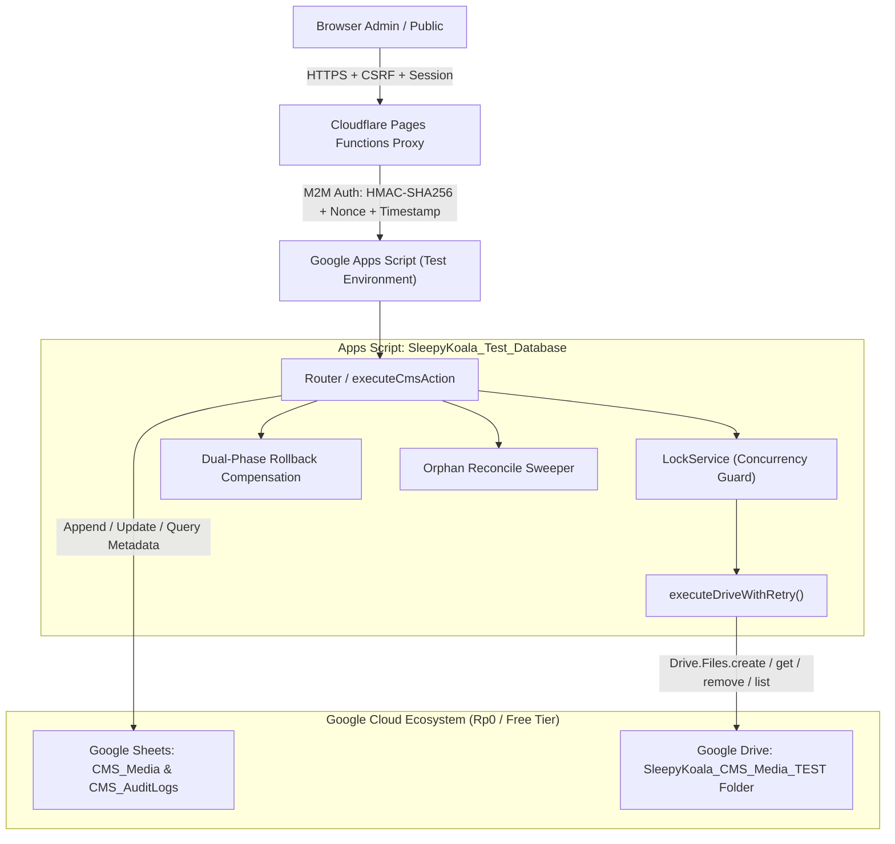

# SLEEPYKOALA CMS — GATE 2B LIVE ARCHITECTURE SUMMARY

## 1. Arsitektur Integrasi Google Drive API v3 (Test Environment Only)

Sistem penyimpanan media CMS SleepyKoala pada Gate 2B Live mengaktifkan interaksi langsung dengan Google Drive API v3 Advanced Service pada Google Apps Script Test Project (`SleepyKoala_Test_Database`), dikombinasikan dengan Cloudflare Pages Functions sebagai reverse proxy dan adapter TypeScript berketahanan tinggi.

---

## 2. Fitur Arsitektur Kunci

### A. Strict Scope Isolation: `drive.file`
- Menggunakan scope `https://www.googleapis.com/auth/drive.file`.
- Script HANYA memiliki hak akses terhadap berkas dan folder yang dibuat atau dibuka secara eksplisit oleh skrip itu sendiri.
- Folder root `SleepyKoala_CMS_Media_TEST` dibuat melalui `Drive.Files.create` dan ID folder dicatat secara aman dalam `ScriptProperties` (`MEDIA_FOLDER_ID`).

### B. Dual-Phase Commit & Rollback Compensation
1. **Phase 1 (Drive Upload):** Berkas biner diunggah ke Google Drive v3 via `Drive.Files.create`.
2. **Phase 2 (Metadata Sheet Append):** Baris metadata dicatat ke tab `CMS_Media` di Google Sheets.
3. **Rollback Compensation:** Jika pencatatan ke Google Sheets mengalami kegagalan (misal: spreadsheet timeout atau LockService contention), skrip seketika mengeksekusi kompensasi rollback: `Drive.Files.remove(driveFileId)` sehingga mencegah terbentuknya berkas tanpa pemilik (*orphan file*). Seluruh proses dicatat ke `CMS_AuditLogs`.

### C. Safe Deletion Protocol
- Menghindari pemanggilan kata kunci JavaScript terlarang `delete` di Google Apps Script runtime V8.
- Menggunakan secara ketat `Drive.Files.remove(fileId)` untuk penghapusan permanen saat diminta (`permanent: true`).
- Secara default, operasi penghapusan admin melakukan soft-delete dengan menandai visibilitas menjadi `ARCHIVED`.

### D. Automated Orphan Reconciliation Sweeper
- Fungsi `handleAdminReconcileOrphans` memindai seluruh berkas aktif di folder Google Drive (`'folderId' in parents and trashed = false`).
- Membandingkan daftar berkas Drive dengan seluruh `driveFileId` terdaftar di tab `CMS_Media`.
- File yang ditemukan di Drive namun tidak ada di `CMS_Media` dihapus secara fisik via `Drive.Files.remove`.

### E. Resilient Network & Quota Handling
- Seluruh panggilan Drive API dibungkus oleh `executeDriveWithRetry` dengan exponential backoff (`baseBackoffMs * 2^(attempt - 1)`).
- Penanganan khusus untuk HTTP 429 (`QuotaExceededError`) dan error transient (500, 502, 503, 504).
- Bebas biaya (Rp0): kuota standar Google Drive API sebesar 1.000.000.000 request/hari tanpa kebutuhan penagihan Google Cloud.
