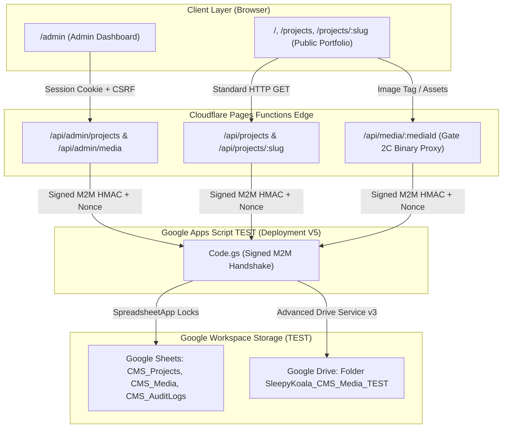

# SLEEPYKOALA CMS — GATE 2D ARCHITECTURE SUMMARY

**Checkpoint ID:** `gate-2d-test-20261101-v1`  
**Status:** COMPLETE & FROZEN  

---

## 1. Topologi Alur Data Dinamis

---

## 2. Prinsip Arsitektur Kunci

1. **Strict Relational Guarding:**
   - Halaman publik **HANYA** menerima proyek yang berstatus `PUBLISHED`.
   - Media **HANYA** disajikan publik jika media tersebut berstatus `PUBLISHED` **dan** proyek induknya berstatus `PUBLISHED`.
   - Jika salah satu kondisi gagal, respons langsung mengembalikan **HTTP 404 Not Found** dengan header `Cache-Control: no-store, no-cache, must-revalidate`.
2. **Dynamic Client Synchronization (`useProjects`):**
   - Komponen React frontend tidak lagi terikat statis pada build-time JSON.
   - Panggilan asynchronous `/api/projects` memuat proyek aktif secara reaktif.
   - Jika koneksi ke backend Apps Script terputus atau timeout, sistem secara transparan beralih ke fallback dataset `projects.json` tanpa membocorkan error atau menghentikan rendering portofolio.
3. **No Build Step Required for Content Updates:**
   - Penambahan proyek, perubahan deskripsi, pembaruan status perekrutan closed testing, atau penggantian aset media langsung tercermin pada permintaan berikutnya.
4. **Zero Cache Poisoning Policy (RFC 9111):**
   - Header untuk 200/304: `Cache-Control: no-cache, must-revalidate`.
   - Header untuk 404/Error: `Cache-Control: no-store, no-cache, must-revalidate`.
   - Header untuk Admin Preview: `Cache-Control: private, no-store, no-cache, must-revalidate`.
   - Tidak ada instruksi `s-maxage` pada edge publik yang dapat menyebabkan stale private content.
