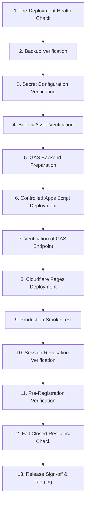

# SLEEPYKOALA CMS — PRODUCTION DEPLOYMENT PLAN
## CONTROLLED 13-STEP RELEASE PROCEDURE (POST-HUMAN-APPROVAL)

**Target Release:** SleepyKoala Studio Milestone 6.3  
**Tipe Release:** Major Feature Enhancement & Production Hardening  
**Prasyarat Mutlak:** Membutuhkan Persetujuan Eksplisit dari Pengguna (Human Release Manager)  
**Biaya:** $0.00 / Rp0 (Zero-Cost / Free-Tier Lock)  

---

## 13-STEP CONTROLLED EXECUTION WORKFLOW



---

### LANGKAH 1: PRE-DEPLOYMENT VERIFICATION & HEALTH CHECK
- Periksa status ketersediaan produksi saat ini (`https://sleepykoala.pages.dev`).
- Pastikan HTTP 200 OK pada halaman publik beranda, katalog `/projects`, dan halaman detail proyek.
- Pastikan Google Play Hybrid Sync tetap berstatus `PAUSED`.

### LANGKAH 2: BACKUP VERIFICATION
- Konfirmasi ketersediaan backup Google Spreadsheet:
  - Sheet `CMS_Projects`
  - Sheet `CMS_Media`
  - Sheet `CMS_AuditLogs`
  - Sheet `TesterRegistrations`
- Pastikan snapshot ID Cloudflare Pages aktif saat ini (`2c3cced9-fc9b-4bc7-857f-7826f9acd386`) terdokumentasi sebagai baseline rollback.

### LANGKAH 3: ENVIRONMENT SECRET CONFIGURATION VERIFICATION
- Akses Cloudflare Dashboard: **Workers & Pages > Projects > sleepykoala > Settings > Variables and Secrets**.
- Pastikan secret berikut telah dikonfigurasi:
  - `APPS_SCRIPT_SECRET` (Telah aktif)
  - `ADMIN_SESSION_SECRET` (**ACTION REQUIRED**: Tambahkan secret acak 32-karakter unik untuk isolasi sesi)
  - `GAS_WEBAPP_URL` (Mengarah ke Web App URL deployment produksi)

### LANGKAH 4: BUILD & ASSET VERIFICATION
- Jalankan verifikasi lokal:
  ```bash
  npm run build
  npm test -- --run
  npm run lint
  ```
- Pastikan 380 unit/integration tests lulus 100%, bundle `dist/` terbentuk tanpa error, dan tidak ada teks gradient atau logo rusak.

### LANGKAH 5: GAS BACKEND PREPARATION
- Periksa kesiapan file lokal `backend/gas/Code.gs`:
  - Verifikasi bahwa `allowedStatuses` pada fungsi `saveProject` memuat `"PRE_REGISTRATION"`.
  - Verifikasi integritas relasional media dan pembersihan referensi thumbnail/screenshot.
  - Verifikasi fungsi `checkAdminSession` fail-closed.

### LANGKAH 6: CONTROLLED APPS SCRIPT DEPLOYMENT
- *Hanya dieksekusi setelah persetujuan manusia*:
  ```bash
  cd backend/gas
  clasp push
  clasp deploy --description "Release Milestone 6.3 - Pre-Registration & Session Hardening"
  ```
- Catat Deployment ID baru dan Version Number yang dihasilkan (misal Version 4).

### LANGKAH 7: VERIFICATION OF GAS WEBAPP ENDPOINT
- Lakukan panggilan handshake aman terhadap endpoint GAS baru menggunakan header `X-Apps-Script-Secret` yang valid.
- Pastikan endpoint mengembalikan respons JSON valid dan tidak mengembalikan respons HTML 500.

### LANGKAH 8: CLOUDFLARE PAGES DEPLOYMENT EXECUTION
- *Hanya dieksekusi setelah persetujuan manusia*:
  ```bash
  npx wrangler pages deploy dist --project-name sleepykoala --branch master
  ```
- Catat Deployment URL preview dan Deployment UUID baru dari output Wrangler.

### LANGKAH 9: PRODUCTION POST-DEPLOYMENT SMOKE TEST
- Akses domain publik `https://sleepykoala.pages.dev`:
  - Validasi navigasi menu dan keterbacaan teks tanpa CSS terpotong.
  - Validasi bahwa 6 proyek portofolio resmi tampil utuh.
  - Validasi respon API publik `/api/projects`.

### LANGKAH 10: SESSION REVOCATION VERIFICATION ON PRODUCTION
- Uji alur otentikasi administrator CMS:
  - Lakukan login dengan OTP email administrator resmi.
  - Verifikasi token sesi `sk_session` berhasil disimpan dalam httpOnly cookie.
  - Lakukan logout dan pastikan token sesi langsung ditolak pada request berikutnya (revocation list berfungsi).

### LANGKAH 11: PROJECT STATUS VERIFICATION (TERMASUK PRE_REGISTRATION)
- Di dalam panel Admin CMS:
  - Buat proyek uji coba atau edit proyek staging dengan status `PRE_REGISTRATION`.
  - Pastikan proyek tersimpan di backend Google Sheets tanpa ditolak oleh `VALIDATION_ERROR`.
  - Pastikan halaman katalog merender badge indigo `Pre-Registration`.
  - Pastikan tidak ada tombol Google Play palsu jika `testingUrl` tidak diisi.

### LANGKAH 12: FAIL-CLOSED RESILIENCE VERIFICATION
- Uji ketahanan edge functions terhadap kegagalan upstream:
  - Kirim request dengan secret tidak valid ke endpoint admin (harus mengembalikan HTTP 401).
  - Pastikan tidak ada kebocoran file konfigurasi, kunci secret, atau proyek berstatus `DRAFT`.

### LANGKAH 13: RELEASE SIGN-OFF AND FINAL STATE TAGGING
- Lakukan penandaan checkpoint rilis:
  ```bash
  git add .
  git commit -m "chore(release): milestone 6.3 production release"
  git tag -a v1.6.3 -m "SleepyKoala Studio v1.6.3 - Pre-Registration & Production Hardened"
  ```
- Dokumentasikan status rilis resmi ke dalam laporan akhir.
