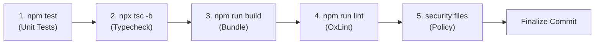

# SLEEPYKOALA STUDIO — SAFE COMMIT & PUSH POLICY
## Stage 3: Repository Hygiene, Commit Formatting & Push Gating Rules
**Document Version:** 1.0.0  
**Status:** Mandatory Engineering Policy  
**Stage:** Stage 3 — Controlled Auto Commit & Push  
**Workspace:** `E:\Antigravity Project\indie-developer-portfolio`  
**License / Cost:** Zero-Cost ($0.00 / Rp 0)

---

## 1. Commit Message Standard

All commits across SleepyKoala Studio repositories must strictly adhere to the conventional format:

```text
<type>(<project>): <summary>

[optional extended body explaining architectural context or issue references]
```

### 1.1. Allowed Commit Types
| Type | Intended Scope & Purpose |
| :--- | :--- |
| `feat` | New feature implementation, UI additions, or capability expansions. |
| `fix` | Bug fixes, visual repairs, error handling corrections, or vulnerability remediation. |
| `refactor` | Code refactoring without altering functional behavior or public contracts. |
| `test` | Adding, updating, or fixing unit tests, integration tests, or mock fixtures. |
| `docs` | Documentation additions, architecture diagrams, reports, or policy updates. |
| `build` | Changes to build configurations, bundling scripts, npm dependencies, or tooling. |
| `chore` | Maintenance tasks, repository hygiene, linter configs, or workflow updates. |

### 1.2. Commit Rules & Constraints
- `<project>` must be a valid canonical project slug (e.g. `indie-developer-portfolio`, `dompetnalar`).
- `<summary>` must be a clear, concise description written in imperative mood (e.g. `add responsive navbar`, not `added responsive navbar`).
- Empty commit summaries are rejected (`commit-engine.js` fails closed).
- Empty commits (`--allow-empty`) are prohibited.
- Commit amendment (`--amend`) is blocked in automated execution to prevent accidental history rewriting.

---

## 2. Safe Staging Policy (Default Deny)

Bulk staging commands (`git add .`, `git add -A`, `git add *`) are **strictly prohibited** in automation scripts and developer workflows.

### 2.1. File Staging Procedure
1. Files to be staged must be explicitly listed by relative file path.
2. Each file is passed through `evaluateFilePolicy()` in `scripts/check-file-policy.js`:
   - Checks against `APPROVED_ROOT_FILES` and `APPROVED_DIRECTORIES`.
   - Checks against `APPROVED_EXTENSIONS`.
   - Checks against `DENYLIST_PATTERNS`.
3. Each file's contents are scanned via `scanFileContent()` for embedded credentials, API keys, private keys, or keystores.
4. Each file's contents are scanned via `scanPrivacyContent()` for customer/tester PII (Indonesian mobile numbers, NIK).
5. If **any** file fails validation, the staging transaction is immediately aborted and any staged files are unstaged (`git restore --staged`), preserving working tree edits.

### 2.2. Denylisted Artifacts
The following file types and names must **never** be staged or committed:
- **Environment & Secrets:** `.env`, `.env.*`, `.dev.vars`, `webcredential.txt`, `credentials.json`, `client_secret*.json`, `service_account*.json`, `play_key*.json`.
- **Cryptographic Keys & Keystores:** `*.jks`, `*.keystore`, `*.p12`, `*.pfx`, `*.pk8`, `*.der`, `*.pem`, `*.key`, `id_rsa*`, `id_ed25519*`, `signing.properties`, `release.keystore`.
- **Database Backups:** `*.dump`, `*.sql`, `*.sqlite`, `*.db`, `*.rdb`, `*.backup`.
- **PII & Tester Dumps:** `testers_export*.json`, `testers_export*.csv`, `testers*.csv`.
- **Build Artifacts & Caches:** `node_modules/`, `dist/`, `dist-ssr/`, `coverage/`, `.wrangler/`, `*.tsbuildinfo`.

---

## 3. Staged Diff Inspection & Conflict Gating

Before any commit is finalized, `inspectStagedDiff()` evaluates the staged patch:
1. **Whitespace & Conflict Inspection:** Runs `git diff --cached --check`. If whitespace errors or unresolved merge conflicts (`<<<<<<<`, `=======`, `>>>>>>>`) exist, the commit is aborted.
2. **Patch Content Secret Scanning:** Analyzes the added lines (`+` additions) in the patch to ensure no newly added string matches secret token patterns.
3. **Empty Staging Check:** Confirms that the staged diff is non-empty. Commits with zero staged changes are rejected.

---

## 4. Quality Gate Requirements

Commits targeting eligible projects must satisfy all configured quality gates before execution:



If any quality gate command exits with code $\neq 0$, the commit process terminates immediately with an error log entry.

---

## 5. Push Gating & Prohibited Operations

### 5.1. Push Gating Prerequisites
Pushing to a remote repository is permitted **only** when all of the following conditions are met:
1. `canPushRemotely` flag in project configuration is explicitly set to `true`.
2. Physical remote is verified on disk (`git remote -v`).
3. Repository visibility is confirmed as `PRIVATE` (`VISIBILITY_UNVERIFIED` blocks push).
4. Current branch matches canonical expected branch (e.g. `master` or `main`).
5. Branch has an active upstream tracking branch configured (`git rev-parse --abbrev-ref @{u}` succeeds).
6. Push mode is fast-forward only (`git push <remote> <branch>`).

### 5.2. Strictly Prohibited Operations
The following Git commands and flags are permanently excluded from the automation toolset:
- `git push --force` or `git push -f`
- `git push --delete`
- `git reset --hard`
- `git clean -fd`
- `git rebase -i` or automated history rewriting
- Storing plain-text PATs or credentials in command-line arguments or environment variables.
