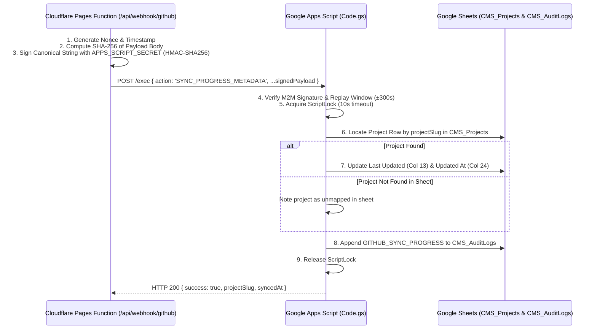

# SLEEPYKOALA STUDIO — GOOGLE APPS SCRIPT SYNC CONTRACT
## Stage 4: Signed M2M Protocol & Google Sheets Backend Integration

**Document Version:** 1.0.0  
**Status:** Canonical Backend Integration Contract  
**Stage:** Stage 4 — GitHub Backend Sync & CI Integration  
**Workspace:** `E:\Antigravity Project\indie-developer-portfolio`  
**License / Cost:** Zero-Cost ($0.00 / Rp 0)

---

## 1. Protocol Architecture & M2M Authentication

Cloudflare Pages Functions synchronize verified GitHub progress events to Google Apps Script via a signed Server-to-Server (M2M) handshake.



---

## 2. Request Contract (`SYNC_PROGRESS_METADATA`)

```json
{
  "action": "SYNC_PROGRESS_METADATA",
  "timestamp": 1794000000000,
  "nonce": "a1b2c3d4-e5f6-7890-abcd-ef1234567890",
  "bodyHash": "6b86b273ff34fce19d6b804eff5a3f5747ada4eaa22f1d49c01e52ddb7875b4b",
  "signature": "M2M_HMAC_SIGNATURE_BASE64URL",
  "secretToken": "APPS_SCRIPT_SECRET_FALLBACK",
  "projectSlug": "indie-developer-portfolio",
  "event": {
    "id": "evt_indie-developer-portfolio_push_c1a2b3_1794000000000",
    "eventType": "general_update",
    "title": "[master] feat: improve portfolio responsive grid",
    "description": "Full commit details...",
    "timestamp": "2026-11-08T12:00:00Z",
    "publicationStatus": "draft"
  },
  "githubDeliveryId": "72ee6b00-3f41-11eb-9876-000000000000",
  "eventType": "push"
}
```

---

## 3. Response Contract

### 3.1 Success Response (HTTP 200)
```json
{
  "success": true,
  "error": null,
  "message": "Metadata progress berhasil disinkronkan.",
  "data": {
    "projectSlug": "indie-developer-portfolio",
    "projectName": "SleepyKoala Studio Website",
    "projectFound": true,
    "eventTitle": "[master] feat: improve portfolio responsive grid",
    "publicationStatus": "draft",
    "syncedAt": "2026-11-08 19:00:00"
  }
}
```

### 3.2 Error Responses
- `INVALID_PROJECT_SLUG`: Provided project slug does not match pattern `^[a-z0-9-_]+$`.
- `INVALID_EVENT_PAYLOAD`: Missing required event fields (`eventType`, `title`).
- `UNAUTHORIZED` / `INVALID_SIGNATURE`: M2M handshake verification failed.
- `SERVER_BUSY`: Concurrency lock contention timed out after 10 seconds.

---

## 4. Google Sheets Non-Destructive Update Guarantees

In accordance with `backend/gas/schema.json`:
1. **Target Tab:** `CMS_Projects`.
2. **Read-Only Columns:**
   - Column 1 (`ID`): Untouched.
   - Column 4 (`Category`): Untouched.
   - Column 5 (`Status` / Implementation Status): Strictly Untouched.
   - Column 23 (`Publish State`): Strictly Untouched.
3. **Updated Columns:**
   - Column 13 (`Last Updated`): Timestamp string (`yyyy-MM-dd HH:mm:ss`).
   - Column 24 (`Updated At`): Timestamp string (`yyyy-MM-dd HH:mm:ss`).
   - Column 25 (`Updated By`): `"system:github-webhook"`.
4. **Audit Trail:**
   - Every execution writes a row to `CMS_AuditLogs` with action `GITHUB_SYNC_PROGRESS` and the sanitized event details JSON.
