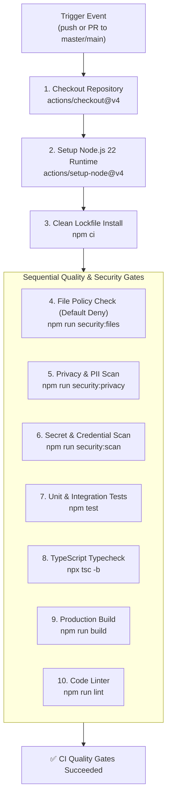

# SLEEPYKOALA STUDIO — GITHUB ACTIONS CI SPECIFICATION
## Stage 4: Continuous Integration Quality Gates & Security Verification

**Document Version:** 1.0.0  
**Status:** Canonical CI Specification  
**Stage:** Stage 4 — GitHub Backend Sync & CI Integration  
**Workspace:** `E:\Antigravity Project\indie-developer-portfolio`  
**License / Cost:** Zero-Cost ($0.00 / Rp 0)

---

## 1. Principles & Architectural Role

The GitHub Actions CI Workflow (`.github/workflows/ci.yml`) is the automated gatekeeper of SleepyKoala Studio's repository hygiene, code quality, and security invariants.

### Key Principles
1. **CI-Only Boundary:** The workflow is strictly for verification. It contains **ZERO deployment steps** and **ZERO automated push triggers** to any branch.
2. **Least Privilege Security:** Runs under `permissions: contents: read`. It cannot write to Git, create releases, or modify GitHub repository settings.
3. **Zero Secrets in CI:** Quality checks run without storing production credentials or Cloudflare tokens in GitHub repository secrets.
4. **Zero-Cost Operation:** Executes entirely within standard free-tier GitHub-hosted runners (`ubuntu-latest`).
5. **Fail-Closed Execution:** Failure of any quality gate step terminates the build and reports failure to the pull request / commit status.

---

## 2. CI Pipeline Stages



---

## 3. Detailed Step Breakdown

| Step Number | Step Name | Command | Purpose & Guardrail |
| :---: | :--- | :--- | :--- |
| **1** | Checkout | `actions/checkout@v4` | Fetches repository tree at the target commit. |
| **2** | Setup Node.js | `actions/setup-node@v4` | Configures Node.js 22 with npm cache enabled. |
| **3** | Clean Install | `npm ci` | Installs exact dependencies declared in `package-lock.json` without updating lockfile. |
| **4** | File Policy Check | `npm run security:files` | Validates every file against Default Deny policy (`scripts/check-file-policy.js`). Blocks alien files and keystores. |
| **5** | Privacy & PII Scan | `npm run security:privacy` | Scans repository files for unapproved tester PII, phone numbers, and addresses (`scripts/check-privacy.js`). |
| **6** | Secret Scan | `npm run security:scan` | Detects Google Cloud tokens, RSA keys, AWS keys, and confidential credentials (`scripts/scan-secrets.js`). |
| **7** | Test Suite | `npm test` | Executes all 35 test suites (649 tests) covering webhooks, CMS, UI components, and authentication. |
| **8** | TypeScript Compile | `npx tsc -b` | Static compilation check validating strict type correctness across the codebase. |
| **9** | Production Build | `npm run build` | Builds production client assets via Vite to verify bundle integrity and asset imports. |
| **10**| Code Linter | `npm run lint` | Executes linter to eliminate dead code, unhandled syntax errors, and style regressions. |

---

## 4. Concurrency & Resource Optimization

```yaml
concurrency:
  group: ${{ github.workflow }}-${{ github.ref }}
  cancel-in-progress: true
```
If new commits are pushed to an active pull request while a CI run is executing, the obsolete run is cancelled immediately, freeing runner minutes and conserving resources.

---

## 5. Cost Policy, Quota Assessment & Activation Gating

### 5.1 Runner Cost Tiers & GitHub Policy
Using `ubuntu-latest` alone does not automatically guarantee Rp 0 across all repository states. GitHub Actions pricing strictly differentiates by repository visibility and account plan:

| Repository State | Runner Type | Account Tier | Cost & Allowance | Verification Status |
| :--- | :--- | :--- | :--- | :--- |
| **Public Repository** | Standard (`ubuntu-latest`) | Free / Any | **100% Free** (Unlimited minutes) | *Proven free condition* |
| **Private Repository** | Standard (`ubuntu-latest`) | Free Plan | **2,000 minutes/month included free**. Overage incurs billing if spending limit > $0, or fails closed if spending limit is $0. | *Quota-dependent eligibility* |
| **Local Working Tree** | N/A | Local | No remote configured (`MISSING_REMOTE`). Visibility cannot be determined via API. | **`CI_ACTIVATION_PENDING_COST_VERIFICATION`** |

### 5.2 Activation Prerequisites
Before the CI workflow is activated on a remote GitHub repository:
1. The developer must create or link the remote repository manually.
2. If private, verify account usage is within the 2,000 min/month free tier allocation.
3. Ensure the GitHub account spending limit is set to **$0.00** to guarantee fail-closed behavior against accidental charges.
4. If public, verify that zero proprietary or sensitive assets are present in the public tree.

