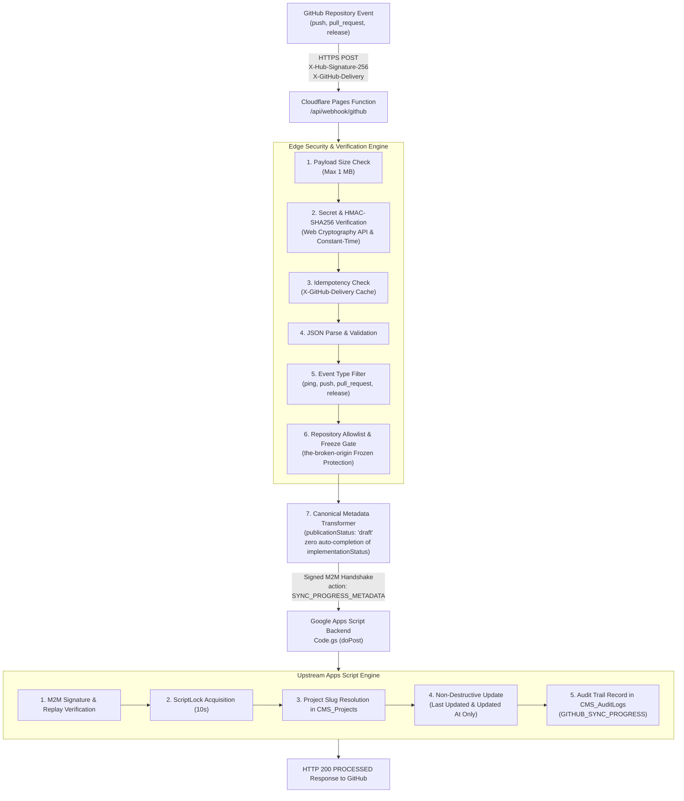

# SLEEPYKOALA STUDIO — GITHUB WEBHOOK ARCHITECTURE
## Stage 4: Cloudflare Pages Functions Webhook & Upstream Synchronization Architecture

**Document Version:** 1.0.0  
**Status:** Canonical Architectural Specification  
**Stage:** Stage 4 — GitHub Backend Sync & CI Integration  
**Workspace:** `E:\Antigravity Project\indie-developer-portfolio`  
**License / Cost:** Zero-Cost ($0.00 / Rp 0)

---

## 1. Architectural Overview & Design Goals

The GitHub Webhook Subsystem bridges repository progression events (code commits, pull requests, version releases) from GitHub into SleepyKoala Studio's portfolio metadata and Google Apps Script storage without compromising security, data integrity, or editorial control.

---

## 2. Component Specifications

### 2.1 Edge Webhook Handler (`functions/api/webhook/github.ts`)
- **Runtime Environment:** Cloudflare Pages Functions (V8 Workers runtime).
- **Endpoint Route:** `/api/webhook/github`.
- **Supported Methods:** `POST` for event intake; `OPTIONS` for preflight. All other HTTP methods are rejected.
- **Crypto Engine:** Native Web Cryptography API (`crypto.subtle`) ensuring zero external dependencies and high performance at zero cost.

### 2.2 Webhook Service Engine (`src/services/githubWebhookService.ts`)
- **Signature Verification:** Validates `X-Hub-Signature-256` against `GITHUB_WEBHOOK_SECRET` using HMAC SHA-256.
- **Timing Attack Mitigation:** Custom `constantTimeCompare` ensures byte-by-byte XOR comparison without early-exit branch leaks.
- **Repository Allowlist:** Validates target repository against approved SleepyKoala projects (`indie-developer-portfolio`, `FinSmart`, `mobile-kasir`, `Idle Master`, `Idle mining`, `Worklume`).
- **Freeze Enforcement:** Specifically intercepts `the-broken-origin` / `TBO-ROBLOX` and returns HTTP 403 `REPOSITORY_FROZEN`.
- **Sanitization Layer:** Scrubs local system paths (e.g. `E:\`, `/home/`), access tokens, passwords, and embedded URL credentials from event titles and descriptions.

### 2.3 Upstream Synchronization Handler (`backend/gas/Code.gs`)
- **Action Route:** `SYNC_PROGRESS_METADATA`.
- **Security Check:** Signed M2M handshake (`verifyM2mAuth`) with anti-replay timestamp verification.
- **Data Safety:** Modifies ONLY `Last Updated` (Col 13) and `Updated At` (Col 24). Does NOT mutate `Status` or `Publish State`.
- **Audit Logging:** Inserts row into `CMS_AuditLogs` capturing delivery ID, sanitized event title, and timestamp.

---

## 3. Supported Event Lifecycles

| Event Type | GitHub Trigger | Transformed Action | Default Publication Status | Lifecycle Invariant |
| :--- | :--- | :--- | :---: | :--- |
| `ping` | Webhook creation / ping test | Responds with `PONG` & zen string | N/A | No downstream sync. |
| `push` | Code pushed to monitored branch | `general_update` progress event | `draft` | `implementationStatus` is untouched; requires manual editorial review. |
| `pull_request` | PR merged into main/master branch | `feature_released` progress event | `draft` | PR title & body sanitized; publication state remains unreleased until confirmed. |
| `release` | Official GitHub Release published | `milestone_reached` progress event | `draft` | Version tag and release notes captured in staging draft. |
| *Other* (`star`, `issues`, etc.) | Unhandled GitHub activity | Returns HTTP 200/202 `IGNORED_EVENT` | N/A | Ignored safely without triggering errors. |

---

## 4. Zero-Cost & Production Boundaries

1. **Zero-Cost Mandate:** Uses standard GitHub Webhooks, Cloudflare Pages free tier, and Google Apps Script free consumer quotas ($0.00 / Rp 0).
2. **Zero Production Mutation:** Local testing runs against synthetic mocks; live webhook triggers only execute when authorized secret tokens are configured.
3. **Fail-Closed Principle:** If secrets are missing or upstream backend is unreachable, the webhook refuses to guess or leak unauthenticated progress data.
