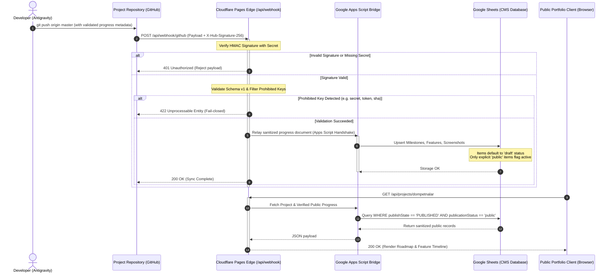
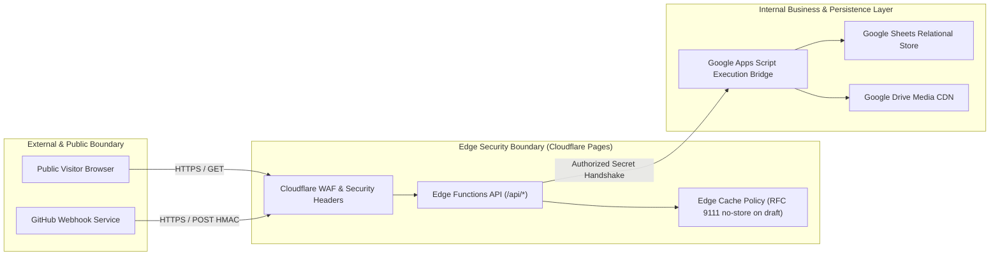

# SLEEPYKOALA STUDIO — PHASE 0: ARCHITECTURE FLOW & DATA TOPOLOGY
**Document Reference:** `docs/reports/PHASE_0_ARCHITECTURE_FLOW.md`  
**Milestone:** Phase 0 — Discovery & Baseline Inventory  
**Auditor:** Senior Software Architect & Platform Auditor  
**Date:** 2026-11-08  
**Scope:** Workstream A — 14-Step Publishing Pipeline Topology  

---

## 1. END-TO-END 14-STEP PUBLISHING PIPELINE ARCHITECTURE

The diagram below maps the complete lifecycle of a feature from local Antigravity workspace authoring to public display on the SleepyKoala Studio portfolio website:

```mermaid
flowchart TD
    subgraph Local_Workspace["1. Project Workspace (Antigravity Local)"]
        S1["Step 1: Feature Engineering"] --> S2["Step 2: Update docs/portfolio/roadmap.json & features.json"]
        S2 --> S3["Step 3: Local Test & Build Verification"]
        S3 --> S4["Step 4: Local Secret & PII Scan (security-scan.js)"]
        S4 --> S5["Step 5: Screenshot Sanitization Verification"]
        S5 --> S6["Step 6: Git Staged Diff Review"]
        S6 --> S7["Step 7: Metadata Schema Validation (Schema v1)"]
        S7 --> S8["Step 8: Git Commit (Conventional Message)"]
    end

    subgraph GitHub_VCS["2. Version Control & Dispatch (GitHub)"]
        S8 --> S9["Step 9: Git Push to GitHub Repo"]
        S9 --> S10["Step 10: GitHub Webhook Dispatch (Push Event)"]
    end

    subgraph Edge_Backend["3. Edge Ingestion & CMS Security Layer"]
        S10 --> S11["Step 11: Cloudflare Edge Webhook Listener\n(HMAC SHA256 Signature Verification)"]
        S11 --> S12["Step 12: Ingestion & Prohibited Key Filter\n(Fail-Closed Validation)"]
        S12 --> S13["Step 13: Google Apps Script & Sheets Sync\n(Draft / Public Separation Gate)"]
    end

    subgraph Public_Presentation["4. Public Web Client"]
        S13 --> S14["Step 14: Public Project Detail Page\n(Only 'public' items rendered)"]
    end

    classDef success fill:#064e3b,stroke:#059669,color:#fff;
    classDef edge fill:#1e1b4b,stroke:#4338ca,color:#fff;
    classDef local fill:#1c1917,stroke:#78716c,color:#fff;
    classDef gh fill:#0f172a,stroke:#38bdf8,color:#fff;

    class S1,S2,S3,S4,S5,S6,S7,S8 local;
    class S9,S10 gh;
    class S11,S12,S13 edge;
    class S14 success;
```

---

## 2. SEQUENCE DIAGRAM: WEBHOOK INGESTION & DATA FLOW

---

## 3. COMPONENT TOPOLOGY & SECURITY PERIMETERS

---

## 4. DUAL-STORAGE SYNCHRONIZATION MODEL

The SleepyKoala Studio architecture operates a zero-cost dual-storage paradigm:

1. **Relational Schema Records:**
   - Managed via Google Sheets as an ACID-like transactional tabular store.
   - Separate tabs for `Projects`, `Milestones`, `Features`, `Screenshots`, `AuditLogs`.
   - Google Apps Script provides CRUD abstractions and row-level locking.

2. **Binary Media Storage:**
   - Managed via Google Drive dedicated folder hierarchy.
   - Screenshots and app banners uploaded through CMS media manager.
   - Publicly accessible via verified caching proxy URLs, avoiding quota throttling.

---

## 5. ZERO-LEAKAGE BOUNDARY SPECIFICATION

| Security Parameter | Boundary Rule | Enforcement Point |
| :--- | :--- | :--- |
| **Git SHAs / Branches** | Never exposed to public JSON responses | `src/services/portfolioMetadataValidator.ts` |
| **Author / Developer PII**| Real names and emails redacted to studio pseudonym | `scripts/security-scan.js` & validator |
| **Internal Database URIs**| Zero SQL/Sheets spreadsheet IDs exposed to frontend | Cloudflare Edge Function proxy |
| **Draft Items** | Completely purged from API payloads (`extractPublicProgress`)| Ingestion service & query layer |
| **Secret Scanning** | Mandatory pre-commit & pre-sync scan | `scripts/security-scan.js` |
