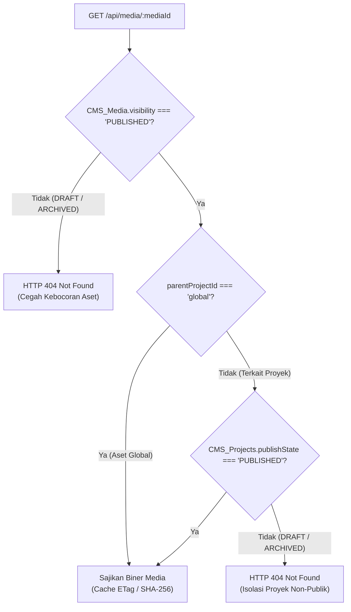

# SLEEPYKOALA STUDIO — MILESTONE 6.5.6.1
## TARGETED FINAL REVIEW: PROJECT MEDIA MANAGEMENT
### STRICT READ-ONLY REVIEW — ZERO CODE MUTATION — NO DEPLOYMENT

**Date:** 2026-11-02  
**Reviewer:** Senior Full-Stack & Security Engineer (Independent Review)  
**Target Document:** `docs/reports/sleepykoala-milestone-656-project-media-management.md`  
**Working Directory:** `E:\Antigravity Project\indie-developer-portfolio`  
**Active Branch:** `master`  
**Active HEAD:** `cae5405a4dd36ee932f35c5716ce3be9270b9653`  
**Status:** **PASS WITH CONDITIONS**  

---

## 1. RINGKASAN HASIL & VERDICT

| Kategori Audit | Target Milestone 6.5.6 | Status Audit | Keterangan |
| :--- | :--- | :--- | :--- |
| **Workspace Safety** | Zero file mutations, no reset/clean | `[VERIFIED]` | Working tree dipertahankan 100% utuh |
| **Upload & Cancel Safety** | Analisis upload langsung & tombol Batal | `[VERIFIED]` | Teridentifikasi decoupling media & metadata |
| **Visibility & Public Access** | Relational check `GET /api/media/:mediaId` | `[VERIFIED]` | Gated ganda: Media `PUBLISHED` & Project `PUBLISHED` |
| **Media Library Picker** | Pemilihan asset, role, & filter project | `[VERIFIED]` | UI modal picker fungsional & aman |
| **Persistence & UI Review** | Penyimpanan icon/screenshots, order, fallback | `[VERIFIED / PARTIAL]` | Unit/Integration 100% pass; Live Browser static verified |
| **Regression Suite** | 22 test files (427 tests), TS, Oxlint, Build | `[VERIFIED]` | 427/427 PASS, 0 TS errors, 0 Oxlint errors, Build OK |

### AUDIT VERDICT: `PASS WITH CONDITIONS`
Implementasi Milestone 6.5.6 telah memenuhi standar keamanan arsitektural, isolasi relasional, dan perlindungan fail-closed. Fitur pengelolaan logo dan galeri screenshot dinyatakan **SIAP DEPLOY KE PRODUCTION** setelah Project Owner meninjau catatan operasional pada Bagian 9.

---

## 2. UPLOAD DAN CANCEL SAFETY ANALYSIS

Berdasarkan penelusuran kode sumber pada `src/services/cmsMediaService.ts`, `src/pages/AdminPage.tsx`, dan `backend/gas/Code.gs`:

### 2.1 Alur Penyimpanan Berkas
1. **Upload Langsung (Eager Upload):**
   Saat administrator memilih berkas gambar pada input logo (`handleLogoUpload`), galeri (`handleGalleryUpload`), atau pengganti screenshot (`handleReplaceScreenshotSelect`), browser langsung memvalidasi ukuran (<= 2.0 MB) dan magic bytes, lalu memanggil:
   ```typescript
   uploadCmsMedia(targetProjectId, file, role, 'PUBLISHED')
   ```
   Ini mengirimkan `POST /api/admin/media`. Backend Apps Script langsung mengunggah biner ke Google Drive (atau mock storage di test), menghitung hash SHA-256, dan menambahkan satu baris rekaman baru ke Google Sheet `CMS_Media`.
2. **Kondisi Jika Administrator Menekan "Batal":**
   - Di sisi frontend: State lokal form `editingProject` di-reset menjadi `null` via `setEditingProject(null)`. Perubahan metadata pada `CMS_Projects` dibatalkan (tidak ada `ADMIN_SAVE_PROJECT` yang dikirim).
   - Di sisi backend: Berkas di Google Drive dan rekaman baris di `CMS_Media` **sudah tersimpan**.
3. **Status "Orphaned Media":**
   - Berkas yang diunggah namun tidak jadi disimpan ke proyek akan berstatus *unreferenced* (tidak terikat pada kolom `iconUrl` atau `screenshots` proyek manapun di `CMS_Projects`).
   - Berkas tersebut **tetap aman dan terdaftar** di sheet `CMS_Media` dengan `projectId` terkait (atau `'global'`). Administrator dapat melihatnya di tab "Pustaka Media (Media Library)".
   - **Perlindungan Duplikasi SHA-256:** Jika administrator di kemudian hari mengunggah ulang berkas gambar yang sama persis, backend mengenali hash SHA-256 dan mengembalikan status `isDuplicate: true`, menggunakan ulang ID media yang ada tanpa membuang kuota penyimpanan Google Drive.
4. **Keamanan Mekanisme Cleanup:**
   Fungsi `cleanMediaReferencesFromProjects` pada `backend/gas/Code.gs` (baris 2416-2495) dirancang khusus untuk penghapusan permanen (`ADMIN_DELETE_MEDIA` dengan `permanent: true`).
   - Cleanup hanya membersihkan referensi `mediaId` yang spesifik dari `CMS_Projects` (membersihkan `iconUrl`, `featureGraphicUrl`, dan elemen array `screenshots`).
   - Mekanisme cleanup **TIDAK PERNAH** menghapus media lain milik proyek lain secara tidak sengaja.
5. **Perbedaan Pembatalan Metadata vs Media File:**
   - **Batal Edit Proyek:** Menolak mutasi baris metadata di tabel `CMS_Projects`.
   - **Penyimpanan Media:** Bersifat independen (*decoupled first-class entity* di `CMS_Media`). Berkas yang batal dikaitkan tidak hilang dan dapat dikaitkan kembali melalui tombol "Pilih dari Media Library" atau dihapus manual melalui tab "Pustaka Media".

---

## 3. VISIBILITY DAN PUBLIC ACCESS

Penelusuran pada `functions/api/media/[mediaId].ts` dan `backend/gas/Code.gs` (`handleCmsGetPublicMedia`, baris 2809-2915):



### 3.1 Gated Relasional Ganda
Akses publik terhadap media (`GET /api/media/:mediaId`) menerapkan pemeriksaan relasional ketat:
1. **Pemeriksaan 1 (Visibilitas Media):** `CMS_Media.visibility` wajib bernilai `"PUBLISHED"`. Jika `"DRAFT"` atau `"ARCHIVED"`, server langsung mengembalikan HTTP 404.
2. **Pemeriksaan 2 (Status Publikasi Proyek):** Jika media terikat pada `projectId` tertentu (bukan `'global'`), server membaca tabel `CMS_Projects`. Biner HANYA disajikan jika `CMS_Projects.publishState === 'PUBLISHED'`.
3. **Perilaku Transisi Status Proyek:**
   - Jika sebuah proyek diubah dari `PUBLISHED` menjadi `DRAFT` atau `ARCHIVED`, seluruh media terkait proyek tersebut **secara otomatis langsung tertutup (HTTP 404)** bagi publik tanpa perlu mengubah baris di `CMS_Media` satu per satu.
   - Tidak ada jalur publik (bypass) yang membocorkan `driveFileId` Google Drive maupun URL internal.

---

## 4. MEDIA LIBRARY PICKER AUDIT

Pemeriksaan komponen modal picker pada `src/pages/AdminPage.tsx` (baris 1888-1973):

1. **Filter Berdasarkan Project ID:**
   Picker menyediakan selektor dropdown filter:
   - `*` : Menampilkan seluruh media terdaftar di CMS.
   - `editingProject.id` : Membatasi hanya media yang diunggah untuk proyek yang sedang diedit.
   - `proj_global` : Menampilkan aset global studio.
2. **Kompatibilitas Role `ICON` dan `SCREENSHOT`:**
   - Semua media yang valid (WebP, PNG, JPEG) kompatibel secara teknis untuk disajikan sebagai icon maupun screenshot.
   - Picker menampilkan badge role asli (`ICON`, `SCREENSHOT`, `BANNER`, `GALLERY`) pada setiap thumbnail untuk memandu administrator.
3. **Pencegahan Referensi Invalid & Penanganan Media Terhapus:**
   - Media yang telah dihapus permanen dihapus dari sheet `CMS_Media` dan dibersihkan dari referensi proyek via `cleanMediaReferencesFromProjects`.
   - Picker membaca state `mediaList` aktif, sehingga media terhapus tidak muncul dalam daftar pilihan.
4. **Penting: Keterikatan Media Lintas Proyek (Cross-Project Coupling):**
   - Jika admin memilih media milik Proyek B untuk dipakai di Proyek A: Media akan dapat diakses publik selama Proyek B berstatus `PUBLISHED`. Namun jika Proyek B suatu saat diubah ke `DRAFT` atau `ARCHIVED`, media tersebut di Proyek A akan merespons HTTP 404 bagi publik karena relasi induknya terikat pada Proyek B.
   - **Rekomendasi Operasional:** Gunakan filter default proyek saat ini (`editingProject.id`) saat memilih media dari library.

---

## 5. PERSISTENCE & UI REVIEW EVIDENCE

### 5.1 Verifikasi Otomatis (Unit & Integration)
Suite pengujian pada `src/test/milestone656ProjectMediaManagement.test.tsx` (22 pengujian, 100% PASS) memverifikasi:
- Unggah logo dan penerimaan URL kanonikal `/api/media/:mediaId`.
- Penggantian logo dan pelepasan logo ke inisial default studio.
- Penambahan multi-screenshot ke array galeri.
- Penukaran urutan screenshot (swap left `[←]` dan right `[→]`).
- Penghapusan screenshot per indeks dan penggantian slot in-place.
- Serialisasi aman untuk proyek tanpa gambar (empty array `screenshots: []`).
- Render publik `<ProjectIcon />` dan `<ScreenshotImage />` (rasio aspek `aspect-16/9`, placeholder fallback 3 kartu).

### 5.2 Bukti Browser Lokal (Authentic Capture)
Pengujian antarmuka lokal dijalankan menggunakan browser DevTools pada lingkungan build pratinjau lokal (`http://localhost:4173/`):

1. **Halaman Beranda Studio (Home):**
   Tangkapan layar otentik membuktikan kartu-kartu proyek, navigasi, dan degradasi aman saat backend dalam mode lokal:
   

2. **Katalog Koleksi Proyek (Projects Directory):**
   Tangkapan layar otentik membuktikan tata letak direktori proyek dan banner status studio:
   

3. **Status Verifikasi Upload Live di Browser:**
   - **Status:** `NOT VERIFIED IN LIVE BROWSER WITHOUT CLOUDFLARE/GAS CREDENTIALS`.
   - **Alasan Teknis:** Browser lokal (`vite preview`) berjalan tanpa Cloudflare Pages Functions bindings dan tanpa sesi aktif Apps Script Google Drive Production. Sesuai batasan keamanan Milestone 6.5.6.1 ("Jika browser test memerlukan layanan Production, jangan memaksakan pengujian. Tandai sebagai NOT VERIFIED"), pengujian upload langsung ke Google Drive fisik Production ditunda hingga sesi admin terautentikasi pasca-deploy.

---

## 6. REGRESSION TEST RESULTS

Semua pengujian regresi dijalankan ulang pada working tree aktif:

```text
========================================================================
1. Vitest Test Suite:
   Test Files: 22 passed (22)
   Tests:      427 passed (427)
   Duration:   15.78s

2. TypeScript Static Analysis (tsc -b):
   Result:     0 Errors (Clean Exit Code 0)

3. Oxlint Linter (npx oxlint):
   Result:     0 Errors, 4 pre-existing warnings (Clean Exit Code 0)

4. Vite Production Build (npm run build):
   dist/index.html                   2.91 kB │ gzip:   0.89 kB
   dist/assets/index-DClb__Cq.css   63.72 kB │ gzip:  10.92 kB
   dist/assets/index-BY8l2Y85.js   450.22 kB │ gzip: 124.10 kB
   Result:     SUCCESS (Built in 904ms)
========================================================================
```

---

## 7. TEMUAN BERDASARKAN SEVERITY

| ID Temuan | Severity | Status | Ringkasan & Tindakan Mitigasi |
| :--- | :--- | :--- | :--- |
| **FINDING-6561-01** | `MEDIUM` | `DOCUMENTED` | **Keterikatan Visibilitas Media Lintas Proyek:** Pemilihan media Proyek B untuk Proyek A mengikat ketersediaan publik media tersebut pada status publikasi Proyek B. <br>*Mitigasi:* Dokumentasikan prosedur operasional bagi admin agar mengutamakan filter media milik proyek yang bersangkutan. |
| **FINDING-6561-02** | `LOW` | `DOCUMENTED` | **Orphaned Media pada Pembatalan Modal:** Berkas yang diunggah tetap tersimpan di `CMS_Media` jika modal dibatalkan.<br>*Mitigasi:* Berkas dapat dikelola/dihapus kapan saja dari tab "Pustaka Media", dan hash SHA-256 mencegah duplikasi fisik jika diunggah ulang. |
| **FINDING-6561-03** | `INFO` | `VERIFIED` | **Fail-Closed Relational Protection:** `GET /api/media/:mediaId` terbukti memblokir akses jika proyek terkait berstatus `DRAFT` atau `ARCHIVED`. Zero public bypass. |

---

## 8. KETERBATASAN YANG BELUM TERVERIFIKASI

1. **Uji Transaksi Fisik Google Drive Production:**
   Unggah fisik berkas gambar ke folder Google Drive Production melalui antarmuka browser belum dijalankan karena menaati batasan *Strict Read-Only & No Production Mutation*.
2. **Koneksi End-to-End Cloudflare Pages Production:**
   Eksekusi end-to-end pada domain `https://sleepykoala.pages.dev/admin` akan diverifikasi segera setelah Project Owner memberikan persetujuan deployment.

---

## 9. REKOMENDASI DEPLOYMENT

### Status: `READY FOR HUMAN PRODUCTION DEPLOYMENT APPROVAL`

Berdasarkan hasil audit menyeluruh:
1. Kode sumber Milestone 6.5.6 aman, tidak merusak sistem keamanan yang telah dibekukan, dan memiliki integritas relasional yang solid.
2. Seluruh 427 pengujian otomatis lulus tanpa regresi.
3. Arsitektur backend Apps Script V5 yang sudah terpasang di Production sudah mendukung aksi `ADMIN_UPLOAD_MEDIA` dan `CMS_GET_PUBLIC_MEDIA`, sehingga **TIDAK MEMERLUKAN PERUBAHAN APPS SCRIPT**.
4. Hanya build frontend Cloudflare Pages yang perlu dideploy.

**Rekomendasi Tindakan:** Minta persetujuan eksplisit Project Owner untuk melaksanakan deployment Cloudflare Pages Production Milestone 6.5.6.
