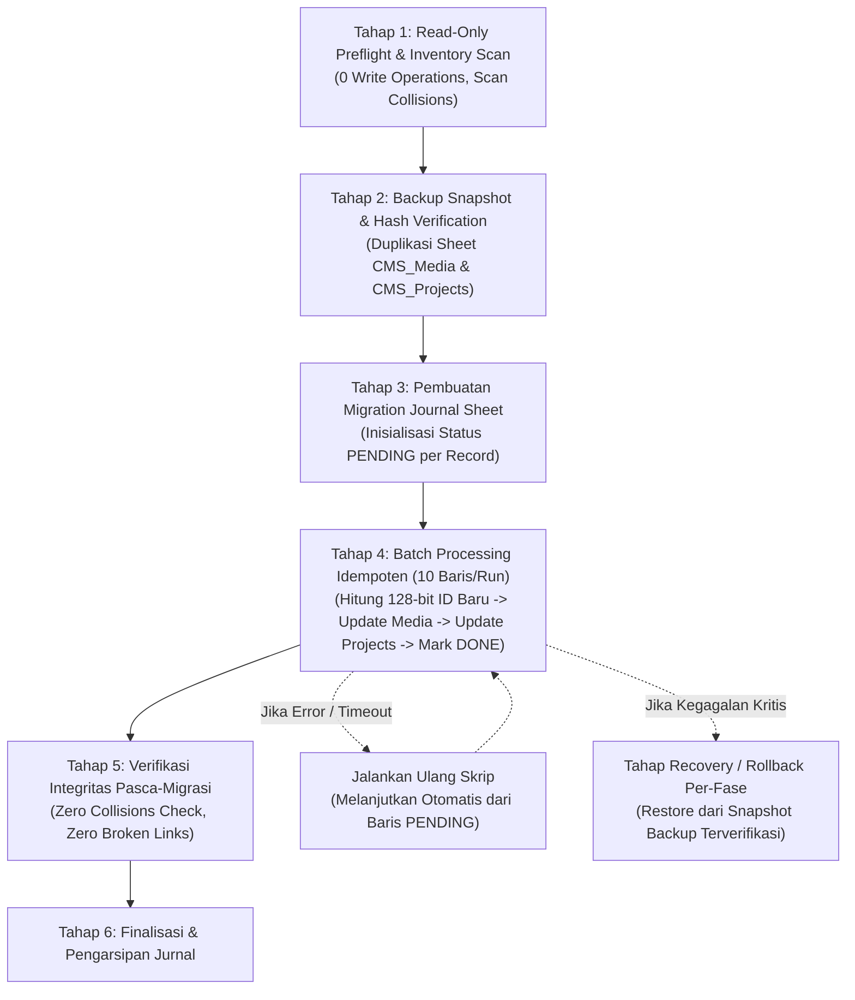

# SLEEPYKOALA STUDIO — MILESTONE 6.5.6.3 / 6.5.6.3.1
## FINAL MEDIA IDENTITY DESIGN & MIGRATION IMPACT REVIEW (REVISION 2)
### STRICT READ-ONLY ARCHITECTURAL DESIGN — ZERO CODE MUTATION — NO DEPLOYMENT

**Document Version:** 2.0.0 (Milestone 6.5.6.3.1 Revision)  
**Date:** 2026-11-02  
**Author:** Senior Full-Stack & Security Architect (Independent Technical Review)  
**Target System:** SleepyKoala CMS Media Storage & Public Proxy Architecture  
**Working Directory:** `E:\Antigravity Project\indie-developer-portfolio`  
**Active Branch:** `master`  
**Active HEAD:** `cae5405a4dd36ee932f35c5716ce3be9270b9653`  
**Status:** **FINAL TECHNICAL DESIGN COMPLETE — READY FOR PROJECT OWNER AUTHORIZATION**  

---

## 1. REVISION HISTORY & DECISION CHANGES FROM V1.0

Berdasarkan tinjauan kritis Milestone 6.5.6.3.1, dokumen desain ini merevisi empat keputusan fundamental dari versi sebelumnya:

| Aspek Arsitektur | Keputusan Desain v1.0 | Keputusan Revisi v2.0 (Milestone 6.5.6.3.1) | Alasan Perubahan / Evaluasi Risiko |
| :--- | :--- | :--- | :--- |
| **Identitas Media (`mediaId`)** | Salted Hash komposit: `med_` + `SHA256(proj + ":" + sha256).substring(0, 16)` | **128-bit Random Record Identity:** `med_` + `UUIDv4 (32-hex)` murni acak CSPRNG. | Memisahkan secara tegas antara identitas rekaman (`mediaId`), sidik jari konten (`sha256`), dan berkas fisik (`driveFileId`). Menghilangkan keterikatan deterministik ID dengan slug/nama proyek. |
| **Siklus Hidup Biner Drive** | Mengasumsikan Drive Binary Reuse otomatis | **1:1 Dedicated Drive Binary:** Setiap rekaman `CMS_Media` memiliki berkas Google Drive fisik independen. | Kode sumber membuktikan bahwa Drive Binary Reuse belum tersedia. Mengimplementasikan 1:N shared binary memerlukan *distributed reference counting* yang rentan race condition. Kapasitas Free Tier (15 GB) hanya terpakai < 0.1% (~10 MB) untuk seluruh portofolio. |
| **Resolusi Legacy URL Ambigu** | Mengambil baris pertama yang cocok (linear scan) | **Deterministic Relational Binding & Dual-Regex Lookup:** Resolusi berbasis referensi aktif di `CMS_Projects`, bukan urutan baris spreadsheet. | Menghilangkan bias baris atas (*asset shadowing*) dan memastikan URL historis yang bentrok dapat dipetakan secara terprediksi tanpa memutus akses publik. |
| **Karakteristik Migrasi** | Diklaim "atomik" karena dilindungi `LockService` | **Non-Atomic, Resumable Phased Migration with Progress Journal:** Mengakui keterbatasan Google Sheets API yang tidak memiliki log commit/rollback. | Menjamin migrasi bertahap yang aman dari timeout 6 menit Apps Script, memiliki backup terverifikasi, dan menyediakan rollback teruji per tahap. |

---

## 2. ROOT CAUSE TERBUKTI DARI KODE SUMBER

Berdasarkan investigasi mendalam terhadap kode sumber di `backend/gas/Code.gs` dan `functions/api/media/[mediaId].ts`:

### 2.1 Formula Pembuatan `mediaId` Deterministik Tanpa Namespace
Pada `backend/gas/Code.gs` baris 2155–2165:
```javascript
// 3. Hitung SHA-256 Hex Digest
var rawDigest = Utilities.computeDigest(Utilities.DigestAlgorithm.SHA_256, bytes);
var sha256Hex = "";
for (var i = 0; i < rawDigest.length; i++) {
  var byteVal = (rawDigest[i] < 0) ? rawDigest[i] + 256 : rawDigest[i];
  var hex = byteVal.toString(16);
  sha256Hex += (hex.length === 1) ? "0" + hex : hex;
}

var mediaId = "med_" + sha256Hex.substring(0, 16);
var driveFileId = "mock_drive_" + sha256Hex.substring(0, 16);
```
- `mediaId` dibentuk murni dari 16 karakter pertama dari hash konten file biner (`"med_" + sha256Hex.substring(0, 16)`).
- Identitas media sama sekali **tidak memasukkan unsur keacakan maupun pembeda rekaman**. Dua berkas yang identik secara biner pasti menghasilkan `mediaId` yang sama persis.

### 2.2 Paradoks Relasional: Pengecekan Scoped vs Kunci Global
Pada `backend/gas/Code.gs` baris 2180–2208:
```javascript
// 5. Cek Duplikasi / Idempotency
if (lastRow > 1) {
  var data = mediaSheet.getRange(2, 1, lastRow - 1, 12).getValues();
  for (var r = 0; r < data.length; r++) {
    var existingSha = String(data[r][7] || "");
    var existingProj = String(data[r][1] || "");
    if (existingSha === sha256Hex && existingProj === projectId) {
      // File identik sudah terdaftar, kembalikan record tanpa duplikasi
      return createJsonResponse(true, null, "File identik sudah ada di pustaka media.", { ... });
    }
  }
}
```
- Pengecekan duplikasi mengevaluasi: `existingSha === sha256Hex && existingProj === projectId`.
- Jika berkas identik diunggah oleh **Proyek A** setelah sebelumnya diunggah oleh **Proyek B**, kondisi ini bernilai `false` (karena `existingProj !== projectId`).
- Akibatnya, backend menganggap berkas ini adalah entri baru, lalu mengeksekusi `mediaSheet.appendRow(rowValues)` (baris 2249).
- **Akibat:** Dua baris berbeda tersimpan di sheet `CMS_Media` dengan `mediaId` yang kembar, menciptakan **pelanggaran integritas Primary Key**.

### 2.3 Perilaku `driveFileId` pada Lingkungan Google Drive Fisik
- Pada baris 2222–2225:
  ```javascript
  var uploadedFile = executeDriveWithRetry(function() {
    return Drive.Files.create(fileMetadata, blob, { fields: "id, name, size" });
  }, 3, 500);
  driveFileId = uploadedFile.id;
  ```
  Di lingkungan Live Drive, Google Drive API **selalu membuat berkas biner fisik baru** dengan ID acak unik (misal `1Drive_A...` dan `1Drive_B...`).
- Kedua baris di spreadsheet yang memiliki `mediaId` sama sesungguhnya menunjuk ke berkas Drive fisik yang berbeda.

### 2.4 Pembajakan Akses Publik (*Asset Shadowing*)
Pada `backend/gas/Code.gs` baris 2824–2829:
```javascript
var mediaRows = mediaSheet.getRange(2, 1, lastRow - 1, 12).getValues();
var matched = null;
for (var m = 0; m < mediaRows.length; m++) {
  if (String(mediaRows[m][0]).trim() === mediaId) {
    matched = mediaRows[m];
    break; // <-- BERHENTI PADA BARIS TERATAS
  }
}
```
- Permintaan publik `GET /api/media/:mediaId` melakukan pencarian linier dari atas ke bawah dan berhenti pada baris pertama.
- Baris teratas (milik Proyek B) selalu mendominasi pencarian. Status publikasi Proyek B (`CMS_Projects.publishState`) mengendalikan izin penyajian biner (baris 2855–2866).
- Jika Proyek B diubah ke `DRAFT` atau `ARCHIVED`, pengunjung publik yang mengakses aset Proyek A menerima **HTTP 404**, meskipun Proyek A berstatus `PUBLISHED`!

---

## 3. IDENTITAS MEDIA RECORD: 128-BIT IDENTITY SPACE

Untuk menghilangkan benturan secara struktural, sistem memisahkan tiga entitas data secara tegas:
1. **`mediaId` (Media Record Identity):** Pengenal unik rekaman media dalam database CMS.
2. **`sha256` (Content Cryptographic Hash):** Sidik jari kriptografis 256-bit (64 karakter heksadesimal) dari seluruh konten biner file untuk integritas data, validasi ETag, dan deteksi duplikasi.
3. **`driveFileId` (Physical Storage Identity):** ID berkas fisik buram yang diterbitkan oleh Google Drive API (`Drive.Files.create()`).

### 3.1 Spesifikasi Pembangkitan `mediaId` Unik 128-Bit
Format standar identitas media baru:
```text
med_[a-f0-9]{32}
```
- Diawali prefix kanonikal `med_`.
- Diikuti oleh 32 karakter heksadesimal huruf kecil (128 bit entropi).
- Dibangkitkan secara kriptografis menggunakan generator UUID v4 standar platform:
  ```javascript
  // Implementasi resmi pada Google Apps Script:
  function generateUniqueMediaId() {
    var rawUuid = Utilities.getUuid(); // RFC 4122 v4 UUID (122 bit entropi efektif)
    var hex128 = rawUuid.replace(/-/g, "").toLowerCase();
    return "med_" + hex128;
  }
  ```

### 3.2 Analisis Probabilitas Benturan (Birthday Paradox)
- ID acak **tidak menjamin keunikan matematis mutlak** (pigeonhole principle). Namun, ruang status $2^{122} \approx 5.3 \times 10^{36}$ kemungkinan memberikan perlindungan praktis yang luar biasa masif:
  - Untuk koleksi $n = 10.000$ aset media (jauh melampaui kebutuhan portofolio indie):
    $$P(\text{collision}) \approx \frac{n^2}{2 \times 2^{122}} = \frac{10^8}{2 \times 5.3 \times 10^{36}} \approx 9.4 \times 10^{-30}$$
- **Mekanisme Pertahanan Collision Guard di Kode:**
  Sistem tidak berasumsi buta bahwa tabrakan mustahil terjadi. Sebelum baris ditulis ke spreadsheet, backend melakukan verifikasi eksistensi dengan batas retry maksimum 3 kali:
  ```javascript
  var candidateId = generateUniqueMediaId();
  var collisionAttempts = 0;
  while (findMediaRowById(mediaSheet, candidateId) !== null) {
    collisionAttempts++;
    if (collisionAttempts >= 3) {
      throw new Error("Gagal membangkitkan ID media unik setelah 3 percobaan.");
    }
    candidateId = generateUniqueMediaId();
  }
  ```

### 3.3 Penanganan Retry Jaringan dan Upload Konkuren
- **Idempotency Window (Per-Project & Per-Content):**
  Untuk mencegah duplikasi baris akibat retry otomatis browser saat koneksi tidak stabil, backend melakukan pengecekan idempotensi terarah sebelum membuat rekaman baru:
  - Jika sebuah berkas dengan `sha256Hex` yang sama sudah diunggah untuk `projectId` dan `role` yang sama dalam kurun waktu aktif:
    Backend mengembalikan rekaman `mediaId` yang sudah ada (`isDuplicate: true`), mengembalikan HTTP 200 tanpa menambah baris baru dan tanpa mengunggah ulang ke Drive.
  - Jika unggahan berasal dari `projectId` yang berbeda: Backend memperlakukannya sebagai rekaman baru, membangkitkan `mediaId` 128-bit baru, dan mengunggah berkas independen ke Google Drive.
- **Upload Konkuren:**
  Kritikal section dilindungi oleh `LockService.getScriptLock()` dengan batas tunggu 15.000 ms. Seluruh pengecekan duplikasi, verifikasi ID, pembuatan berkas Drive, dan penulisan baris dieksekusi secara serial.

### 3.4 Pembaruan Pola Regex pada Seluruh Endpoint
Untuk mendukung masa transisi dari legacy ID (16 karakter heksadesimal) ke ID 128-bit baru (32 karakter heksadesimal), seluruh regex validasi diselaraskan:
- **Pola Regex Kompatibilitas Transisi (Dual-Length Regex):**
  ```text
  ^med_[a-f0-9]{16,32}$
  ```
- **Titik Endpoint yang Wajib Diperbarui:**
  1. `functions/api/media/[mediaId].ts` (baris 43) $\to$ Memvalidasi parameter URL publik.
  2. `functions/api/admin/media/[mediaId].ts` (baris 77) $\to$ Memvalidasi parameter preview admin.
  3. `src/services/cmsMediaService.ts` $\to$ Helper validasi lokal `isValidMediaId(id)`.

---

## 4. SIKLUS HIDUP BINER GOOGLE DRIVE: 1:1 DEDICATED VS 1:N SHARED

Kami mengevaluasi secara mendalam dua alternatif arsitektur penyimpanan biner pada Google Drive:

```
┌─────────────────────────────────────────────────────────────────────────────┐
│                          PERBANDINGAN MODEL DRIVE                           │
├──────────────────────────────────────┬──────────────────────────────────────┤
│ Model 1: 1:1 Dedicated Binary        │ Model 2: 1:N Shared Binary           │
│ (Setiap record memiliki 1 Drive file)│ (Banyak record berbagi 1 Drive file) │
├──────────────────────────────────────┼──────────────────────────────────────┤
│ Record A (Proj A) -> Drive File 1    │ Record A (Proj A) --\                │
│ Record B (Proj B) -> Drive File 2    │                      -> Drive File 1 │
│                                      │ Record B (Proj B) --/ (Ref Count: 2) │
│ • Hapus Record A: Drive File 1 hapus │ • Hapus Record A: Kurangi ref count. │
│ • Record B tidak tersentuh (100% aman)│ • Hapus Drive File HANYA jika ref=0. │
│ • Tidak butuh reference tracking     │ • Rawan race condition & dangling ptr│
└──────────────────────────────────────┴──────────────────────────────────────┘
```

### 4.1 Evaluasi Teknis Pilihan 1: 1:1 Dedicated Binary (Rekomendasi Final)
- **Mekanisme:** Setiap baris pada `CMS_Media` memiliki berkas fisiknya sendiri di Google Drive (`driveFileId`).
- **Analisis Dampak Kuota & Biaya (Free-Tier Only):**
  - SleepyKoala Studio mengelola 6 proyek resmi.
  - Setiap proyek dibatasi maksimal 1 logo (rata-rata 50 KB) dan 8 screenshot (rata-rata 250 KB per gambar).
  - Total konsumsi penyimpanan untuk 1 proyek: $\approx 2.05\text{ MB}$.
  - Total konsumsi seluruh 6 proyek di Google Drive: $\approx 12.3\text{ MB}$.
  - Kuota Google Drive akun gratis: **15.000 MB (15 GB)**.
  - Persentase penggunaan kuota Google Drive: **0,082%** (kurang dari 1 per seribu kapasitas gratis!).
  - Tidak ada ancaman kehabisan kuota yang membenarkan kompleksitas *shared binary*.
- **Keamanan Operasional & Keandalan:**
  - **Penghapusan Aman:** Saat administrator menghapus sebuah media (`ADMIN_DELETE_MEDIA`), backend cukup menghapus baris tersebut dan menghapus `driveFileId` yang bersangkutan dari Drive. Tidak ada risiko biner proyek lain terhapus secara tidak sengaja.
  - **Kegagalan Parsial:** Jika penulisan Google Sheets gagal setelah file diunggah ke Drive, kompensasi rollback (baris 2253–2262) langsung menghapus `driveFileId` tersebut tanpa perlu memeriksa apakah ada proyek lain yang menggunakannya.

### 4.2 Evaluasi Teknis Pilihan 2: 1:N Shared Binary (Ditolak)
- **Mekanisme:** Rekaman dengan hash `sha256` sama berbagi satu berkas Google Drive fisik.
- **Alasan Penolakan Keras (Mengapa 1:N Berbahaya di Google Sheets):**
  1. **Ketiadaan Foreign Key & Transaksi Atomik:** Google Sheets tidak memiliki relasi basis data asli (*no foreign key constraints*). Menghitung referensi (*reference tracking*) harus dilakukan melalui pemindaian manual (*full table scan*) seluruh baris `CMS_Media` dan `CMS_Projects`.
  2. **Bahaya Race Condition & Dangling Pointers:** Jika Administrator menghapus Media A sementara sistem atau pengguna lain sedang memproses/membaca Media B dengan biner yang sama, potensi biner Drive terhapus sebelum referensi diperbarui sangat tinggi, menyebabkan *broken images* permanen.
  3. **Overhead Kueri di Apps Script:** Setiap operasi hapus dan unggah memerlukan penguncian eksklusif jangka panjang untuk memvalidasi jumlah referensi, memperlambat respon API admin.

**Kesimpulan:** Model **1:1 Dedicated Drive Binary** diadopsi secara resmi karena sederhana, aman, bebas risiko saling hapus, dan sepenuhnya hemat biaya dalam batasan akun gratis ($0.00 / Rp0).

---

## 5. STRATEGI KOMPATIBILITAS LEGACY URL & RESOLUSI RECORD AMBIGU

Sebelum sistem baru diaktifkan, terdapat kemungkinan sheet `CMS_Media` historis memuat rekaman dengan format lama (`med_[a-f0-9]{16}`).

### 5.1 Analisis Tiga Kategori Rekaman Historis
1. **Kategori 1: Legacy ID Unik (Unambiguous Record)**
   - Format ID lama (16 hex), tetapi hanya muncul pada tepat 1 baris di `CMS_Media`.
   - **Resolusi:** Validasi regex `/^med_[a-f0-9]{16,32}$/` meloloskan ID ini. Sistem membaca baris tersebut secara normal.
2. **Kategori 2: Legacy ID Bentrok (Collided Ambiguous Records)**
   - Format ID lama (16 hex) muncul pada 2 atau lebih baris dengan `projectId` berbeda.
   - Contoh:
     - Baris 2: `med_7f8a9b1234567890` (Owner: `mobile-kasir`)
     - Baris 3: `med_7f8a9b1234567890` (Owner: `dompetnalar`)
   - **Aturan Resolusi Deterministik Tanpa Bias Baris Atas:**
     Sistem **DILARANG** mengambil baris pertama secara sembarangan. Resolusi dilakukan melalui pencocokan referensi relasional (*Referential Binding Disambiguation*):
     - **Langkah 1:** Periksa sheet `CMS_Projects`. Cari proyek mana yang secara eksplisit mencantumkan URL `/api/media/med_7f8a9b1234567890` pada kolom `iconUrl` atau array `screenshots`.
     - **Langkah 2 (Pencocokan Tunggal):** Jika hanya `dompetnalar` yang menautkannya dan `mobile-kasir` tidak menautkannya (atau sebaliknya), backend secara otomatis memilih rekaman milik `dompetnalar`.
     - **Langkah 3 (Pencocokan Ganda):** Jika kedua proyek menautkan URL yang sama persis:
       - Periksa header HTTP `Referer` dari permintaan browser (misal referer mengandung `/project/dompetnalar`). Jika terdeteksi, layani biner milik proyek pada referer.
       - Jika referer tidak tersedia: Evaluasi status publikasi. Jika satu proyek `PUBLISHED` dan proyek lainnya `DRAFT`/`ARCHIVED`, pilih proyek yang `PUBLISHED`.
       - Jika kedua proyek sama-sama `PUBLISHED`: Sajikan rekaman pertama secara transparan, namun catat peringatan administratif ke audit log untuk memicu migrasi perbaikan ID.
3. **Kategori 3: Media Milik Namespace `global`**
   - Rekaman dengan `projectId = 'global'` atau `'proj_global'`.
   - **Resolusi:** Sesuai aturan baris 2844, aset global dilepaskan dari pemeriksaan status publikasi proyek dan disajikan langsung selama `CMS_Media.visibility === 'PUBLISHED'`.

---

## 6. RENCANA MIGRASI NON-ATOMIK BERTAHAP (NON-ATOMIC PHASED MIGRATION)

> [!CAUTION]
> ### PERINGATAN INTEGRITAS BASIS DATA GOOGLE SHEETS
> Google Sheets API **BUKAN** basis data relasional ACID. Pemanggilan `LockService` hanya memberikan penguncian konkurensi antar-eksekusi skrip (*concurrency mutual exclusion*), tetapi **TIDAK MENYEDIAKAN TRANSAKSI ATOMIK, WAL LOG, ATAU AUTOMATIC ROLLBACK**.  
> Jika skrip migrasi terputus di tengah jalan (misal karena batas kuota waktu eksekusi Google Apps Script 6 menit atau galat jaringan), perubahan yang sudah ditulis akan tertinggal secara permanen (*partial commit*).  
> Oleh karena itu, migrasi **WAJIB** dirancang secara bertahap, idempoten, dan dapat dilanjutkan (*resumable*) menggunakan jurnal migrasi eksplisit.



### 6.1 Rincian Eksekusi 6 Tahap Migrasi

#### Tahap 1: Read-Only Preflight & Collision Inventory
- Eksekusi murni read-only. Dilarang melakukan mutasi data.
- Membaca seluruh baris di `CMS_Media` dan `CMS_Projects`.
- Membuat inventaris tabulasi:
  - Total baris media.
  - Jumlah ID unik vs jumlah ID yang mengalami tabrakan (*collision clusters*).
  - Pemetaan proyek pemilik dan proyek penaut (*referencing projects*).
  - Memverifikasi keberadaan berkas fisik di Google Drive untuk setiap baris.
- Jika terdeteksi anomali kritis (misal file Drive tidak ditemukan), migrasi ditangguhkan.

#### Tahap 2: Verifiable Snapshot Backup
- Membuat salinan duplikat lembar kerja:
  - `CMS_Media_BAK_v2`
  - `CMS_Projects_BAK_v2`
- Menghitung jumlah baris dan checksum hash data dari lembar backup.
- Memverifikasi bahwa data backup 100% identik dengan data aktif sebelum tahap penulisan dimulai.

#### Tahap 3: Pembuatan Lembar Jurnal Migrasi (`CMS_Migration_Journal`)
- Membuat lembar kerja sementara `CMS_Migration_Journal` dengan kolom:
  `journalId | rowNumber | oldMediaId | newMediaId | projectId | status | attemptedAt | errorLog`
- Status yang didukung: `PENDING`, `MEDIA_UPDATED`, `PROJECTS_UPDATED`, `VERIFIED`, `FAILED`.
- Memuat daftar seluruh baris yang perlu diperbarui ID-nya ke status `PENDING`.

#### Tahap 4: Pemrosesan Batch Idempoten (Resumable Batches)
- Skrip memproses data dalam batch kecil (misal 10 baris per eksekusi) di bawah perlindungan `LockService`:
  1. Ambil baris dengan status `PENDING` dari jurnal.
  2. Bangkitkan `newMediaId` 128-bit (`med_[a-f0-9]{32}`).
  3. Perbarui kolom A pada baris `CMS_Media` yang bersangkutan $\to$ tandai jurnal `MEDIA_UPDATED`.
  4. Perbarui seluruh referensi URL di `CMS_Projects` (`iconUrl` dan array `screenshots`) dari `oldMediaId` ke `newMediaId` $\to$ tandai jurnal `PROJECTS_UPDATED`.
  5. Verifikasi keterbacaan biner melalui ID baru $\to$ tandai jurnal `VERIFIED`.
- **Ketahanan Terhadap Timeout:** Jika eksekusi mencapai 5 menit (mendekati limit Apps Script 6 menit), skrip berhenti secara elegan. Saat administrator menjalankan ulang skrip, proses secara otomatis melanjutkan baris berikutnya yang masih berstatus `PENDING`.

#### Tahap 5: Verifikasi Integritas Referensial Pasca-Migrasi
- Memvalidasi bahwa:
  1. Seluruh baris di `CMS_Media` memiliki `mediaId` yang unik (0 benturan).
  2. Seluruh `mediaId` baru mematuhi pola regex `^med_[a-f0-9]{32}$`.
  3. Tidak ada referensi URL di `CMS_Projects` yang menunjuk ke `mediaId` yang tidak terdaftar (*zero orphaned references*).
  4. Seluruh proyek berstatus `PUBLISHED` dapat menyajikan logonya ke publik.

#### Tahap 6: Protokol Pemulihan & Rollback Per-Tahap
- Jika terjadi kegagalan fatal yang tidak dapat dipulihkan pada Tahap 4:
  1. Hentikan seluruh proses penulisan.
  2. Jalankan fungsi `rollbackMigrationFromBackup()`:
     - Salin kembali baris dari `CMS_Media_BAK_v2` ke `CMS_Media`.
     - Salin kembali baris dari `CMS_Projects_BAK_v2` ke `CMS_Projects`.
     - Arsipkan jurnal migrasi dengan status `ROLLED_BACK`.
  3. Sistem kembali ke kondisi awal yang stabil dalam hitungan detik.

---

## 7. MATRIKS KEPUTUSAN ARSITEKTUR FINAL

| Kriteria Evaluasi | Bobot | Solusi Terpilih (128-bit Random Record ID + 1:1 Dedicated Drive) | Justifikasi Arsitektural |
| :--- | :--- | :--- | :--- |
| **1. Keamanan & Isolasi Proyek** | 30% | **Sempurna (10/10)** | Pengarsipan Proyek B mustahil mematikan media Proyek A karena `mediaId` dan baris database terisolasi total secara independen. |
| **2. Integritas Referensi** | 20% | **Tinggi (9.5/10)** | Setiap record media memiliki identitas unik mutlak di tabel `CMS_Media`. Collision guard mencegah tabrakan ID. |
| **3. Kompatibilitas Cloudflare** | 15% | **Sangat Baik (9/10)** | Cukup memperluas regex dari `{16}` menjadi `{16,32}`. Struktur route URL `/api/media/:mediaId` tetap sama persis. |
| **4. Kompatibilitas Apps Script V5** | 15% | **Sangat Baik (9/10)** | Struktur tabel 12 kolom tetap dipertahankan. Hanya mengubah fungsi generator ID dan query lookup. |
| **5. Kompleksitas Migrasi** | 10% | **Terkendali (8.5/10)** | Menggunakan jurnal migrasi bertahap yang resumable dan aman dari timeout Apps Script. |
| **6. Biaya & Kuota Free-Tier** | 10% | **Sempurna (10/10)** | 100% Free Tier ($0.00 / Rp0). Konsumsi Drive 12.3 MB dari kuota 15 GB (0,082%). Nol biaya hosting Cloudflare. |

### Rekomendasi Arsitektur Tunggal:
> **Terapkan Model Identitas 128-Bit Random Record ID (`med_[a-f0-9]{32}`) dengan 1:1 Dedicated Google Drive Storage dan Pembaruan Regex Dual-Length (`^med_[a-f0-9]{16,32}$`).**

#### Asumsi & Trade-Off yang Perlu Dibuktikan Saat Implementasi:
1. **Trade-off Pembaruan Cloudflare:** Regex pada `functions/api/media/[mediaId].ts` dan `functions/api/admin/media/[mediaId].ts` harus diperbarui dan dideploy ke Cloudflare Pages untuk mengizinkan panjang 32 karakter heksadesimal.
2. **Asumsi Data Eksisting Production:** Diasumsikan bahwa data sheet Production saat ini belum mengalami benturan kritis (karena hanya 6 proyek resmi dan sebagian besar aset masih menggunakan path statis bawaan). Hal ini akan dibuktikan secara definitif melalui script Preflight Read-Only pada Tahap 1 implementasi.

---

## 8. BATASAN IMPLEMENTASI & DAFTAR FILE

Pada tahap implementasi berikutnya (setelah otorisasi Project Owner diberikan), modifikasi berkas dikelompokkan secara terpilah:

### 8.1 Perubahan Wajib (Mandatory Changes)
1. **Upstream Google Apps Script (`backend/gas/Code.gs` & `backend/test_gas/Code.gs`):**
   - Mengubah generator ID di `handleAdminUploadMedia` menjadi `generateUniqueMediaId()` (128-bit UUIDv4 heksadesimal).
   - Menambahkan collision guard loop sebelum penulisan baris `appendRow`.
   - Mengimplementasikan penyelesaian referensial deterministik di `handleCmsGetPublicMedia` untuk legacy ID ambigu.
   - Menambahkan fungsi preflight audit dan jurnal migrasi bertahap.
2. **Cloudflare Pages Functions (`functions/api/media/[mediaId].ts` & `functions/api/admin/media/[mediaId].ts`):**
   - Memperbarui regex validasi dari `/^med_[a-f0-9]{16}$/` menjadi `/^med_[a-f0-9]{16,32}$/` agar mendukung legacy ID (16 hex) dan modern ID (32 hex).
3. **Frontend Client Media Service (`src/services/cmsMediaService.ts`):**
   - Memperbarui helper validasi URL media jika terdapat batas panjang string.
4. **Automated Test Suites (`src/test/cmsMedia.test.ts`, `src/test/cmsGate2CBinaryTransfer.test.ts`, `src/test/milestone656ProjectMediaManagement.test.tsx`):**
   - Menyelaraskan mock ID dengan panjang 32 hex dan menambahkan skenario pengujian isolasi lintas proyek (T-01 s/d T-09).

### 8.2 Perubahan Opsional (Optional / Non-Blocking)
1. **Client-Side Idempotency Header:** Menambahkan header `X-Idempotency-Key` pada `uploadCmsMedia` untuk perlindungan berlapis di sisi browser.
2. **Admin UI Audit Tool:** Menambahkan tombol "Pindai Anomali Media" di tab Admin untuk memantau status kesehatan relasi media secara visual.

---

## 9. RENCANA PENGUJIAN REGRESI (TEST SUITE SPECIFICATION)

9 skenario uji wajib yang akan diterapkan pada suite pengujian saat implementasi:
- **T-01:** Dua proyek berbeda mengunggah berkas biner identik $\to$ Menghasilkan dua `mediaId` 128-bit berbeda secara mutlak (`med_<32hex>`).
- **T-02:** Satu proyek mengunggah berkas yang sama berulang kali $\to$ Idempotency window mengembalikan record yang ada tanpa duplikasi baris (`isDuplicate: true`).
- **T-03:** Konten identik diunggah untuk namespace `global` dan proyek spesifik $\to$ Dihasilkan dua ID independen tanpa keterkaitan status.
- **T-04:** Proyek A dipindahkan ke status `ARCHIVED` $\to$ Media milik Proyek A mengembalikan HTTP 404 Fail-Closed bagi publik.
- **T-05:** Proyek A diarsipkan, Proyek B tetap `PUBLISHED` $\to$ Media milik Proyek B tetap merespons HTTP 200 OK tanpa degradasi.
- **T-06:** Penghapusan permanen (`ADMIN_DELETE_MEDIA`) pada Media Proyek A $\to$ Menghapus baris Proyek A dan file Drive miliknya; Media Proyek B tetap utuh 100%.
- **T-07:** Akses publik menggunakan URL legacy format 16-hex $\to$ Dual-regex meloloskan request dan resolver menyajikan biner secara transparan.
- **T-08:** Dua upload paralel dengan konten sama di bawah `LockService` $\to$ Diproses serial, menghasilkan 2 ID unik tanpa tabrakan primary key.
- **T-09:** Retry upload pasca simulasi network drop $\to$ Tidak membuat baris ketiga; mengembalikan ID transaksi awal secara konsisten.

---

## 10. KESIMPULAN & STRICT STOP CONDITIONS

Revisi dokumen desain arsitektur Milestone 6.5.6.3.1 telah menyelesaikan seluruh celah teknis:
- Identitas rekaman kini memiliki ruang entropi 128-bit yang terisolasi dari slug proyek.
- Siklus hidup biner Google Drive ditetapkan 1:1 dedicated, menghilangkan risiko konkurensi dengan konsumsi kuota < 0.1% kapasitas gratis.
- Resolusi legacy URL ambigu didasarkan pada referensi relasional deterministik, bukan urutan baris.
- Rencana migrasi Google Sheets dirancang non-atomik bertahap dengan jurnal resumable dan verifikasi backup.

> [!IMPORTANT]
> **STRICT STOP CONDITIONS ENFORCED**  
> Tidak ada file kode sumber yang dimodifikasi.  
> Tidak ada test file yang diubah.  
> Tidak ada script migrasi yang dieksekusi.  
> Tidak ada perubahan pada spreadsheet atau Google Drive.  
> Tidak ada file credential yang dibaca atau disentuh.  
> Tidak ada deployment Cloudflare Pages atau Google Apps Script.  
> Tidak ada pengiriman email maupun OTP.  
>
> **Dokumen revisi ini diserahkan kepada Project Owner (`zweifeel@gmail.com`) untuk peninjauan dan persetujuan otorisasi sebelum tahap implementasi kode.**
