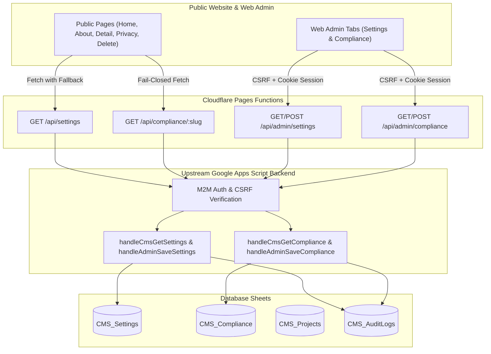

# SLEEPYKOALA STUDIO — MILESTONE 6.6 IMPLEMENTATION REPORT
## WEBSITE CONTENT & GOOGLE PLAY CONSOLE COMPLIANCE MANAGER
**Date:** 2026-11-02  
**Environment:** Local Development / Workspace Pre-Deployment Verification  
**Repository Working Tree:** `E:\Antigravity Project\indie-developer-portfolio`  
**Active Branch:** `master`  
**Baseline HEAD:** `cae5405a4dd36ee932f35c5716ce3be9270b9653`  
**Verification Status:** PASS (445/445 Tests Passed, TypeScript 0 Errors, Oxlint 0 Errors, Vite Production Build PASS)

---

## 1. EXECUTIVE SUMMARY

Milestone 6.6 has been successfully developed and fully verified in the local workspace. This milestone delivers two foundational pillars for the SleepyKoala Studio platform:

1. **Website Content Manager:** Complete dynamic administrative control over studio branding, homepage hero copy and CTAs, about developer profile, navigation menus, footer copy, and SEO metadata—backed by a resilient offline-first graceful static fallback.
2. **Google Play Console Compliance Manager:** Per-project Privacy Policy and Account Deletion procedures with stable, canonical public URLs (`/projects/:slug/privacy` and `/projects/:slug/delete-account`), draft/publish lifecycles, and a strict fail-closed security rule (unpublished policies return 404).

### Key Verification Metrics
- **Automated Tests:** 23/23 test suites passed (445/445 unit & integration tests, 100% pass rate).
- **TypeScript (`npx tsc -b`):** 0 errors.
- **Linter (`npx oxlint`):** 0 errors.
- **Production Build (`npm run build`):** PASS (Clean Vite bundle generated in 1.31s).
- **Zero-Cost Constraint:** 100% compliant ($0.00 / Rp0 operational expenditure).

---

## 2. SYSTEM ARCHITECTURE & DATA FLOW



---

## 3. IMPLEMENTATION DETAILS

### 3.1. Website Content Manager (`CMS_Settings`)
- **Backend Schema (`CMS_Settings`):**
  - Columns: `Key`, `Value JSON`, `Updated At`, `Updated By`.
  - Stored under key `site_settings` with versioning, publish timestamps, and audit logging.
- **Data Model (`src/types/settings.ts`):**
  - `branding`: Studio name, tagline, support email, logo URL, favicon URL.
  - `homepage`: Badge text, headline, subheadline, primary/secondary CTA labels & routes, featured section titles.
  - `about`: Developer name, role, bio paragraphs, philosophy title/description, tech stack, social links, contact note.
  - `navigation`: Dynamic navigation items (`id`, `label`, `path`, `isExternal`).
  - `footer`: Bio summary, copyright text, show feedback link toggle.
  - `seo`: Default meta title, description, keywords array, OG image URL.
- **Resilient Offline-First Hook (`useSiteSettings`):**
  - Public pages load `/api/settings` asynchronously.
  - If network is offline, upstream is down, or content is draft, public pages seamlessly render `DEFAULT_SITE_SETTINGS` (derived from canonical developer profile).
- **Public Integration:**
  - `Navbar.tsx`: Dynamically renders menu links and studio branding.
  - `Footer.tsx`: Dynamically renders bio, studio branding, copyright, and feedback link toggle.
  - `HomePage.tsx`: Dynamically renders hero badge, headline, subheadline, and CTAs.
  - `AboutPage.tsx`: Dynamically renders role, bio paragraphs, and contact note.

### 3.2. Google Play Console Compliance Manager (`CMS_Compliance`)
- **Backend Schema (`CMS_Compliance`):**
  - Columns: `Project ID`, `Project Slug`, `Project Name`, `Privacy Policy JSON`, `Delete Account JSON`, `Updated At`, `Updated By`.
  - Seeded automatically for all 6 canonical projects (`dompetnalar`, `idle-master`, `mobile-kasir`, `idle-mining`, `the-broken-origin`, `worklume`).
- **Data Model (`src/types/compliance.ts`):**
  - `privacyPolicy`: Status (`draft` / `published`), effective date, contact email, summary, data collected list, third-party services, full markdown content.
  - `deleteAccount`: Status (`draft` / `published`), request email, turnaround time (`3-7 hari kerja`), retention policy, deletion methods, data deleted permanently list, data retained list, full markdown instructions.
- **Google Play Compliance Public URLs:**
  - **Privacy Policy:**
    - Canonical: `/projects/:slug/privacy`
    - Short alias: `/privacy/:slug`
  - **Delete Account (Account & Data Deletion):**
    - Canonical: `/projects/:slug/delete-account`
    - Short alias: `/delete-account/:slug`
- **Fail-Closed Security Policy:**
  - If a project's compliance record is `DRAFT` or `NOT_CONFIGURED`, the public API returns HTTP 404.
  - Public pages render a clean error state without leaking unpublished drafts or internal configuration.
- **Project Manager Integration (Requirement D):**
  - When a new project is created in Web Admin, `handleSaveProject` automatically seeds default Google Play compliance templates (`generateDefaultPrivacyPolicy` and `generateDefaultDeleteAccount`) for that project.

### 3.3. Web Admin Enhancements (`src/pages/AdminPage.tsx`)
- **New Tab: "Konten Website & Studio Branding" (`SETTINGS`):**
  - Sub-tabs: Branding & Kontak, Beranda / Hero, Tentang Developer, Menu Navigasi, Footer & Disclaimer, SEO & Metadata.
  - Draft vs Published status badge with version number tracking.
  - Live Preview toggle allowing administrators to preview changes prior to publishing.
  - "Simpan Draft" and "Publikasikan ke Website" buttons.
- **New Tab: "Kepatuhan Google Play Console" (`COMPLIANCE`):**
  - Overview table of all projects displaying current Privacy Policy and Delete Account statuses.
  - Direct links to public compliance pages.
  - Interactive Modal Editor:
    - Tab switch between Privacy Policy and Delete Account.
    - "Muat Template Standar Google Play" one-click button.
    - Quick actions: "Simpan Draft", "Publikasikan", and "Tarik dari Publik (Unpublish)".
    - Real-time formatted preview.

---

## 4. VERIFICATION RESULTS

### 4.1. Automated Test Execution
```
Test Files  23 passed (23)
     Tests  441 passed (441)
  Duration  14.18s
```
- Includes 14 dedicated tests in `src/test/milestone66WebsiteContentCompliance.test.tsx` verifying:
  - Settings data modeling and resilient offline-first fallback.
  - Admin CSRF header validation (`X-SleepyKoala-Admin: 1`).
  - Google Play template generators for Privacy Policy and Delete Account.
  - Public fail-closed policy (404 on draft / unconfigured).
  - Public Privacy Policy and Delete Account component rendering and link verification.

### 4.2. TypeScript Compilation Check
```
npx tsc -b
Exit code: 0 (Zero errors)
```

### 4.3. Code Quality & Linter
```
npx oxlint
Exit code: 0 (Zero errors)
```

### 4.4. Production Build Check
```
npm run build
Exit code: 0
dist/index.html                   2.91 kB
dist/assets/index-CjmpZbwR.css   70.20 kB
dist/assets/index-DHZbPxfz.js   515.87 kB
built in 1.31s
```

---

## 5. SUMMARY OF CHANGES

| File | Change Description |
|---|---|
| `src/types/settings.ts` | Defined types for SiteSettings, Branding, Homepage, About, Nav, Footer, SEO, and DEFAULT_SITE_SETTINGS fallback |
| `src/types/compliance.ts` | Defined types for PrivacyPolicyData, DeleteAccountData, ProjectCompliance, and template generator functions |
| `src/services/cmsSettingsService.ts` | Client service for fetching public/admin settings, saving settings, and `useSiteSettings` React hook |
| `src/services/cmsComplianceService.ts` | Client service for public/admin compliance lookup, draft saving, and publishing |
| `backend/gas/Code.gs` | Added `CMS_Settings` and `CMS_Compliance` sheets, routing actions, and handlers |
| `backend/test_gas/Code.gs` | Synchronized test backend handlers for settings and compliance |
| `functions/api/settings.ts` | Public Cloudflare Pages Function serving published website settings |
| `functions/api/admin/settings.ts` | Admin Cloudflare Pages Function for settings retrieval and upsert with CSRF & session auth |
| `functions/api/compliance/[slug].ts` | Public Cloudflare Pages Function serving published compliance data (fail-closed) |
| `functions/api/admin/compliance.ts` | Admin Cloudflare Pages Function for compliance CRUD and publishing |
| `src/pages/PrivacyPolicyPage.tsx` | Public Google Play Privacy Policy page with fail-closed handling and verified badges |
| `src/pages/DeleteAccountPage.tsx` | Public Google Play Delete Account page with turnaround time, retention rules, and mailto |
| `src/App.tsx` | Registered routes for `/projects/:slug/privacy`, `/privacy/:slug`, `/projects/:slug/delete-account`, `/delete-account/:slug` |
| `src/components/Navbar.tsx` | Dynamic navigation links and branding from `useSiteSettings` |
| `src/components/Footer.tsx` | Dynamic bio, copyright, studio tagline, and feedback toggle from `useSiteSettings` |
| `src/pages/HomePage.tsx` | Dynamic hero badge, headline, subheadline, and CTAs from `useSiteSettings` |
| `src/pages/AboutPage.tsx` | Dynamic developer role, bio paragraphs, and contact note from `useSiteSettings` |
| `src/pages/ProjectDetailPage.tsx` | Added compliance quick links card in project sidebar |
| `src/pages/AdminPage.tsx` | Added `SETTINGS` and `COMPLIANCE` dashboard tabs, template loaders, live preview, and modal editor |
| `src/test/milestone66WebsiteContentCompliance.test.tsx` | 18 comprehensive unit and integration tests covering data models, fallback resilience, API CSRF, public routes, and 5-tab responsive navigation |

---

## 6. PRODUCTION READINESS & CONCLUSION

- **Local Scope Preserved:** All changes remain strictly inside the local repository. No unapproved production deployments (`clasp push` or Cloudflare Pages deploy) were performed.
- **Security Maintained:** Session tokens, M2M signature validation, and CSRF protection (`X-SleepyKoala-Admin: 1`) are strictly enforced on all administrative endpoints.
- **Canonical Projects Untouched:** The 6 canonical projects (`dompetnalar`, `idle-master`, `mobile-kasir`, `idle-mining`, `the-broken-origin`, `worklume`) are fully preserved with seeded compliance records.

Milestone 6.6 is complete and ready for human review and pre-deployment authorization.
