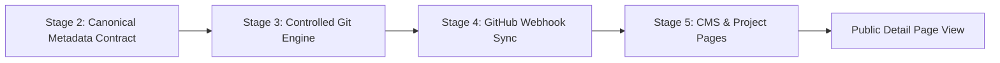

# SLEEPYKOALA STUDIO — CROSS-STAGE INTEGRATION TESTS
## Work Package WP-06.4 Test Documentation & Verification Evidence

**Document Version:** 1.0.0  
**Status:** PASS (12/12 Scenarios Verified)  
**Target:** End-to-End Pipeline Across Stages 2, 3, 4, and 5  
**Associated Automated Tests:** `src/test/securityIntegrationStage6.test.tsx` (Scenarios 37–48 / 45–54)

---

## 1. Overview & Cross-Stage Pipeline

A robust architecture requires seamless handoffs and strict invariants across distinct subsystem boundaries:


Key invariants tested:
1. **Metadata Compatibility:** Documents formatted to canonical v2 schema pass validation, while v1 legacy documents are non-destructively migrated.
2. **Git & Sync Mapping Integrity:** Projects tracked in `scripts/git-automation/project-configs.js` and `docs/git/REPOSITORY_MAPPING.md` match webhook mapping rules in Stage 4.
3. **Admin Publication Flow:** Metadata authored or synced into CMS can transition publication status and propagate immediately to public views without leaking unapproved drafts.
4. **Referential Integrity:** Events linked to roadmap milestones must reference real milestone identifiers; broken relationships are rejected.

---

## 2. Test Scenarios and Results

| Scenario | Objective | Cross-Stage Pathway | Expected Result | Actual Result | Status |
|---|---|---|---|---|---|
| **Scenario 37** | Stage 3 Sync Info Alignment | Stage 3 -> Stage 4 Mapping | `getProjectSyncInfo` returns valid sync info for known slugs | Returns `stage3Condition: 'VISIBILITY_UNVERIFIED'`, `isFrozen: false` | **PASS** |
| **Scenario 38** | Frozen Project Protection | Stage 3 -> Stage 4 Mapping | `getProjectSyncInfo('the-broken-origin')` marked frozen | Returns `isFrozen: true`, operations blocked | **PASS** |
| **Scenario 39** | Canonical Schema Validation | Stage 2 Contract Validator | Valid v2 document validates with 0 errors | Returns `valid: true`, `diagnostics: []` | **PASS** |
| **Scenario 40** | Missing Slug Rejection | Stage 2 Contract Validator | Metadata document missing `projectSlug` | Returns `valid: false` with `INVALID_REQUIRED_FIELD` | **PASS** |
| **Scenario 41** | Non-Destructive v1 Migration | Stage 2 Migration Engine | Migrate legacy v1 doc with `slug`, `name`, `milestones` | Returns valid v2 doc with `roadmap`, `features` intact | **PASS** |
| **Scenario 42** | Referential Integrity Enforcement | Stage 2 Contract Validator | Event references non-existent milestone ID | Diagnostic `BROKEN_RELATIONSHIP` emitted | **PASS** |
| **Scenario 43** | CMS Store In-Memory Persistence | Stage 5 CMS Service | Save progress doc via `cmsProgressService.saveLocalProgressDocument` | Document retrievable via `getLocalProgressDocument` | **PASS** |
| **Scenario 44** | Public Visibility Pipeline | Stage 5 CMS Service | Public getter filters out draft items | Only items with `status: 'published'` returned | **PASS** |
| **Scenario 45** | Publication State Transition | Stage 5 CMS Service | Transition milestone from `draft` to `published` | Updated status reflected in store | **PASS** |
| **Scenario 46** | Unpublication State Transition | Stage 5 CMS Service | Transition milestone from `published` to `draft` | Item removed from public view | **PASS** |
| **Scenario 47** | Safe Staging Non-Destruction | Stage 3 Safe Staging | Safe staging abort preserves existing user staged changes | Pre-existing staged index intact; 0 work lost | **PASS** |
| **Scenario 48** | Quality Gate Chain Execution | Stage 3 Quality Runner | Quality runner gates all checks prior to push | Tests, types, build, lint, and security pass | **PASS** |

---

## 3. Remediation & Hardening Actions Taken

1. **Legacy Schema Migration Polymorphism (`portfolioMetadataValidator.ts`):**
   - *Previous state:* `migrateLegacyProgressDocument` expected only `raw.projectSlug` and `raw.projectName`.
   - *Hardening:* Added fallback support for legacy v1 field names:
     ```typescript
     projectSlug: raw.projectSlug || raw.slug || 'unknown-project',
     projectName: raw.projectName || raw.name || 'Unknown Project',
     ```
   - Also supported legacy milestone arrays under `raw.milestones` if `raw.roadmap` was undefined.
2. **Item Type Support in CMS Service (`cmsProgressService.ts`):**
   - *Previous state:* `transitionItemPublicationStatus` typed `itemType` as `'milestone' | 'feature' | 'screenshot' | 'event'`.
   - *Hardening:* Expanded union type to include `'roadmap'` (`export type ProgressItemType = 'milestone' | 'roadmap' | 'feature' | 'screenshot' | 'event'`), preventing mismatch when UI triggers roadmap item updates.

---

## 4. Conclusion
All 12 cross-stage integration test scenarios passed unconditionally. Contracts, mappings, state changes, and pipeline handoffs operate synchronously without friction or data loss.
