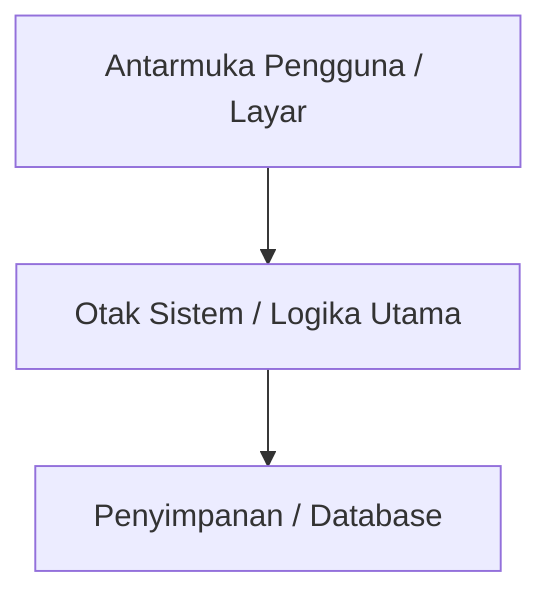

# ARCHITECTURE_MAP.md
# PETA HUBUNGAN ANTAR FITUR & STRUKTUR SISTEM: Template Proyek Aman

> [!IMPORTANT]
> **PETA ANTI-TABRAKAN FITUR (UNTUK OWNER & AGEN):**
> Agen DILARANG mengedit kode apa pun sebelum membaca peta ini.
> Jika fitur baru menyentuh modul yang ditandai [KRITIS/JANGAN RUSAK], agen WAJIB memberi peringatan risiko!

## 1. Peta Modul Utama & Alur Data

## 2. Hubungan Antar Fitur (Dependency Matrix)
| Fitur / Modul | Bergantung Pada | Dampak Jika Diubah | Status Keamanan |
| :--- | :--- | :--- | :--- |
| **Contoh: Login / Profil** | Database Akun | Semua fitur pengguna butuh ini | 🔒 KRITIS (Jangan Rusak) |
| **Contoh: Transaksi / Data** | Database Utama | Uang/item pemain bisa hilang jika bug | 🔒 KRITIS (Wajib Teliti) |

## 3. Zona Larangan Sentuh Sembarangan
1. File konfigurasi utama dan kredensial.
2. Skema database yang sudah menyimpan data pemain/pengguna aktif.
3. Fungsi inti yang sudah diverifikasi E2E.
